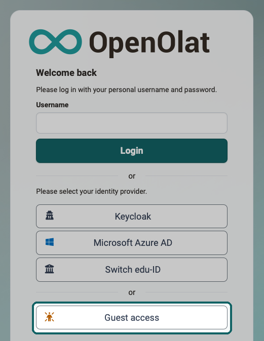
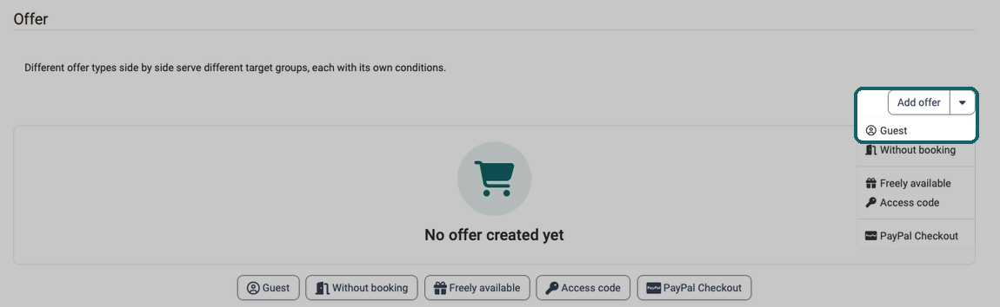
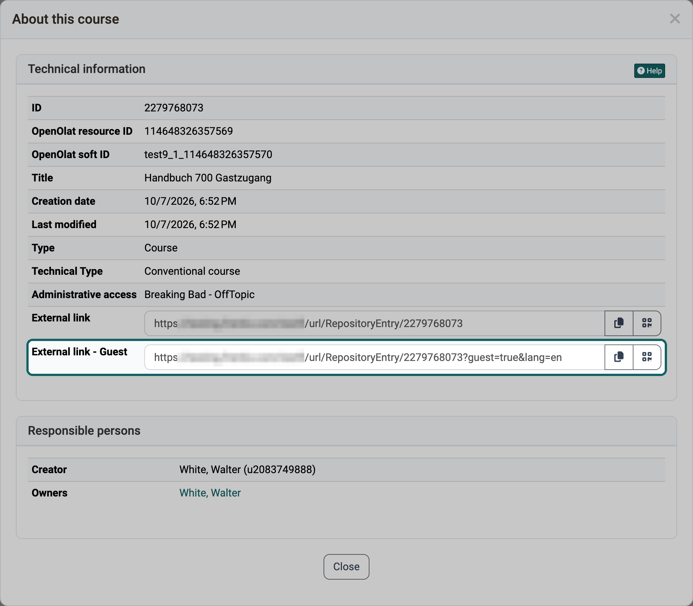

# Roles and Rights: Guest access {: #guest_access}

{ class="shadow lightbox aside-right-lg" }

Besides registered users, people without an OpenOlat account can also access the system as guests. Guests are anonymous, unregistered users who cannot be managed in the [user management](../../manual_admin/usermanagement/index.md).

For guests to gain access, the system administrators of the OpenOlat instance switch on guest access. They also define which OpenOlat areas guests can access. If guest access is switched on, the login page shows the button "Guest access" below the other login options. Guests enter OpenOlat via this button.

Besides courses, other learning resources can also be released for guests, for example wikis, blogs, tests, videos or glossaries.

## Course level {: #course_level}

!!! info "Important"

    Guest access can only be activated for conventional courses, not for learning path courses.

In a conventional course, course owners can set up the access configuration so that guests can also access the course: `Course > Administration > Settings > Tab "Share"`. Set "Access for participants" to "Bookable and open offers". Then add an offer of the type "Guest" in the "Offer" section via "Add offer". If the course has no offer yet, the offer types are also available as separate buttons below "No offer created yet", including "Guest".

{ class="shadow lightbox" title="Share tab of the course settings · 2026.10.07" }

Guests can see or partially edit the following course elements:

  * **Read only**: CP learning content, blog, wiki, forum, notifications, calendar, single page, external page, file dialog, link list
  * **Forum**: In the course editor, course owners can use the option "Allow guests to post" to define whether guests may also create forum posts
  * **Podcast and video**: watch
  * **Folder**: download files
  * **SCORM**: run
  * **Test**: run depending on configuration
  * **Self-test**: run
  * **BigBlueButton, OpenMeetings** and similar meetings: participate
  * **Surveys**: edit

!!! tip "Guests stay anonymous"

    Guest access does not create a membership in the course. All guests use the same anonymous guest account. The member management of the course and the user management therefore do not list any guests, and individual guests cannot be told apart. If you want to record the participants by name, invite them as external members.

If you want to give a guest direct access to a course, send them the link from the line "External link - Guest". The link is shown in two places as soon as the course has an offer of the type "Guest":

- in the window "About this course": `Course > Administration > About this course`
- in the offer for guests, field "External link - Guest": `Course > Administration > Settings > Tab "Share"`

With "Copy to clipboard", you take the link into an e-mail. With "Show QR code", you show it as a QR code, for example for guests at an event who open the course on their own phone. How this works is described under [Copy links and pass them on as a QR code](Navigation.md#url_field). [:octicons-tag-16:{ title="from Release 21.1.2 (OO-9982)" }](https://track.frentix.com/issue/OO-9982){:target="_blank"}

{ class="shadow lightbox" title="About this course window · 2026.11.09" }

!!! tip "Tip: Alternative to guest access"

    If you want to invite someone to an OpenOlat course who does not yet have an OpenOlat account, as a course owner you can alternatively use the option "Invite external members" in the [members management](../learningresources/Members_management.md). The invited person then receives a registration link and limited access to OpenOlat, but has more possibilities than a guest.

!!! note "Note"

    System administrators find further information on configuring OpenOlat for guests on the pages "[Anonymous guests and external users](../../manual_admin/administration/Guest_and_invitation.md)" and "[Customizing](../../manual_admin/administration/Customizing.md)".

## Further information {: #further_information}

**Mentioned on this page** 
[User management >](../../manual_admin/usermanagement/index.md) 
[Navigation >](Navigation.md) 
[Members management >](../learningresources/Members_management.md) 
[Anonymous guests and external users >](../../manual_admin/administration/Guest_and_invitation.md) 
[Customizing >](../../manual_admin/administration/Customizing.md)

**Further reading** 
[Access configuration >](../learningresources/Access_configuration.md) 
[Offer types >](../learningresources/Offer_Types.md) 
[Roles and Rights: User Types >](User_Types.md) 
[Login Page >](../login_registration/Login_Page.md)

[To the top of the page ^](#guest_access)
