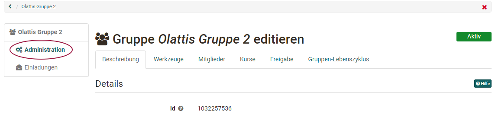
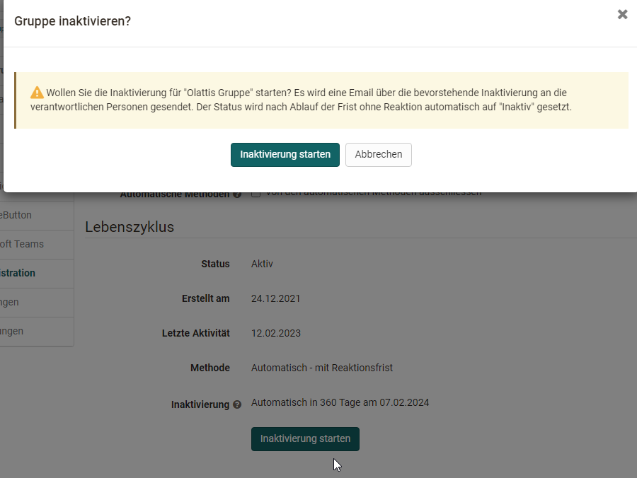

# Gruppenadministration {: #group_administration}

Wer eine Gruppe betreut, richtet sie in der Gruppenadministration ein: welche Werkzeuge die Mitglieder nutzen, wer Mitglied ist, mit welchen Kursen die Gruppe verbunden ist und wie neue Personen hineinkommen. Wenn Sie eine neue Gruppe erstellen, sind Sie automatisch Betreuer:in dieser Gruppe. Betreuer:innen sehen im Menü der Gruppe den Eintrag "Administration", Gruppenverwalter:innen und Administrator:innen sehen ihn in jeder Gruppe: 
`Gruppen > "Gruppenname" > Administration`

{ class="shadow lightbox" title="Administration einer Gruppe" }

In den Tabs der Gruppenadministration können Sie:

  * im Tab "Beschreibung" Name, Beschreibung und vorgesehene Anzahl Teilnehmende ändern,
  * im Tab "Werkzeuge" den Mitgliedern Werkzeuge zur Verfügung stellen, die dann im Menü der Gruppe erscheinen,
  * im Tab "Mitglieder" Mitglieder hinzufügen und festlegen, wer sie sieht,
  * im Tab "Kurse" die Gruppe mit Kursen verbinden,
  * im Tab "Freigabe" festlegen, wie sich Personen selbst eintragen, und die Gruppe per LTI freigeben,
  * im Tab "Gruppen-Lebenszyklus" die Gruppe inaktiv setzen, löschen oder reaktivieren,
  * im Tab "Optionen" als Person mit administrativer Rolle den Betreuer:innen Einladungen und die LTI-Freigabe erlauben.

Welche Tabs Sie sehen, hängt von Ihrer Rolle und von der Gruppe ab. Die Bedingungen stehen beim jeweiligen Tab.

Mehrere Gruppen gemeinsam bearbeiten oder eine Gruppe löschen Sie in der Liste der Gruppen: [Gruppenverwaltung](../../area_modules/Group_Management.de.md)

## Tab Beschreibung

Im Tab "Beschreibung" ändern Sie die Angaben, die Sie beim Erstellen der Gruppe festgelegt haben:

* "Name der Gruppe" und "Beschreibung",
* "Vorgesehene Anzahl Teilnehmende",
* "Warteliste" und "Automatisches Nachrücken".

Zum Kopieren zeigt der Tab ausserdem den "Link zu dieser Gruppe" und den Link zur "Visitenkarte dieser Gruppe".

## Tab Werkzeuge {: #tools}

Im Tab "Werkzeuge" statten Sie die Gruppe mit Werkzeugen für die Zusammenarbeit aus. Jedes eingeschaltete Werkzeug erscheint mit seinem Symbol im Menü der Gruppe links.

!!! info "Wichtig"

    Welche Werkzeuge zur Wahl stehen, legt die System-Administration fest. "Information an Mitglieder", "E-Mail", "Ordner" und "Forum" stehen immer zur Wahl. Kalender, Chat, Wiki, Portfolio, OpenMeetings, Adobe Connect, BigBlueButton, Microsoft Teams und Zoom erscheinen nur, wenn das zugehörige Modul eingeschaltet und, wo das Modul es verlangt, für Gruppen freigegeben ist. Fehlt Ihnen ein Werkzeug, wenden Sie sich an die Administrator:innen Ihrer OpenOlat-Instanz.

Folgende Werkzeuge stehen zur Wahl:

Werkzeug | | Beschreibung
---|---|---
:o_icon_o_icon_news: | Information an Mitglieder| Ist "Information an Mitglieder" eingeschaltet, legen Sie fest, ob nur Betreuer:innen oder auch Teilnehmer:innen Mitteilungen erstellen. Eigene Mitteilungen kann jede Person bearbeiten. Als Betreuer:in bearbeiten und löschen Sie alle Mitteilungen.
:o_icon_o_co_icon:| E-Mail| Ist "E-Mail" eingeschaltet, schicken auch Teilnehmer:innen Nachrichten an ausgewählte Betreuer:innen, Teilnehmer:innen oder an alle.
:o_icon_o_calendar_icon: | Kalender| Mit einem Kalender tragen Sie gemeinsame Termine der Gruppe ein. Sie legen fest, ob nur Betreuer:innen oder alle Mitglieder Einträge erstellen. Allgemeines zum Kalender beschreibt die Seite [Persönliche Werkzeuge: Kalender](../../personal_menu/Calendar.de.md).
:o_icon_o_bc_icon: | Ordner| Mit einem Ordner tauschen die Mitglieder Dateien aus. Je nach Konfiguration durch die Administrator:innen bearbeiten sie Office-Dokumente auch gemeinsam. Ist der Ordner eingeschaltet und gespeichert, legen Sie fest, wer Dateien hochladen und erstellen darf.
:o_icon_o_fo_icon:| Forum| Mit dem Forum tauschen sich alle Mitglieder zeitversetzt aus. Als Betreuer:in der Gruppe bearbeiten und löschen Sie Beiträge und verfassen neue.
:o_icon_o_icon_chat: | Chat| Mit dem Chat schreiben die Mitglieder einander in Echtzeit. Sie sehen dort auch, welche anderen Mitglieder gerade in OpenOlat angemeldet sind.
:o_icon_o_wiki_icon: | Wiki| Mit einem Wiki erstellen die Mitglieder gemeinsam Inhalte. Wie die Arbeit mit einem Wiki geht, beschreibt die Seite [Wiki erstellen](../../learningresources/Wiki.de.md).
:o_icon_o_ep_icon: | Portfolio| Mit einem [Portfolio](../../area_modules/Portfolio_General_Information.de.md) 2.0 arbeiten die Mitglieder gemeinsam an einem Portfolio. Es ist kein Portfolio für eine Bewertung.
:material-monitor: | OpenMeetings| Ist OpenMeetings eingeschaltet und gespeichert, steht der Gruppe ein virtueller Meetingraum zur Verfügung. Er funktioniert ähnlich wie der [Kursbaustein "OpenMeetings"](../../learningresources/Course_Element_OpenMeetings.de.md).
:material-monitor: | Adobe Connect| Mit Adobe Connect steht der Gruppe ein virtueller Meetingraum zur Verfügung. Er funktioniert ähnlich wie der [Kursbaustein "Adobe Connect"](../../learningresources/Course_Element_Adobe_Connect.de.md) [:octicons-tag-16:{ title="ab Release 14.0 (OO-3889)" }](https://track.frentix.com/issue/OO-3889).
:material-monitor: | BigBlueButton| Mit BigBlueButton stehen der Gruppe mehrere BigBlueButton-Räume zur Verfügung. Sie funktionieren ähnlich wie der [Kursbaustein "BigBlueButton"](../../learningresources/bigbluebutton/index.de.md). In der Gruppe stehen nur die Raumvorlagen zur Wahl, die für Gruppen freigegeben sind. Sie können von den Raumvorlagen in Kursen abweichen. Hat ein Mitglied in OpenOlat die Rolle Betreuer:in, Kursbesitzer:in, Autor:in oder Administrator:in, stehen dieser Person gegebenenfalls weitere Raumvorlagen zur Verfügung.
:material-monitor: | Microsoft Teams| Mit Microsoft Teams stehen der Gruppe mehrere Räume zur Verfügung. Sie funktionieren ähnlich wie der [Kursbaustein "Microsoft Teams"](../../learningresources/Course_Element_Microsoft_Teams.de.md).
:material-monitor: | Zoom| Mit Zoom steht der Gruppe ein Zoom-Meeting zur Verfügung. Es funktioniert ähnlich wie der [Kursbaustein "Zoom"](../../learningresources/zoom/index.de.md) [:octicons-tag-16:{ title="ab Release 17.0.0 (OO-6189)" }](https://track.frentix.com/issue/OO-6189).

Jedes Werkzeug lässt sich nur einmal in eine Gruppe einbinden. Eine Gruppe hat also nie zwei Ordner, Wikis oder Foren. Brauchen Sie mehrere Werkzeuge derselben Art, verwenden Sie statt einer Gruppe einen Kurs.

Wie die Mitglieder die Werkzeuge nutzen, beschreibt die Seite [Gruppenwerkzeuge nutzen](../Using_Group_Tools.de.md).

## Tab Mitglieder {: #members}

Im Tab "Mitglieder" bestimmen Sie, wer zur Gruppe gehört und wer die Mitglieder sieht. Der Tab hat drei Bereiche: "Anzeige Mitglieder", "Mitglieder Konfiguration" und "Mitglieder".

### Anzeige Mitglieder {: #display_members}

Ist "Mitglieder sehen Betreuer:innen" oder "Mitglieder sehen Teilnehmer:innen" eingeschaltet, erscheint im Menü der Gruppe der Eintrag "Mitglieder". Die Mitglieder sehen dort die Personen der eingeschalteten Rolle.

Mit "Alle Benutzer:innen sehen Betreuer:innen" und "Alle Benutzer:innen sehen Teilnehmer:innen" zeigen Sie die Liste zusätzlich auf der Visitenkarte der Gruppe, die alle Benutzer:innen sehen.

Hat die Gruppe eine Warteliste, legen Sie mit "Mitglieder sehen Warteliste" und "Alle Benutzer:innen sehen Warteliste" fest, wer die Warteliste sieht.

Mit "Mitglieder dürfen Liste der Mitglieder herunterladen" erlauben Sie den Mitgliedern, die Liste als Excel-Datei herunterzuladen und zu drucken.

### Mitglieder Konfiguration {: #membership_configuration}

Ist "Teilnehmer:innen können Gruppe verlassen" eingeschaltet, tragen sich Teilnehmer:innen selbst aus der Gruppe aus: [Gruppe verlassen](../Leave_a_Group.de.md). Sonst bitten sie eine Betreuer:in der Gruppe, sie zu entfernen.

### Mitglieder {: #member_list}

Der Bereich "Mitglieder" listet alle Mitglieder der Gruppe. Sie filtern die Liste nach Rolle oder Warteliste, suchen gezielt nach Personen und entfernen Mitglieder. Mit dem Symbol "Herunterladen" erhalten Sie die Betreuer:innen und Teilnehmer:innen der Gruppe als Excel-Datei.

Mit "Mitglied hinzufügen" suchen Sie Personen, die ein Konto in OpenOlat haben, und fügen sie der Gruppe hinzu. Welche Wege dabei zur Wahl stehen, hängt von Ihrer Rolle in OpenOlat ab:

* **Massensuche**: Sie fügen mehrere Personen auf einmal über Anmeldename, E-Mail oder Institutionsnummer hinzu. In der Standardkonfiguration sehen Autor:innen die Massensuche, Benutzer:innen ohne weitere Rolle sehen sie nicht.
* **Externe Mitglieder einladen**: Über den Pfeil neben "Mitglied hinzufügen" laden Sie Personen ohne OpenOlat-Konto mit ihrer E-Mail-Adresse ein. Die Aktion steht zur Wahl, wenn die System-Administration Einladungen für Gruppen eingeschaltet hat. Administrator:innen und Gruppenverwalter:innen laden immer ein, Betreuer:innen mit der Rolle Autor:in je nach Konfiguration für alle Gruppen oder nur, wenn es im Tab "Optionen" für diese Gruppe eingeschaltet ist.

    
Autor:innen Ansicht

	

 

Beim Hinzufügen legen Sie fest, ob eine Person Betreuer:in oder Teilnehmer:in der Gruppe wird:

  *  **Betreuer:innen** öffnen die Gruppenadministration, ändern alle hier beschriebenen Einstellungen und löschen die Gruppe auch. Ist die Gruppe mit einem Kurs verbunden, öffnen sie im Kurs zusätzlich das Bewertungswerkzeug und die Teststatistiken für ihre Gruppe. Weitere für Betreuer:innen freigegebene Aktionen führen sie ebenfalls aus, beschränkt auf ihre Gruppe.
  *  **Teilnehmer:innen** nutzen die Werkzeuge der Gruppe im Rahmen der Einstellungen, die die Betreuer:innen festgelegt haben.

Personen einzeln hinzufügen lohnt sich, wenn Sie gezielt bestimmte Personen in der Gruppe haben möchten. Sollen sich Personen selbst eintragen, richten Sie im Tab "Freigabe" ein Angebot ein: [Gruppenmitglied werden](../Group_Membership.de.md#by_yourself)

## Tab Kurse {: #courses}

Im Tab "Kurse" verbinden Sie die Gruppe mit Kursen. In Kursen dienen Gruppen zum Beispiel der kontrollierten Einschreibung, der Zusammenarbeit, der Vergabe von Referaten, der Anmeldung zu Exkursionen und der Vergabe von Rechten im Kurs.

Den Tab sehen Sie, wenn die Gruppe mit mindestens einem Kurs verbunden ist oder wenn Sie die Rolle Autor:in, Gruppenverwalter:in oder Administrator:in haben.

Mit "Kurs hinzufügen" öffnen Sie die Auswahl der Kurse. Unter "Meine Einträge" stehen die Kurse, bei denen Sie Besitzer:in sind, unter "Alle Einträge" zusätzlich die Kurse, die Sie referenzieren dürfen. Um einen Kurs auszuwählen, markieren Sie ihn, klicken auf den Titel oder klicken in der Spalte "Auswählen" auf den Haken. Mit einem Klick auf das Symbol :octicons-info-16: sehen Sie Angaben zum Kurs, zum Beispiel Autor:in, Sprache oder Beschreibung.

Autor:innen erstellen oder importieren hier auch neue Kurse, die sie gleich mit der Gruppe verbinden.

Eine Gruppe lässt sich mit beliebig vielen Kursen verbinden, und ein Kurs mit mehreren Gruppen. Die Verbindung entsteht auf zwei Wegen: von der Gruppe aus im Tab "Kurse" oder vom Kurs aus in der [Mitgliederverwaltung](../../learningresources/Members_management.de.md): 
`Kurs > Administration > Mitgliederverwaltung > Gruppen`

## Tab Freigabe {: #booking}

Im Tab "Freigabe" legen Sie fest, wie Personen ohne Ihr Zutun in die Gruppe kommen. Mit einem Angebot tragen sich Interessierte selbst als Teilnehmer:innen ein, statt dass Sie jede Person im Tab "Mitglieder" hinzufügen. Zusätzlich geben Sie die Gruppe hier für ein anderes Lernmanagementsystem frei (siehe unten).

Für Gruppen stehen diese Angebotsarten zur Wahl:

* :material-key-variant: **Zugangscode**: Nur wer den Code kennt, bucht die Gruppe. Sie legen den Code selbst fest und geben ihn weiter. Die Person gibt ihn vor dem ersten Öffnen der Gruppe ein. Auch ein Angebot mit Zugangscode können Sie zeitlich begrenzen.
* :material-gift: **Frei verfügbar**: Alle Benutzer:innen buchen die Gruppe ohne Code und werden damit Teilnehmer:innen. Auch den freien Zugang können Sie zeitlich begrenzen.
* :fontawesome-brands-cc-paypal: **PayPal Checkout**: Die Buchung kostet einen Betrag, den die Person mit einem PayPal-Konto oder einer Kreditkarte (Visa/Mastercard) bezahlt. Die Angebotsart steht zur Wahl, wenn die System-Administration PayPal Checkout eingeschaltet hat und Sie die Rolle Autor:in, Lernressourcenverwalter:in oder Administrator:in haben. Warteliste und PayPal Checkout schliessen sich aus: Ist im Tab "Beschreibung" die Warteliste eingeschaltet, fehlt PayPal Checkout; besteht ein Angebot mit Bezahlung, fehlt die Warteliste.

Sie können auch mehrere Angebote einrichten, die nebeneinander gelten. Ein Beispiel: in den ersten zwei Tagen "Frei verfügbar", danach nur mit Zugangscode oder gegen Bezahlung. Überschneiden sich zwei Angebote zeitlich, wählen Interessierte eines davon. Ein bestehendes Angebot ändern Sie jederzeit.

Sobald ein Angebot besteht, erscheint die Gruppe unter "Veröffentlichte Gruppen", wo andere sie finden und buchen. Buchen lässt sich eine Gruppe nur, solange sie den Status "Aktiv" hat [:octicons-tag-16:{ title="ab Release 20.0.0 (OO-7272)" }](https://track.frentix.com/issue/OO-7272). Ohne Angebot steht die Gruppe nur den Personen offen, die Betreuer:innen im Tab "Mitglieder" hinzugefügt haben.

Wer eine Gruppe gebucht hat, steht in der Liste der Teilnehmer:innen. Ab dann entscheidet allein diese Liste über den Zugang zur Gruppe. Ein abgelaufenes Angebot ändert an einer bestehenden Teilnahme deshalb nichts.

Entfernen Sie eine Person aus der Gruppe, bucht sie die Gruppe über ein noch gültiges Angebot erneut. Soll das nicht möglich sein, ändern oder entfernen Sie das Angebot.

!!! tip "Tipp"

    Löschen Sie Angebote, die Sie nicht mehr brauchen, oder begrenzen Sie sie zeitlich. Bestehende Buchungen bleiben davon unberührt.

Gruppen mit Angebot eignen sich vor allem, wenn:

* Sie Projekte oder kursunabhängige Schulungen anbieten,
* Sie Personen sammeln, die Sie später einem Kurs zuordnen,
* die Anzahl Teilnehmender begrenzt ist und die Gruppe die Organisation übernimmt, auch mit automatischem Nachrücken.

### LTI 1.3 Zugangskonfiguration [:octicons-tag-16:{ title="ab Release 15.5 (OO-5206)" }](https://track.frentix.com/issue/OO-5206) {: #lti_access_configuration}

Unter den Angeboten zeigt der Tab den Bereich "LTI 1.3 Zugangskonfiguration". Damit holen Sie Personen aus einem anderen Lernmanagementsystem, zum Beispiel aus Moodle, direkt in die Gruppe: [LTI-Zugang zu einer Gruppe konfigurieren](../LTI_Share_groups.de.md)

Den Bereich sehen Administrator:innen und Gruppenverwalter:innen, wenn die LTI-Konfiguration der System-Administration ihre Rolle zulässt. Betreuer:innen mit der Rolle Autor:in sehen ihn, wenn die LTI-Freigabe für alle Gruppen gilt oder im Tab "Optionen" für diese Gruppe eingeschaltet ist.

## Tab Gruppen-Lebenszyklus [:octicons-tag-16:{ title="ab Release 16.1.0 (OO-5190)" }](https://track.frentix.com/issue/OO-5190)

Im Tab "Gruppen-Lebenszyklus" sehen Sie den Status der Gruppe, wann sie erstellt wurde, wann sie zuletzt genutzt wurde und wann die nächste Inaktivierung oder Löschung geplant ist. Hier setzen Sie eine aktive Gruppe inaktiv, löschen eine inaktive Gruppe oder reaktivieren sie. Mit "Von den automatischen Methoden ausschliessen" nehmen Sie die Gruppe vom automatischen Gruppen-Lebenszyklus aus, zum Beispiel eine Gruppe, die dauerhaft bestehen muss.

{ class="shadow lightbox" title="Dialog Gruppe inaktivieren im Tab Gruppen-Lebenszyklus" }

Wie der automatische Gruppen-Lebenszyklus abläuft und wer ihn einrichtet, beschreibt das Administrationshandbuch: [Automatischer Gruppen-Lebenszyklus](../../../manual_admin/administration/Automatic_Group_Lifecycle.de.md)

## Tab Optionen [:octicons-tag-16:{ title="ab Release 17.0.0 (OO-6300)" }](https://track.frentix.com/issue/OO-6300) {: #options}

Im Tab "Optionen" erlauben Personen mit administrativer Rolle den Betreuer:innen dieser Gruppe zwei Dinge, die sonst Administrator:innen und Gruppenverwalter:innen vorbehalten sind:

* **Einladung externer Benutzer:innen für Gruppenbetreuer:innen mit Autor:innen-Rolle aktivieren**: Betreuer:innen mit der Rolle Autor:in laden im Tab "Mitglieder" externe Mitglieder ein.
* **"LTI 1.3"-Freigabe für Gruppenbetreuer:innen mit Autor:innen-Rolle aktivieren**: Betreuer:innen mit der Rolle Autor:in sehen im Tab "Freigabe" die "LTI 1.3 Zugangskonfiguration".

Den Tab gibt es nur, wenn die System-Administration für Einladungen oder für LTI 1.3 festgelegt hat, dass die Berechtigung pro Gruppe eingeschaltet werden muss. Administrator:innen und Gruppenverwalter:innen bearbeiten ihn, Principals sehen ihn nur zum Lesen.

## Weiterführende Informationen {: #further_information}

**Auf dieser Seite erwähnt** 
[Gruppenverwaltung >](../../area_modules/Group_Management.de.md) 
[Persönliche Werkzeuge: Kalender >](../../personal_menu/Calendar.de.md) 
[Wiki erstellen >](../../learningresources/Wiki.de.md) 
[Allgemeines zum Portfolio >](../../area_modules/Portfolio_General_Information.de.md) 
[Kursbaustein "OpenMeetings" >](../../learningresources/Course_Element_OpenMeetings.de.md) 
[Kursbaustein "Adobe Connect" >](../../learningresources/Course_Element_Adobe_Connect.de.md) 
[Kursbaustein "BigBlueButton" >](../../learningresources/bigbluebutton/index.de.md) 
[Kursbaustein "Microsoft Teams" >](../../learningresources/Course_Element_Microsoft_Teams.de.md) 
[Kursbaustein "Zoom" >](../../learningresources/zoom/index.de.md) 
[Gruppenwerkzeuge nutzen >](../Using_Group_Tools.de.md) 
[Gruppe verlassen >](../Leave_a_Group.de.md) 
[Gruppenmitglied werden >](../Group_Membership.de.md) 
[Mitgliederverwaltung >](../../learningresources/Members_management.de.md) 
[LTI-Zugang zu einer Gruppe konfigurieren >](../LTI_Share_groups.de.md) 
[Automatischer Gruppen-Lebenszyklus >](../../../manual_admin/administration/Automatic_Group_Lifecycle.de.md)

**Weiterführend** 
[Gruppen erstellen >](../Create_Groups.de.md) 
[Rollen und Rechte: Welche Rollen gibt es? >](../../basic_concepts/Roles.de.md)

[Zum Seitenanfang ^](#group_administration)

