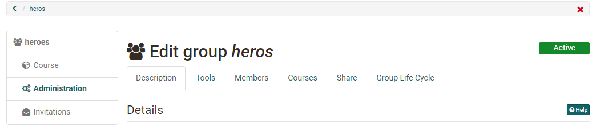
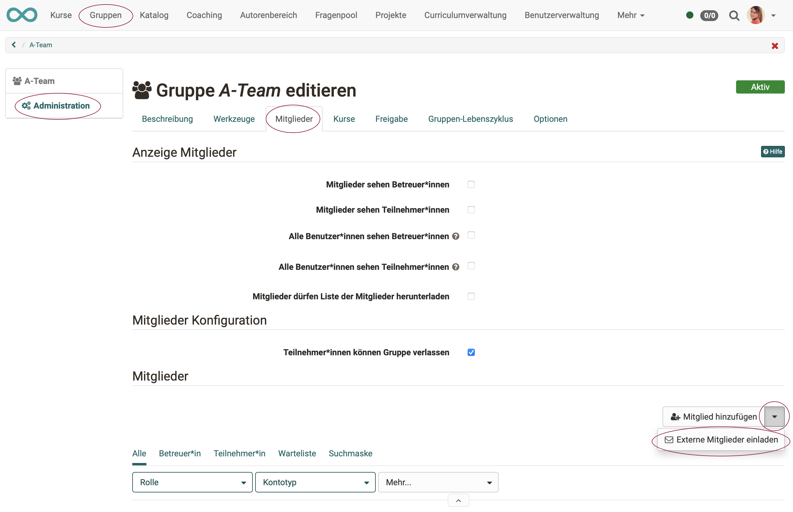
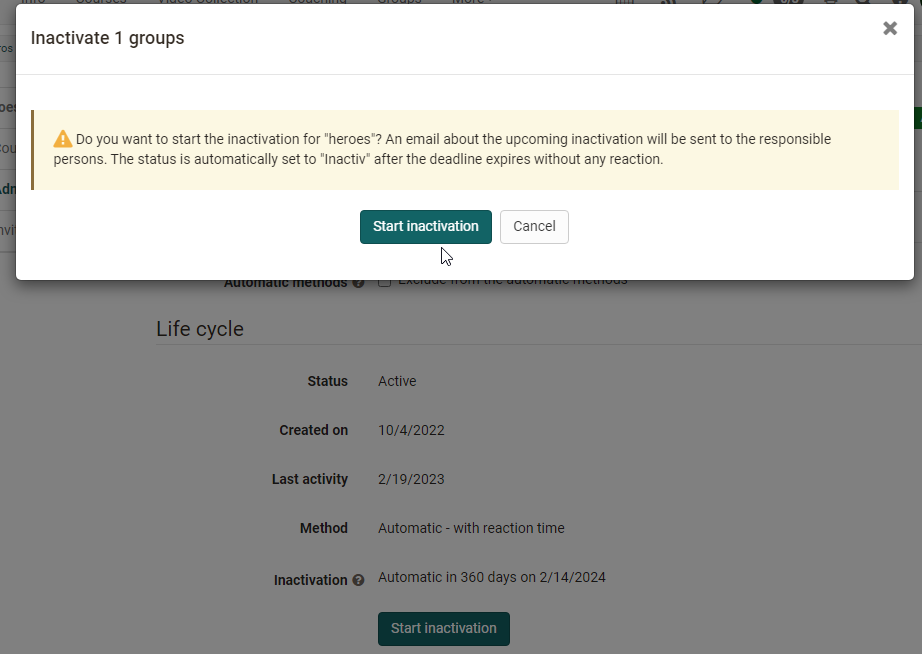

# Group Administration {: #group_administration}

Group coaches set up their group in the group administration: which tools the members use, who is a member, which courses the group is linked to and how new people get in. If you create a new group, you are automatically coach of this group. Coaches see the entry "Administration" in the menu of the group, group managers and administrators see it in every group: 
`Groups > "Group name" > Administration`

{ class="shadow lightbox" title="Administration of a group" }

In the tabs of the group administration you can:

  * in the tab "Description", change the name, the description and the maximum number of participants,
  * in the tab "Tools", provide the members with tools that then appear in the menu of the group,
  * in the tab "Members", add members and define who sees them,
  * in the tab "Courses", link the group to courses,
  * in the tab "Share", define how people sign up themselves, and share the group via LTI,
  * in the tab "Group Life Cycle", set the group inactive, delete or reactivate it,
  * in the tab "Options", as a person with an administrative role, allow the coaches to send invitations and to share via LTI.

Which tabs you see depends on your role and on the group. The conditions are given with each tab.

You edit several groups together or delete a group in the list of groups: [Group Management](../../area_modules/Group_Management.md)

## Tab Description

In the tab "Description" you change the information you defined when you created the group:

* "Group name" and "Description",
* "Maximum number of participants",
* "Waiting list" and "Moving up automatically".

For copying, the tab also shows the "Link to this group" and the link to the "Visiting card" of the group.

## Tab Tools  {: #tools}

In the tab "Tools" you equip the group with tools for collaboration. Each tool you switch on appears with its icon in the menu of the group on the left.

!!! info "Important"

    The system administration defines which tools are available. "Information for members", "E-mail", "Folder" and "Forum" are always available. Calendar, chat, wiki, portfolio, OpenMeetings, Adobe Connect, BigBlueButton, Microsoft Teams and Zoom only appear if the corresponding module is switched on and, where the module requires it, released for groups. If a tool is missing, contact the administrators of your OpenOlat instance.

The following tools are available:

Tool | | Description
---|---|---
:o_icon_o_icon_news: | Information for members| If "Information for members" is switched on, you define whether only coaches or also participants create messages. Every person can edit their own messages. As a coach, you edit and delete all messages.
:o_icon_o_co_icon:| E-mail| If "E-mail" is switched on, participants can also send messages to selected coaches, participants or to all.
:o_icon_o_calendar_icon: | Calendar| With a calendar you enter common dates of the group. You define whether only coaches or all members create entries. General information about the calendar is on the page [User tools: Calendar](../../personal_menu/Calendar.md).
:o_icon_o_bc_icon: | Folder| With a folder the members exchange files. Depending on the configuration by the administrators, they can also edit office documents together. Once the folder is switched on and saved, you define who can upload and create files.
:o_icon_o_fo_icon:| Forum| With the forum all members exchange ideas at different times. As coach of the group, you edit and delete posts and write new ones.
:o_icon_o_icon_chat: | Chat| With the chat the members write to each other in real time. There you also see which other members are currently logged in to OpenOlat.
:o_icon_o_wiki_icon: | Wiki| With a wiki the members create content together. How to work with a wiki is described on the page [Creating Wikis](../../learningresources/Wiki.md).
:o_icon_o_ep_icon: | ePortfolio| With a [portfolio](../../area_modules/Portfolio_General_Information.md) 2.0 the members work together on a portfolio. It is not a portfolio for an assessment.
:material-monitor: | OpenMeetings| If OpenMeetings is switched on and saved, a virtual meeting room is available to the group. It works similarly to the [Course Element "OpenMeetings"](../../learningresources/Course_Element_OpenMeetings.md).
:material-monitor: | Adobe Connect| With Adobe Connect a virtual meeting room is available to the group. It works similarly to the [Course Element "Adobe Connect"](../../learningresources/Course_Element_Adobe_Connect.md) [:octicons-tag-16:{ title="from Release 14.0 (OO-3889)" }](https://track.frentix.com/issue/OO-3889).
:material-monitor: | BigBlueButton| With BigBlueButton several BigBlueButton rooms are available to the group. They work similarly to the [Course Element "BigBlueButton"](../../learningresources/bigbluebutton/index.md). In the group, only the room templates released for groups are available. They may differ from the room templates in courses. If a member has the role coach, course owner, author or administrator in OpenOlat, further room templates may be available to this person.
:material-monitor: | Microsoft Teams| With Microsoft Teams several rooms are available to the group. They work similarly to the [Course Element "Microsoft Teams"](../../learningresources/Course_Element_Microsoft_Teams.md).
:material-monitor: | Zoom| With Zoom a Zoom meeting is available to the group. It works similarly to the [Course Element "Zoom"](../../learningresources/zoom/index.md) [:octicons-tag-16:{ title="from Release 17.0.0 (OO-6189)" }](https://track.frentix.com/issue/OO-6189).

Each tool can only be added once to a group. A group therefore never has two folders, wikis or forums. If you need several tools of the same kind, use a course instead of a group.

How the members use the tools is described on the page [Using Group Tools](../Using_Group_Tools.md).

## Tab Members  {: #members}

In the tab "Members" you determine who belongs to the group and who sees the members. The tab has three areas: "Display members", "Membership configuration" and "Members".

### Display members {: #display_members}

If "Members can see coaches" or "Members can see participants" is switched on, the entry "Members" appears in the menu of the group. There the members see the people of the role you switched on.

With "All users can see coaches" and "All users can see participants" you also show the list on the visiting card of the group, which all users see.

If the group has a waiting list, you define with "Members can see waiting list" and "All users can see the waiting list" who sees the waiting list.

With "Members can download the list of members" you allow the members to download the list as an Excel file and to print it.

### Membership configuration {: #membership_configuration}

If "Members can leave the group" is switched on, participants remove themselves from the group: [Leave a group](../Leave_a_Group.md). Otherwise they ask a coach of the group to remove them.

### Members {: #member_list}

The area "Members" lists all members of the group. You filter the list by role or waiting list, search for specific people and remove members. With the icon "Download" you get the coaches and participants of the group as an Excel file.

With "Add member" you search for people who have an account in OpenOlat and add them to the group. Which ways are available depends on your role in OpenOlat:

* **Bulk search**: You add several people at once by username, e-mail or institution identifier. In the default configuration, authors see the bulk search, users without a further role do not.
* **Invite external members**: Via the arrow next to "Add member" you invite people without an OpenOlat account with their e-mail address. The action is available if the system administration has switched on invitations for groups. Administrators and group managers can always invite, coaches with the role author depending on the configuration for all groups or only if it is switched on for this group in the tab "Options".

    
Author view

	

 

When adding, you define whether a person becomes coach or participant of the group:

*  **Coaches** open the group administration, change all settings described here and can also delete the group. If the group is linked to a course, they also open the assessment tool and the test statistics for their group in the course. They also carry out further actions released for coaches, limited to their group.
*  **Participants** use the tools of the group within the settings the coaches have defined.

Adding people one by one is useful if you want specific people in the group. If people should sign up themselves, set up an offer in the tab "Share": [Become a group member](../Group_Membership.md#by_yourself)

## Tab Courses {: #courses}

In the tab "Courses" you link the group to courses. In courses, groups serve for example for controlled enrolment, for collaboration, for assigning presentations, for registering for excursions and for granting rights in the course.

You see the tab if the group is linked to at least one course or if you have the role author, group manager or administrator.

With "Add course" you open the selection of courses. Under "My entries" you find the courses you own, under "All entries" also the courses you may reference. To select a course, highlight it, click on the title or click on the check mark in the column "Select". A click on the :octicons-info-16: icon shows information on the course, for example author, language or description.

Authors also create or import new courses here and link them to the group right away.

A group can be linked to any number of courses, and a course to several groups. The link is made in two ways: from the group in the tab "Courses" or from the course in the [Members management](../../learningresources/Members_management.md): 
`Course > Administration > Members management > Groups`

## Tab Share {: #booking}

In the tab "Share" you define how people get into the group without your intervention. With an offer, interested people sign up themselves as participants, instead of you adding every person in the tab "Members". In addition, you share the group here with another learning management system (see below).

For groups, these offer types are available:

  * :material-key-variant: **Access code**: Only people who know the code book the group. You define the code yourself and pass it on. The person enters it before opening the group for the first time. You can also limit an offer with access code in time.
  * :material-gift: **Freely available**: All users book the group without a code and thus become participants. You can also limit the free access in time.
  * :fontawesome-brands-cc-paypal: **PayPal Checkout**: The booking costs an amount that the person pays with a PayPal account or a credit card (Visa/Mastercard). The offer type is available if the system administration has switched on PayPal Checkout and you have the role author, learning resource manager or administrator. Waiting list and PayPal Checkout exclude each other: if the waiting list is switched on in the tab "Description", PayPal Checkout is missing; if an offer with payment exists, the waiting list is missing.

You can also set up several offers that apply side by side. An example: "Freely available" during the first two days, then only with access code or against payment. If two offers overlap in time, interested people choose one of them. You can change an existing offer at any time.

As soon as an offer exists, the group appears under "Published groups", where others find and book it. A group can only be booked as long as it has the status "Active" [:octicons-tag-16:{ title="from Release 20.0.0 (OO-7272)" }](https://track.frentix.com/issue/OO-7272). Without an offer, the group is only open to the people coaches have added in the tab "Members".

Whoever has booked a group is on the list of participants. From then on, only this list decides about access to the group. An expired offer therefore does not change an existing participation.

If you remove a person from the group, they book the group again via an offer that is still valid. If that should not be possible, change or remove the offer.

!!! tip "Tip"

    Delete offers you no longer need, or limit them in time. Existing bookings are not affected.

Groups with an offer are particularly suitable if:

* you offer projects or course-independent training,
* you collect people you want to assign to a course later,
* the number of participants is limited and the group takes over the organisation, also with moving up automatically.

### LTI 1.3 access configuration [:octicons-tag-16:{ title="from Release 15.5 (OO-5206)" }](https://track.frentix.com/issue/OO-5206) {: #lti_access_configuration}

Below the offers, the tab shows the area "LTI 1.3 access configuration". With it, you bring people from another learning management system, for example from Moodle, directly into the group: [Configure LTI access to a group](../LTI_Share_groups.md)

Administrators and group managers see the area if the LTI configuration of the system administration allows their role. Coaches with the role author see it if the LTI release applies to all groups or is switched on for this group in the tab "Options".

## Tab Group Life Cycle [:octicons-tag-16:{ title="from Release 16.1.0 (OO-5190)" }](https://track.frentix.com/issue/OO-5190)

In the tab "Group Life Cycle" you see the status of the group, when it was created, when it was last used and when the next inactivation or deletion is planned. Here you set an active group inactive, delete an inactive group or reactivate it. With "Exclude from the automatic methods" you exclude the group from the automatic group life cycle, for example a group that must exist permanently.

{ class="shadow lightbox" title="Dialog Inactivate group in the tab Group Life Cycle" }

How the automatic group life cycle works and who sets it up is described in the Administration Manual: [Automatic Group Life Cycle](../../../manual_admin/administration/Automatic_Group_Lifecycle.md)

## Tab Options [:octicons-tag-16:{ title="from Release 17.0.0 (OO-6300)" }](https://track.frentix.com/issue/OO-6300) {: #options}

In the tab "Options", people with an administrative role allow the coaches of this group two things that are otherwise reserved for administrators and group managers:

* **Activate invitation of external users for group coaches with authoring rights**: Coaches with the role author invite external members in the tab "Members".
* **Activate "LTI 1.3" release for group coaches with author role**: Coaches with the role author see the "LTI 1.3 access configuration" in the tab "Share".

The tab only exists if the system administration has defined for invitations or for LTI 1.3 that the permission must be switched on per group. Administrators and group managers edit it, principals only see it read-only.

## Further information {: #further_information}

**Mentioned on this page** 
[Group Management >](../../area_modules/Group_Management.md) 
[User tools: Calendar >](../../personal_menu/Calendar.md) 
[Creating Wikis >](../../learningresources/Wiki.md) 
[Portfolio - General Information >](../../area_modules/Portfolio_General_Information.md) 
[Course Element "OpenMeetings" >](../../learningresources/Course_Element_OpenMeetings.md) 
[Course Element "Adobe Connect" >](../../learningresources/Course_Element_Adobe_Connect.md) 
[Course Element "BigBlueButton" >](../../learningresources/bigbluebutton/index.md) 
[Course Element "Microsoft Teams" >](../../learningresources/Course_Element_Microsoft_Teams.md) 
[Course Element "Zoom" >](../../learningresources/zoom/index.md) 
[Using Group Tools >](../Using_Group_Tools.md) 
[Leave a group >](../Leave_a_Group.md) 
[Become a group member >](../Group_Membership.md) 
[Members management >](../../learningresources/Members_management.md) 
[Configure LTI access to a group >](../LTI_Share_groups.md) 
[Automatic Group Life Cycle >](../../../manual_admin/administration/Automatic_Group_Lifecycle.md)

**Further reading** 
[Create Groups >](../Create_Groups.md) 
[Roles and Rights: Which roles are available? >](../../basic_concepts/Roles.md)

[To the top of the page ^](#group_administration)
