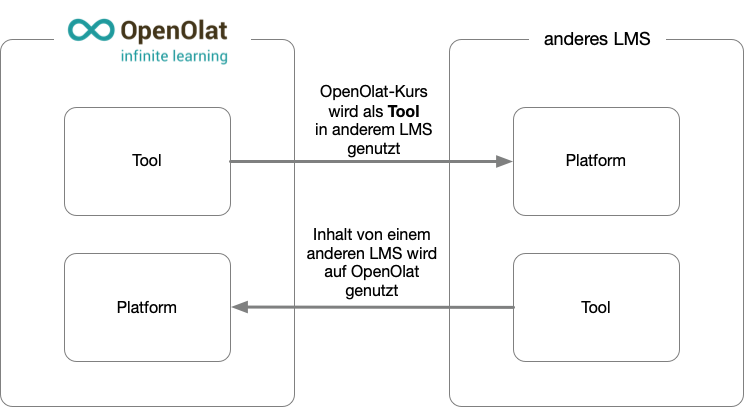

# Configure LTI access to a group [:octicons-tag-16:{ title="from Release 15.5 (OO-5206)" }](https://track.frentix.com/issue/OO-5206) {: #LTI_access_to_a_group}

## What can you do with the LTI share of a group? {: #lti_share_meaning}

With the LTI share of a group, you bring people from another learning management system (LMS), for example from Moodle, into an OpenOlat group without sharing a course. The people click a link in their own system and land directly in the group, without applying for an OpenOlat account and without signing in separately. The two systems connect for this through the LTI standard (Learning Tools Interoperability).

This is useful when people from a partner organization are to work with you, but their own system offers no shared place for it. In the group they use the tools you have switched on in the "Tools" tab, such as "Forum" or "Folder", for example to discuss submitted work. If the group is linked to courses in the "Courses" tab, the people are also members of these courses through the group: [Group Administration](Group_Administration/index.md#courses)

You find step-by-step instructions for Moodle in the how-to: [How do I integrate an OpenOlat course into Moodle?](../../manual_how-to/LTI_integrate_course_into_moodle/LTI_integrate_course_into_moodle.md)

**What the LTI share of a group does:**

* The group stays in OpenOlat. The people work in OpenOlat with the tools of the group.
* On the first call, OpenOlat creates an account for each person. If "Match users by E-mail" is switched on for the external platform, OpenOlat instead links the person to their existing account, provided exactly one account has this e-mail address.
* The person becomes a member of the shared group directly, as participant or as coach.
* OpenOlat does not report results from a group back to the platform. Only the LTI share of a course does that.
* The LTI share applies only to this one group and only to the platform you select. In the user interface it is called "Deployment".
* If you delete the LTI share, the platform can no longer access the group.

[To the top of the page ^](#LTI_access_to_a_group)

---

## Direction of the exchange {: #exchange_direction}

Information about groups and members can generally be exchanged in both directions:

* from OpenOlat (= tool) to the other LMS (= platform)
* from the other LMS (= tool) to OpenOlat (= platform)

{ class="shadow lightbox" title="Tool and platform roles between two systems" }

If OpenOlat is the platform, you embed the external tool in a course via the course element "LTI page". Which data of the persons OpenOlat transfers to the tool, such as name, e-mail address and roles, is set in the course element: [Course element "LTI page"](../learningresources/Course_Element_LTI_Page.md). The following sections describe OpenOlat as the tool.

[To the top of the page ^](#LTI_access_to_a_group)

---

## Requirements {: #conditions}

System administrators register the external platform in the system administration of OpenOlat under `Administration > External tools > LTI > Tab "External platforms"`. On the other side, administrator access to the other LMS is required as well. Who may add the LTI share of a group is set in the system administration. Depending on the setting, these are administrators, group managers and group coaches with author rights: [Who can add deployments?](../../manual_admin/administration/LTI_Integrations.md#deployments) 
Ideally, set up both systems at the same time, because certain dialogs in both systems must be configured directly one after the other.

[To the top of the page ^](#LTI_access_to_a_group)

---

## Configuration procedure {: #config_process}

The configuration connects both systems in five steps. This page describes step 3 and the connection test, the how-to for Moodle describes the other steps. They apply to a group in the same way as to a course.

1. [Setup "External Tool" in Moodle](../../manual_how-to/LTI_integrate_course_into_moodle/LTI_integrate_course_into_moodle.md#setup_step1)
2. [Setup "External platform" in OpenOlat](../../manual_how-to/LTI_integrate_course_into_moodle/LTI_integrate_course_into_moodle.md#setup_step2)
3. [LTI share of the group in OpenOlat](#group_share)
4. [Embedding the external tool (=OpenOlat) in the Moodle course](../../manual_how-to/LTI_integrate_course_into_moodle/LTI_integrate_course_into_moodle.md#setup_step4)
5. [Connection test](#roles_members_management)

[To the top of the page ^](#LTI_access_to_a_group)

---

## Share a group via LTI {: #group_share}

With the LTI share, you allow an external platform to call this one group. You add the LTI share with the "Add deployment" button, under: 
`Group > Administration > Tab "Share" > Section "LTI 1.3 access configuration"`

Only people who may add an LTI share see the section "LTI 1.3 access configuration", see [Requirements](#conditions).

In the dialog you select the previously set up "Platform" and enter the "Deployment ID" from the platform. OpenOlat provides the other details and only displays them: the "Tool URL" of the group in the format `https://<OpenOlat-URL>/auth/BusinessGroup/<Group-ID>`, the "Initiate login URL", the "Redirection URL" and, in the "Public Key" field, the key of the platform. Where these details go in Moodle is shown in step 3 of the how-to. It describes the course and applies to the group in the same way: [LTI release of the course in OpenOlat](../../manual_how-to/LTI_integrate_course_into_moodle/LTI_integrate_course_into_moodle.md#setup_step3)

You can enter the same deployment ID of a platform in the LTI share of several groups and courses. Within the same group, it can be used only once per platform; a second attempt ends with the message "Deployment ID must be unique for a specific platform and group." OpenOlat recognizes which group to open from the address the platform sends with the call, as with courses: [One deployment ID for several courses](../learningresources/LTI_Share_courses.md#deployment_id_several_courses) [:octicons-tag-16:{ title="from Release 21.1 (OO-9092)" }](https://track.frentix.com/issue/OO-9092)

[To the top of the page ^](#LTI_access_to_a_group)

---

## Which details are exchanged? {: #data_exchange}

Whoever calls the group from the platform brings details about themselves along. OpenOlat sends nothing back for a group.

On every call, the platform sends the person's first name, last name, e-mail address, language and LTI role. From these, OpenOlat creates the account on the first call and determines the role in the group. Which details about the person the platform transmits is determined by the platform. The complete list is given for the LTI share of a course and applies to the group in the same way: [From Moodle to OpenOlat](../learningresources/LTI_Share_courses.md#data_exchange_from_moodle)

OpenOlat transfers results to the platform only from a course with an LTI share, not from a group. OpenOlat does not query the LTI service for names and roles (Names and Role Provisioning Service, NRPS). A person therefore only joins the group when they call the group themselves.

[To the top of the page ^](#LTI_access_to_a_group)

---

## Where do you see the people from the other platform? [:octicons-tag-16:{ title="from Release 15.5 (OO-5207)" }](https://track.frentix.com/issue/OO-5207) {: #roles_members_management}

You see in the group whether the connection works: when a person calls the group from the platform for the first time, they appear in the member list under: 
`Group > Administration > Tab "Members"`

OpenOlat adds the person directly to the shared group. A separate group "LTI: name of the platform", as with the LTI share of a course, is not created. Which role the person receives in the group is decided by the LTI role the platform sends with the call:

| LTI role in the platform |   | Role in the group |
| ------------------------ | ------- | ----------------- |
| Instructor (course role or role in the institution) | becomes | coach |
| Mentor | becomes | coach |
| Learner or any other role | becomes | participant |

For the connection test from step 5, call the group in Moodle through the link of the external tool and then check whether the new account appears in the member list of the group.

[To the top of the page ^](#LTI_access_to_a_group)

---

## Further information {: #further_information}

**Mentioned on this page** 
[Group Administration >](Group_Administration/index.md) 
[How do I integrate an OpenOlat course into Moodle? >](../../manual_how-to/LTI_integrate_course_into_moodle/LTI_integrate_course_into_moodle.md) 
[Course Element "LTI Page" >](../learningresources/Course_Element_LTI_Page.md) 
[LTI 1.3 Integrations >](../../manual_admin/administration/LTI_Integrations.md) 
[Configure LTI access to a course >](../learningresources/LTI_Share_courses.md)

**Further reading** 
[LTI - External Platforms >](../../manual_admin/administration/LTI_External_platforms.md) 
[LTI - External tools >](../../manual_admin/administration/LTI_External_tools.md) 
[LTI - Deep Linking >](../../manual_admin/administration/LTI_Deeplinking.md) 
[LTI - Role mapping >](../../manual_admin/administration/LTI_Role_Mapping.md) 
[Become a group member >](Group_Membership.md)

[To the top of the page ^](#LTI_access_to_a_group)
