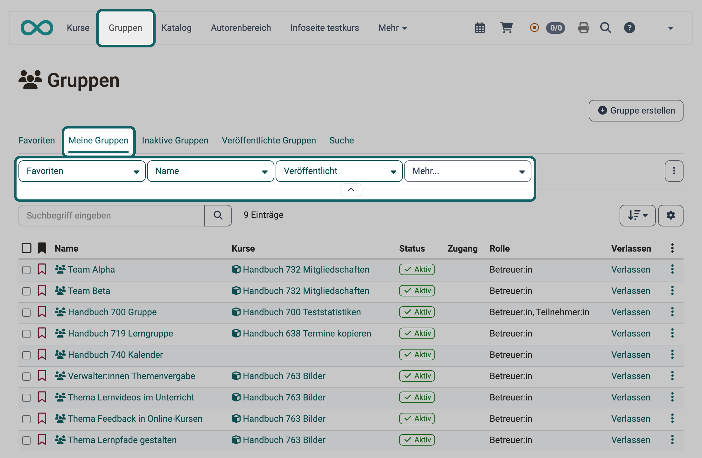

# :o_icon_o_icon_group: Gruppen {: #groups}

:octicons-device-camera-video-24: **Video-Einführung**: [Arbeit mit Gruppen](<https://www.youtube.com/embed/7LAPedqB9tk>){:target="_blank"}

!!! note "Quick Links"

    * [Gruppen erstellen](Create_Groups.de.md)
    * [Gruppenmitglied werden](Group_Membership.de.md)
    * [Gruppenwerkzeuge nutzen](Using_Group_Tools.de.md)
    * [Gruppe verlassen](Leave_a_Group.de.md)
    * [Gruppenadministration](Group_Administration/index.de.md)
    * [LTI Freigabe konfigurieren](LTI_Share_groups.de.md)
    * [Rollen in Gruppen](../basic_concepts/Roles/index.de.md#groups)

    Für Berechtigte mit Verwaltungsaufgaben:

    * [Gruppenverwaltung](../area_modules/Group_Management.de.md)

In Gruppen arbeiten Personen zusammen: in einem Kurs, über mehrere Kurse hinweg oder ganz unabhängig von Kursen. Jede Gruppe konfigurieren Sie für ihren Zweck. Dieses Kapitel beschreibt, wie Sie Gruppen für verschiedene Verwendungszwecke konfigurieren und nutzen.

[Zum Seitenanfang ^](#groups)

---

## Wo findet man die OpenOlat Gruppen? {: #where}

Die Gruppen, in denen Sie Mitglied sind, erreichen Sie über den Eintrag "Gruppen" in der Hauptnavigation. Der Tab "Meine Gruppen" listet Ihre aktiven Gruppen: 
`Gruppen > Meine Gruppen`

Die übrigen Tabs zeigen weitere Ausschnitte. "Favoriten" zeigt die Gruppen, die Sie mit dem Symbol "Bookmark hinzufügen" in der Liste markiert haben, "Inaktive Gruppen" Ihre inaktiven Gruppen. "Veröffentlichte Gruppen" zeigt veröffentlichte Gruppen, in denen Sie noch kein Mitglied sind und denen Sie beitreten können. Unter "Suche" finden Sie Gruppen über einen Suchbegriff.

Bei vielen Gruppen behalten Sie mit den Filtern den Überblick, etwa mit "Name" oder "Veröffentlicht". Die Filterleiste klappen Sie mit dem kleinen Pfeil unter den Tabs auf und zu.

{ class="shadow lightbox" title="Tab Meine Gruppen im Bereich Gruppen · 2026.11.10" }

In der Liste können Sie

* eine Gruppe verlassen, mit "Verlassen" in der Zeile der Gruppe
* eine Gruppe löschen, in der Sie Betreuer:in sind: über :o_icon_o_icon_actions: am Ende der Zeile mit "Löschen". Wer eine Gruppe erstellt, ist ihre Betreuer:in.
* nach einem Klick auf eine Gruppe ihre Mitglieder sehen und, sofern die Gruppe es erlaubt, mit ihnen Kontakt aufnehmen
* die Werkzeuge der Gruppe nutzen

[Zum Seitenanfang ^](#groups)

---

## Welche Gruppentypen gibt es? {: #types}

### Lerngruppen innerhalb eines Kurses

Für Gruppenarbeiten in einem Kurs bilden Sie Lerngruppen in der [Mitgliederverwaltung](../learningresources/Members_management.de.md) des Kurses: `Kurs > Administration > Mitgliederverwaltung`.

### Gruppen, die mehrere Kurse gemeinsam besuchen

Diese Art Gruppe entspricht einer Klasse, die über längere Zeit zusammenbleibt und gemeinsam verschiedene Kurse besucht. Statt jede Teilnehmer:in einzeln in einen Kurs einzubuchen, fügen Sie dem Kurs die ganze Gruppe hinzu. Löschen Sie eine Gruppe, die mit einem Kurs verbunden ist, bleibt der Kurs bestehen.

### Interessengruppen

Gruppen entstehen auch ganz unabhängig von Kursen, etwa für den Austausch über gemeinsame Interessen. So bilden alle Lehrenden eines Fachgebiets eine gemeinsame Gruppe, oder Lernende bilden in Eigeninitiative Gruppen zur Prüfungsvorbereitung.

### Managed Groups

Eine zusätzliche Software wie der Syncher legt Gruppen an und weist ihnen die Mitglieder automatisch zu. So übernimmt OpenOlat Gruppen, die in anderen Systemen schon bestehen.

!!! note "Hinweis"

    Die Informationen dieses Kapitels richten sich vor allem an Teilnehmende, Betreuer:innen und Kursbesitzer:innen (Autor:innen).

    Sind Sie ausserdem mit der Verwaltung der Gruppen beauftragt, stehen Ihnen weitere Aktionen zur Verfügung. Die Seite [Gruppenverwaltung](../area_modules/Group_Management.de.md) beschreibt sie.

[Zum Seitenanfang ^](#groups)

---

## Weiterführende Informationen {: #further_information}

[Modul Gruppen >](../../manual_admin/administration/Modules_Groups.de.md) 
[Automatischer Gruppen-Lebenszyklus >](../../manual_admin/administration/Automatic_Group_Lifecycle.de.md)

[Zum Seitenanfang ^](#groups)
