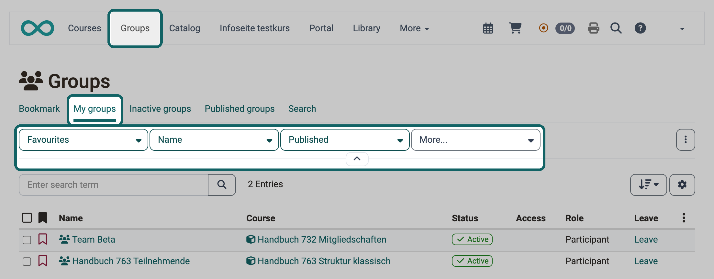

# :o_icon_o_icon_group: Groups {: #groups}

:octicons-device-camera-video-24: **Video Introduction (German)**: [Working with groups](<https://www.youtube.com/embed/7LAPedqB9tk>){:target="_blank"}

!!! note "Quick Links"

    * [Create Groups](Create_Groups.md)
    * [Become a group member](Group_Membership.md)
    * [Using Group Tools](Using_Group_Tools.md)
    * [Leave a group](Leave_a_Group.md)
    * [Group Administration](Group_Administration/index.md)
    * [LTI Sharing](LTI_Share_groups.md)
    * [Roles in groups](../basic_concepts/Roles/index.md#groups)

    For authorized persons with administrative tasks:

    * [Group Management](../area_modules/Group_Management.md)

In groups, persons work together: in a course, across several courses or completely independently of courses. You configure each group for its purpose. This chapter describes how to configure and use groups for different purposes.

[To the top of the page ^](#groups)

---

## Where to find OpenOlat groups? {: #where}

You reach the groups in which you are a member via the entry "Groups" in the main navigation. The tab "My groups" lists your active groups: 
`Groups > My groups`

The other tabs show further selections. "Favourites" shows the groups you have marked with the icon "Add bookmark" in the list, "Inactive groups" your inactive groups. "Published groups" shows published groups in which you are not yet a member and which you can join. Under "Search" you find groups with a search term.

With many groups, the filters help you keep track, for example "Name" or "Published". You expand and collapse the filter bar with the small arrow below the tabs.

{ class="shadow lightbox" title="Tab My groups in the Groups area · 2026.11.10" }

In the list you can

* leave a group, with "Leave" in the row of the group
* delete a group in which you are a coach: via :o_icon_o_icon_actions: at the end of the row with "Delete". Whoever creates a group is its coach.
* after a click on a group, see its members and, if the group allows it, get in contact with them
* use the tools of the group

[To the top of the page ^](#groups)

---

## What types of groups are there? {: #types}

### Learning groups within a course

For group work in a course, you form learning groups in the [members management](../learningresources/Members_management.md) of the course: `Course > Administration > Members management`.

### Groups that attend several courses together

This type of group corresponds to a class that stays together for a longer period of time and attends different courses together. Instead of enrolling each participant in a course individually, you add the entire group to the course. If you delete a group associated with a course, the course remains.

### Interest groups

Groups also come into being completely independently of courses, for example to share common interests. All teachers in a subject area form a joint group, or learners form groups on their own initiative to prepare for exams.

### Managed Groups

Additional software such as the Syncher creates groups and assigns their members automatically. In this way, OpenOlat takes over groups that already exist in other systems.

!!! note "Note"

    The information in this chapter is primarily intended for participants, coaches and course owners (authors).

    If you are also in charge of managing the groups, further actions are available to you. The page [Group management](../area_modules/Group_Management.md) describes them.

[To the top of the page ^](#groups)

---

## Further information {: #further_information}

[Module Groups >](../../manual_admin/administration/Modules_Groups.md) 
[Automatic Group Life Cycle >](../../manual_admin/administration/Automatic_Group_Lifecycle.md)

[To the top of the page ^](#groups)
