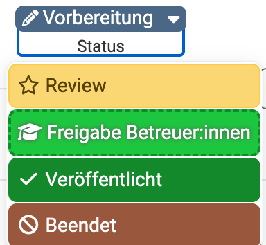
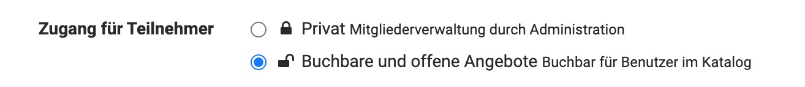
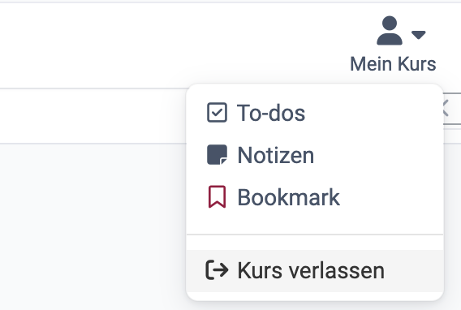
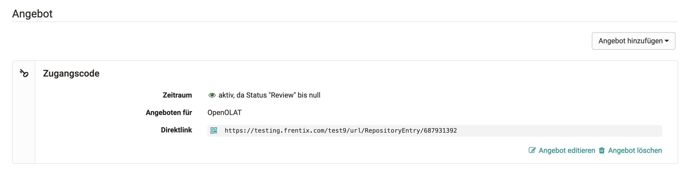
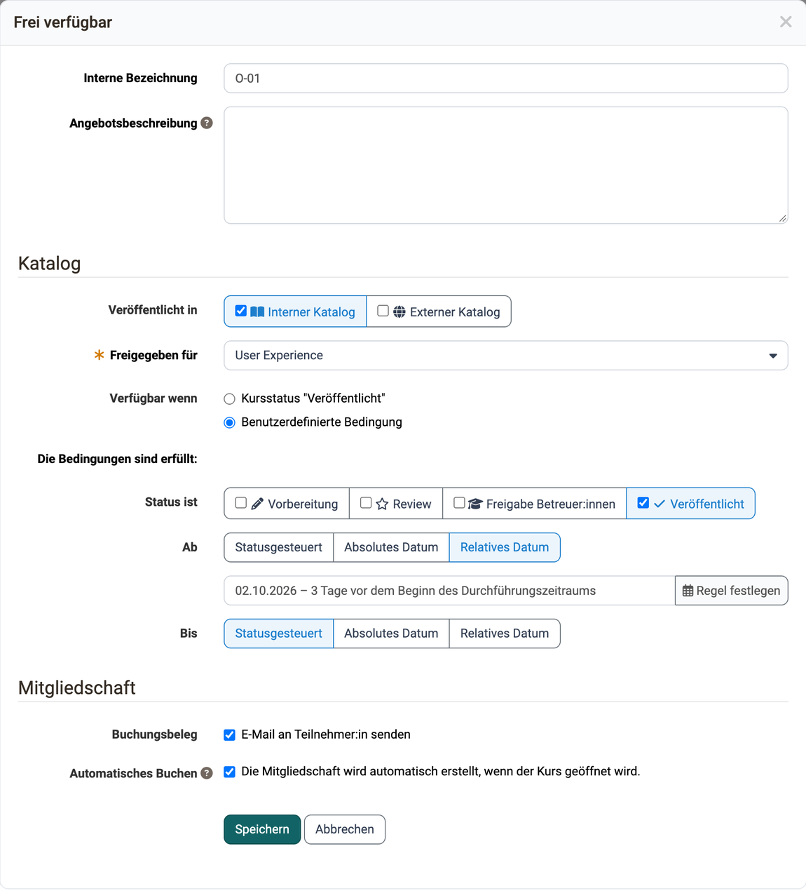
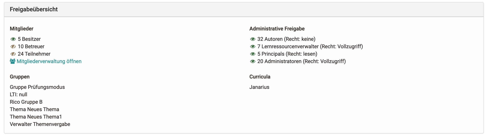
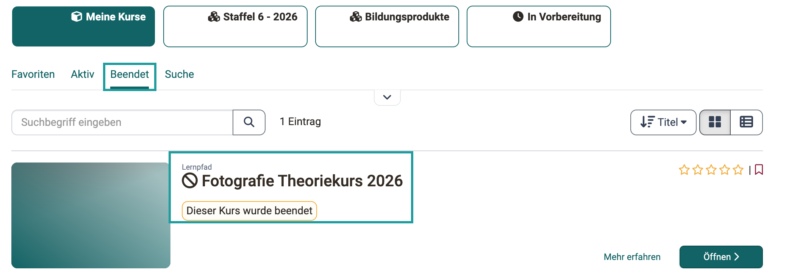

# Zugangskonfiguration / Freigabe {: #access-configuration}

Damit Teilnehmende einen Kurs sehen und nutzen können, veröffentlichen Sie ihn und richten den Zugang ein. Beides legen Besitzer:innen der Lernressource fest: den Publikationsstatus im Menü "Status" der Toolbar, den Zugang im Tab "Freigabe" der Einstellungen.

## Status der Veröffentlichung [:octicons-tag-16:{ title="ab Release 13.0 (OO-3584)" }](https://track.frentix.com/issue/OO-3584){:target="_blank"}

Eine neu erstellte Lernressource hat den Publikationsstatus "Vorbereitung" und ist nur für ihre Besitzer:innen zugänglich. Im Menü "Status" der Toolbar ändern Sie den Status und machen die Lernressource weiteren Personen zugänglich:

{ class="thumbnail lightbox" title="Menü Status einer Lernressource" }

Publikationsstatus | Zugriff |
---|---|
Vorbereitung | Nur Besitzer:innen dieser Lernressource haben Zugriff. |
Review | Nur Besitzer:innen dieser Lernressource haben Zugriff. Alle Vorbereitungen zu dieser Lernressource sind abgeschlossen und die Inhalte sind zur weiteren Überprüfung freigegeben. |
Freigabe Betreuer:innen | Besitzer:innen und Betreuer:innen dieser Lernressource haben Zugriff. |
Veröffentlicht | Alle Mitglieder der Lernressource haben Zugriff. Der Kurs steht unter "Kurse" im Tab "Aktiv". |
Beendet | Die Zugriffsart der Mitglieder richtet sich nach der konfigurierten Einstellung des Status "Beendet": "Nur-Lese-Zugriff" oder "Kein Zugriff". |

!!! info "Wichtig"

    Hat ein Kurs den Status "Vorbereitung", "Review" oder "Freigabe Betreuer:innen", erscheint er unter `Kurse > In Vorbereitung`. Teilnehmende können ihn aber erst nach der Veröffentlichung öffnen, auch die Toolbar bleibt ihnen bis dahin verschlossen.

Wer eine Lernressource nutzen darf, legen Sie im Tab "Freigabe" fest. Die folgenden Abschnitte beschreiben die Optionen.

## Tab Freigabe

### Angebotsarten konfigurieren und Angebote erstellen

Ob Teilnehmende einen Kurs selbst buchen oder von Ihnen eingetragen werden, entscheiden Sie unter "Zugang für Teilnehmer:innen": 
`Kurs > Administration > Einstellungen > Tab "Freigabe"`

{ class="shadow lightbox" title="Tab Freigabe der Kurseinstellungen" }

Mit "Privat" tragen Besitzer:innen oder Personen mit dem Recht zur Mitgliederverwaltung die Teilnehmenden selbst ein.

Mit "Buchbare und offene Angebote" buchen Teilnehmende den Kurs oder die Lernressource selbst. Je nach Angebot geben sie dafür einen Zugangscode ein.

[Details zum Tab "Freigabe" >](../learningresources/Course_Settings_Share.de.md)

### Lernressource verlassen {: #leave_learning_resource}

Wer einen Kurs freiwillig belegt hat, möchte ihn oft auch selbst wieder verlassen können. Mit der Einstellung "Teilnehmer:innen können austreten" im Tab "Freigabe" legen Sie fest, ob und wann Teilnehmende das dürfen. Die Einstellung erscheint beim Verwendungszweck "Eigenständig", siehe [Kurseinstellungen - Tab Freigabe](Course_Settings_Share.de.md#sections_by_usage). Zur Wahl stehen:

* "Jederzeit": Teilnehmende können den Kurs jederzeit verlassen.
* "Nach Kursenddatum oder Status "Beendet"": Wurde ein Durchführungszeitraum festgelegt, dürfen Teilnehmende den Kurs nach Ablauf dieses Zeitraums verlassen. Unabhängig davon dürfen sie den Kurs verlassen, sobald er den Status "Beendet" hat. Ohne Durchführungszeitraum ist das Verlassen also erst im Status "Beendet" möglich. Bei sonstigen Lernressourcen heisst die Option "Status "Beendet"". [:octicons-tag-16:{ title="ab Release 20.3 (OO-9272)" }](https://track.frentix.com/issue/OO-9272)
* "Nie": Teilnehmende können den Kurs nicht selbst verlassen. Bei Bedarf tragen Besitzer:innen sie aus.

Welche Option bei neuen Lernressourcen voreingestellt ist, legt die System-Administration im [Modul Lernressource](../../manual_admin/administration/Modules_Learning_Resource.de.md#allow_leaving_courses) fest. Ohne eigene Vorgabe ist es "Jederzeit".

Dürfen Teilnehmende den Kurs verlassen, wählen sie in der Kurs-Toolbar im Menü "Mein Kurs" den Eintrag "Kurs verlassen". Den gleichen Weg bietet die Infoseite im Kasten "Mein Kurs" mit der Schaltfläche "Kurs verlassen", siehe [Allgemeine Funktionen: Infoseite](General_Functions_Infopage.de.md#leave_course).

{ class="shadow lightbox" title="Menü Mein Kurs in der Kurs-Toolbar · 2026.10.20" }

### Administrative Freigabe

Im Abschnitt "Administrative Freigabe" wählen Sie die Organisation oder Unterorganisation, für die der Kurs den administrativen Rollen freigegeben ist. Dazu zählen andere Autor:innen (je nach Recht), Lernressourcenverwalter:innen, Principals und Administrator:innen. Den Abschnitt gibt es nur, wenn das Modul Organisationen eingeschaltet ist.

Ausserdem legen Sie im Tab "Freigabe" fest, welche Rechte andere Autor:innen an der Lernressource haben. Diese Rechte gelten für alle Autor:innen der OpenOlat-Instanz. Mit diesen Rechten sehen andere Autor:innen die Lernressource, sobald sie nicht mehr im Status "Vorbereitung" ist.

Autor:innen können | Erklärung
:-----|:------------------
referenzieren | Lernressourcen wie zum Beispiel Glossar, Formular, Video oder Test können in Kurse anderer Autor:innen eingebunden werden. Komplette Kurse können auch in Gruppen eingebunden werden.
kopieren | Die Lernressource kann von allen anderen Autor:innen kopiert und so weitergenutzt und in der kopierten Variante auch verändert werden.
exportieren | Die Lernressource ist für alle anderen Autor:innen zum Download freigegeben und kann auch wieder in OpenOlat importiert werden.

!!! warning "Achtung"

    Die Optionen "referenzieren" und "kopieren" eignen sich, wenn Sie eine Lernressource anderen Autor:innen als Vorlage oder gutes Beispiel bereitstellen möchten. Bei Kursen ist eine Referenzierung selten sinnvoll, vermeiden Sie sie dort.

    Jede dieser Freigaben gilt für alle anderen Autor:innen der OpenOlat-Instanz. Prüfen Sie deshalb vorher, ob Sie das wirklich wollen.

## Angebot / Angebote erstellen {: #offer}

Sollen Teilnehmende einen Kurs selbst buchen, erstellen Sie dafür ein Angebot. Das ist möglich, sobald Sie unter "Zugang für Teilnehmer:innen" die Option "Buchbare und offene Angebote" gewählt haben.

{ class="shadow lightbox" title="Abschnitt Angebot im Tab Freigabe" }

Angebote sind unabhängig vom Publikationsstatus des Kurses im Katalog sichtbar, sobald ihre Verfügbarkeit es zulässt (siehe unten, Abschnitt "Verfügbarkeit des Angebots steuern"). Angebote können ausserdem auf einzelne Organisationen oder Unterorganisationen beschränkt werden.

Ein Angebot legt fest, wer den Kurs oder die Lernressource unter welchen Bedingungen buchen kann. Buchen steht dabei für belegen, einschreiben oder einkaufen.

Klicken Sie auf "Angebot hinzufügen" und wählen Sie die Angebotsart.

!!! info "Wichtig"

    Einen Zugang für OpenOlat-Gäste (Personen ohne OpenOlat-Konto) können Sie nur in herkömmlichen Kursen einrichten.

### Angebotsoptionen

{ class="size24" } **Zugangscode**

Mit "Zugangscode" beschränken Sie die Buchung auf einen bestimmten Personenkreis. Nur wer den Code kennt, kann die Lernressource buchen. Die Besitzer:innen verteilen den Code ausserhalb von OpenOlat, etwa vorab per E-Mail oder bei Blended-Learning-Veranstaltungen an der Tafel. Die buchende Person gibt den Code einmal ein, vor dem ersten Öffnen des Kurses.

{ class="size24" } **Frei verfügbar**

Wählen Sie diese Option, wenn keine weiteren Einschränkungen gelten. Alle OpenOlat-Benutzer:innen können die Lernressource buchen und nutzen. Die buchende Person wird Teilnehmer:in der Lernressource. Ist "Automatisches Buchen" eingeschaltet, leitet OpenOlat die Person direkt in den Kurs, ohne dass sie im Buchungsdialog noch ausdrücklich bucht. Im Unterschied zu "Ohne Buchung" sehen die Besitzer:innen, wer den Kurs gebucht hat.

{ class="size24" } **PayPal Checkout**

Mit "PayPal Checkout" ist die Buchung kostenpflichtig. Sie legen einen Betrag fest, den die buchende Person mit einem PayPal-Konto oder einer Kreditkarte (Visa/Mastercard) bezahlt. Die Option erscheint nur, wenn Administrator:innen sie in der System-Administration [eingerichtet](../../manual_admin/administration/Payment_PayPal.de.md) haben. Ein Angebot mit "PayPal Checkout" erstellen können nur Personen mit der Rolle Autor:in, Lernressourcenverwalter:in oder Administrator:in. Besitzer:innen ohne eine dieser Rollen sehen die Option nicht.

{ class="size24" } **Ohne Buchung**

Mit diesem Angebot veröffentlichen Sie einen Kurs, auf den alle OpenOlat-Benutzer:innen zugreifen können, ohne dass sie in der Mitgliederverwaltung erscheinen.

{ class="size24" } **Gastzugang**

Im herkömmlichen Kurs können Sie ein Angebot nur für Gäste erstellen. Es gilt dann nur für Gäste und lässt sich nicht auf Unterorganisationen einschränken. So geben Sie Lernressourcen auch Personen ganz ohne OpenOlat-Konto frei.

### Details zur Angebotskonfiguration

Ein Angebot lässt sich zeitlich begrenzen: Wählen Sie unter "Verfügbar wenn" die Option "Benutzerdefinierte Bedingung" und setzen Sie ein Datum unter "Ab", "Bis" oder beiden, siehe [Verfügbarkeit des Angebots steuern](#offer_availability). Ohne Datum hängt die Verfügbarkeit nur vom Status ab. Sie können Angebote jederzeit nachträglich anpassen.

Sie können auch mehrere Angebote einrichten. Die buchende Person wählt dann zwischen ihnen, achten Sie deshalb auf aussagekräftige Beschreibungen. So kombinieren Sie zum Beispiel Zugangscodes für Personen aus unterschiedlichen Kontexten, oder Sie machen einen Kurs bis zu einem bestimmten Termin frei verfügbar und danach nur noch mit Zugangscode zugänglich.

!!! warning "Achtung"

    Ein Datum unter "Ab" oder "Bis" begrenzt nur die Buchung, nicht den Durchführungszeitraum der Lernressource. Wer eine Lernressource gebucht hat, steht in der Liste der Teilnehmenden. Ab diesem Zeitpunkt entscheidet allein diese Liste, ob die Person Zugang hat.

    Ein abgelaufenes Angebot ändert deshalb nichts an einer bestehenden Teilnahme. Als Besitzer:in können Sie jederzeit Personen zur Liste der Teilnehmenden hinzufügen oder daraus entfernen. Eine entfernte Person kann sich durch erneutes Buchen wieder eintragen.

Sie können Angebote jederzeit löschen. Bereits erstellte Buchungsaufträge bleiben davon unberührt.

### Verfügbarkeit des Angebots steuern [:octicons-tag-16:{ title="ab Release 21.0 (OO-9304)" }](https://track.frentix.com/issue/OO-9304) {: #offer_availability}

Die Verfügbarkeit stellen Sie im Angebot selbst ein. Klicken Sie auf "Angebot hinzufügen" und wählen Sie die Angebotsart, oder öffnen Sie ein bestehendes Angebot.

Zuoberst steht das Feld "Interne Bezeichnung". Der Name ist nur intern sichtbar und hilft Ihnen, mehrere Angebote derselben Lernressource auseinanderzuhalten. Darunter gliedert sich das Angebot in die Abschnitte "Katalog" (Veröffentlichung, Freigabe und Verfügbarkeit) und "Mitgliedschaft" (Buchungsbeleg und automatisches Buchen).

Im Abschnitt "Katalog" legen Sie mit der Einstellung "Verfügbar wenn" fest, wann das Angebot buchbar ist. Zur Wahl stehen:

* **Kursstatus "Veröffentlicht"** (Voreinstellung): Das Angebot ist buchbar, sobald der Kurs den Status "Veröffentlicht" hat.
* **"Benutzerdefinierte Bedingung"**: Sie legen die Bedingungen selbst fest.

Bei der benutzerdefinierten Bedingung erscheinen unter "Die Bedingungen sind erfüllt:" diese Felder:

* **"Status ist":** die Status, in denen das Angebot buchbar sein soll. Bei einem Kurs stehen "Vorbereitung", "Review", "Freigabe Betreuer:innen" und "Veröffentlicht" zur Wahl, mehrere gleichzeitig sind möglich.
* **"Ab" / "Bis":** grenzen den Verfügbarkeitszeitraum zusätzlich ein. Je Grenze wählen Sie einen Modus:
    * **"Statusgesteuert":** es gilt allein der gewählte Status, ohne Datumsgrenze.
    * **"Absolutes Datum":** ein festes Datum.
    * **"Relatives Datum":** ein Datum relativ zum Durchführungszeitraum. Über "Regel festlegen" bestimmen Sie den Abstand, zum Beispiel drei Tage vor dem Beginn des Durchführungszeitraums. Damit ein relatives Datum wirksam wird, muss der Durchführungszeitraum der Lernressource gesetzt sein.

{ class="shadow lightbox" title="Abschnitt Katalog eines Angebots" }

So wird ein Angebot beispielsweise erst kurz vor Kursbeginn buchbar oder schliesst automatisch einige Tage vor Kursende, ohne dass Sie feste Daten pflegen müssen.

## Freigabeübersicht

Ob die Freigabe so wirkt wie gewollt, prüfen Sie am Ende des Tabs "Freigabe". Die Freigabeübersicht zeigt auf einen Blick, wer auf den Kurs Zugriff hat und welche Gruppen oder Curricula mit ihm verknüpft sind.

{ class="shadow lightbox" title="Freigabeübersicht im Tab Freigabe" }

## Kurszyklus: Beenden und löschen

Ist ein Kurs vorbei, beenden Sie ihn, löschen ihn oder tun beides.

Wenn Sie einen Kurs beenden, richtet sich der Zugriff der Kursmitglieder nach der Einstellung für den Status "Beendet": Bei "Nur-Lese-Zugriff" bleibt der Kurs im Lesemodus zugänglich, bei "Kein Zugriff" sehen die Teilnehmenden die Inhalte nicht mehr. Diese Voreinstellung gibt die System-Administration vor; sie kann pro Kurs im Tab "Optionen" überschrieben werden. [:octicons-tag-16:{ title="ab Release 21.0 (OO-9298)" }](https://track.frentix.com/issue/OO-9298)

Alle Benutzerdaten bleiben bestehen. Im Menüpunkt "Kurse" steht der Kurs nicht mehr im Tab "Aktiv", sondern im Tab "Beendet" gleich nebenan.

{ class="shadow lightbox" title="Kurse, Tab Beendet" }

Im Autorenbereich zeigt OpenOlat den beendeten Kurs durchgestrichen und mit eigenem Symbol.

Falls der Kurs wieder geöffnet werden soll, wählen Sie im Kurs im Menü "Status" der Toolbar einen anderen Status, zum Beispiel "Veröffentlicht".

### Kurs löschen

Unter `Kurs > Administration > Löschen` bzw. über das 3-Punkte-Menü  im Autorenbereich löschen Sie eine Lernressource. OpenOlat verschiebt sie in den Tab "Gelöscht", der wie ein Papierkorb funktioniert.

## Weiterführende Informationen {: #further_information}

[Kurseinstellungen - Tab Freigabe >](../learningresources/Course_Settings_Share.de.md) 
[Modul Lernressource >](../../manual_admin/administration/Modules_Learning_Resource.de.md) 
[Allgemeine Funktionen: Infoseite >](../learningresources/General_Functions_Infopage.de.md) 
[PayPal Konfiguration >](../../manual_admin/administration/Payment_PayPal.de.md) 
[Toolbar: Mein Kurs >](../learningresources/Toolbar_My_Course.de.md) 
[Katalog 2.0 - Angebote >](../area_modules/catalog2.0_angebote.de.md) 
[Mitgliederverwaltung >](../learningresources/Members_management.de.md)

[Zum Seitenanfang ^](#access-configuration)
