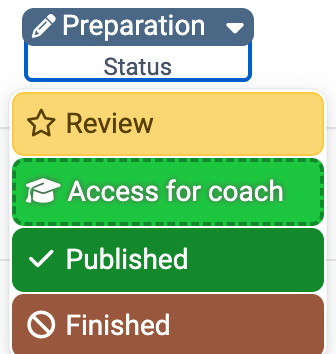
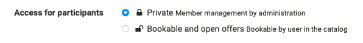
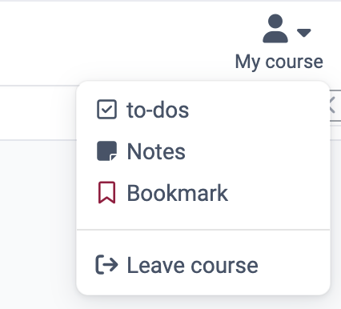
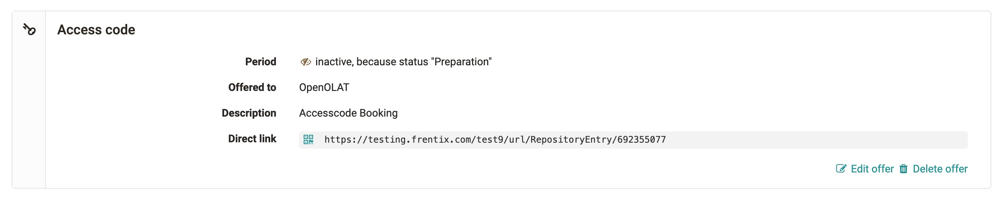
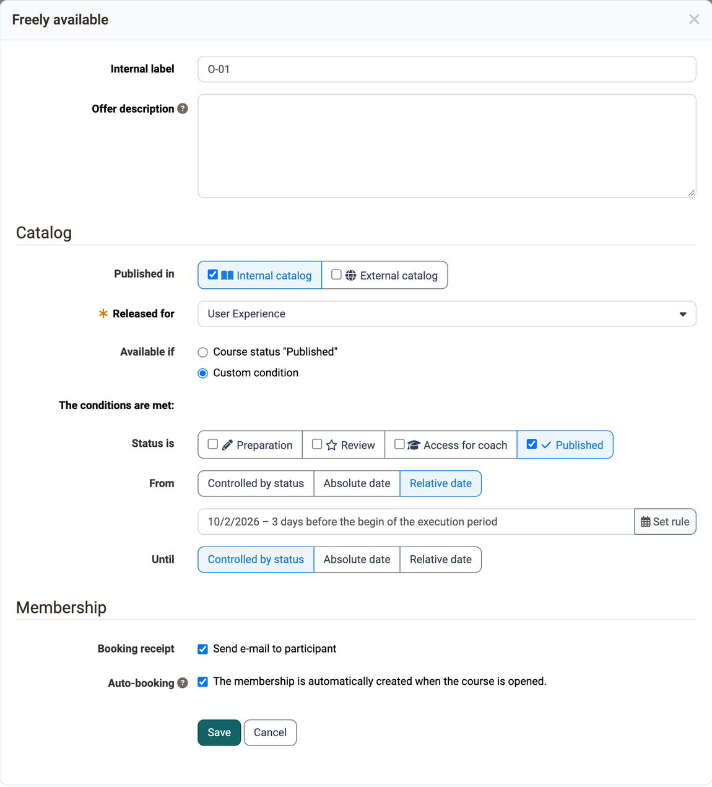
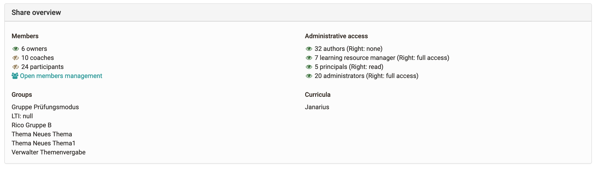
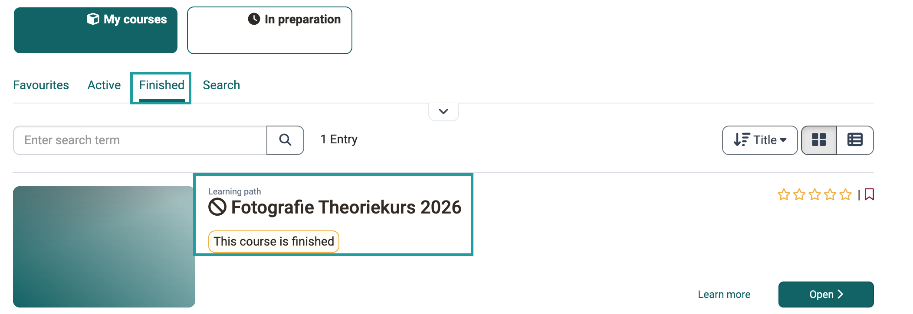

# Access configuration {: #access-configuration}

For participants to see and use a course, you publish it and set up access. The owners of the learning resource define both: the publication status in the menu "Status" of the toolbar, the access in the tab "Share" of the settings.

## Publication status [:octicons-tag-16:{ title="from Release 13.0 (OO-3584)" }](https://track.frentix.com/issue/OO-3584){:target="_blank"}

A newly created learning resource has the publication status "Preparation" and is only accessible to its owners. In the menu "Status" of the toolbar, you change the status and make the learning resource accessible to further persons:

{ class="thumbnail lightbox" title="Status menu of a learning resource" }

Publication status | Access |
---|---|
Preparation | Only owners of this learning resource have access. |
Review | Only owners of this learning resource have access. All preparations for this learning resource are completed and the contents are released for further review. |
Access for coach | Owners and coaches of this learning resource have access. |
Published | All members of the learning resource have access. The course is listed under "Courses" in the tab "Active". |
Finished | The type of access for members depends on the configured setting of the status "Finished": "Read-only" or "No access". |

!!! info "Important"

    If a course has the status "Preparation", "Review" or "Access for coach", it appears under `Courses > In preparation`. However, participants can only open it after publication, and the toolbar also remains closed to them until then.

You define who may use a learning resource in the tab "Share". The following sections describe the options.

## Tab Share

### Configure offer types and create offers

Whether participants book a course themselves or are enrolled by you, you decide under "Access for participants": 
`Course > Administration > Settings > Tab "Share"`

{ class="shadow lightbox" title="Share tab of the course settings" }

With "Private", owners or persons with the right of members management enter the participants themselves.

With "Bookable and open offers", participants book the course or the learning resource themselves. Depending on the offer, they enter an access code for this.

[Details on the tab "Share" >](../learningresources/Course_Settings_Share.md)

### Leaving a learning resource {: #leave_learning_resource}

Anyone who has taken a course voluntarily often wants to be able to leave it on their own again. With the setting "Participants can leave" in the tab "Share", you define whether and when participants may do so. The setting appears with the usage "Standalone", see [Course settings - Tab Share](Course_Settings_Share.md#sections_by_usage). The following options are available:

* "At any time": Participants can leave the course at any time.
* "After course end date or status "Finished"": If an execution period has been set, participants may leave the course after this period has ended. Regardless of this, they may leave the course as soon as it has the status "Finished". Without an execution period, leaving is therefore only possible in the status "Finished". For other learning resources, the option is called "Status "Finished"". [:octicons-tag-16:{ title="from Release 20.3 (OO-9272)" }](https://track.frentix.com/issue/OO-9272)
* "Never": Participants cannot leave the course on their own. If necessary, the owners remove them.

Which option is preset for new learning resources is defined by the system administration in the [Module Learning resource](../../manual_admin/administration/Modules_Learning_Resource.md#allow_leaving_courses). Without its own default, it is "At any time".

If participants may leave the course, they select the entry "Leave course" in the menu "My course" of the course toolbar. The info page offers the same way with the button "Leave Course" in the box "My course", see [General Functions: Info Page](General_Functions_Infopage.md#my_course).

{ class="shadow lightbox" title="Menu My course in the course toolbar · 2026.10.20" }

### Administrative release

In the section "Administrative release", you select the organisation or sub-organisation for which the course is released to the administrative roles. These include other authors (depending on rights), learning resource managers, principals and administrators. The section only exists if the module Organisations is switched on.

In addition, you define in the tab "Share" which rights other authors have to the learning resource. These rights apply to all authors of the OpenOlat instance. With these rights, other authors see the learning resource as soon as it is no longer in the status "Preparation".

Authors can | Description
:-----|:------------------
reference | Learning resources such as glossary, form, video or test can be embedded in courses of other authors. Complete courses can also be embedded in groups.
copy | The learning resource can be copied by all other authors and thus reused and also modified in the copied variant.
export | The learning resource is released for download by all other authors and can also be imported back into OpenOlat.

!!! warning "Attention"

    The options "reference" and "copy" are suitable if you want to provide a learning resource to other authors as a template or good example. For courses, referencing is rarely useful, so avoid it there.

    Each of these releases applies to all other authors of the OpenOlat instance. Therefore check beforehand whether you really want this.

## Offer / Create offers {: #offer}

If participants are to book a course themselves, you create an offer for this. This is possible as soon as you have selected the option "Bookable and open offers" under "Access for participants".

{ class="shadow lightbox" title="Section Offer in the Share tab" }

Offers are visible in the catalog independently of the publication status of the course, as soon as their availability allows it (see below, section "Manage offer availability"). Offers can also be restricted to individual organisations or sub-organisations.

An offer defines who can book the course or the learning resource under which conditions. Booking stands for enrolling, registering or purchasing.

Click "Add offer" and choose the type of offer.

!!! info "Important"

    You can only set up access for OpenOlat guests (persons without an OpenOlat account) in conventional courses.

### Offer options

{ class="size24" } **Access code**

With "Access code", you restrict the booking to a specific group of persons. Only those who know the code can book the learning resource. The owners distribute the code outside OpenOlat, for example in advance by e-mail or on the board at blended learning events. The booking person enters the code once, before opening the course for the first time.

{ class="size24" } **Freely available**

Select this option if no further restrictions apply. All OpenOlat users can book and use the learning resource. The booking person becomes a participant of the learning resource. If "Auto-booking" is switched on, OpenOlat takes the person directly into the course without them booking explicitly in the booking dialog. Unlike with "Without booking", the owners see who has booked the course.

{ class="size24" } **PayPal Checkout**

With "PayPal Checkout", the booking is subject to a fee. You define an amount that the booking person pays with a PayPal account or a credit card (Visa/Mastercard). The option only appears if administrators have [set it up](../../manual_admin/administration/Payment_PayPal.md) in the system administration. Only persons with the role author, learning resource manager or administrator can create an offer with "PayPal Checkout". Owners without one of these roles do not see the option.

{ class="size24" } **Without booking**

With this offer, you publish a course that all OpenOlat users can access without appearing in the members management.

{ class="size24" } **Guest access**

In the conventional course, you can create an offer for guests only. It then only applies to guests and cannot be restricted to sub-organisations. This way you release learning resources also to persons completely without an OpenOlat account.

### Details on the offer configuration

An offer can be limited in time: under "Available if", select the option "Custom condition" and set a date under "From", "Until" or both, see [Manage offer availability](#offer_availability). Without a date, availability depends only on the status. You can adjust offers at any time afterwards.

You can also set up several offers. The booking person then chooses between them, so make sure the descriptions are meaningful. For example, you combine access codes for persons from different contexts, or you make a course freely available until a certain date and only accessible with an access code afterwards.

!!! warning "Attention"

    A date under "From" or "Until" only limits the booking, not the execution period of the learning resource. Anyone who has booked a learning resource is on the list of participants. From that point on, this list alone decides whether the person has access.

    An expired offer therefore does not change an existing participation. As the owner, you can add persons to the list of participants or remove them from it at any time. A removed person can enter again by booking again.

You can delete offers at any time. Booking orders already created remain unaffected.

### Manage offer availability [:octicons-tag-16:{ title="from Release 21.0 (OO-9304)" }](https://track.frentix.com/issue/OO-9304) {: #offer_availability}

You set the availability in the offer itself. Click "Add offer" and choose the type of offer, or open an existing offer.

At the top you find the field "Internal label". The name is only visible internally and helps you tell several offers of the same learning resource apart. Below it, the offer is divided into the sections "Catalog" (publication, sharing and availability) and "Membership" (booking receipt and auto-booking).

In the section "Catalog", the setting "Available if" defines when the offer can be booked. The following options are available:

* **Course status "Published"** (default): The offer can be booked as soon as the course has the status "Published".
* **"Custom condition"**: You define the conditions yourself.

With the custom condition, these fields appear under "The conditions are met:":

* **"Status is":** the statuses in which the offer should be bookable. For a course, "Preparation", "Review", "Access for coach" and "Published" are available, and several at the same time are possible.
* **"From" / "Until":** additionally narrow down the availability period. For each limit you choose a mode:
    * **"Controlled by status":** only the selected status applies, without a date limit.
    * **"Absolute date":** a fixed date.
    * **"Relative date":** a date relative to the execution period. Use "Set rule" to set the interval, for example three days before the begin of the execution period. For a relative date to take effect, the execution period of the learning resource must be set.

{ class="shadow lightbox" title="Section Catalog of an offer" }

This way an offer becomes bookable shortly before the course starts, for example, or closes automatically a few days before the course ends, without you having to maintain fixed dates.

## Share overview

Whether the sharing works as intended, you check at the end of the tab "Share". The share overview shows at a glance who has access to the course and which groups or curricula are linked to it.

{ class="shadow lightbox" title="Share overview in the Share tab" }

## Lifecycle: Finish and delete

Once a course is over, you finish it, delete it or do both.

When you finish a course, member access depends on the setting for the status "Finished": with "Read-only" the course remains accessible in read mode, with "No access" participants no longer see the content. This default is set by the system administration; it can be overridden per course in the tab "Options". [:octicons-tag-16:{ title="from Release 21.0 (OO-9298)" }](https://track.frentix.com/issue/OO-9298)

All user data is retained. In the menu item "Courses", the course is no longer in the tab "Active", but in the tab "Finished" right next to it.

{ class="shadow lightbox" title="Courses, tab Finished" }

In Authoring, OpenOlat shows the finished course crossed out and with its own icon.

If the course is to be reopened, select a different status in the "Status" menu of the course toolbar, for example "Published".

### Delete course

Under `Course > Administration > Delete` or via the action menu  in Authoring, you delete a learning resource. OpenOlat moves it to the tab "Deleted", which works like a trash.

## Further information {: #further_information}

[Course settings - Tab Share >](../learningresources/Course_Settings_Share.md) 
[Module Learning resource >](../../manual_admin/administration/Modules_Learning_Resource.md) 
[General Functions: Info Page >](../learningresources/General_Functions_Infopage.md) 
[PayPal Configuration >](../../manual_admin/administration/Payment_PayPal.md) 
[Toolbar: My Course >](../learningresources/Toolbar_My_Course.md) 
[Catalog 2.0 - Offers >](../area_modules/catalog2.0_angebote.md) 
[Members management >](../learningresources/Members_management.md)

[To the top of the page ^](#access-configuration)
