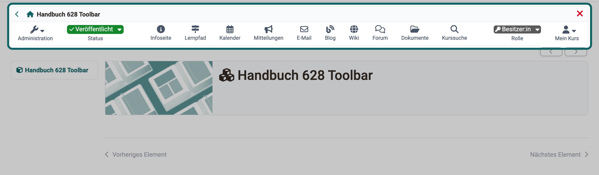
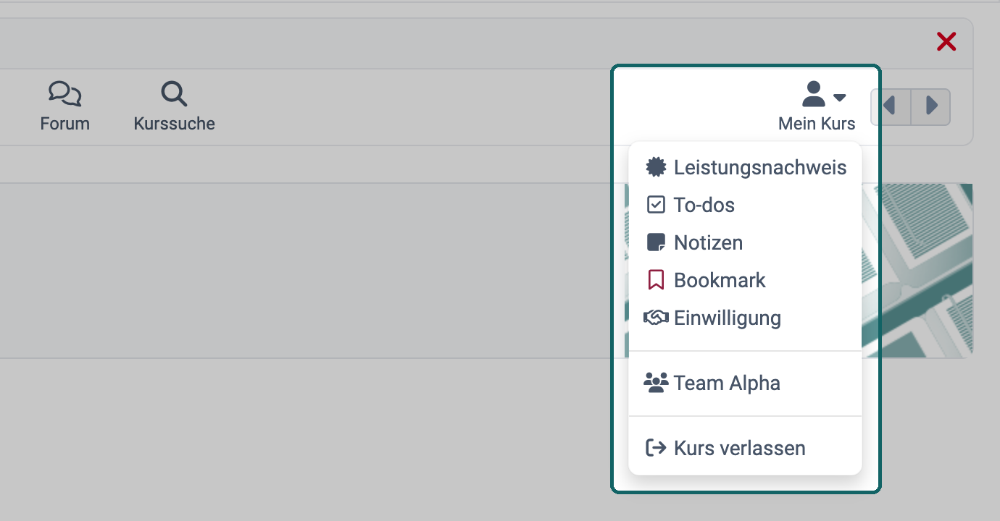
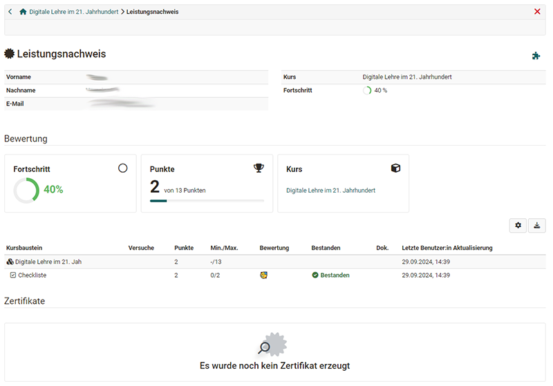

# Zusätzliche Kursfunktionen

{ class="shadow lightbox" title="Toolbar eines Kurses · 2026.10.27" }

In der Toolbar eines Kurses stehen Teilnehmenden eine Reihe von weiteren Kursfunktionen zur Verfügung. Einige Elemente wie ["Infoseite"](../learningresources/Info_page.de.md), "Mein Kurs" oder der Bereich "Lernpfad" (bei Lernpfadkursen) werden automatisch angelegt. Auch das Element "Termine" erscheint automatisch in der Toolbar, wenn die ["Termine und Absenzen"](../learningresources/Events_and_absences.de.md) im Kurs aktiviert sind.

Andere Werkzeuge aktivieren Kursbesitzer:innen zusätzlich unter `Kurs > Administration > Einstellungen > Tab "Toolbar"`. Weitere Infos zu diesen aktivierbaren Werkzeugen finden Sie auf der separaten Seite ["Einsatz weiterer Kursfunktionen der Toolbar"](../learningresources/Using_Additional_Course_Features.de.md).

## Menü "Mein Kurs"

Das Dropdown-Menü "Mein Kurs" der Toolbar bietet Zugriff auf personalisierte Bestandteile des Kurses.

{ class="shadow lightbox" title="Menü Mein Kurs in der Toolbar · 2026.10.29" }

Abhängig von der Konfiguration des Kurses werden eventuell nicht alle der folgenden Einträge angezeigt.

* **Leistungsnachweis**: Zeigt Ihre Bewertungen im Kurs und gibt, sofern aktiviert, Zugriff auf das [Zertifikat](../learningresources/Course_Settings_Assessment.de.md#section_certificate) des Kurses.
* **To-dos**: Zeigt die aktuellen To-dos des Kurses.
* **Notizen**: Hier können Sie kursspezifische Notizen eintragen, die nur Sie als Kursteilnehmer:in lesen können.
* **Bookmark**: Aktivieren Sie den Bookmark, dann erscheint der Kurs im Menü "Kurse" im Tab "Favoriten".
* **Einwilligung**: Sollte es im Kurs bestimmte Nutzungsbedingungen und/oder eine kursbezogene Datenschutzerklärung geben, denen Sie zugestimmt haben, können Sie diese hier einsehen und auch die Einwilligung widerrufen.
* **Gruppen**: Hier sehen Sie alle kursspezifischen Gruppen in denen Sie Mitglied sind und können direkt dorthin navigieren.
* **Kurs verlassen**: Hier tragen Sie sich aus dem Kurs aus.

### Leistungsnachweis

Ein Leistungsnachweis fasst die Resultate einer Person im Kurs zusammen. Damit Teilnehmende ihn sehen, schalten Kursbesitzer:innen unter `Kurs > Administration > Einstellungen > Tab "Bewertung"` die Option "Leistungsnachweis den Teilnehmer:innen anzeigen" ein. Teilnehmende sehen dann die bewertbaren Kursbausteine wie Tests und Aufgaben, ihre Punkte und weitere Informationen.

{ class="shadow lightbox" title="Leistungsnachweis eines Kurses" }

Falls für den Kurs ein [Zertifikat](../learningresources/Course_Settings_Assessment.de.md#section_certificate) ausgestellt wurde, finden Sie dies ebenfalls unter "Leistungsnachweis" zum Herunterladen. Betreuende des Kurses sehen die Zertifikate im Bereich [Coaching](../area_modules/Coaching.de.md).

Bei automatisch ausgestellten Zertifikaten nach erfolgreichem Abschluss eines Kurses erhalten Sie eine automatisch generierte Benachrichtigung per E-Mail.

!!! note "Alle Leistungsnachweise im Überblick"

    Leistungsnachweise und Zertifikate aus all Ihren Kursen finden Sie im persönlichen Menü unter ["Leistungsnachweise"](../personal_menu/Personal_Tools.de.md#evidences_of_achievement).

### To-dos [:octicons-tag-16:{ title="ab Release 18.2 (OO-7039)" }](https://track.frentix.com/issue/OO-7039)
Hier sehen Teilnehmende alle To-dos des Kurses, die sie betreffen.
Das können zum einen automatisch erzeugte To-dos aus den [Aufgaben-Kursbausteinen](../learningresources/Course_Element_Task.de.md) sein. Sie fordern dazu auf, einen bestimmten Schritt der Aufgabe zu erledigen, z.B. eine Aufgabe auszuwählen oder eine Lösung abzugeben.
Zum anderen können Kursbesitzer:innen und Betreuer:innen allen Teilnehmenden oder einzelnen Personen bestimmte To-dos zuweisen. Teilnehmende ändern den Status eines To-dos, wenn sie die Aktion erledigt haben.

Die To-dos dienen den Teilnehmenden als Orientierung, was aktuell im Kurs zu tun ist.
Einen Überblick über alle persönlichen und kursbezogenen To-dos finden Teilnehmende im Bereich ["Persönliche Werkzeuge"](../personal_menu/To-Dos.de.md). Dort können Teilnehmende auch eigene To-dos erstellen.

### Kurs verlassen [:octicons-tag-16:{ title="ab Release 10.2 (OO-1405)" }](https://track.frentix.com/issue/OO-1405)

Die "Kurs verlassen" Funktion beendet sofort Ihre Kurs- oder Gruppenmitgliedschaft, abhängig davon auf welche Weise Sie Zugriff zum Kurs haben. Im Anschluss daran haben Sie keinen Zugriff mehr auf den Kurs und müssen die Betreuer:innen des Kurses oder der Gruppe kontaktieren, um wieder Zugriff zu erhalten.

Die Möglichkeit, sich aus einem Kurs auszutragen, schalten Kursbesitzer:innen vorher ein unter: 
`Kurs > Administration > Einstellungen > Tab "Freigabe"`

Sie gilt nur für Teilnehmende, nicht für Betreuer:innen oder Besitzer:innen.

## Lernpfad der Toolbar [:octicons-tag-16:{ title="ab Release 15.0 (OO-4300)" }](https://track.frentix.com/issue/OO-4300)
Über das Lernpfad-Icon in der Toolbar erhalten Teilnehmende einen Überblick über ihren Fortschritt in allen Kursbausteinen. Je nach gewählten Spalten zeigt die Tabelle ausserdem Informationen wie die Art der Durchführung und Termine. So behalten Teilnehmende ihre Aktivitäten im Kurs im Blick.

{ class="shadow lightbox" title="Lernpfad aus Sicht der Teilnehmer:in" }

Kursbesitzer:innen und Betreuende erhalten über den Link "Lernpfad" zunächst eine Übersicht über alle Teilnehmenden und können dann eine Person auswählen, um ihren Lernfortschritt zu sehen.

## Weitere aktivierbare Werkzeuge der Toolbar im Kurzüberblick [:octicons-tag-16:{ title="ab Release 15.0 (OO-4168)" }](https://track.frentix.com/issue/OO-4168)

* [Kurssuche](../basic_concepts/Search_in_Course.de.md): Durchsuchen Sie den Kurs nach Schlüsselbegriffen
* **Kurskalender**: Zugriff auf den kursspezifischen Kalender
* **Liste der Teilnehmer:innen**: Übersicht der Kursmitglieder
* **Mitteilungen**: Zentrale Kursinfos für die Kursmitglieder
* **E-Mail**: Kontaktmöglichkeit zu den Kursbesitzer:innen und Betreuer:innen
* **BigBlueButton Online-Termine**, "Teams Online-Meeting" oder "Zoom", je nach eingeschaltetem Modul: Für synchrone Meetings
* **Blog**: Zugriff auf einen zentralen Kurs-Blog
* **Wiki**: Zugriff auf ein zentrales Wiki für den Kurs
* **Forum**: Zugriff auf ein zentrales Kurs-Forum
* **Dokumente**: Zugriff auf einen zentralen Ordner für Dokumente
* **Glossar**: Zugriff auf das Glossar des Kurses, sofern ein Glossar mit dem Kurs verbunden wurde
* [Kurs-Chat](../basic_concepts/Chat.de.md): Für den synchronen Austausch der Kurs-Mitglieder
* [Externe Kurstools](../learningresources/Course_Settings_Toolbar.de.md#external_tools): Bis zu vier konfigurierbare Links zu externen Webanwendungen

Weitere Informationen zu den Werkzeugen finden Sie unter ["Einsatz weiterer Kursfunktionen der Toolbar"](../learningresources/Using_Additional_Course_Features.de.md).

## Weiterführende Informationen {: #further_information}

**Auf dieser Seite erwähnt** 
[Toolbar: Infoseite >](../learningresources/Info_page.de.md) 
[Termine und Absenzen >](../learningresources/Events_and_absences.de.md) 
[Einsatz weiterer Kursfunktionen der Toolbar >](../learningresources/Using_Additional_Course_Features.de.md) 
[Kurseinstellungen - Tab Bewertung >](../learningresources/Course_Settings_Assessment.de.md) 
[Coaching - Übersicht >](../area_modules/Coaching.de.md) 
[Persönliche Werkzeuge >](../personal_menu/Personal_Tools.de.md) 
[Kursbaustein "Aufgabe" >](../learningresources/Course_Element_Task.de.md) 
[Persönliche Werkzeuge: To-dos >](../personal_menu/To-Dos.de.md) 
[Suche in einem Kurs >](../basic_concepts/Search_in_Course.de.md) 
[Chat >](../basic_concepts/Chat.de.md) 
[Kurseinstellungen - Tab Toolbar >](../learningresources/Course_Settings_Toolbar.de.md)

**Weiterführend** 
[Toolbar: Mein Kurs >](../learningresources/Toolbar_My_Course.de.md) 
[Kurs-Administration: Übersicht >](../learningresources/Administration.de.md) 
[Toolbar: Termine >](../learningresources/Toolbar_Events.de.md) 
[Toolbar: Übersicht >](../learningresources/Toolbar.de.md)

[Zum Seitenanfang ^](#zusatzliche-kursfunktionen)

