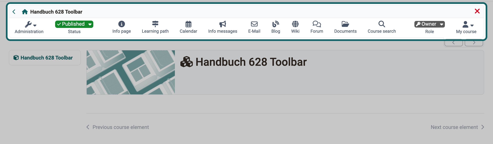
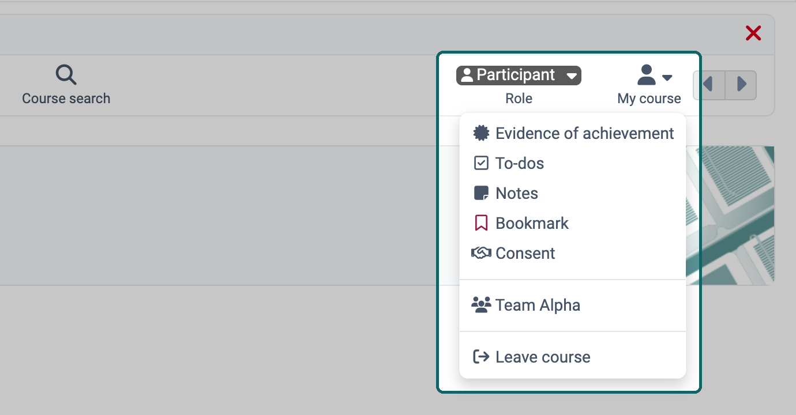
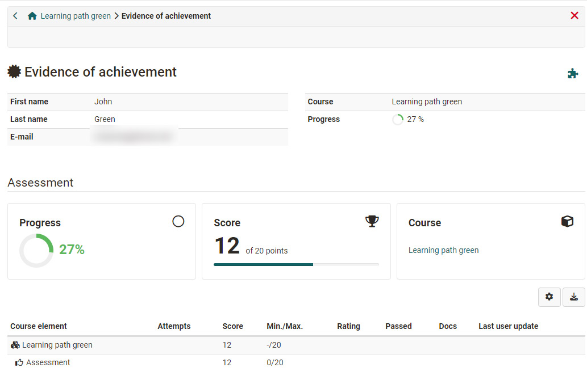

# Additional Course Features

{ class="shadow lightbox" title="Toolbar of a course · 2026.10.27" }

In the toolbar of a course, participants have a number of additional course functions at their disposal. Some elements, such as ["Info page"](../learningresources/Info_page.md), "My course" or the "Learning path" area (for learning path courses), are added automatically. The "Events" element also appears automatically in the toolbar once ["Events and absences"](../learningresources/Events_and_absences.md) has been activated in the course.

Course owners activate other tools additionally under `Course > Administration > Settings > Tab "Toolbar"`. For more information on these activatable tools, see the separate page ["Using Additional Course Features"](../learningresources/Using_Additional_Course_Features.md).

## Menu "My course"

The drop-down menu "My course" in the toolbar provides access to personalized parts of the course.

{ class="shadow lightbox" title="Menu My course in the toolbar · 2026.10.29" }

Depending on the configuration of the course, not all of the following entries may be displayed.

* **Evidence of achievement**: Shows your assessments in the course and, if activated, gives access to the course [certificate](../learningresources/Course_Settings_Assessment.md#section_certificate).
* **To-dos**: Shows the current to-dos of the course.
* **Notes**: Here you can enter course-specific notes that only you as a course participant can read.
* **Bookmark**: Activate the bookmark, and the course appears in the "Courses" menu under the "Favourites" tab.
* **Consent**: If there are specific terms of use and/or a course-related privacy policy in the course that you have agreed to, you can view them here and also revoke your consent.
* **Groups**: Here you see all course-specific groups you are a member of and can navigate directly to them.
* **Leave course**: Here you remove yourself from the course.

### Evidence of Achievement

An evidence of achievement summarises the results of a person in the course. For participants to see it, course owners switch on the option "Show evidence of achievement to participants" under `Course > Administration > Settings > Tab "Assessment"`. Participants then see the assessable course elements such as tests and tasks, their points and further information.

{ class="shadow lightbox" title="Evidence of achievement of a course" }

If a [certificate](../learningresources/Course_Settings_Assessment.md#section_certificate) has been issued for the course, you will also find it under "Evidence of achievement" for download. Coaches of the course see the certificates in the [Coaching](../area_modules/Coaching.md) area.

For certificates issued automatically after successfully completing a course, you receive an automatically generated notification by e-mail.

!!! note "All evidences of achievement at a glance"

    Evidences of achievement and certificates from all your courses can be found in the personal menu under ["Evidence of achievement"](../personal_menu/Personal_Tools.md#evidences_of_achievement).

### To-dos [:octicons-tag-16:{ title="from Release 18.2 (OO-7039)" }](https://track.frentix.com/issue/OO-7039)
Here participants see all to-dos of the course that concern them.
On the one hand, these can be to-dos generated automatically from the [task course elements](../learningresources/Course_Element_Task.md). They ask you to complete a certain step of the task, for example select a task or submit a solution.
On the other hand, course owners and coaches can assign specific to-dos to all participants or to individual persons. Participants change the status of a to-do once they have completed the action.

The to-dos serve participants as an orientation for what currently needs to be done in the course.
Participants find an overview of all personal and course-related to-dos in the ["User tools"](../personal_menu/To-Dos.md) area. There, participants can also create their own to-dos.

### Leave course [:octicons-tag-16:{ title="from Release 10.2 (OO-1405)" }](https://track.frentix.com/issue/OO-1405)

The "Leave course" function immediately ends your course or group membership, depending on how you have access to the course. After that, you no longer have access to the course and must contact the coaches of the course or group to regain access.

Course owners switch on the option to leave a course beforehand under: 
`Course > Administration > Settings > Tab "Share"`

It only applies to participants, not to coaches or owners.

## Learning path in the toolbar [:octicons-tag-16:{ title="from Release 15.0 (OO-4300)" }](https://track.frentix.com/issue/OO-4300)
Via the learning path icon in the toolbar, participants get an overview of their progress in all course elements. Depending on the columns selected, the table also shows information such as the type of implementation and dates. This way, participants keep track of their activities in the course.

{ class="shadow lightbox" title="Learning path from the participant's view" }

Course owners and coaches first get an overview of all participants via the "Learning path" link and can then select a person to see their learning progress.

## Other activatable toolbar tools at a glance [:octicons-tag-16:{ title="from Release 15.0 (OO-4168)" }](https://track.frentix.com/issue/OO-4168)

* [Course search](../basic_concepts/Search_in_Course.md): Search the course by keywords
* **Course calendar**: Access to the course-specific calendar
* **Participant list**: Overview of the course members
* **Info messages**: Central course information for the course members
* **E-mail**: Contact option for the course owners and coaches
* **BigBlueButton online meetings**, "Teams Online-Meeting" or "Zoom", depending on the module switched on: For synchronous meetings
* **Blog**: Access to a central course blog
* **Wiki**: Access to a central wiki for the course
* **Forum**: Access to a central course forum
* **Documents**: Access to a central folder for documents
* **Glossary**: Access to the course glossary, if a glossary has been linked to the course
* [Course chat](../basic_concepts/Chat.md): For the synchronous exchange of course members
* [External course tools](../learningresources/Course_Settings_Toolbar.md#external_tools): Up to four configurable links to external web applications

Further information on the tools can be found under ["Using Additional Course Features"](../learningresources/Using_Additional_Course_Features.md).

## Further information {: #further_information}

**Mentioned on this page** 
[Toolbar: Info page >](../learningresources/Info_page.md) 
[Events and absences >](../learningresources/Events_and_absences.md) 
[Using Additional Course Features >](../learningresources/Using_Additional_Course_Features.md) 
[Course Settings - Tab Assessment >](../learningresources/Course_Settings_Assessment.md) 
[Coaching - Overview >](../area_modules/Coaching.md) 
[User tools >](../personal_menu/Personal_Tools.md) 
[Course Element "Task" >](../learningresources/Course_Element_Task.md) 
[User tools: To-dos >](../personal_menu/To-Dos.md) 
[Search in a course >](../basic_concepts/Search_in_Course.md) 
[Chat >](../basic_concepts/Chat.md) 
[Course Settings - Tab Toolbar >](../learningresources/Course_Settings_Toolbar.md)

**Further reading** 
[Toolbar: My Course >](../learningresources/Toolbar_My_Course.md) 
[Course Administration: Overview >](../learningresources/Administration.md) 
[Toolbar: Events >](../learningresources/Toolbar_Events.md) 
[Toolbar: Overview >](../learningresources/Toolbar.md)

[To the top of the page ^](#additional-course-features)
