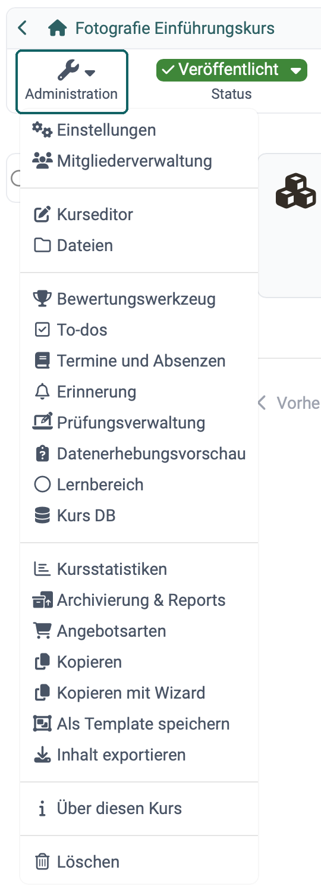
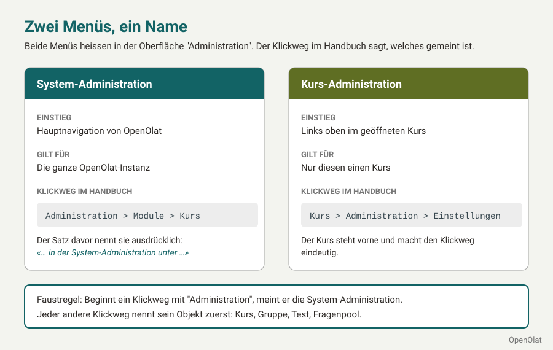

# Kurs-Administration: Übersicht {: #course_administration}

{ class="shadow lightbox aside-left-lg" }

:octicons-device-camera-video-24: **Video-Einführung**: [Admin-Funktionen](<https://www.youtube.com/embed/rWPcz6udUrI>){:target="_blank"}

Sind Sie Besitzer:in eines Kurses, zeigt OpenOlat Ihnen links oben den Button "Administration". Dort finden Sie alle Optionen zur Bearbeitung, Konfiguration und Administration des Kurses, vor und während seiner Nutzung. Dieselben Optionen sehen Administrator:innen und Lernressourcenverwalter:innen der Organisation, der der Kurs angehört. Zu den wichtigsten zählen der [Kurseditor](../General_Configuration_of_Course_Elements.de.md) und die [Einstellungen](../Course_Settings/index.de.md).

Betreuer:innen steht der Button "Administration" ebenfalls zur Verfügung. Sie sehen dort weniger Optionen, nur die für Betreuer:innen relevanten, zum Beispiel das [Bewertungswerkzeug](../Assessment_tool_overview/index.de.md). Personen, denen im [Bereich "Rechte" der Mitgliederverwaltung](../Members_management.de.md#section_rights) einzelne Rechte erteilt wurden, sehen die Optionen zu diesen Rechten.

!!! info "Wichtig"

    Manche Optionen stehen nur zur Verfügung, wenn das entsprechende Feature aktiviert ist. Wenden Sie sich gegebenenfalls an die Administrator:innen Ihrer Organisation.

Andere Lernressourcen verfügen ebenfalls über das Menü "Administration", jedoch sind die Menüoptionen dort nicht so umfangreich. Sie variieren je nach Lernressource.

Wozu jeder Menüpunkt dient und wo er beschrieben ist, zeigt der Abschnitt [Menüpunkte](#menu_items).

## Kurs-Administration und System-Administration {: #course_vs_system_administration}

In OpenOlat heissen zwei Menüs "Administration": das Menü in einem geöffneten Kurs und der Menüpunkt in der Hauptnavigation. Steht in einer Anleitung nur "Administration", ist deshalb nicht sofort klar, wo Sie suchen. Kennen Sie den Unterschied, finden Sie eine Einstellung auf Anhieb und wissen, ob eine Änderung nur einen Kurs betrifft oder die ganze OpenOlat-Instanz.

{ class="shadow lightbox" title="Zwei Menüs namens Administration · 2026.11.12" }

Die Kurs-Administration öffnen Sie im Kurs links oben mit dem Button "Administration". Alles, was Sie dort ändern, gilt nur für diesen einen Kurs: Sie verwalten zum Beispiel die Mitglieder, bauen den Kurs im Kurseditor auf oder legen unter `Kurs > Administration > Einstellungen` seine Einstellungen fest.

Welche Menüpunkte Sie sehen, hängt von Ihrer Rolle und Ihren Rechten im Kurs ab: Besitzer:innen sehen alle, Betreuer:innen weniger, Personen mit einzelnen Rechten aus der Mitgliederverwaltung die Menüpunkte zu diesen Rechten. Zwei Personen im selben Kurs sehen deshalb verschiedene Menüpunkte, wenn ihre Rollen oder Rechte verschieden sind. Den Button "Administration" zeigt OpenOlat, sobald Ihre Rolle oder ein Recht mindestens einen Menüpunkt freigibt. Den Menüpunkt "Einstellungen" sehen Besitzer:innen und Personen mit dem Recht "Kurseditor". Rechte erteilen die Besitzer:innen im [Bereich "Rechte" der Mitgliederverwaltung](../Members_management.de.md#section_rights).

Die System-Administration erreichen Systemadministrator:innen über den Menüpunkt "Administration" in der Hauptnavigation; nur sie sehen diesen Menüpunkt. Was sie dort einstellen, gilt für die ganze OpenOlat-Instanz und damit für alle Kurse. So schalten sie zum Beispiel unter `Administration > Module` die [Module](../../../manual_admin/administration/Modules/index.de.md) ein und legen unter `Administration > Module > Kurs` die [Standardeinstellungen](../../../manual_admin/administration/Modules_Course.de.md#default_settings) fest, mit denen neue Kurse starten. Brauchen Sie eine Funktion, die nur die System-Administration einschalten kann, wenden Sie sich an Ihre Organisation.

Im Handbuch erkennen Sie am Klickweg, welches Menü gemeint ist. Ein Klickweg in die Kurs-Administration beginnt mit dem Kurs: `Kurs > Administration > Einstellungen`. Ein Klickweg in die System-Administration beginnt mit "Administration", und der Satz davor nennt die System-Administration, zum Beispiel: in der System-Administration unter `Administration > Module > Kurs`. Andere Lernressourcen haben ein eigenes Menü "Administration", ihr Klickweg beginnt mit der Lernressource, zum Beispiel `Test > Administration > Einstellungen`.

[Zum Seitenanfang ^](#course_administration)

---

## Menüpunkte {: #menu_items}

Suchen Sie einen Menüpunkt, sagt Ihnen die Übersicht in einem Satz, wozu er dient, und führt Sie mit dem Link zu seiner Beschreibung. Die Tabellen folgen dem Menü "Administration": Jede Tabelle entspricht einer Gruppe, die das Menü mit einer Linie abtrennt, in derselben Reihenfolge wie dort. Im Menü tragen die Gruppen keinen Titel; die Titel über den Tabellen sagen, wozu die Menüpunkte einer Gruppe dienen.

**Kurs einrichten und Mitglieder verwalten**

| Menüpunkt | Wozu |
|---|---|
| [Einstellungen](../Course_Settings/index.de.md) | Alles festlegen, was den Kurs als Ganzes betrifft. Einstellungen eines einzelnen Kursbausteins legen Sie im Kurseditor fest. |
| [Mitgliederverwaltung](../Members_management.de.md) | Sehen, wer Zugriff auf den Kurs hat, und weitere Personen und Gruppen zu Mitgliedern machen. |

**Inhalte aufbauen**

| Menüpunkt | Wozu |
|---|---|
| [Kurseditor](../General_Configuration_of_Course_Elements.de.md) | Den Kurs aufbauen: Kursbausteine hinzufügen und konfigurieren. |
| [Dateien](../Storage_folder.de.md) | Den Ablageordner des Kurses öffnen und den Speicherverbrauch des Kurses prüfen. Dateien, die Sie mit anderen teilen, verwalten Sie im [File Hub](../../personal_menu/File_Hub.de.md) oder im [Media Center](../../personal_menu/Media_Center.de.md). |

**Kurs durchführen und Teilnehmende betreuen**

| Menüpunkt | Wozu |
|---|---|
| [Bewertungswerkzeug](../Assessment_tool_overview/index.de.md) | Die Teilnehmenden in allen bewertbaren Kursbausteinen bewerten, zum Beispiel mit Punkten oder bestanden/nicht bestanden, und ihnen Feedback geben. Nicht zu verwechseln mit dem Kursbaustein "Bewertung". |
| [To-dos](../Course_todos.de.md) | To-dos zum Kurs erstellen und an alle Teilnehmenden oder an einzelne Personen vergeben. |
| [Badges](../OpenBadges.de.md) | Badges des Kurses erstellen, vergeben und anzeigen. Ein Badge ist ein digitales Lernabzeichen für ein erreichtes Ziel. Der Menüpunkt erscheint, wenn Badges in OpenOlat eingeschaltet sind und der Kurs Badges vergibt. |
| [Unterlagen Betreuer:innen](../Coach_Files.de.md) | Dateien in einem gemeinsamen Ordner ablegen, auf den nur Betreuer:innen und Besitzer:innen zugreifen. Den Ordner schalten Sie in den Kurseinstellungen im [Tab "Optionen"](../Course_Settings_Options.de.md) ein. |
| [Termine und Absenzen](../Events_and_absences.de.md) | Termine und Absenzen der Teilnehmenden verwalten. |
| [Erinnerung](../Course_Reminders.de.md) | E-Mails an Personen im Kurs automatisch versenden, sobald Bedingungen zutreffen, die Sie festlegen. |
| [Prüfungsverwaltung](../Assessment_Management/index.de.md) | Den Prüfungsmodus und die Prüfungseinsicht konfigurieren. Im Prüfungsmodus öffnen Teilnehmende zum Beispiel nur bestimmte Kursbausteine. |
| [Datenerhebungsvorschau](../../../manual_admin/administration/Modules_Quality_Management.de.md) | Einsehen, welche Datenerhebungen, etwa Befragungen, das Qualitätsmanagement zum Kurs plant. Planen und bearbeiten können sie nur Qualitätsverwalter:innen. Den Menüpunkt zeigt OpenOlat, wenn Systemadministrator:innen das Qualitätsmanagement und seine Datenerhebungsvorschau eingeschaltet haben. |
| [Lernbereich](../Learning_Areas.de.md) | Lernbereiche erstellen und bearbeiten. Ein Lernbereich fasst mehrere Gruppen des Kurses zusammen. |
| [Kurs DB](#course_DB) | Angaben einzelner Personen speichern, die kein Kursbaustein erfasst. Beschrieben weiter unten auf dieser Seite. |

**Auswerten, sichern und weiterverwenden**

| Menüpunkt | Wozu |
|---|---|
| [Kursstatistiken](../Statistics_Course.de.md) | Die Zugriffe auf den Kurs auswerten. Betreuer:innen und weitere Mitglieder brauchen dafür das Recht "Statistiken". |
| [Teststatistiken](../Statistics_Test.de.md) | Die Tests des Kurses anonymisiert auswerten. Der Menüpunkt erscheint, sobald der Kurs einen Kursbaustein "Test" enthält. Betreuer:innen sehen ihn ohne zusätzliches Recht. |
| [Fragebogen Statistiken](../Statistics_Survey.de.md) | Die Umfragen des Kurses anonymisiert auswerten. Der Menüpunkt erscheint, sobald der Kurs einen Kursbaustein "Umfrage" enthält. Betreuer:innen sehen ihn ohne zusätzliches Recht. |
| [Archivierung & Reports](../Course_Archiving/index.de.md) | Die Daten des Kurses als Gesamtarchiv oder Teilarchiv sichern und Reports herunterladen, etwa die Kursresultate und die Mitgliedschaften. |
| [Angebotsarten](../Offer_Types.de.md) | Die Buchungsaufträge einsehen, also wer den Kurs über welches Angebot gebucht hat. Ein Angebot legt fest, wie Personen den Kurs im Katalog buchen, etwa "Frei verfügbar" oder mit "Zugangscode". Angebote erstellen Sie in den Kurseinstellungen im [Tab "Freigabe"](../Course_Settings_Share/index.de.md). |
| [Kopieren](../Course_Copy.de.md) | Den Kurs mit Struktur, Ordnerinhalten, HTML-Seiten und Gruppennamen kopieren. Benutzerdaten wie Forenbeiträge und Gruppenmitglieder bleiben im Original. |
| [Kopieren mit Wizard](../Course_Copy_Wizard.de.md) | Beim Kopieren auswählen, welche Elemente die Kopie übernimmt. Der Menüpunkt erscheint nur in [Lernpfadkursen](../Learning_path_course/index.de.md). |
| [Als Template speichern](../Course_Copy_Template.de.md) | Den Kurs als Template speichern: als Vorlage, aus der Sie mit "Als Kurs instanziieren" neue Kurse erstellen, etwa für die Durchführungen im Course Planner. |
| [Als Kurs instanziieren](#instantiate_as_course) | Aus einem Template einen neuen Kurs erstellen. Beschrieben weiter unten auf dieser Seite. |
| [Als Lernpfad duplizieren](#duplicate_as_learning_path) | Einen herkömmlichen Kurs als Lernpfadkurs kopieren. Beschrieben weiter unten auf dieser Seite. |
| [Inhalt exportieren](../Export_Content.de.md) | Den Kurs als ZIP-Datei herunterladen, als Sicherungskopie oder für den Import in eine andere OpenOlat-Instanz. |

**Angaben zum Kurs nachschlagen**

| Menüpunkt | Wozu |
|---|---|
| [Über diesen Kurs](../Technical_Information_on_Resources_and_Usage.de.md) | Nachschlagen, welche ID der Kurs hat, wer ihn erstellt hat und wem er gehört, dazu den externen Link und die Produkte im Course Planner, in denen der Kurs eingebunden ist. Den Menüpunkt sehen Besitzer:innen des Kurses, Lernressourcenverwalter:innen und Administrator:innen. |

**Kurs löschen**

| Menüpunkt | Wozu |
|---|---|
| [Löschen](../Course_Delete.de.md) | Den Kurs in den Papierkorb verschieben. Dabei entfernt OpenOlat alle Benutzerdaten. Liegt der Kurs im Papierkorb, steht an dieser Stelle der Menüpunkt "Wiederherstellen". |

[Zum Seitenanfang ^](#course_administration)

## Kurs DB {: #course_DB}

Soll ein Kurs Angaben einzelner Personen speichern, die kein Kursbaustein erfasst, etwa ein Häkchen "Gelesen" oder die Antworten einer selbst gebauten Umfrage, legen Sie dafür in der Kurs DB eine Datenbank an. Eine Seite im Kurs, zum Beispiel ein Kursbaustein "HTML-Seite", schreibt und liest die Werte je Person über die REST-Schnittstelle von OpenOlat, meist per JavaScript.

Mit "Neue Datenbank erstellen" legen Sie eine Datenbank mit einem Namen an. OpenOlat zeigt dazu die URL, unter der die Seite die Werte ablegt. Mit "Exportieren" laden Sie die Werte aller Personen als Excel-Datei herunter. "Zurücksetzen" leert die Datenbank, "Löschen" entfernt sie.

Den Menüpunkt sehen Besitzer:innen des Kurses, Lernressourcenverwalter:innen und Administrator:innen sowie Mitglieder mit dem Recht ["Kurs Datenbank"](../Members_management.de.md#right_course_db). Voraussetzung ist, dass die Kurs DB auf Ihrer OpenOlat-Instanz eingeschaltet ist. Sie ist Teil der Serverkonfiguration und im Auslieferungszustand ausgeschaltet. Für eine Aktivierung wenden Sie sich an Ihre Organisation.

[Zum Seitenanfang ^](#course_administration)

## Als Kurs instanziieren [:octicons-tag-16:{ title="ab Release 20.2 (OO-8897)" }](https://track.frentix.com/issue/OO-8897){:target="_blank"} {: #instantiate_as_course}

Haben Sie ein Template vorbereitet, erstellen Sie daraus mit diesem Menüpunkt einen neuen Kurs. Ein Wizard führt Sie durch die Erstellung.

Den Menüpunkt gibt es nur in Kursen mit dem Verwendungszweck "Template". Dort steht er an der Stelle von "Als Template speichern". Sie sehen ihn, wenn Sie den Kurs kopieren dürfen, also wenn das Menü auch "Kopieren" zeigt.

[Zu den Details >](../Creating_Course.de.md#purpose) 
[Zum Seitenanfang ^](#course_administration)

## Als Lernpfad duplizieren {: #duplicate_as_learning_path}

Wollen Sie einen herkömmlichen Kurs als Lernpfadkurs weiterführen, zum Beispiel einen Kurs, der vor OpenOlat 15 entstanden ist, erstellen Sie mit diesem Menüpunkt eine Kopie als Lernpfadkurs. Der ursprüngliche Kurs bleibt unverändert erhalten.

Im Dialog "Als Lernpfad duplizieren" geben Sie den "Titel der Lernressource" und das "Kennzeichen der Lernressource" der Kopie an und wählen das Kursdesign: "Mit Lernpfad" führt die Teilnehmenden in einer festen Reihenfolge durch den Kurs, "Mit Lernfortschritt" zeigt den Fortschritt ohne feste Reihenfolge. "Duplizieren und konvertieren" erstellt die Kopie. [:octicons-tag-16:{ title="ab Release 20.2 (OO-8967)" }](https://track.frentix.com/issue/OO-8967){:target="_blank"}

Den Menüpunkt gibt es nur in herkömmlichen Kursen. Im Menü folgt er auf "Als Template speichern", in einem Template auf "Als Kurs instanziieren". Sie sehen ihn, wenn Sie den Kurs kopieren dürfen, also wenn das Menü auch "Kopieren" zeigt. Denselben Dialog öffnen Sie in den Kurseinstellungen im [Tab "Durchführung"](../Course_Settings_Execution.de.md#course_type) mit dem Button "Als Lernpfad duplizieren".

!!! tip "Tipp"

    Wenn der Kurs lediglich in das aktuelle Format übertragen werden soll, ist in den meisten Fällen die Option "Mit Lernfortschritt" die bessere Wahl. Hier muss die Kursstruktur nicht in einer festen Reihenfolge bearbeitet werden, was der Hypermedia-Struktur des Ausgangskurses eher entspricht. Diese Einstellung kann bei Bedarf auch nachträglich im Kurseditor des kopierten Kurses am obersten Kursbaustein angepasst werden.

    Beachten Sie, dass grundsätzlich Gäste keinen Zugang zu Lernpfadkursen haben.

[Zum Seitenanfang ^](#course_administration)

## Weiterführende Informationen {: #further_information}

[Toolbar >](../Course_Settings_Toolbar.de.md) 
[Toolbar: Infoseite >](../Info_page.de.md) 
[Rollen und Rechte: Welche Rollen gibt es? >](../../basic_concepts/Roles/index.de.md)

**youtube** 
[Admin-Funktionen](<https://www.youtube.com/embed/rWPcz6udUrI>)

[Zum Seitenanfang ^](#course_administration)

