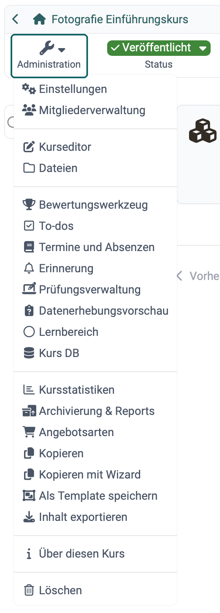
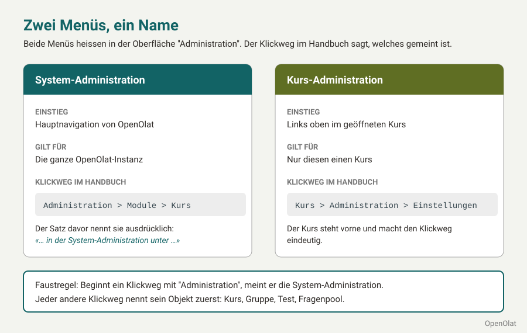
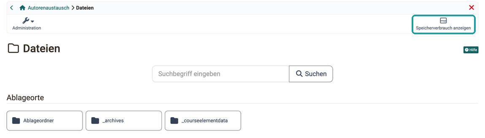
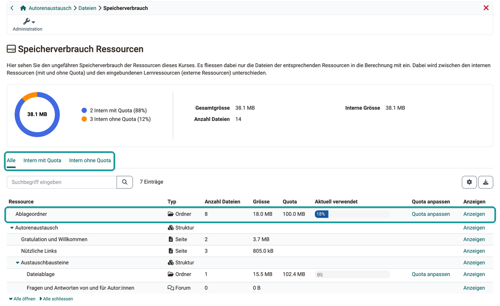

# Kurs-Administration: Übersicht {: #course_administration}

{ class="shadow lightbox aside-left-lg" }

:octicons-device-camera-video-24: **Video-Einführung**: [Admin-Funktionen](<https://www.youtube.com/embed/rWPcz6udUrI>){:target="_blank"}

Sind Sie Besitzer:in eines Kurses, zeigt OpenOlat Ihnen links oben den Button "Administration". Dort finden Sie alle Optionen zur Bearbeitung, Konfiguration und Administration des Kurses, vor und während seiner Nutzung. Dieselben Optionen sehen Administrator:innen und Lernressourcenverwalter:innen der Organisation, der der Kurs angehört. Zu den wichtigsten zählen der [Kurseditor](#course_editor) und die [Einstellungen](#settings).

Betreuer:innen steht der Button "Administration" ebenfalls zur Verfügung. Sie sehen dort weniger Optionen, nur die für Betreuer:innen relevanten, zum Beispiel das [Bewertungswerkzeug](#assessment_tool). Personen, denen im [Bereich "Rechte" der Mitgliederverwaltung](../Members_management.de.md#section_rights) einzelne Rechte erteilt wurden, sehen die Optionen zu diesen Rechten.

!!! info "Wichtig"

    Manche Optionen stehen nur zur Verfügung, wenn das entsprechende Feature aktiviert ist. Wenden Sie sich gegebenenfalls an die Administrator:innen Ihrer Organisation.

Andere Lernressourcen verfügen ebenfalls über das Menü "Administration", jedoch sind die Menüoptionen dort nicht so umfangreich. Sie variieren je nach Lernressource.

Einen Überblick über die Menüoptionen der "Administration" von Kursen geben die Abschnitte ab [Einstellungen](#settings).

## Kurs-Administration und System-Administration {: #course_vs_system_administration}

In OpenOlat heissen zwei Menüs "Administration": das Menü in einem geöffneten Kurs und der Menüpunkt in der Hauptnavigation. Steht in einer Anleitung nur "Administration", ist deshalb nicht sofort klar, wo Sie suchen. Kennen Sie den Unterschied, finden Sie eine Einstellung auf Anhieb und wissen, ob eine Änderung nur einen Kurs betrifft oder die ganze OpenOlat-Instanz.

{ class="shadow lightbox" title="Zwei Menüs namens Administration · 2026.11.12" }

Die Kurs-Administration öffnen Sie im Kurs links oben mit dem Button "Administration". Alles, was Sie dort ändern, gilt nur für diesen einen Kurs: Sie verwalten zum Beispiel die Mitglieder, bauen den Kurs im Kurseditor auf oder legen unter `Kurs > Administration > Einstellungen` seine Einstellungen fest.

Welche Menüpunkte Sie sehen, hängt von Ihrer Rolle und Ihren Rechten im Kurs ab: Besitzer:innen sehen alle, Betreuer:innen weniger, Personen mit einzelnen Rechten aus der Mitgliederverwaltung die Menüpunkte zu diesen Rechten. Zwei Personen im selben Kurs sehen deshalb verschiedene Menüpunkte, wenn ihre Rollen oder Rechte verschieden sind. Den Button "Administration" zeigt OpenOlat, sobald Ihre Rolle oder ein Recht mindestens einen Menüpunkt freigibt. Den Menüpunkt "Einstellungen" sehen Besitzer:innen und Personen mit dem Recht "Kurseditor". Rechte erteilen die Besitzer:innen im [Bereich "Rechte" der Mitgliederverwaltung](../Members_management.de.md#section_rights).

Die System-Administration erreichen Systemadministrator:innen über den Menüpunkt "Administration" in der Hauptnavigation; nur sie sehen diesen Menüpunkt. Was sie dort einstellen, gilt für die ganze OpenOlat-Instanz und damit für alle Kurse. So schalten sie zum Beispiel unter `Administration > Module` die [Module](../../../manual_admin/administration/Modules/index.de.md) ein und legen unter `Administration > Module > Kurs` die [Standardeinstellungen](../../../manual_admin/administration/Modules_Course.de.md#default_settings) fest, mit denen neue Kurse starten. Brauchen Sie eine Funktion, die nur die System-Administration einschalten kann, wenden Sie sich an Ihre Organisation.

Im Handbuch erkennen Sie am Klickweg, welches Menü gemeint ist. Ein Klickweg in die Kurs-Administration beginnt mit dem Kurs: `Kurs > Administration > Einstellungen`. Ein Klickweg in die System-Administration beginnt mit "Administration", und der Satz davor nennt die System-Administration, zum Beispiel: in der System-Administration unter `Administration > Module > Kurs`. Andere Lernressourcen haben ein eigenes Menü "Administration", ihr Klickweg beginnt mit der Lernressource, zum Beispiel `Test > Administration > Einstellungen`.

[Zum Seitenanfang ^](#course_administration)

---

## Einstellungen {: #settings}

Hier legen Sie alle Einstellungen fest, die den Kurs als Ganzes betreffen. (Einstellungen für einen einzelnen Kursbaustein legen Sie im Kurseditor fest, nachdem Sie den Kursbaustein ausgewählt haben.)

[Zu den Details >](../Course_Settings/index.de.md) 
[Zum Seitenanfang ^](#course_administration)

## Mitgliederverwaltung {: #members_management}

In der Mitgliederverwaltung finden Kursbesitzer:innen eine Auflistung aller Personen, die Zugriff auf den Kurs bzw. die Lernressource haben. Sie können hier weiteren Benutzer:innen und Gruppen Zugriff gewähren, indem Sie jemand zum Mitglied des Kurses machen.

[Zu den Details >](../Members_management.de.md) 
[Zum Seitenanfang ^](#course_administration)

## Kurseditor {: #course_editor}

Im Kurseditor bauen Sie den Kurs auf: Sie fügen Kursbausteine hinzu und konfigurieren sie.

[Zu den Details >](../General_Configuration_of_Course_Elements.de.md) 
[Zum Seitenanfang ^](#course_administration)

## Dateien {: #files}

Manche im Kurs verwendete Dateien liegen im Ablageordner. Dieser gehört zum Kurs und kann hier geöffnet werden. 
(Andere Dateien und Objekte werden mit anderen Benutzer:innen geteilt, sind an anderen Stellen abgelegt und können im File Hub oder Media Center verwaltet werden.)

[Zu den Details über den Ablageordner >](../Storage_folder.de.md) 
[Zu den Details über den File Hub >](../../personal_menu/File_Hub.de.md) 
[Zu den Details über das Media Center >](../../personal_menu/Media_Center.de.md) 

### Speicherverbrauch [:octicons-tag-16:{ title="ab Release 18.0.2 (OO-6938)" }](https://track.frentix.com/issue/OO-6938){:target="_blank"} {: #storage_usage}

Wird ein Kurs gross oder geht ein Upload nicht mehr durch, zeigt die Auswertung Speicherverbrauch, welche Ordner und Kursbausteine wie viel Speicher belegen und wo eine Quota die Grenze setzt. So sehen Sie, wo Sie aufräumen können und ob Sie mehr Platz anfordern müssen.

Sie öffnen die Auswertung im Bereich "Dateien" mit dem Button :o_icon_o_icon_hdd: "Speicherverbrauch anzeigen" oben rechts: 
`Kurs > Administration > Dateien > Speicherverbrauch anzeigen`

{ class="shadow lightbox" title="Bereich Dateien der Kurs-Administration" }

Den Bereich "Dateien" sehen Besitzer:innen des Kurses und Personen, denen im [Bereich "Rechte" der Mitgliederverwaltung](../Members_management.de.md#section_rights) das Recht "Kurseditor" erteilt wurde.

Die Seite "Speicherverbrauch Ressourcen" zeigt oben die Werte "Gesamtgrösse", "Interne Grösse" und "Anzahl Dateien" des Kurses, dazu ein Kreisdiagramm mit dem Anteil der Ressourcen mit und ohne Quota. Darunter listet eine Tabelle den Ablageordner und die Kursbausteine in der Struktur des Kurses. Über das Suchfeld finden Sie eine Zeile nach Name oder Typ, "Alle öffnen" und "Alle schliessen" klappen die Struktur auf und zu. Je Zeile stehen der Typ, die Anzahl Dateien, die Grösse, die Quota und in der Spalte "Aktuell verwendet" ein Balken, wie viel der Quota belegt ist. Ab 80 Prozent hebt OpenOlat den Balken farbig hervor. Mit "Anzeigen" öffnen Sie den Ordner oder den Kursbaustein der Zeile. Die Tabelle lässt sich als Excel-Datei exportieren.

{ class="shadow lightbox" title="Seite Speicherverbrauch Ressourcen eines Kurses" }

Drei Filter grenzen die Tabelle ein:

* "Alle": alle Ordner und Kursbausteine des Kurses, auch solche ohne Dateien.
* "Intern mit Quota": die Ordner mit eigener Quota. Das sind der Ablageordner, "Unterlagen Betreuer:innen" und "Dokumente (Toolbar)" sowie die Kursbausteine "Ordner" und "Teilnehmer:innen Ordner".
* "Intern ohne Quota": die Kursbausteine, die Speicher belegen, aber keine eigene Quota haben. Das sind "Forum", "Dateidiskussion", "Aufgabe", "Gruppenaufgabe", "Seite" und "Themenbörse".

Verwendet ein Kursbaustein "Ordner" als Ablageort einen Ordner aus dem Ablageordner, erscheint er nicht als eigene Zeile. Dasselbe gilt für "Unterlagen Betreuer:innen" und "Dokumente (Toolbar)", wenn sie einen Ordner aus dem Ablageordner nutzen. Die Dateien zählen dann zum Ablageordner und fallen unter dessen Quota. Beim Kursbaustein "Teilnehmer:innen Ordner" zeigt die Tabelle je Teilnehmer:in den Abgabeordner und den Rückgabeordner. Die Quota gilt für jeden dieser Ordner einzeln.

#### Quota anpassen {: #storage_usage_edit_quota}

Die Aktion "Quota anpassen" steht nur in den Zeilen mit eigener Quota: beim Ablageordner, bei "Unterlagen Betreuer:innen" und "Dokumente (Toolbar)" sowie bei den Kursbausteinen "Ordner" und "Teilnehmer:innen Ordner". Die Kursbausteine "Forum", "Dateidiskussion", "Aufgabe", "Gruppenaufgabe", "Seite" und "Themenbörse" zählen ihren Verbrauch, haben aber keine Quota, die sich anpassen lässt.

Ändern können die Quota [Administrator:innen, Systemadministrator:innen und Lernressourcenverwalter:innen](../../basic_concepts/Roles/index.de.md#org) der Organisation, der der Kurs angehört. Alle anderen sehen im Dialog "Quota anpassen" die aktuellen Werte, aber keinen Button zum Speichern. Brauchen Sie für einen Ordner mehr Platz, wenden Sie sich an eine dieser Personen.

Weitere Wege, den Speicherbedarf zu senken, beschreibt die Anleitung ["Mit welchen Massnahmen kann ich den Speicherverbrauch reduzieren?"](../../../manual_how-to/reduce_storage_consumption/reduce_storage_consumption.de.md).

[Zum Seitenanfang ^](#course_administration)

## Bewertungswerkzeug {: #assessment_tool}

Das Bewertungswerkzeug (nicht zu verwechseln mit dem Kursbaustein "Bewertung") dient der Betreuung und Ergebniskontrolle aller Kursteilnehmer:innen. Hier haben Sie Zugriff auf alle bewertbaren Kursbausteine und können die Teilnehmenden zum Beispiel mit Punkten oder bestanden/nicht bestanden bewerten und ihnen individuelle Feedbacks geben.

[Zu den Details >](../Assessment_tool_overview/index.de.md) 
[Zum Seitenanfang ^](#course_administration)

## To-dos [:octicons-tag-16:{ title="ab Release 18.2 (OO-7039)" }](https://track.frentix.com/issue/OO-7039){:target="_blank"} {: #to-dos}

To-dos, die einen bestimmten Kurs betreffen, können direkt hier im Kurs erstellt werden. Es können To-dos an alle Kursteilnehmer:innen oder an Einzelpersonen vergeben werden.

[Zu den Details >](../Course_todos.de.md) 
[Zum Seitenanfang ^](#course_administration)

## Badges [:octicons-tag-16:{ title="ab Release 18.0 (OO-7003)" }](https://track.frentix.com/issue/OO-7003){:target="_blank"} {: #badges}

Sofern aktiviert, können hier kursbezogene Badges erstellt, editiert und angezeigt werden.

[Zu den Details >](../OpenBadges.de.md) 
[Zum Seitenanfang ^](#course_administration)

## Unterlagen Betreuer:innen [:octicons-tag-16:{ title="ab Release 16.0 (OO-5566)" }](https://track.frentix.com/issue/OO-5566){:target="_blank"} {: #coach_files}

Sofern aktiviert, können Betreuer:innen und Besitzer:innen des Kurses in diesem gemeinsamen Ordner Dateien ablegen, auf die nur sie zugreifen können.

[Zu den Details >](../Coach_Files.de.md) 
[Zum Seitenanfang ^](#course_administration)

## Termine und Absenzen [:octicons-tag-16:{ title="ab Release 12.0 (OO-2636)" }](https://track.frentix.com/issue/OO-2636){:target="_blank"} {: #events_and_absences_}

Hier finden Sie das Werkzeug zur Administration von Terminen und Absenzen der Teilnehmenden.

[Zu den Details >](../Events_and_absences.de.md) 
[Zum Seitenanfang ^](#course_administration)

## Erinnerung [:octicons-tag-16:{ title="ab Release 10.3 (OO-1494)" }](https://track.frentix.com/issue/OO-1494){:target="_blank"} {: #reminders}

Mit Erinnerungen versendet OpenOlat automatisch E-Mails an Personen im Kurs. Wann eine Erinnerung verschickt wird, bestimmen Bedingungen, die Sie festlegen.

[Zu den Details >](../Course_Reminders.de.md) 
[Zum Seitenanfang ^](#course_administration)

## Prüfungsverwaltung [:octicons-tag-16:{ title="ab Release 10.2 (OO-1349)" }](https://track.frentix.com/issue/OO-1349){:target="_blank"} {: #assessment_management}

Unter dieser Menüoption können Sie Konfigurationen für Prüfungsmodi erstellen, bearbeiten und anzeigen lassen. Sie können beispielsweise einen Prüfungsmodus konfigurieren, in dem die Teilnehmer:innen nur bestimmte Kursbausteine öffnen können und auch der Aufruf anderer Informationsquellen eingeschränkt ist.

[Zu den Details des Prüfungsmodus >](../Assessment_mode.de.md) 
[Zu den Details der Prüfungseinsicht >](../Assessment_inspection.de.md) 
[Zum Seitenanfang ^](#course_administration)

## Datenerhebungsvorschau [:octicons-tag-16:{ title="ab Release 18.2 (OO-7399)" }](https://track.frentix.com/issue/OO-7399){:target="_blank"} {: #data_collection_previews}

Sofern aktiviert, können Kursbesitzer:innen die geplanten Erhebungen des Moduls Qualitätsmanagement zum Kurs einsehen. Für Kursbesitzer:innen ist diese Vorschau rein informativ. Eine Bearbeitung ist lediglich für Qualitätsmanager:innen möglich.

[Zu den Details über das Qualitätsmanagement >](../../../manual_admin/administration/Modules_Quality_Management.de.md) 
[Zum Seitenanfang ^](#course_administration)

## Lernbereich {: #learning_areas}

Ein Lernbereich fasst mehrere Gruppen eines Kurses zusammen. Hier erstellen, sehen und bearbeiten Sie die Lernbereiche des Kurses.

[Zu den Details >](../Learning_Areas.de.md) 
[Zum Seitenanfang ^](#course_administration)

## Kurs DB {: #course_DB}

Soll ein Kurs Angaben einzelner Personen speichern, die kein Kursbaustein erfasst, etwa ein Häkchen "Gelesen" oder die Antworten einer selbst gebauten Umfrage, legen Sie dafür in der Kurs DB eine Datenbank an. Eine Seite im Kurs, zum Beispiel ein Kursbaustein "HTML-Seite", schreibt und liest die Werte je Person über die REST-Schnittstelle von OpenOlat, meist per JavaScript.

Mit "Neue Datenbank erstellen" legen Sie eine Datenbank mit einem Namen an. OpenOlat zeigt dazu die URL, unter der die Seite die Werte ablegt. Mit "Exportieren" laden Sie die Werte aller Personen als Excel-Datei herunter. "Zurücksetzen" leert die Datenbank, "Löschen" entfernt sie.

Den Menüpunkt sehen Besitzer:innen des Kurses, Lernressourcenverwalter:innen und Administrator:innen sowie Mitglieder mit dem Recht ["Kurs Datenbank"](../Members_management.de.md#right_course_db). Voraussetzung ist, dass die Kurs DB auf Ihrer OpenOlat-Instanz eingeschaltet ist. Sie ist Teil der Serverkonfiguration und im Auslieferungszustand ausgeschaltet. Für eine Aktivierung wenden Sie sich an Ihre Organisation.

[Zum Seitenanfang ^](#course_administration)

## Kursstatistiken {: #course_statistics}

Diese Kursfunktion zeigt Ihnen Statistiken über den Zugriff auf Ihren OpenOlat-Kurs an. Zugang zu den Statistiken haben alle Besitzer:innen dieses Kurses. Betreuer:innen und weitere Mitglieder sehen den Menüpunkt nur, wenn ihnen das Recht "Statistiken" erteilt wurde.

[Zu den Details >](../Statistics_Course.de.md) 
[Zum Seitenanfang ^](#course_administration)

## Teststatistiken {: #test_statistics}

Die Teststatistiken werten die Tests eines Kurses anonymisiert aus. Sie zeigen alle Tests des Kurses. Der Menüpunkt erscheint, sobald der Kurs einen Kursbaustein "Test" enthält.

[Zu den Details >](../Statistics_Test.de.md) 
[Zum Seitenanfang ^](#course_administration)

## Fragebogen Statistiken {: #survey_statistics}

Die Fragebogen Statistiken werten die Umfragen eines Kurses anonymisiert aus. Der Menüpunkt erscheint, sobald der Kurs einen Kursbaustein "Umfrage" enthält.

[Zu den Details >](../Statistics_Survey.de.md) 
[Zum Seitenanfang ^](#course_administration)

## Archivierung & Reports [:octicons-tag-16:{ title="ab Release 19.0 (OO-7504)" }](https://track.frentix.com/issue/OO-7504){:target="_blank"} {: #archiving_reporting}

Hier sichern Sie die Daten des Kurses, etwa um Ergebnisse über das Kursende hinaus aufzubewahren. Ein Wizard erstellt ein Gesamtarchiv oder ein Teilarchiv mit ausgewählten Kursbausteinen. Unter "Reports" laden Sie zudem die Kursresultate, die Mitgliedschaften des Kurses, den Kurs-Chat und Berichte zu den Foren herunter.

[Zu den Details >](../Course_Archiving/index.de.md) 
[Zum Seitenanfang ^](#course_administration)

## Angebotsarten {: #offer_types}

Um einen Kurs oder eine andere Lernressource im Katalog anzubieten, braucht es mindestens ein Angebot. Hier finden Sie die Buchungsaufträge zu den Angeboten des Kurses.

[Zu den Details >](../Offer_Types.de.md) 
[Zum Seitenanfang ^](#course_administration)

## Kopieren {: #copy}

Beim Kopieren eines Kurses werden die komplette Struktur, Ordnerinhalte, HTML-Seiten und Gruppennamen (ohne Gruppenmitglieder) übernommen. Benutzerdaten wie Forenbeiträge, Gruppenmitglieder etc. werden jedoch nicht kopiert.

[Zu den Details >](../Course_Copy.de.md) 
[Zum Seitenanfang ^](#course_administration)

## Kopieren mit Wizard [:octicons-tag-16:{ title="ab Release 16.0 (OO-4416)" }](https://track.frentix.com/issue/OO-4416){:target="_blank"} {: #copy_wizard}

Wenn Sie einen Kurs mit Hilfe des Wizards kopieren, können Sie die zu kopierenden Elemente auswählen. Der Menüpunkt erscheint nur in Lernpfadkursen.

[Zu den Details >](../Course_Copy_Wizard.de.md) 
[Zum Seitenanfang ^](#course_administration)

## Als Template speichern [:octicons-tag-16:{ title="ab Release 20.2 (OO-8896)" }](https://track.frentix.com/issue/OO-8896){:target="_blank"} {: #copy_template}

Soll ein bestehender Kurs für die Verwendung mit dem Course Planner zur Instanzierung in Durchführungen verwendet werden, speichern Sie ihn als Template.

[Zu den Details >](../Course_Copy_Template.de.md) 
[Zum Seitenanfang ^](#course_administration)

## Als Kurs instanziieren [:octicons-tag-16:{ title="ab Release 20.2 (OO-8897)" }](https://track.frentix.com/issue/OO-8897){:target="_blank"} {: #instantiate_as_course}

Haben Sie ein Template vorbereitet, erstellen Sie daraus mit diesem Menüpunkt einen neuen Kurs. Ein Wizard führt Sie durch die Erstellung.

Den Menüpunkt gibt es nur in Kursen mit dem Verwendungszweck "Template". Dort steht er an der Stelle von "Als Template speichern". Sie sehen ihn, wenn Sie den Kurs kopieren dürfen, also wenn das Menü auch "Kopieren" zeigt.

[Zu den Details >](../Creating_Course.de.md#purpose) 
[Zum Seitenanfang ^](#course_administration)

## Als Lernpfad duplizieren {: #duplicate_as_learning_path}

Wollen Sie einen herkömmlichen Kurs als Lernpfadkurs weiterführen, zum Beispiel einen Kurs, der vor OpenOlat 15 entstanden ist, erstellen Sie mit diesem Menüpunkt eine Kopie als Lernpfadkurs. Der ursprüngliche Kurs bleibt unverändert erhalten.

Im Dialog "Als Lernpfad duplizieren" geben Sie den "Titel der Lernressource" und das "Kennzeichen der Lernressource" der Kopie an und wählen das Kursdesign: "Mit Lernpfad" führt die Teilnehmenden in einer festen Reihenfolge durch den Kurs, "Mit Lernfortschritt" zeigt den Fortschritt ohne feste Reihenfolge. "Duplizieren und konvertieren" erstellt die Kopie. [:octicons-tag-16:{ title="ab Release 20.2 (OO-8967)" }](https://track.frentix.com/issue/OO-8967){:target="_blank"}

Den Menüpunkt gibt es nur in herkömmlichen Kursen. Im Menü folgt er auf "Als Template speichern", in einem Template auf "Als Kurs instanziieren". Sie sehen ihn, wenn Sie den Kurs kopieren dürfen, also wenn das Menü auch "Kopieren" zeigt. Denselben Dialog öffnen Sie in den Kurseinstellungen im [Tab "Durchführung"](../Course_Settings_Execution.de.md#course_type) mit dem Button "Als Lernpfad duplizieren".

!!! tip "Tipp"

    Wenn der Kurs lediglich in das aktuelle Format übertragen werden soll, ist in den meisten Fällen die Option "Mit Lernfortschritt" die bessere Wahl. Hier muss die Kursstruktur nicht in einer festen Reihenfolge bearbeitet werden, was der Hypermedia-Struktur des Ausgangskurses eher entspricht. Diese Einstellung kann bei Bedarf auch nachträglich im Kurseditor des kopierten Kurses am obersten Kursbaustein angepasst werden.

    Beachten Sie, dass grundsätzlich Gäste keinen Zugang zu Lernpfadkursen haben.

[Zum Seitenanfang ^](#course_administration)

## Inhalt exportieren {: #export_content}

Exportieren Sie Ihre Lernressourcen als ZIP-Datei, um eine Sicherungskopie zu erhalten oder um die Lernressource in einer anderen OpenOlat Instanz zu importieren.

[Zu den Details >](../Export_Content.de.md) 
[Zum Seitenanfang ^](#course_administration)

## Über diesen Kurs [:octicons-tag-16:{ title="ab Release 21.1 (OO-9760)" }](https://track.frentix.com/issue/OO-9760){:target="_blank"} {: #about}

Hier schlagen Sie nach, welche ID der Kurs hat, wer ihn erstellt hat und wem er gehört. Das Fenster zeigt auch den externen Link und die Produkte im Course Planner, in denen der Kurs eingebunden ist. Bei anderen Lernressourcen sehen Sie zusätzlich, welche Kurse sie verwenden.

Den Menüpunkt sehen Besitzer:innen des Kurses, Lernressourcenverwalter:innen und Administrator:innen.

[Zu den Details >](../Technical_Information_on_Resources_and_Usage.de.md) 
[Zum Seitenanfang ^](#course_administration)

## Löschen {: #delete}

Beim Löschen wird ein Kurs zunächst in den Papierkorb verschoben und alle Benutzerdaten werden entfernt. (Das gilt auch für Lernressourcen.)

Liegt der Kurs im Papierkorb, steht an dieser Stelle der Menüpunkt "Wiederherstellen".

[Zu den Details >](../Course_Delete.de.md) 
[Zum Seitenanfang ^](#course_administration)

## Weiterführende Informationen {: #further_information}

[Toolbar >](../Course_Settings_Toolbar.de.md) 
[Toolbar: Infoseite >](../Info_page.de.md) 
[Rollen und Rechte: Welche Rollen gibt es? >](../../basic_concepts/Roles/index.de.md)

**youtube** 
[Admin-Funktionen](<https://www.youtube.com/embed/rWPcz6udUrI>)

[Zum Seitenanfang ^](#course_administration)

