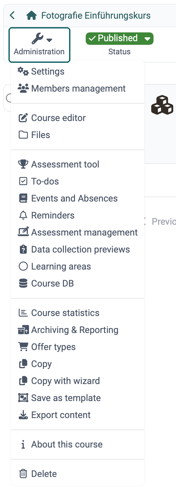
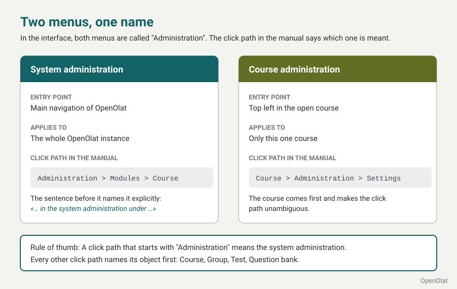
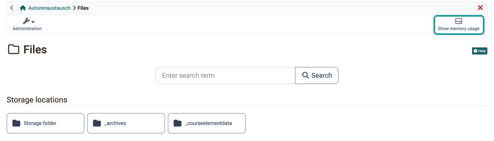
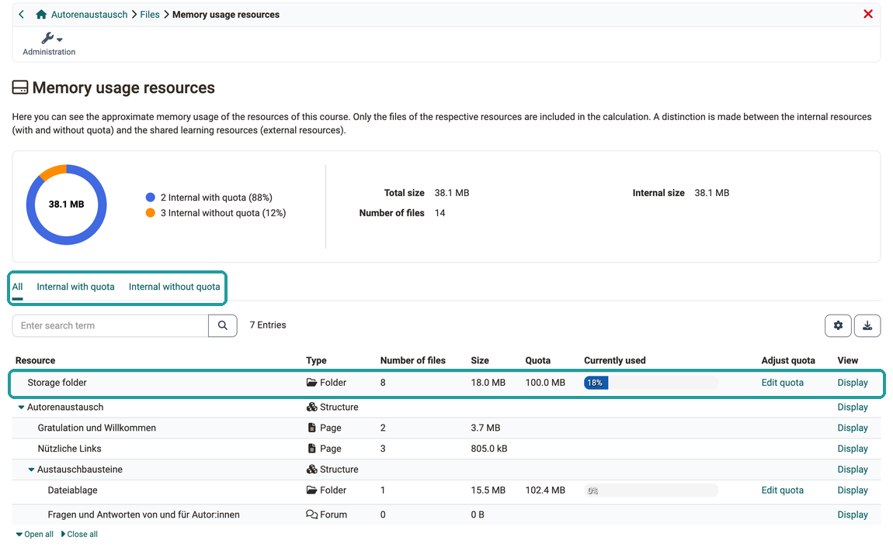

# Course Administration: Overview {: #course_administration}

{ class="shadow lightbox aside-left-lg" }

:octicons-device-camera-video-24: **Video introduction (German)**: [Admin-Funktionen](<https://www.youtube.com/embed/rWPcz6udUrI>){:target="_blank"}

If you are an owner of a course, OpenOlat shows you the "Administration" button at the top left. There you will find all options for editing, configuration and administration of the course, before and during its use. Administrators and learning resource managers of the organisation the course belongs to see the same options. The most important options include the [course editor](#course_editor) and the [settings](#settings).

The "Administration" button is also available for coaches. They see fewer options there, only those relevant to coaches, for example the [assessment tool](#assessment_tool). Persons who have been granted individual rights in the [Rights area of the members management](../Members_management.md#section_rights) see the options for these rights.

!!! info "Important"

    Some options are only available if the corresponding feature is activated. If necessary, please contact the administrators of your organisation.

Other learning resources also have the "Administration" menu, but the menu options there are not as extensive. They vary depending on the learning resource.

The sections from [Settings](#settings) onwards give an overview of the "Administration" menu options for courses.

## Course administration and system administration {: #course_vs_system_administration}

In OpenOlat, two menus are called "Administration": the menu in an opened course and the menu item in the main navigation. If an instruction only says "Administration", it is therefore not immediately clear where to look. If you know the difference, you find a setting right away and know whether a change affects only one course or the whole OpenOlat instance.

{ class="shadow lightbox" title="Two menus called Administration · 2026.11.12" }

You open the course administration in the course at the top left with the "Administration" button. Everything you change there applies only to this one course: for example, you manage the members, build the course in the course editor or define its settings under `Course > Administration > Settings`.

Which menu items you see depends on your role and your rights in the course: owners see all of them, coaches fewer, persons with individual rights from the members management the menu items for these rights. Two persons in the same course therefore see different menu items if their roles or rights differ. OpenOlat shows the "Administration" button as soon as your role or a right unlocks at least one menu item. The menu item "Settings" is visible to owners and to persons with the right "Course editor". Owners grant rights in the [Rights area of the members management](../Members_management.md#section_rights).

System administrators reach the system administration via the menu item "Administration" in the main navigation; only they see this menu item. What they set there applies to the whole OpenOlat instance and thus to all courses. For example, they switch on the [modules](../../../manual_admin/administration/Modules/index.md) under `Administration > Modules` and define the [default settings](../../../manual_admin/administration/Modules_Course.md#default_settings) with which new courses start under `Administration > Modules > Course`. If you need a function that only the system administration can switch on, contact your organisation.

In the manual, the click path shows which menu is meant. A click path into the course administration starts with the course: `Course > Administration > Settings`. A click path into the system administration starts with "Administration", and the sentence before it names the system administration, for example: in the system administration under `Administration > Modules > Course`. Other learning resources have their own "Administration" menu, and their click path starts with the learning resource, for example `Test > Administration > Settings`.

[To the top of the page ^](#course_administration)

---

## Settings {: #settings}

Here you define all settings that affect the course as a whole. (You define settings for a single course element in the course editor after selecting the course element.)

[See the details >](../Course_Settings/index.md) 
[To the top of the page ^](#course_administration)

## Members management {: #members_management}

In the members management, course owners will find a list of all persons who have access to the course or learning resource. You can grant access to other users and groups here by making someone a member of the course.

[See the details >](../Members_management.md) 
[To the top of the page ^](#course_administration)

## Course editor {: #course_editor}

In the course editor you build the course: you add course elements and configure them.

[See the details >](../General_Configuration_of_Course_Elements.md) 
[To the top of the page ^](#course_administration)

## Files {: #files}

Some files used in the course are stored in the storage folder. This belongs to the course and can be opened here. 
(Other files and objects are shared with other users, are stored in other places and can be managed in the File Hub or Media Center).

[See the details about the Storage folder >](../Storage_folder.md) 
[See the details about the File Hub >](../../personal_menu/File_Hub.md) 
[See the details about the Media Center >](../../personal_menu/Media_Center.md) 

### Storage usage [:octicons-tag-16:{ title="from Release 18.0.2 (OO-6938)" }](https://track.frentix.com/issue/OO-6938){:target="_blank"} {: #storage_usage}

When a course grows large or an upload no longer goes through, the storage usage evaluation shows which folders and course elements occupy how much storage and where a quota sets the limit. This shows you where you can clean up and whether you need to request more space.

You open the evaluation in the "Files" area with the :o_icon_o_icon_hdd: "Show memory usage" button at the top right: 
`Course > Administration > Files > Show memory usage`

{ class="shadow lightbox" title="Files area of the course administration" }

The "Files" area is visible to owners of the course and to persons who have been granted the "Course editor" right in the [Rights area of the members management](../Members_management.md#section_rights).

The storage usage page, titled "Memory usage resources" on screen, shows the values "Total size", "Internal size" and "Number of files" of the course at the top, together with a pie chart showing the share of resources with and without quota. Below, a table lists the storage folder and the course elements in the structure of the course. The search field finds a row by name or type, "Open all" and "Close all" expand and collapse the structure. Each row shows the type, the number of files, the size, the quota and, in the "Currently used" column, a bar showing how much of the quota is occupied. From 80 percent, OpenOlat highlights the bar in color. "Display" opens the folder or the course element of the row. The table can be exported as an Excel file.

{ class="shadow lightbox" title="Memory usage resources page of a course" }

Three filters narrow down the table:

* "All": all folders and course elements of the course, including those without files.
* "Internal with quota": the folders with their own quota. These are the storage folder, "Coach files" and "Documents (Toolbar)" as well as the course elements "Folder" and "Participant folder".
* "Internal without quota": the course elements that occupy storage but have no quota of their own. These are "Forum", "File dialog", "Task", "Group task", "Page" and "Topic broker".

If a "Folder" course element uses a folder from the storage folder as its file destination, it does not appear as a separate row. The same applies to "Coach files" and "Documents (Toolbar)" when they use a folder from the storage folder. The files then count towards the storage folder and fall under its quota. For the "Participant folder" course element, the table shows the drop box and the return box for each participant. The quota applies to each of these folders individually.

#### Edit quota {: #storage_usage_edit_quota}

The "Edit quota" action only appears in rows with their own quota: for the storage folder, for "Coach files" and "Documents (Toolbar)" as well as for the course elements "Folder" and "Participant folder". The course elements "Forum", "File dialog", "Task", "Group task", "Page" and "Topic broker" count their usage but have no quota that can be adjusted.

The quota can be changed by [administrators, system administrators and learning resource managers](../../basic_concepts/Roles/index.md#org) of the organisation the course belongs to. Everyone else sees the current values in the "Edit quota" dialog, but no button to save. If you need more space for a folder, contact one of these persons.

The guide ["What measures can I take to reduce storage space consumption?"](../../../manual_how-to/reduce_storage_consumption/reduce_storage_consumption.md) describes further ways to reduce storage requirements.

[To the top of the page ^](#course_administration)

## Assessment tool {: #assessment_tool}

The assessment tool (not to be confused with the course element "Assessment") is used to coach and monitor the results of all course participants. Here you have access to all assessable course elements and can, for example, assess the participants with points or passed/failed and give them individual feedback.

[See the details >](../Assessment_tool_overview/index.md) 
[To the top of the page ^](#course_administration)

## To-dos [:octicons-tag-16:{ title="from Release 18.2 (OO-7039)" }](https://track.frentix.com/issue/OO-7039){:target="_blank"} {: #to-dos}

To-dos relating to a specific course can be created directly here in the course. To-dos can be assigned to all course participants or to individuals.

[See the details >](../Course_todos.md) 
[To the top of the page ^](#course_administration)

## Badges [:octicons-tag-16:{ title="from Release 18.0 (OO-7003)" }](https://track.frentix.com/issue/OO-7003){:target="_blank"} {: #badges}

If activated, course-related badges can be created, edited and displayed here.

[See the details >](../OpenBadges.md) 
[To the top of the page ^](#course_administration)

## Coach files [:octicons-tag-16:{ title="from Release 16.0 (OO-5566)" }](https://track.frentix.com/issue/OO-5566){:target="_blank"} {: #coach_files}

If activated, coaches and owners of the course can store files in this shared folder that only they can access.

[See the details >](../Coach_Files.md) 
[To the top of the page ^](#course_administration)

## Events and Absences [:octicons-tag-16:{ title="from Release 12.0 (OO-2636)" }](https://track.frentix.com/issue/OO-2636){:target="_blank"} {: #events_and_absences_}

Here you will find the tool for the administration of participants' events and absences.

[See the details >](../Events_and_absences.md) 
[To the top of the page ^](#course_administration)

## Reminders [:octicons-tag-16:{ title="from Release 10.3 (OO-1494)" }](https://track.frentix.com/issue/OO-1494){:target="_blank"} {: #reminders}

With reminders, OpenOlat automatically sends e-mails to persons in the course. Conditions that you define determine when a reminder is sent.

[See the details >](../Course_Reminders.md) 
[To the top of the page ^](#course_administration)

## Assessment management [:octicons-tag-16:{ title="from Release 10.2 (OO-1349)" }](https://track.frentix.com/issue/OO-1349){:target="_blank"} {: #assessment_management}

This menu option allows you to create, edit and display configurations for assessment modes. For example, you can configure an assessment mode that only allows participants to access certain course elements and also restricts participants from accessing other sources of information.

[See the details about the assessment mode >](../Assessment_mode.md) 
[See the details about the assessment inspection >](../Assessment_inspection.md) 
[To the top of the page ^](#course_administration)

## Data collection previews [:octicons-tag-16:{ title="from Release 18.2 (OO-7399)" }](https://track.frentix.com/issue/OO-7399){:target="_blank"} {: #data_collection_previews}

If activated, course owners can view the planned surveys of the Quality Management module for the course. This preview is purely informative for course owners. Editing is only possible for quality managers.

[See the details about quality management >](../../../manual_admin/administration/Modules_Quality_Management.md) 
[To the top of the page ^](#course_administration)

## Learning areas {: #learning_areas}

A learning area brings together several groups of a course. Here you create, view and edit the learning areas of the course.

[See the details >](../Learning_Areas.md) 
[To the top of the page ^](#course_administration)

## Course DB {: #course_DB}

If a course is to store information on individual persons that no course element records, for example a "Read" tick or the answers of a self-built survey, you create a database for it in the Course DB. A page in the course, for example an "HTML page" course element, writes and reads the values per person via the REST interface of OpenOlat, usually with JavaScript.

With "Create a new database" you create a database with a name. OpenOlat then shows the URL under which the page stores the values. With "Export" you download the values of all persons as an Excel file. "Reset" empties the database, "Delete" removes it.

The menu item is visible to owners of the course, learning resource managers and administrators as well as members with the right ["Course database"](../Members_management.md#right_course_db). It requires that the Course DB is switched on in your OpenOlat instance. It is part of the server configuration and switched off by default. For activation, contact your organisation.

[To the top of the page ^](#course_administration)

## Course statistics {: #course_statistics}

This course function shows you statistics on access to your OpenOlat course. All owners of this course have access to the statistics. Coaches and other members only see the menu item if they have been granted the right "Statistics".

[See the details >](../Statistics_Course.md) 
[To the top of the page ^](#course_administration)

## Test statistics {: #test_statistics}

The test statistics evaluate the tests of a course anonymously. They show all tests of the course. The menu item appears as soon as the course contains a "Test" course element.

[See the details >](../Statistics_Test.md) 
[To the top of the page ^](#course_administration)

## Survey statistics {: #survey_statistics}

The survey statistics evaluate the surveys of a course anonymously. The menu item appears as soon as the course contains a "Survey" course element.

[See the details >](../Statistics_Survey.md) 
[To the top of the page ^](#course_administration)

## Archiving & Reporting [:octicons-tag-16:{ title="from Release 19.0 (OO-7504)" }](https://track.frentix.com/issue/OO-7504){:target="_blank"} {: #archiving_reporting}

Here you secure the data of the course, for example to keep results beyond the end of the course. A wizard creates a complete archive or a partial archive with selected course elements. Under "Reports" you also download the course results, the memberships of the course, the course chat and reports on the forums.

[See the details >](../Course_Archiving/index.md) 
[To the top of the page ^](#course_administration)

## Offer types {: #offer_types}

To offer a course or another learning resource in the catalog, at least one offer is needed. Here you find the booking orders for the offers of the course.

[See the details >](../Offer_Types.md) 
[To the top of the page ^](#course_administration)

## Copy {: #copy}

When copying a course, the complete structure, folder contents, HTML pages and group names (without group members) are copied. However, user data such as forum posts, group members etc. are not copied.

[See the details >](../Course_Copy.md) 
[To the top of the page ^](#course_administration)

## Copy with wizard [:octicons-tag-16:{ title="from Release 16.0 (OO-4416)" }](https://track.frentix.com/issue/OO-4416){:target="_blank"} {: #copy_wizard}

If you copy a course using the wizard, you can select the elements to be copied. The menu item only appears in learning path courses.

[See the details >](../Course_Copy_Wizard.md) 
[To the top of the page ^](#course_administration)

## Save as template [:octicons-tag-16:{ title="from Release 20.2 (OO-8896)" }](https://track.frentix.com/issue/OO-8896){:target="_blank"} {: #copy_template}

If an existing course is to be used with the Course Planner for instantiation in implementations, save it as a template.

[See the details >](../Course_Copy_Template.md) 
[To the top of the page ^](#course_administration)

## Instantiate as course [:octicons-tag-16:{ title="from Release 20.2 (OO-8897)" }](https://track.frentix.com/issue/OO-8897){:target="_blank"} {: #instantiate_as_course}

If you have prepared a template, use this menu item to create a new course from it. A wizard guides you through the creation.

The menu item only exists in courses with the usage "Template". There it takes the place of "Save as template". You see it if you are allowed to copy the course, that is if the menu also shows "Copy".

[See the details >](../Creating_Course.md#purpose) 
[To the top of the page ^](#course_administration)

## Duplicate as learning path {: #duplicate_as_learning_path}

If you want to continue a conventional course as a learning path course, for example a course created before OpenOlat 15, use this menu item to create a copy as a learning path course. The original course remains unchanged.

In the dialog "Duplicate as learning path" you enter the "Title of learning resource" and the "Reference of learning resource" of the copy and choose the course design: "With learning path" guides participants through the course in a fixed order, "With learning progress" shows the progress without a fixed order. "Duplicate & convert" creates the copy. [:octicons-tag-16:{ title="from Release 20.2 (OO-8967)" }](https://track.frentix.com/issue/OO-8967){:target="_blank"}

The menu item only exists in conventional courses. In the menu it follows "Save as template", in a template "Instantiate as course". You see it if you are allowed to copy the course, that is if the menu also shows "Copy". You open the same dialog in the course settings in the [tab "Execution"](../Course_Settings_Execution.md#course_type) with the button "Duplicate as learning path".

!!! tip "Tip"

    If the course is only to be transferred to the current format, the "With learning progress" option is usually the better choice. In this case, the course structure does not have to be edited in a fixed order, which is more in line with the hypermedia structure of the previous course. If necessary, this setting can also be adjusted retrospectively in the course editor of the copied course at the top course element.

    Please note that guests do not have access to learning path courses.

[To the top of the page ^](#course_administration)

## Export content {: #export_content}

Export your learning resources as a ZIP file to get a backup copy or to import the learning resource in another OpenOlat instance.

[See the details >](../Export_Content.md) 
[To the top of the page ^](#course_administration)

## About this course [:octicons-tag-16:{ title="from Release 21.1 (OO-9760)" }](https://track.frentix.com/issue/OO-9760){:target="_blank"} {: #about}

Here you look up which ID the course has, who created it and who owns it. The window also shows the external link and the products in the Course Planner in which the course is embedded. For other learning resources, you also see which courses use them.

The menu item is visible to the owners of the course, learning resource managers and administrators.

[See the details >](../Technical_Information_on_Resources_and_Usage.md) 
[To the top of the page ^](#course_administration)

## Delete {: #delete}

When a course is deleted, it is first moved to the trash and all user data is removed. (This also applies to learning resources).

If the course is in the trash, the menu item "Restore" appears in this place.

[See the details >](../Course_Delete.md) 
[To the top of the page ^](#course_administration)

## Further information {: #further_information}

[Toolbar >](../Course_Settings_Toolbar.md) 
[Toolbar: Info page >](../Info_page.md) 
[Roles and Rights: Which roles are available? >](../../basic_concepts/Roles/index.md)

**youtube** 
[Admin-Funktionen](<https://www.youtube.com/embed/rWPcz6udUrI>)

[To the top of the page ^](#course_administration)

