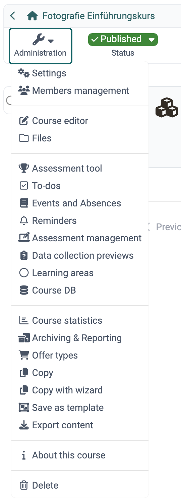
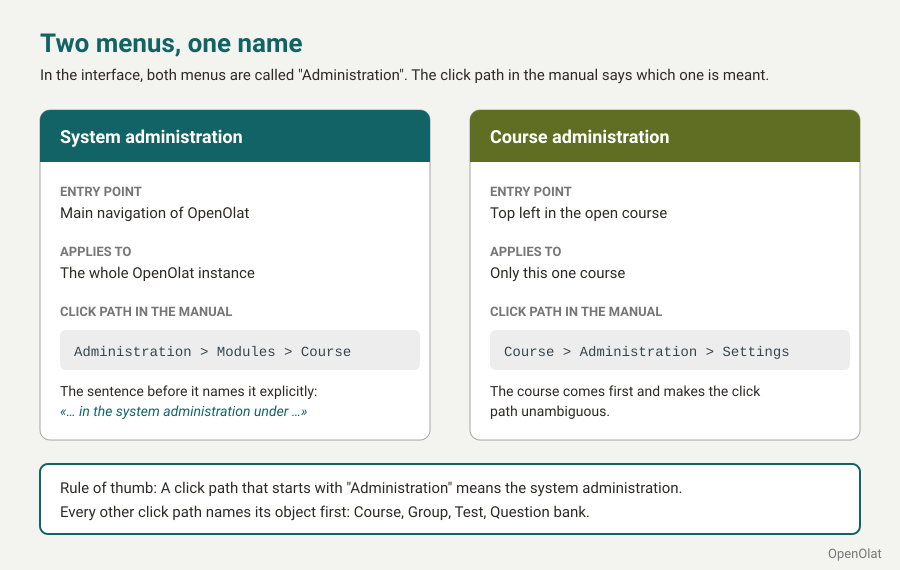

# Course Administration: Overview {: #course_administration}

{ class="shadow lightbox aside-left-lg" }

:octicons-device-camera-video-24: **Video introduction (German)**: [Admin-Funktionen](<https://www.youtube.com/embed/rWPcz6udUrI>){:target="_blank"}

If you are an owner of a course, OpenOlat shows you the "Administration" button at the top left. There you will find all options for editing, configuration and administration of the course, before and during its use. Administrators and learning resource managers of the organisation the course belongs to see the same options. The most important options include the [course editor](../General_Configuration_of_Course_Elements.md) and the [settings](../Course_Settings/index.md).

The "Administration" button is also available for coaches. They see fewer options there, only those relevant to coaches, for example the [assessment tool](../Assessment_tool_overview/index.md). Persons who have been granted individual rights in the [Rights area of the members management](../Members_management.md#section_rights) see the options for these rights.

!!! info "Important"

    Some options are only available if the corresponding feature is activated. If necessary, please contact the administrators of your organisation.

Other learning resources also have the "Administration" menu, but the menu options there are not as extensive. They vary depending on the learning resource.

The section [Menu items](#menu_items) shows what each menu item is for and where it is described.

## Course administration and system administration {: #course_vs_system_administration}

In OpenOlat, two menus are called "Administration": the menu in an opened course and the menu item in the main navigation. If an instruction only says "Administration", it is therefore not immediately clear where to look. If you know the difference, you find a setting right away and know whether a change affects only one course or the whole OpenOlat instance.

{ class="shadow lightbox" title="Two menus called Administration · 2026.11.12" }

You open the course administration in the course at the top left with the "Administration" button. Everything you change there applies only to this one course: for example, you manage the members, build the course in the course editor or define its settings under `Course > Administration > Settings`.

Which menu items you see depends on your role and your rights in the course: owners see all of them, coaches fewer, persons with individual rights from the members management the menu items for these rights. Two persons in the same course therefore see different menu items if their roles or rights differ. OpenOlat shows the "Administration" button as soon as your role or a right unlocks at least one menu item. The menu item "Settings" is visible to owners and to persons with the right "Course editor". Owners grant rights in the [Rights area of the members management](../Members_management.md#section_rights).

System administrators reach the system administration via the menu item "Administration" in the main navigation; only they see this menu item. What they set there applies to the whole OpenOlat instance and thus to all courses. For example, they switch on the [modules](../../../manual_admin/administration/Modules/index.md) under `Administration > Modules` and define the [default settings](../../../manual_admin/administration/Modules_Course.md#default_settings) with which new courses start under `Administration > Modules > Course`. If you need a function that only the system administration can switch on, contact your organisation.

In the manual, the click path shows which menu is meant. A click path into the course administration starts with the course: `Course > Administration > Settings`. A click path into the system administration starts with "Administration", and the sentence before it names the system administration, for example: in the system administration under `Administration > Modules > Course`. Other learning resources have their own "Administration" menu, and their click path starts with the learning resource, for example `Test > Administration > Settings`.

[To the top of the page ^](#course_administration)

---

## Menu items {: #menu_items}

If you are looking for a menu item, the overview tells you in one sentence what it is for, and the link takes you to its description. The tables follow the "Administration" menu: each table corresponds to a group that the menu separates with a line, in the same order as there. In the menu, the groups have no title; the titles above the tables say what the menu items of a group are for.

**Set up the course and manage members**

| Menu item | Purpose |
|---|---|
| [Settings](../Course_Settings/index.md) | Define everything that affects the course as a whole. You define the settings of a single course element in the course editor. |
| [Members management](../Members_management.md) | See who has access to the course, and make further persons and groups members. |

**Build the content**

| Menu item | Purpose |
|---|---|
| [Course editor](../General_Configuration_of_Course_Elements.md) | Build the course: add course elements and configure them. |
| [Files](../Storage_folder.md) | Open the storage folder of the course and check the storage usage of the course. Files that you share with others are managed in the [File Hub](../../personal_menu/File_Hub.md) or in the [Media Center](../../personal_menu/Media_Center.md). |

**Run the course and coach participants**

| Menu item | Purpose |
|---|---|
| [Assessment tool](../Assessment_tool_overview/index.md) | Assess the participants in all assessable course elements, for example with points or passed/failed, and give them feedback. Not to be confused with the course element "Assessment". |
| [To-dos](../Course_todos.md) | Create to-dos for the course and assign them to all participants or to individual persons. |
| [Badges](../OpenBadges.md) | Create, award and display the badges of the course. A badge is a digital learning badge for an achieved goal. The menu item appears if badges are switched on in OpenOlat and the course awards badges. |
| [Coach files](../Coach_Files.md) | Store files in a shared folder that only coaches and owners can access. You switch the folder on in the course settings in the [tab "Options"](../Course_Settings_Options.md). |
| [Events and Absences](../Events_and_absences.md) | Manage the events and absences of the participants. |
| [Reminders](../Course_Reminders.md) | Automatically send e-mails to persons in the course as soon as conditions that you define apply. |
| [Assessment management](../Assessment_Management/index.md) | Configure the assessment mode and the assessment inspection. In the assessment mode, participants open only certain course elements, for example. |
| [Data collection previews](../../../manual_admin/administration/Modules_Quality_Management.md) | See which data collections, for example surveys, quality management plans for the course. Only quality managers can plan and edit them. OpenOlat shows the menu item if system administrators have switched on quality management and its data collection preview. |
| [Learning areas](../Learning_Areas.md) | Create and edit learning areas. A learning area brings together several groups of the course. |
| [Course DB](#course_DB) | Store information on individual persons that no course element records. Described further down on this page. |

**Evaluate, secure and reuse**

| Menu item | Purpose |
|---|---|
| [Course statistics](../Statistics_Course.md) | Evaluate the access to the course. Coaches and other members need the right "Statistics" for this. |
| [Test statistics](../Statistics_Test.md) | Evaluate the tests of the course anonymously. The menu item appears as soon as the course contains a "Test" course element. Coaches see it without an additional right. |
| [Survey statistics](../Statistics_Survey.md) | Evaluate the surveys of the course anonymously. The menu item appears as soon as the course contains a "Survey" course element. Coaches see it without an additional right. |
| [Archiving & Reporting](../Course_Archiving/index.md) | Secure the data of the course as a complete archive or a partial archive and download reports, for example the course results and the memberships. |
| [Offer types](../Offer_Types.md) | View the booking orders, that is who booked the course via which offer. An offer defines how persons book the course in the catalog, for example "Freely available" or with "Access code". You create offers in the course settings in the [tab "Share"](../Course_Settings_Share/index.md). |
| [Copy](../Course_Copy.md) | Copy the course with structure, folder contents, HTML pages and group names. User data such as forum posts and group members stay in the original. |
| [Copy with wizard](../Course_Copy_Wizard.md) | Select which elements the copy takes over. The menu item only appears in [learning path courses](../Learning_path_course/index.md). |
| [Save as template](../Course_Copy_Template.md) | Save the course as a template: as a model from which you create new courses with "Instantiate as course", for example for the implementations in the Course Planner. |
| [Instantiate as course](#instantiate_as_course) | Create a new course from a template. Described further down on this page. |
| [Duplicate as learning path](#duplicate_as_learning_path) | Copy a conventional course as a learning path course. Described further down on this page. |
| [Export content](../Export_Content.md) | Download the course as a ZIP file, as a backup copy or for import into another OpenOlat instance. |

**Look up information on the course**

| Menu item | Purpose |
|---|---|
| [About this course](../Technical_Information_on_Resources_and_Usage.md) | Look up which ID the course has, who created it and who owns it, as well as the external link and the products in the Course Planner in which the course is embedded. The menu item is visible to the owners of the course, learning resource managers and administrators. |

**Delete the course**

| Menu item | Purpose |
|---|---|
| [Delete](../Course_Delete.md) | Move the course to the trash. OpenOlat removes all user data in the process. If the course is in the trash, the menu item "Restore" appears in this place. |

[To the top of the page ^](#course_administration)

## Course DB {: #course_DB}

If a course is to store information on individual persons that no course element records, for example a "Read" tick or the answers of a self-built survey, you create a database for it in the Course DB. A page in the course, for example an "HTML page" course element, writes and reads the values per person via the REST interface of OpenOlat, usually with JavaScript.

With "Create a new database" you create a database with a name. OpenOlat then shows the URL under which the page stores the values. With "Export" you download the values of all persons as an Excel file. "Reset" empties the database, "Delete" removes it.

The menu item is visible to owners of the course, learning resource managers and administrators as well as members with the right ["Course database"](../Members_management.md#right_course_db). It requires that the Course DB is switched on in your OpenOlat instance. It is part of the server configuration and switched off by default. For activation, contact your organisation.

[To the top of the page ^](#course_administration)

## Instantiate as course [:octicons-tag-16:{ title="from Release 20.2 (OO-8897)" }](https://track.frentix.com/issue/OO-8897){:target="_blank"} {: #instantiate_as_course}

If you have prepared a template, use this menu item to create a new course from it. A wizard guides you through the creation.

The menu item only exists in courses with the usage "Template". There it takes the place of "Save as template". You see it if you are allowed to copy the course, that is if the menu also shows "Copy".

[See the details >](../Creating_Course.md#purpose) 
[To the top of the page ^](#course_administration)

## Duplicate as learning path {: #duplicate_as_learning_path}

If you want to continue a conventional course as a learning path course, for example a course created before OpenOlat 15, use this menu item to create a copy as a learning path course. The original course remains unchanged.

In the dialog "Duplicate as learning path" you enter the "Title of learning resource" and the "Reference of learning resource" of the copy and choose the course design: "With learning path" guides participants through the course in a fixed order, "With learning progress" shows the progress without a fixed order. "Duplicate & convert" creates the copy. [:octicons-tag-16:{ title="from Release 20.2 (OO-8967)" }](https://track.frentix.com/issue/OO-8967){:target="_blank"}

The menu item only exists in conventional courses. In the menu it follows "Save as template", in a template "Instantiate as course". You see it if you are allowed to copy the course, that is if the menu also shows "Copy". You open the same dialog in the course settings in the [tab "Execution"](../Course_Settings_Execution.md#course_type) with the button "Duplicate as learning path".

!!! tip "Tip"

    If the course is only to be transferred to the current format, the "With learning progress" option is usually the better choice. In this case, the course structure does not have to be edited in a fixed order, which is more in line with the hypermedia structure of the previous course. If necessary, this setting can also be adjusted retrospectively in the course editor of the copied course at the top course element.

    Please note that guests do not have access to learning path courses.

[To the top of the page ^](#course_administration)

## Further information {: #further_information}

[Toolbar >](../Course_Settings_Toolbar.md) 
[Toolbar: Info page >](../Info_page.md) 
[Roles and Rights: Which roles are available? >](../../basic_concepts/Roles/index.md)

**youtube** 
[Admin-Funktionen](<https://www.youtube.com/embed/rWPcz6udUrI>)

[To the top of the page ^](#course_administration)

