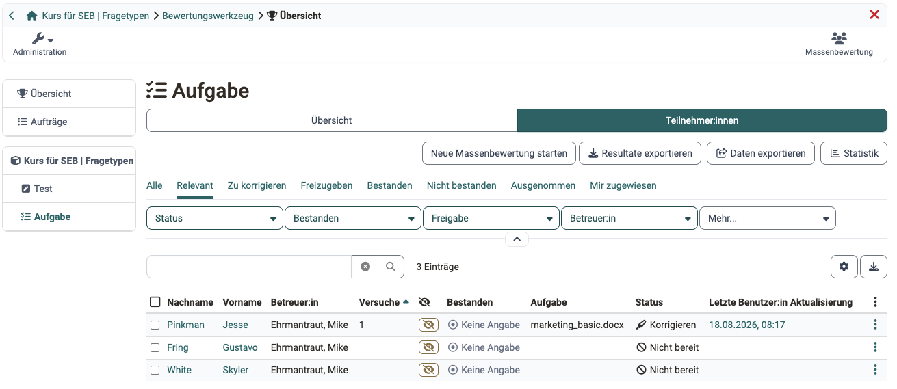
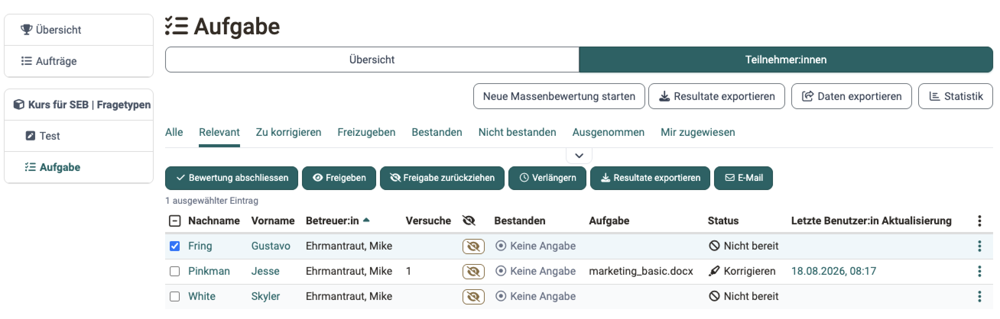

# Aufgaben und Gruppenaufgaben bewerten

Wer Abgaben in den Kursbausteinen "Aufgabe" und "Gruppenaufgabe" bewertet, erledigt das im Bewertungswerkzeug des Kurses. Hier erfahren Sie, wie Sie dort Abgaben ansehen, herunterladen und bewerten.

Sie öffnen das Bewertungswerkzeug unter: `Kurs > Administration > Bewertungswerkzeug`

Wählen Sie links den Kursbaustein aus, den Sie bewerten möchten. Er hat zwei Tabs: Im Tab "Übersicht" sehen Sie den Stand der Bewertung dieses Kursbausteins, zum Beispiel wie viele Personen ihn schon bestanden haben. Im Tab "Teilnehmer:innen" sehen Sie die Teilnehmenden und starten die Bewertung.

## Tab Teilnehmer:innen

**Generelle Aktionsmöglichkeiten**

{ class="shadow lightbox" title="Tab Teilnehmer:innen im Bewertungswerkzeug" }

Betreuer:innen und Besitzer:innen haben über die entsprechenden Buttons verschiedene Aktionsmöglichkeiten: 

* Über "Resultate exportieren" die abgegebenen Dokumente aller oder ausgewählter Teilnehmenden samt einem [Excel-Report](#results_export) herunterladen.
* Über "Daten exportieren" die Bewertungsdaten der Teilnehmenden ausgeben.
* Über "Statistik" die Auswertung des Kursbausteins öffnen.
* Über "Neue Massenbewertung starten" alle Teilnehmenden auf einmal bewerten.
* Über "Bewertung abschliessen" die Bewertung für alle oder ausgewählte Teilnehmende abschliessen.
* Über "Freigeben" und "Freigabe zurückziehen" die Bewertungen für alle oder ausgewählte Teilnehmende auf einen Schlag sichtbar oder unsichtbar machen.
* Über "E-Mail" eine E-Mail an alle oder ausgewählte Teilnehmende senden.
* Über "Verlängern" die Fristen für alle oder ausgewählte Personen verlängern.

Ohne Auswahl stehen die Buttons "Neue Massenbewertung starten", "Resultate exportieren", "Daten exportieren" und "Statistik" zur Verfügung. Wie Sie eine Massenbewertung für Aufgaben erstellen, beschreibt die Anleitung [Wie und wo kann ich eine Massenbewertung vornehmen?](../../manual_how-to/bulk_assessment/bulk_assessment.de.md)

Für Aktionen, die nur bestimmte Teilnehmende betreffen, wählen Sie diese Personen zuerst in der Liste aus. Danach erscheinen die Buttons für die Auswahl.

{ class="shadow lightbox" title="Teilnehmerliste im Bewertungswerkzeug" }

## Einreichung ansehen

Bevor Betreuer:innen oder Besitzer:innen eine Aufgabe bewerten, sehen sie sich die abgegebenen Dokumente an: einzeln für jede Person, oder für mehrere Personen gesammelt über die Massenbewertung oder den Download der abgegebenen Dokumente.

### Einreichungen einzelner Teilnehmender

Sobald Teilnehmende eine Datei mit dem Button "Endgültige Abgabe" abgegeben haben, können Betreuer:innen sie öffnen und ansehen.

Um die Abgabe _einer einzelnen Person_ anzusehen, wählen Sie die Person aus und klicken auf die abgegebene Datei.

{ class="shadow lightbox" title="Bewertungsflow einer Person" }

Wie Sie bewertbare Kursbausteine einzelner Personen bewerten, beschreibt die Schritt-für-Schritt-Anleitung [Lernende bewerten](Assessment_of_learners.de.md).

### Einreichungen aller oder mehrerer Teilnehmender

Wenn viele Teilnehmende abgegeben haben oder Sie viele Personen bewerten müssen, laden Sie mit dem Button "Resultate exportieren" alle Abgaben auf einmal herunter. In der heruntergeladenen ZIP-Datei finden Sie auch alle zugewiesenen Aufgabenstellungen.

Alternativ wählen Sie die gewünschten Personen aus und klicken dann auf "Resultate exportieren".

Anschliessend können Sie das [Bewertungsformular](The_assessment_form.de.md) ausfüllen. Es erscheint bei der Bewertung eines Kursbausteins unter "Bewertung".

### Excel-Report der Resultate [:octicons-tag-16:{ title="ab Release 21.0.2 (OO-9601)" }](https://track.frentix.com/issue/OO-9601) {: #results_export}

Die ZIP-Datei aus "Resultate exportieren" enthält neben den abgegebenen Dokumenten einen Excel-Report, sofern im Kursbaustein der Schritt "Bewertung" aktiviert ist. Ohne diesen Schritt enthält die ZIP-Datei nur die Dokumente. Der Report führt pro Person eine Zeile und hält fest, wer welchen Schritt wann abgeschlossen hat. Kursverantwortliche lesen daraus zum Beispiel ab, welche Betreuerin oder welcher Betreuer eine Bewertung abgeschlossen hat, und stützen darauf die Vergütung der Bewertungsarbeit.

Neben Laufnummer, Kurspfad, erstem Zugriff und den Personendaten enthält der Report diese Spalten:

Spalte | Inhalt | Erscheint
---------|----------|----------
Gruppe | Name der Gruppe, welche die Lösung abgegeben hat | nur beim Kursbaustein Gruppenaufgabe
Aufgabe | Titel der zugewiesenen Aufgabenstellung | wenn der Schritt Aufgabenstellung aktiviert ist
Schritt | Schritt des Workflows, in dem die Person aktuell steht | immer
Zuweisung abgeschlossen | Datum, an dem die Aufgabe zugewiesen wurde | wenn der Schritt Aufgabenstellung aktiviert ist
Abgabe abgeschlossen | Datum der endgültigen Abgabe | immer
Feedback abgeschlossen | Datum, an dem Rückgabe und Feedback abgeschlossen wurden | wenn der Schritt Feedback aktiviert ist
Überarbeitung abgeschlossen | Datum, an dem die Überarbeitung abgeschlossen wurde | wenn der Schritt Überarbeitung aktiviert ist
Bewertung abgeschlossen | Datum, an dem die Bewertung abgeschlossen wurde | wenn der Schritt Bewertung aktiviert ist
Bemerkungen | Bemerkungen zur Abgabe | immer
Betreuer | Die der Person zugewiesene betreuende Person | wenn die Zuweisung Betreuende/Teilnehmende aktiviert ist

Die Spalte "Betreuer" steht hinter den Bewertungsspalten (Punkte, Bestanden, Versuche, letzte Änderung).

Ein Schritt, der im Kursbaustein nicht aktiviert ist, erzeugt keine Spalte. Fehlt also zum Beispiel die Spalte "Feedback abgeschlossen", ist der Schritt Feedback in diesem Kursbaustein nicht aktiv. Welche Schritte aktiv sind, legen Kursbesitzer:innen im Kurseditor fest: `Kurs > Kurseditor > "Aufgabenbaustein" > Tab "Workflow"`.

Denselben Excel-Report erzeugt die Kursarchivierung, sofern im Kursbaustein der Schritt Bewertung aktiviert ist.

Wer Reports aus mehreren Kursen sammelt oder ausserhalb von OpenOlat ablegt, erkennt am Sheet "Exportinformationen", aus welchem Kurs und welchem Kursbaustein die Datei stammt und wann und von wem sie erstellt wurde. Die Excel-Datei hat dafür zwei Sheets: "Resultate" mit den Spalten oben und "Exportinformationen". Das Sheet "Exportinformationen" hat die Spalten "Information" und "Wert" und diese Zeilen: [:octicons-tag-16:{ title="ab Release 21.1.1 (OO-9812)" }](https://track.frentix.com/issue/OO-9812)

Zeile | Inhalt
---------|----------
URL | Link auf den Kursbaustein im Kurs. Über den Link gelangen Sie von der Datei direkt zur Aufgabe zurück.
OpenOlat Version | Version von OpenOlat, mit der die Datei erstellt wurde.
Kurstitel | Titel des Kurses.
Kurskennzeichen | Kennzeichen des Kurses. Hat der Kurs kein Kennzeichen, steht hier die ID des Kurses.
Kursbausteintitel | Titel des Kursbausteins.
Kursbaustein ID | Nummer des Kursbausteins. Dieselbe Nummer steht am Ende der URL. Sie bezeichnet den Kursbaustein eindeutig, auch wenn sich sein Titel später ändert.
Exportsprache | Sprache der Person, die den Export ausgelöst hat, als ausgeschriebener Name, zum Beispiel "German".
Exportiert | Datum und Uhrzeit des Exports.
Exportiert von | Name der Person, die den Export ausgelöst hat, in der Kursarchivierung die Person, die das Archiv erstellt hat. Leer bleibt die Zeile in Archivdateien, die OpenOlat selbst anlegt, zum Beispiel beim Löschen eines Kurses.

Dasselbe Sheet enthalten die Excel-Dateien mit Testresultaten, siehe [Tests exportieren](Test_export.de.md#export_information).

## Bewertungsmöglichkeiten Kursbaustein "Aufgabe"

Welche Schritte im Bewertungsflow zur Verfügung stehen, hängt von der Konfiguration des Kursbausteins ab. Sie wird im Kursbaustein ["Aufgabe"](../learningresources/Course_Element_Task.de.md) bzw. ["Gruppenaufgabe"](../learningresources/Course_Element_Grouptask.de.md) festgelegt. Im Bewertungswerkzeug lassen sich die Bewertungsoptionen nicht mehr ändern.

Falls so konfiguriert, laden Sie ein Rückgabe-Dokument hoch, zum Beispiel eine ausführliche Bewertungstabelle oder eine korrigierte Version der Einreichung. Mit dem Button "Benötigt Überarbeitung" geben Sie eine Einreichung an die teilnehmende Person zurück und lösen eine Überarbeitungsschleife aus.

Sobald Teilnehmende eine Aufgabe endgültig abgegeben haben, können sie nichts mehr abgeben oder austauschen. Wurde eine Aufgabe versehentlich abgegeben oder das falsche Dokument hochgeladen, öffnen Betreuer:innen die Abgabe mit "Abgabe erneut öffnen" wieder. Die Person kann dann erneut abgeben.

Wie weit der Bewertungsflow fortgeschritten ist, erkennen Teilnehmende und Betreuer:innen an den grünen Haken bei den einzelnen Bewertungsschritten.

Soll die Person keine Einreichungen oder Überarbeitungen mehr abgeben, klicken Sie auf den Button "Abgabe akzeptieren". Damit sind Bearbeitung und Bewertung der Aufgabe endgültig abgeschlossen. Die Teilnehmenden erhalten eine entsprechende Meldung.

Punkte, Feedback und weitere Angaben zur Bewertung hinterlegen Sie im unteren Teil im Bereich "Bewertung", dem eigentlichen Bewertungsformular. Die Möglichkeiten beschreibt die Seite [Das Bewertungsformular](The_assessment_form.de.md).

## Bewertungsflow für Gruppenaufgaben

Abgaben im Kursbaustein "Gruppenaufgabe" bewerten Sie ähnlich wie im Kursbaustein "Aufgabe".

 * Öffnen Sie die gewünschte Gruppenaufgabe.
 * Wählen Sie im Tab "Übersicht" die gewünschte Gruppe oder filtern Sie im Tab "Teilnehmer:innen" nach der gewünschten Gruppe.
 * Hat ein Gruppenmitglied für die Gruppe abgegeben, gilt die Abgabe für die ganze Gruppe und lässt sich für die ganze Gruppe bewerten.
 * Klicken Sie auf ein Gruppenmitglied oder wählen Sie im 3-Punkte-Menü die Option "Details anzeigen / bewerten". Damit öffnen Sie den Bewertungsflow der Gruppe.
 * Bewerten Sie die Gruppe wie beim Kursbaustein "Aufgabe".

Im Bereich "Bewertung", dem eigentlichen Bewertungsformular, klicken Sie auf den Button "Bewerten".

{ class="shadow lightbox" title="Bewertungsflow einer Gruppe im Bewertungswerkzeug" }

Mit dem Button "Bewerten" bewerten Sie alle Gruppenmitglieder auf einen Schlag und können trotzdem einzelne Gruppenmitglieder abweichend bewerten.

Wenn nicht die ganze Gruppe bestanden hat oder nicht alle dieselbe Punktzahl erhalten sollen, darf "Für die ganze Gruppe" _nicht_ ausgewählt sein. Dann bewerten Sie jedes Gruppenmitglied einzeln.

{ class="shadow lightbox" title="Dialog Bewertung einer Gruppenaufgabe" }

!!! info "Wichtig"

    Andere bewertbare Kursbausteine als die "Gruppenaufgabe" bewerten Sie für eine Gruppe für jedes Gruppenmitglied einzeln.

!!! note "Hinweis"

    Gruppen lassen sich auch direkt im Kursbaustein "Gruppenaufgabe" bewerten, ähnlich wie im Kursbaustein "Aufgabe".

## Weiterführende Informationen {: #further_information}

**Auf dieser Seite erwähnt** 
[Wie und wo kann ich eine Massenbewertung vornehmen? >](../../manual_how-to/bulk_assessment/bulk_assessment.de.md) 
[Lernende bewerten >](Assessment_of_learners.de.md) 
[Das Bewertungsformular >](The_assessment_form.de.md) 
[Tests exportieren >](Test_export.de.md) 
[Kursbaustein "Aufgabe" >](../learningresources/Course_Element_Task.de.md) 
[Kursbaustein "Gruppenaufgabe" >](../learningresources/Course_Element_Grouptask.de.md)

**Weiterführend** 
[Bewertungswerkzeug - Übersicht >](Assessment_tool_overview.de.md) 
[Bewertungswerkzeug: Tab Teilnehmer:innen >](Assessment_tool_tab_Users.de.md) 
[Bewertung von Kursbausteinen >](Assessment_of_course_modules.de.md)

[Zum Seitenanfang ^](#aufgaben-und-gruppenaufgaben-bewerten)
