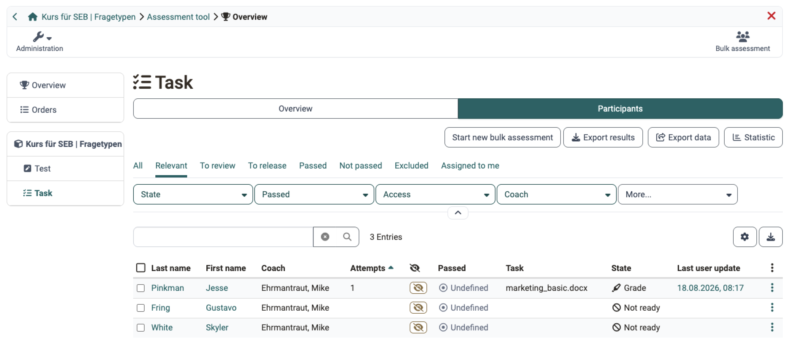
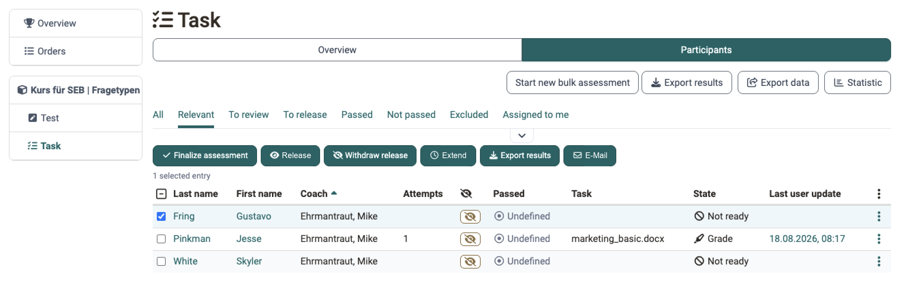
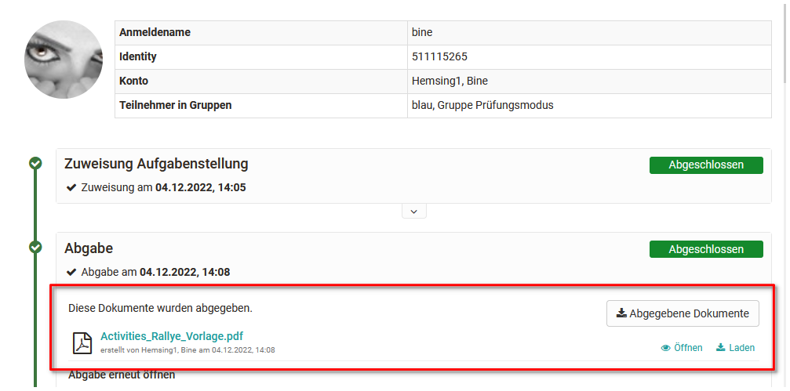
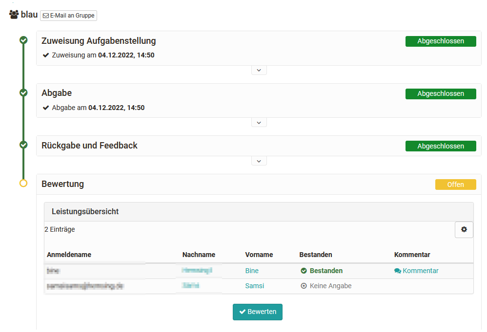
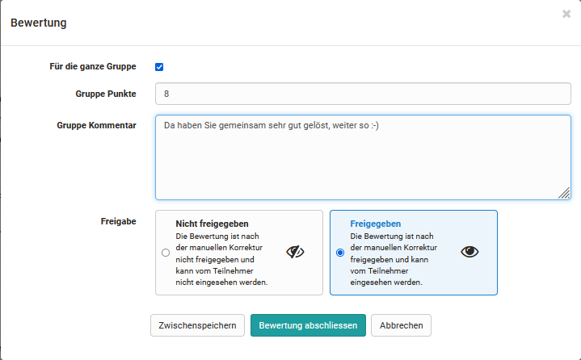

# Assessing tasks and group tasks

Whoever assesses submissions in the course elements "Task" and "Group task" does so in the assessment tool of the course. Here you will learn how to view, download and assess submissions there.

You open the assessment tool under: `Course > Administration > Assessment tool`

On the left, select the course element you want to assess. It has two tabs: In the tab "Overview" you see the state of the assessment of this course element, for example how many persons have already passed it. In the tab "Participants" you see the participants and start the assessment.

## Tab Participants

**General action options**

{ class="shadow lightbox" title="Tab Participants in the assessment tool" }

Course coaches and course owners have various action options via the corresponding buttons:

* Use "Export results" to download the submitted documents of all or selected participants together with an [Excel report](#results_export).
* Use "Export data" to output the assessment data of the participants.
* Use "Statistic" to open the analysis of the course element.
* Use "Start new bulk assessment" to assess all participants at once.
* Use "Finalize assessment" to finalize the assessment for all or selected participants.
* Use "Release" and "Withdraw release" to make the assessments visible or invisible for all or selected participants at once.
* Use "E-Mail" to send an email to all or selected participants.
* Use "Extend" to extend the deadlines for all or selected persons.

Without a selection, the buttons "Start new bulk assessment", "Export results", "Export data" and "Statistic" are available. How to create a bulk assessment for tasks is described in the guide [How and where can I do a bulk assessment?](../../manual_how-to/bulk_assessment/bulk_assessment.md)

For actions that only concern certain participants, first select these persons in the list. The buttons for the selection then appear.

{ class="shadow lightbox" title="Participant list in the assessment tool" }

## View submitted documents

Before coaches or owners assess a task, they look at the submitted documents: individually for each person, or collected for several persons via the bulk assessment or the download of the submitted documents.

### Submissions of individual participants

As soon as participants have submitted a file with the button "Final task submission", coaches can open and view it.

To view the submission of _an individual person_, select the person and click on the submitted file.

{ class="shadow lightbox" title="Assessment workflow of a person" }

How to assess assessable course elements of individual persons is described in the step-by-step guide [Assessment of learners](Assessment_of_learners.md).

### Submissions from all or multiple participants

If many participants have submitted or you need to assess many persons, download all submissions at once with the button "Export results". In the downloaded zip file you also find all assigned tasks.

Alternatively, select the desired persons and then click on "Export results".

Afterwards you can fill in the [Assessment form](The_assessment_form.md). It will appear under "Assessment" when you assess a course element.

### Excel report of the results [:octicons-tag-16:{ title="from Release 21.0.2 (OO-9601)" }](https://track.frentix.com/issue/OO-9601) {: #results_export}

Besides the submitted documents, the zip file from "Export results" contains an Excel report, provided the step "Grading" is activated in the course element. Without this step, the zip file contains only the documents. The report carries one row per person and records who completed which step and when. Course owners read from it, for example, which coach completed an assessment, and base the remuneration of the assessment work on it.

Besides the sequential number, course path, first access and the person data, the report contains these columns:

Column | Content | Appears
---------|----------|----------
Group | Name of the group that submitted the solution | only for the course element Group task
Task | Title of the assigned task | if the step Task is activated
Step | Workflow step the person currently stands in | always
Assignment completed | Date on which the task was assigned | if the step Task is activated
Submission completed | Date of the final submission | always
Feedback completed | Date on which return and feedback were completed | if the step Feedback is activated
Revision completed | Date on which the revision was completed | if the step Revision is activated
Grading completed | Date on which the assessment was completed | if the step Grading is activated
Remarks | Remarks on the submission | always
Coach | The coach assigned to the person | if the assignment of coaches and participants is activated

The column "Coach" stands behind the assessment columns (Score, Passed, Attempts, last change).

A step that is not activated in the course element produces no column. So if the column "Feedback completed" is missing, the step Feedback is not active in this course element. Which steps are active is defined by course owners in the course editor: `Course > Course editor > "Task element" > Tab "Workflow"`.

The course archiving produces the same Excel report, provided the step Grading is activated in the course element.

Whoever collects reports from several courses or stores them outside OpenOlat recognises from the sheet "Export information" which course and which course element the file comes from, and when and by whom it was created. For this, the Excel file has two sheets: "Results" with the columns above and "Export information". The sheet "Export information" has the columns "Information" and "Value" and these rows: [:octicons-tag-16:{ title="from Release 21.1.1 (OO-9812)" }](https://track.frentix.com/issue/OO-9812)

Row | Content
---------|----------
URL | Link to the course element in the course. The link takes you from the file directly back to the task.
OpenOlat Version | Version of OpenOlat with which the file was created.
Course title | Title of the course.
Course reference | Reference of the course. If the course has no reference, the ID of the course is shown here.
Course element title | Title of the course element.
Course element ID | Number of the course element. The same number is at the end of the URL. It identifies the course element unambiguously, even if its title changes later.
Export language | Language of the person who started the export, as a written-out name, for example "German".
Exported | Date and time of the export.
Exported by | Name of the person who started the export; in the course archiving, the person who created the archive. The row stays empty in archive files that OpenOlat creates itself, for example when a course is deleted.

The Excel files with test results contain the same sheet, see [Export tests](Test_export.md#export_information).

## Assessment workflow course element "Task"

Which steps are available in the assessment workflow depends on the configuration of the course element. It is defined in the course element ["Task"](../learningresources/Course_Element_Task.md) or ["Group task"](../learningresources/Course_Element_Grouptask.md). In the assessment tool, the assessment options can no longer be changed.

If configured accordingly, upload a return document, for example a detailed evaluation table or a corrected version of the submission. With the button "Needs revision" you return a submission to the participant and trigger a revision loop.

Once participants have finally submitted a task, they can no longer submit or exchange anything. If a task was submitted by mistake or the wrong document was uploaded, coaches reopen the submission with "Reopen submission". The person can then submit again.

Participants and coaches can see how far the assessment workflow has progressed by the green ticks next to the individual assessment steps.

If the person is not to submit any more submissions or revisions, click on the button "Accept submission". Processing and assessment of the task are then finally completed. The participants receive a corresponding message.

You record points, feedback and further assessment details in the lower part in the area "Assessment", the actual assessment form. The page [The assessment form](The_assessment_form.md) describes the options.

## Assessment workflow course element "Group task"

You assess submissions in the course element "Group task" in a similar way as in the course element "Task".

 * Open the desired group task.
 * Select the desired group in the tab "Overview" or filter for the desired group in the tab "Participants".
 * If a group member has submitted for the group, the submission applies to the whole group and can be assessed for the whole group.
 * Click on a group member or select the option "Show details / assess" in the 3-dot menu. This opens the assessment workflow of the group.
 * Assess the group as with the course element "Task".

In the area "Assessment", the actual assessment form, click on the button "Grade".

{ class="shadow lightbox" title="Assessment workflow of a group in the assessment tool" }

With the button "Grade" you assess all group members at once and can still assess individual group members differently.

If not the whole group has passed or not all should receive the same score, "For the whole group" must _not_ be selected. You then assess each group member individually.

{ class="shadow lightbox" title="Dialog Assessment of a group task" }

!!! info "Important"

    You assess course elements other than the "Group task" for a group individually for each group member.

!!! note "Note"

    Groups can also be assessed directly in the course element "Group task", similar to the course element "Task".

## Further information {: #further_information}

**Mentioned on this page** 
[How and where can I do a bulk assessment? >](../../manual_how-to/bulk_assessment/bulk_assessment.md) 
[Assessment of learners >](Assessment_of_learners.md) 
[The assessment form >](The_assessment_form.md) 
[Export tests >](Test_export.md) 
[Course Element "Task" >](../learningresources/Course_Element_Task.md) 
[Course Element "Group Task" >](../learningresources/Course_Element_Grouptask.md)

**Further** 
[Assessment tool - overview >](Assessment_tool_overview.md) 
[Assessment tool - Tab Users >](Assessment_tool_tab_Users.md) 
[Assessment of course modules >](Assessment_of_course_modules.md)

[To the top of the page ^](#assessing-tasks-and-group-tasks)