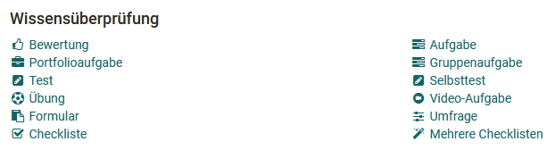
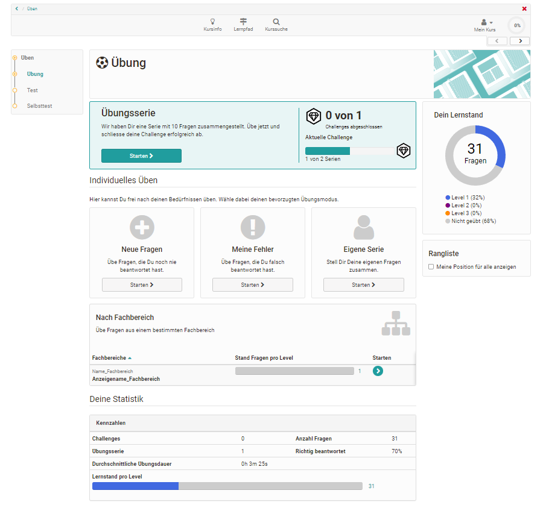
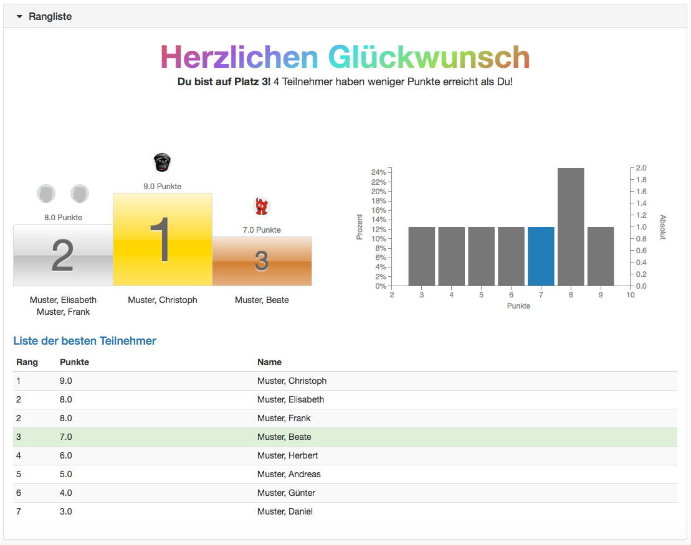

# Wissensüberprüfung {: #assessment}

Mit den Kursbausteinen der Gruppe "Wissensüberprüfung" prüfen Sie, was Teilnehmende gelernt haben, und bewerten ihre Leistungen. Diese Seite gibt einen Überblick, zu jedem Kursbaustein gibt es eine eigene Seite mit allen Einstellungen. Besitzer:innen des Kurses fügen die Kursbausteine im Kurseditor ein und konfigurieren sie dort: `Kurs > Administration > Kurseditor`. Betreuer:innen erreichen den Kurseditor nur, wenn ihnen im Kurs das Recht "Kurseditor" erteilt wurde.

{ class="shadow lightbox" title="Gruppe Wissensüberprüfung im Kurseditor" }

Im Zentrum stehen die drei Kursbausteine, die OpenOlat [Tests](../learningresources/Configure_tests.de.md) verwenden, und die beiden Kursbausteine für [Einsendeaufgaben](Course_Element_Task.de.md). Für weitere Szenarien stehen die [Portfolioaufgabe](../learningresources/Creating_Portfolio_Tasks.de.md), die [Bewertung](Course_Element_Assessment.de.md) mit oder ohne Rubrik-Bewertung und die Checkliste zur Wahl.

In den meisten Kursbausteinen dieser Gruppe können Sie Punkte vergeben. Der Kursbaustein erhält dann den Tab "HighScore" für die [Rangliste](#highscore). Die Punkte mehrerer Kursbausteine lassen sich zusammenzählen, und das Bestehen eines Kurses kann von den Bewertungen verschiedener Kursbausteine abhängen. In herkömmlichen Kursen übernimmt das ein Kursbaustein [Struktur](Course_Element_Structure.de.md).

Alle Kursbausteine dieser Gruppe ausser Selbsttest, Übung und Umfrage haben den Tab "Erinnerungen", bei Aufgabe und Gruppenaufgabe in Lernpfadkursen heisst er "Erinnerungen & To-dos". Dort richten Sie E-Mails ein, die OpenOlat abhängig vom Bearbeitungsstand des Kursbausteins verschickt, zum Beispiel wenn eine Aufgabe oder ein Test zu einem bestimmten Datum noch nicht bearbeitet ist. Die Möglichkeiten gleichen denen im Menü "Erinnerung" des Kurses: `Kurs > Administration > Erinnerung`. Mehr dazu: [Erinnerungen](../learningresources/Course_Reminders.de.md)

Zur Gruppe gehören auch die Kursbausteine "Umfrage" und "Formular". Mit ihnen binden Sie OpenOlat [Formulare](../learningresources/Form_Editor.de.md) für Befragungen und ähnliche Zwecke in einen Kurs ein.

## Kursbaustein "Bewertung" {: #course_element_assessment}
:fontawesome-regular-thumbs-up:

Mit dem Kursbaustein "Bewertung" bewerten Sie Leistungen, die Teilnehmende nicht in OpenOlat abgeben, zum Beispiel ein Referat vor Ort oder eine eigene Website. Für eine Bewertung nach festgelegten Kriterien steht die Rubrik-Bewertung zur Verfügung.

Wie Sie eine Bewertung einrichten, durchführen und konfigurieren, beschreibt die Seite [Kursbaustein "Bewertung"](Course_Element_Assessment.de.md).

## Kursbaustein "Aufgabe" {: #course_element_task}

:fontawesome-solid-list-check:

Mit dem Kursbaustein "Aufgabe" organisieren Sie Dateiabgaben und Einsendeaufgaben. Teilnehmende laden ihre Lösungen in den Kurs hoch und erhalten von den Betreuer:innen ein Feedback und eine Bewertung. Betreuer:innen können Überarbeitungen einfordern und Musterlösungen bereitstellen.

Den Ablauf der Aufgabe legen Sie im Tab "Workflow" fest. Dort schalten Sie die folgenden Schritte ein oder aus und konfigurieren sie anschliessend:

  * **Aufgabenstellung**: Stellen Sie eine Aufgabenstellung direkt im Kursbaustein zur Verfügung.
  * **Abgabe**: Teilnehmende reichen ihre Lösungen ein. Sie erstellen sie direkt in OpenOlat oder laden eine Datei hoch.
  * **Feedback**: Betreuer:innen geben korrigierte Aufgaben mit Feedback zurück und fordern bei Bedarf eine Überarbeitung an. Statt der Betreuer:innen oder zusätzlich können sich Teilnehmende auch gegenseitig beurteilen (Peer-Review).
  * **Überarbeitung**: Teilnehmende geben überarbeitete Dokumente ab. Betreuer:innen können weitere Überarbeitungen anfordern, bis sie die Aufgabe als erledigt betrachten und die Überarbeitung abschliessen.
  * **Musterlösungen**: Stellen Sie allen Teilnehmenden eine Musterlösung für die Aufgabe zur Verfügung. Musterlösungen laden Sie als Datei hoch oder erstellen sie direkt in OpenOlat.
  * **Bewertung**: Punkte, bestanden/nicht bestanden und Feedback erfassen Sie für jede Person einzeln.

Ob die Aufgabe obligatorisch oder freiwillig ist, legen Sie in Lernpfadkursen im Tab "Lernpfad" fest, in herkömmlichen Kursen im Tab "Workflow". Obligatorische Aufgaben müssen bearbeitet werden. OpenOlat zieht sie nach Ablauf des Abgabetermins ein und übergibt sie den Betreuer:innen zur Bewertung. Bei freiwilligen Aufgaben entscheiden Teilnehmende selbst, ob sie sie bearbeiten. Freiwillige Aufgaben zieht OpenOlat nach dem Abgabetermin nicht ein.

Alle Einstellungen des Kursbausteins beschreibt die Seite [Kursbaustein "Aufgabe"](Course_Element_Task.de.md).

## Kursbaustein "Portfolioaufgabe" {: #course_element_portfolio}

:fontawesome-solid-briefcase:

Mit dem Kursbaustein "Portfolioaufgabe" stellen Sie den Teilnehmenden eine vorbereitete Mappe bereit. Die Teilnehmenden holen die Portfolioaufgabe im Kurs ab und gelangen danach in ihren persönlichen Portfoliobereich. Dort füllen sie die Mappe mit Inhalten und geben sie bei Bedarf weiteren Personen oder den Betreuer:innen frei. Je nach Konfiguration können diese Personen das Portfolio kommentieren und bewerten.

Die Portfolioaufgabe braucht eine Portfoliovorlage, die Sie im Tab "Lerninhalt" verknüpfen. Unter "Portfoliovorlage wählen oder erstellen" wählen Sie mit "Auswählen" eine bestehende Portfoliovorlage oder legen mit "Erstellen" eine neue an. Wie Sie eine Portfolioaufgabe Schritt für Schritt erstellen, beschreibt die Seite [Portfolioaufgabe erstellen](../learningresources/Creating_Portfolio_Tasks.de.md).

Ist eine Portfoliovorlage verknüpft, zeigt der Tab ihren Titel. Mit "Vorschau" sehen Sie die Portfoliovorlage an, mit "Ersetzen" verknüpfen Sie eine andere.

!!! info "Wichtig"

    Hat eine teilnehmende Person die Portfoliovorlage bereits abgeholt, lässt sie sich nicht mehr ersetzen.

Im Tab "Bewertung" legen Sie fest, ob Punkte, der Status bestanden/nicht bestanden und individuelle Kommentare angezeigt werden.

Wie Teilnehmende eine Portfolioaufgabe abholen und bearbeiten, beschreibt die Seite [Portfolioaufgabe: abholen und bearbeiten](../learningresources/Portfolio_task_and_assignment_Collecting_and_editing.de.md). Wie Betreuer:innen eine Portfolioaufgabe kommentieren und bewerten, beschreibt die Seite [Portfolioaufgabe: kommentieren und bewerten](../learningresources/Portfolio_assignment_Grading.de.md).

Allgemeines zu Portfolio und E-Portfolio finden Sie auf der Seite [Allgemeines zum Portfolio](../area_modules/Portfolio_General_Information.de.md).

Alle Einstellungen des Kursbausteins beschreibt die Seite [Kursbaustein "Portfolioaufgabe"](Course_Element_Portfolio_Task.de.md).

## Kursbaustein "Gruppenaufgabe" [:octicons-tag-16:{ title="ab Release 10.3 (OO-991)" }](https://track.frentix.com/issue/OO-991) {: #course_element_group_tasks}
:fontawesome-solid-list-check:

Der Kursbaustein "Gruppenaufgabe" funktioniert weitgehend wie der Kursbaustein ["Aufgabe"](Course_Element_Task.de.md). Eine Gruppe bearbeitet die Aufgabe gemeinsam und gibt eine gemeinsame Lösung ab. Punkte und Feedback gelten für die ganze Gruppe und lassen sich für einzelne Gruppenmitglieder anpassen.

Gegenüber dem Kursbaustein "Aufgabe" gibt es zwei Unterschiede:

Im Tab "Workflow" wählen Sie eine oder mehrere Gruppen aus, denen die Aufgabe zugewiesen wird. Nur diese Gruppen sehen und bearbeiten die Aufgabe. Solange keine Gruppe zugewiesen ist, ist der Kursbaustein bei geschlossenem Kurseditor nicht sichtbar.

Bei geschlossenem Kurseditor zeigt der Tab "Teilnehmer:innen" den Betreuer:innen die zugeordneten Gruppen. Dort wählen sie eine Gruppe aus und bewerten sie. Bei der Bewertung entscheiden sie, ob die Bewertung für die ganze Gruppe oder nur für ein bestimmtes Gruppenmitglied gilt.

Alle Einstellungen des Kursbausteins beschreibt die Seite [Kursbaustein "Gruppenaufgabe"](Course_Element_Grouptask.de.md).

## Kursbaustein "Test" {: #course_element_test}
:fontawesome-solid-square-pen:

Mit dem Kursbaustein "Test" binden Sie eine Lernressource "Test" in Ihren Kurs ein. Ein Test dient im Kurs der Leistungsüberprüfung oder als Quiz und umfasst verschiedene [Fragetypen](../learningresources/Test_question_types.de.md). Je nach Fragetyp wertet OpenOlat den Test automatisch aus oder Betreuer:innen werten ihn manuell aus. OpenOlat verwendet für Tests das Format IMS QTI 2.1. Damit lassen sich Tests mit anderen Testsystemen und Learning-Management-Systemen austauschen, die diesen Standard ebenfalls unterstützen.

Ist noch kein Test verknüpft, zeigt der Tab "Test-Konfiguration" den Hinweis "Für diesen Kursbaustein wurde noch keine Test-Lernressource ausgewählt." Dort wählen Sie mit "Auswählen" einen bestehenden Test aus, erstellen mit "Erstellen" einen neuen oder importieren einen Test. Ist ein Test verknüpft, zeigt der Tab seinen Titel. "Vorschau" startet die Vorschau des Tests. Weitere Informationen finden Sie auf der Seite [Tests erstellen](../learningresources/Test.de.md).

Die Einstellungen des Tests im Kurs legen Sie vor allem in den Tabs "Test-Konfiguration" und "Optionen" fest, siehe [Tests auf Kursebene](../learningresources/Tests_at_course_level.de.md). Alle Einstellungen des Kursbausteins beschreibt die Seite [Kursbaustein "Test"](Course_Element_Test.de.md).

Die Einstellungen im Tab "Optionen" übernimmt OpenOlat zunächst aus der Lernressource. Möchten Sie sie für diesen Kurs ändern, wählen Sie im Tab "Optionen" die Einstellung "Konfiguration anpassen". Danach setzen Sie zum Beispiel eine Zeitbeschränkung, begrenzen die Anzahl der Lösungsversuche, erlauben Gästen die Teilnahme oder wählen Darstellungsoptionen. Ist "Fragetitel anzeigen" ausgeschaltet und "Menü-Navigation anzeigen" eingeschaltet, zeigt die Navigation anonymisierte Titel statt der Fragetitel.

Im Tab "Optionen" können Sie im Bereich "Informationstext (HTML-Seite)" eine HTML-Seite für den Test einrichten. OpenOlat zeigt sie auf der Startseite des Tests oberhalb der Start-Schaltfläche unter "Information" an. Sie können die Seite später wieder ersetzen.

Ist eine Seite gewählt, erscheint der Bereich "Sicherheitseinstellung" mit der Option "Verlinkung in gesamtem Ablageordner zulassen". Sie ist nützlich, wenn die Seite auf andere HTML-Dateien oder Grafiken im Ablageordner verlinkt. Sie bewirkt aber auch, dass versierte Teilnehmende Einsicht in den gesamten Ablageordner des Kurses erhalten.

Um den eingebundenen Test auszutauschen, klicken Sie im Tab "Test-Konfiguration" auf "Ersetzen" und wählen den neuen Test. Liegen bereits Testresultate von Teilnehmenden vor, können Sie diese im nächsten Schritt herunterladen. Ersetzen lässt sich der Test nur, wenn der Kursbaustein publizierbar ist.

!!! warning "Achtung"

    Wenn Teilnehmende den Test gerade ausführen und noch nicht abgeschlossen haben, gehen deren Resultate verloren. Ebenso gehen alle Resultate verloren, die zwischen dem Austauschen des Tests und dem Publizieren dieser Änderung angefallen sind.

Ein in einem Kurs verlinkter Test lässt sich nur so lange vollständig im Testeditor bearbeiten, bis ihn mindestens eine teilnehmende Person gestartet und abgeschlossen hat. Danach können nur noch Tippfehler korrigiert werden.

OpenOlat speichert die Resultate der Teilnehmenden personalisiert.

## Kursbaustein "Selbsttest" {: #course_element_self_test}

:fontawesome-solid-square-pen:

Den Kursbaustein "Selbsttest" konfigurieren Sie ähnlich wie den Kursbaustein "Test". Ein Selbsttest kennt aber keinen Status bestanden/nicht bestanden, hat keinen Tab "HighScore" und erscheint nicht im Bewertungswerkzeug.

Selbsttests dienen dem Üben: OpenOlat speichert alle Eingaben anonym, und Teilnehmende können einen Selbsttest so oft wie gewünscht bearbeiten.

Im Kursbaustein "Selbsttest" binden Sie wie beim Kursbaustein "Test" eine Lernressource vom Typ Test ein. Wenn Sie noch keinen Test erstellt haben, folgen Sie den Anweisungen auf der Seite ["Wie gehe ich vor, wenn ich einen Test erstelle?"](../../manual_how-to/test_creation_procedure/test_creation_procedure.de.md).

Weitere Informationen zu Tests finden Sie auf den Seiten [Tests erstellen](../learningresources/Test.de.md) und [Tests auf Kursebene](../learningresources/Tests_at_course_level.de.md).

Eine komplexere Alternative zum Selbsttest ist der Kursbaustein "Übung".

## Kursbaustein "Übung" [:octicons-tag-16:{ title="ab Release 17.0 (OO-5220)" }](https://track.frentix.com/issue/OO-5220) {: #course_element_uebung}

:octicons-device-camera-video-24: **Video-Einführung**: [Der Kursbaustein Übung](<https://www.youtube.com/embed/ljbqzYLn0Zs>){:target="_blank"}

Der Kursbaustein mit Lernkarten-Logik dient der individuellen Selbstüberprüfung der Teilnehmenden. Dafür kombiniert die Lehrperson mehrere OpenOlat Tests oder Fragen-Sets aus dem Fragenpool, die die Teilnehmenden selbständig in Serien und Challenges bearbeiten. Die Anzahl der Fragen pro Übungsserie lässt sich genau wie die Anzahl der Challenges festlegen. Umfasst eine Serie beispielsweise 10 Fragen, werden 10 Fragen eingeblendet. Danach entscheiden Teilnehmende, ob sie falsch beantwortete Fragen nochmals beantworten oder überspringen. Die Anzahl der Level spiegelt die Intensität der Übung wider und gibt an, wie häufig eine Frage wiederholt korrekt beantwortet werden muss.

{ class="shadow lightbox" title="Kursbaustein Übung aus Sicht der Teilnehmenden" }

Neben der "Übungsserie", die OpenOlat nach den Einstellungen der Lehrperson zusammenstellt, wählen Teilnehmende unter "Individuelles Üben" einen eigenen Übungsmodus: "Neue Fragen" übt Fragen, die sie noch nie beantwortet haben, "Meine Fehler" übt falsch beantwortete Fragen, und unter "Eigene Serie" stellen sie Fragen selbst zusammen, zum Beispiel gefiltert nach Level oder Fachbereich. Im Bereich "Nach Fachbereich" üben sie Fragen aus einem bestimmten Fachbereich.

Nach Abschluss einer Challenge sind neben der Einordnung in Ranglisten detaillierte Statistiken zum Lernstand sowie eine zusammenfassende Übersicht verfügbar.

!!! info "Wichtig"

    Für diesen Kursbaustein können nur automatisch auswertbare Testfragen verwendet werden.

## Kursbaustein "Videoaufgabe" [:octicons-tag-16:{ title="ab Release 17.2 (OO-6643)" }](https://track.frentix.com/issue/OO-6643)

Mit dem Kursbaustein "Videoaufgabe" verwenden Sie Lernressourcen "Video" für interaktive Übungen (formativ) oder für Aufgaben mit Bewertung (summativ). Teilnehmende erkennen im Video relevante Situationen und ordnen ihnen Begriffe zu. Die Abschnitte im Video (Segmente) und die Begriffe legen Sie in der Lernressource "Video" fest. Zur Wahl stehen die Modi "Übung: Begriffe zuordnen", "Übung: Situationen erkennen" und "Test: Situationen erkennen". Bewertbar ist nur der Test.

## Kursbaustein "Formular" [:octicons-tag-16:{ title="ab Release 15.5 (OO-5338)" }](https://track.frentix.com/issue/OO-5338) {: #course_element_form}

Mit dem Kursbaustein "Formular" fügen Sie einem Kurs eine Lernressource "Formular" hinzu. Das Formular funktioniert ähnlich wie der Kursbaustein "Umfrage". Teilnehmende füllen es einmal aus, mit der Option "Mehrfaches Ausfüllen des Formulars" auch mehrmals. Anders als bei der Umfrage sind die Antworten nicht anonym: Betreuende sehen, wer das Formular wie ausgefüllt hat.

Im Tab "Formular" legen Sie unter "Teilnahme bis ..." einen Abgabetermin fest. Ergänzend können Sie eine [Kurs-Erinnerung](../learningresources/Course_Reminders.de.md) verknüpfen. Ist die Option "E-Mail Bestätigung" für Teilnehmende gewählt, erhalten sie nach der Abgabe eine Bestätigung mit Datum und Uhrzeit sowie ihrem ausgefüllten Formular als PDF. Die Bestätigung lässt sich auch an Besitzer:innen, Betreuer:innen und externe E-Mail-Adressen senden.

Betreuende sehen im Kurs in einer Übersichtstabelle, welche Teilnehmenden das Formular schon ausgefüllt haben und welche nicht. Ein abgegebenes Formular öffnen sie mit "Wieder öffnen" zur weiteren Bearbeitung oder setzen es mit "Daten zurücksetzen" ganz zurück. Ein Klick auf eine teilnehmende Person zeigt ihr ausgefülltes Formular. Die Formulardaten aller Teilnehmenden stehen als Excel-Export zur Verfügung.

Der Kursbaustein hilft zum Beispiel, wenn Teilnehmende bestimmte Formulare verpflichtend ausfüllen müssen, etwa vor einem Laborpraktikum oder als Bestätigung, dass sie eine Leistung eigenständig erbracht haben.

!!! info "Wichtig"

    Anders als der Kursbaustein "Umfrage" bietet der Kursbaustein "Formular" keine grafische Auswertung der Antworten.

## Kursbaustein "Umfrage" [:octicons-tag-16:{ title="ab Release 13.0 (OO-3676)" }](https://track.frentix.com/issue/OO-3676) {: #course_element_survey}

:fontawesome-solid-sliders:

Mit dem Kursbaustein "Umfrage" fügen Sie Ihrem Kurs einen Online-Fragebogen hinzu. Als Basis dient die Lernressource "Formular", die Sie mit dem Kursbaustein Umfrage verknüpfen. Wenn Sie noch kein Formular für Befragungen erstellt haben, folgen Sie den Anweisungen unter "[Wie erstelle ich eine Formular-Lernressource?](../../manual_how-to/create_a_form/create_a_form.de.md)". OpenOlat speichert die Resultate einer Umfrage standardmässig anonymisiert.

Ein im Kurs verknüpftes Formular lässt sich im [Formulareditor](../learningresources/Form_Editor.de.md) nur so lange vollständig bearbeiten, wie es noch niemand zum Ausfüllen geöffnet hat. Danach können nur noch Tippfehler korrigiert werden.

!!! warning "Achtung"

    Wenn Teilnehmende aktuell die Umfrage ausführen, jedoch noch nicht abgeschlossen haben, gehen deren Resultate verloren.

Weitere Informationen zu Fragebogen und Umfrage finden Sie auf der Seite [Formulare - Übersicht](../learningresources/Form.de.md) und ihren Unterseiten.

## Kursbaustein "Checkliste" [:octicons-tag-16:{ title="ab Release 9.4 (OO-936)" }](https://track.frentix.com/issue/OO-936) {: #course_element_checklist}

:fontawesome-regular-square-check:

Mit dem Kursbaustein "Checkliste" binden Sie Check- oder Prüflisten in die Kursstruktur ein und bewerten sie. Eine Checkliste enthält Punkte, die als erledigt oder unerledigt abgehakt werden. Sie hilft Teilnehmenden zum Beispiel, kleinere Aufgaben zu erledigen oder Informationen festzuhalten, und eignet sich als Anwesenheits- oder To-do-Liste.

Mit "Mehrere Checklisten" fügen Sie mehrere identische Checklisten auf einmal hinzu. OpenOlat legt dabei bis zu 12 Kursbausteine mit denselben Punkten an und fasst sie in einem Kursbaustein "Struktur" zusammen. Jeder Kursbaustein erhält automatisch einen Titel, den Sie ändern können, und kann ein eigenes Abgabedatum erhalten.

So erstellen Sie schnell mehrere Checklisten mit denselben Kriterien, zum Beispiel für verschiedene Gruppen, für verschiedene zu prüfende Objekte, für verschiedene Veranstaltungstermine oder um denselben Gegenstand zu verschiedenen Zeitpunkten zu prüfen.

Alle Einstellungen des Kursbausteins beschreibt die Seite [Kursbaustein "Checkliste"](Course_Element_Checklist.de.md).

## Rangliste [:octicons-tag-16:{ title="ab Release 11.3 (OO-2133)" }](https://track.frentix.com/issue/OO-2133) {: #highscore}

Vergeben Sie in einem Kursbaustein Punkte, können Sie den Teilnehmenden eine Rangliste anzeigen. Die Rangliste ermöglicht einen spielerischen Vergleich der Teilnehmenden und kann als Motivationsfaktor verstanden werden.

Eingerichtet wird die Rangliste im Tab "HighScore". Über diesen Tab verfügen alle bewertbaren Kursbausteine mit Ausnahme der Kursbausteine Übung und Videoaufgabe, zusätzlich der Kursbaustein "Struktur". Voraussetzung
für die Nutzung des Tabs "HighScore" ist, dass für den gewählten Baustein
(z.B. Test, Aufgabe, Bewertung) Punkte vergeben werden.

Zuerst muss "Highscore anzeigen" aktiviert werden. Optional kann ein
Anfangsdatum hinzugefügt werden. Ab diesem Datum wird die Rangliste angezeigt.
Andernfalls wird die Rangliste direkt nach Beenden des Tests angezeigt.
Mit "Daten der Benutzer:innen anonymisieren" zeigt die Rangliste die Personen anonymisiert statt mit Vor- und Nachnamen. Im nächsten Abschnitt können Sie
wählen, welche Elemente der Rangliste angezeigt werden sollen. Zur Auswahl
stehen der Gratulationstitel, das Siegertreppchen, das Histogramm und die Liste
der besten Teilnehmer:innen. Bei der Liste kann zudem definiert werden, ob alle
Teilnehmenden oder nur eine gewisse Anzahl der besten Teilnehmenden angezeigt werden
soll. Mindestens eine dieser Optionen muss ausgewählt werden.

{ class="shadow lightbox" title="Rangliste eines Kursbausteins" }

---

## Weiterführende Informationen {: #further_information}

**Auf dieser Seite erwähnt** 
[Test konfigurieren >](Configure_tests.de.md) 
[Kursbaustein "Aufgabe" >](Course_Element_Task.de.md) 
[Portfolioaufgabe erstellen >](Creating_Portfolio_Tasks.de.md) 
[Kursbaustein "Bewertung" >](Course_Element_Assessment.de.md) 
[Kursbaustein "Struktur" >](Course_Element_Structure.de.md) 
[Erinnerungen >](Course_Reminders.de.md) 
[Der Formulareditor >](Form_Editor.de.md) 
[Portfolioaufgabe: abholen und bearbeiten >](Portfolio_task_and_assignment_Collecting_and_editing.de.md) 
[Portfolioaufgabe: kommentieren und bewerten >](Portfolio_assignment_Grading.de.md) 
[Allgemeines zum Portfolio >](../area_modules/Portfolio_General_Information.de.md) 
[Kursbaustein "Portfolioaufgabe" >](Course_Element_Portfolio_Task.de.md) 
[Kursbaustein "Gruppenaufgabe" >](Course_Element_Grouptask.de.md) 
[Test Fragetypen >](Test_question_types.de.md) 
[Tests erstellen >](Test.de.md) 
[Tests auf Kursebene >](Tests_at_course_level.de.md) 
[Kursbaustein "Test" >](Course_Element_Test.de.md) 
[Wie gehe ich vor, wenn ich einen Test erstelle? >](../../manual_how-to/test_creation_procedure/test_creation_procedure.de.md) 
[Wie erstelle ich eine Formular-Lernressource? >](../../manual_how-to/create_a_form/create_a_form.de.md) 
[Formulare - Übersicht >](Form.de.md) 
[Kursbaustein "Checkliste" >](Course_Element_Checklist.de.md)

**Weiterführend** 
[Kursbausteine >](Course_Elements.de.md) 
[Bewertungswerkzeug - Übersicht >](Assessment_tool_overview.de.md) 
[Kurseinstellungen - Tab Bewertung >](Course_Settings_Assessment.de.md)

**youtube** 
[Der Kursbaustein Übung](<https://www.youtube.com/embed/ljbqzYLn0Zs>)

[Zum Seitenanfang ^](#assessment)
