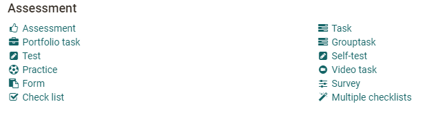
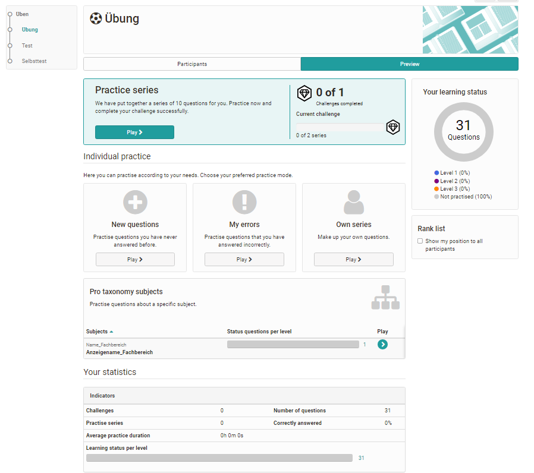
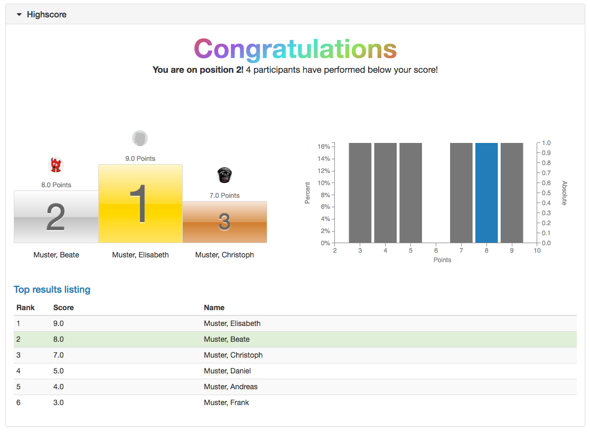

# Assessment {: #assessment}

With the course elements of the group "Assessment" you check what participants have learned and assess their performance. This page gives an overview; each course element has its own page with all settings. The owners of the course add the course elements in the course editor and configure them there: `Course > Administration > Course editor`. Coaches only reach the course editor if they have been granted the "Course editor" right in the course.

{ class="shadow lightbox" title="Group Assessment in the course editor" }

At the centre are the three course elements that use OpenOlat [tests](../learningresources/Configure_tests.md) and the two course elements for [submission tasks](Course_Element_Task.md). For further scenarios, the [portfolio task](../learningresources/Creating_Portfolio_Tasks.md), the [assessment](Course_Element_Assessment.md) with or without rubric assessment, and the check list are available.

In most course elements of this group you can award points. The course element then receives the tab "HighScore" for the [highscore](#highscore). The points of several course elements can be added up, and passing a course can depend on the assessments of different course elements. In conventional courses, a course element [Structure](Course_Element_Structure.md) takes care of this.

All course elements of this group except Self-test, Practice and Survey have the tab "Reminders"; for Task and Grouptask in learning path courses it is called "Reminders & to-dos". There you set up emails that OpenOlat sends depending on the progress of the course element, for example if a task or a test has not been worked on by a certain date. The options are similar to those in the menu "Reminders" of the course: `Course > Administration > Reminders`. More about this: [Course Reminders](../learningresources/Course_Reminders.md)

The group also includes the course elements "Survey" and "Form". With them, you build OpenOlat [forms](../learningresources/Form_Editor.md) for surveys and similar purposes into a course.

## Course Element: Assessment {: #course_element_assessment}

:fontawesome-regular-thumbs-up:

With the course element "Assessment" you assess achievements that participants do not submit in OpenOlat, for example an on-site presentation or a website of their own. For an assessment based on defined criteria, the rubric assessment is available.

How to set up, carry out and configure an assessment is described on the page [Course Element "Assessment"](Course_Element_Assessment.md).

## Course Element: Task {: #course_element_task}

:fontawesome-solid-list-check:

With the course element "Task" you organise file submissions and submission tasks. Participants upload their solutions to the course and receive feedback and an assessment from the coaches. Coaches can request revisions and provide sample solutions.

You define the sequence of the task in the tab "Workflow". There you switch the following steps on or off and then configure them:

  * **Task assignment**: Provide a task directly in the course element.
  * **Submission**: Participants submit their solutions. They create them directly in OpenOlat or upload a file.
  * **Feedback**: Coaches return corrected tasks with feedback and request a revision if needed. Instead of the coaches or in addition, participants can also assess each other (peer review).
  * **Revision**: Participants submit revised documents. Coaches can request further revisions until they consider the task completed and close the revision.
  * **Sample solution**: Provide all participants with a sample solution for the task. You upload sample solutions as a file or create them directly in OpenOlat.
  * **Grading**: You record points, passed/failed and feedback individually for each person.

Whether the task is mandatory or optional is defined in the tab "Learning path" in learning path courses, and in the tab "Workflow" in conventional courses. Mandatory tasks have to be completed. OpenOlat collects them after the deadline and hands them over to the coaches for assessment. With optional tasks, participants decide themselves whether to work on them. OpenOlat does not collect optional tasks after the deadline.

All settings of the course element are described on the page [Course Element "Task"](Course_Element_Task.md).

## Course Element: Portfolio Task {: #course_element_portfolio}

:fontawesome-solid-briefcase:

With the course element "Portfolio task" you provide participants with a prepared binder. The participants pick up the portfolio task in the course and are then taken to their personal portfolio area. There they fill the binder with content and, if needed, share it with other people or the coaches. Depending on the configuration, these persons can comment on and assess the portfolio.

The portfolio task needs a portfolio template, which you link in the tab "Learning content". Under "Select or create portfolio template", you select an existing portfolio template with "Select" or create a new one with "Create". How to create a portfolio task step by step is described on the page [Creating Portfolio Tasks](../learningresources/Creating_Portfolio_Tasks.md).

Once a portfolio template is linked, the tab shows its title. With "Preview" you view the portfolio template, with "Replace" you link a different one.

!!! info "Important"

    Once a participant has picked up the portfolio template, it can no longer be replaced.

In the tab "Assessment" you define whether points, the status passed/failed and individual comments are displayed.

How participants pick up and work on a portfolio task is described on the page [Portfolio task: collecting and editing](../learningresources/Portfolio_task_and_assignment_Collecting_and_editing.md). How coaches comment on and assess a portfolio task is described on the page [Portfolio assignment: Grading](../learningresources/Portfolio_assignment_Grading.md).

General information on portfolio and e-portfolio can be found on the page [Portfolio - General Information](../area_modules/Portfolio_General_Information.md).

All settings of the course element are described on the page [Course Element "Portfolio Task"](Course_Element_Portfolio_Task.md).

## Course Element: Group Task [:octicons-tag-16:{ title="from Release 10.3 (OO-991)" }](https://track.frentix.com/issue/OO-991) {: #course_element_group_tasks}

:fontawesome-solid-list-check:

The course element "Group task" works largely like the course element ["Task"](Course_Element_Task.md). A group works on the task together and submits a joint solution. Points and feedback apply to the whole group and can be adjusted for individual group members.

There are two differences compared with the course element "Task":

In the tab "Workflow" you select one or more groups to which the task is assigned. Only these groups see and work on the task. As long as no group is assigned, the course element is not visible when the course editor is closed.

When the course editor is closed, the tab "Participants" shows the coaches the assigned groups. There they select a group and assess it. During the assessment they decide whether the assessment applies to the whole group or only to a certain group member.

All settings of the course element are described on the page [Course Element "Group Task"](Course_Element_Grouptask.md).

## Course Element: Test {: #course_element_test}

:fontawesome-solid-square-pen:

With the course element "Test" you integrate a learning resource "Test" into your course. A test in a course is used to assess achievements or as a quiz and includes various [question types](../learningresources/Test_question_types.md). Depending on the question type, OpenOlat evaluates the test automatically or coaches evaluate it manually. OpenOlat uses the IMS QTI 2.1 format for tests. This allows tests to be exchanged with other test systems and learning management systems that also support this standard.

If no test is linked yet, the tab "Test configuration" shows the notice "No test learning resource has been selected for this course element yet." There you select an existing test with "Select", create a new one with "Create" or import a test. Once a test is linked, the tab shows its title. "Preview" starts the preview of the test. Further information can be found on the page [Creating Tests](../learningresources/Test.md).

You define the settings of the test in the course mainly in the tabs "Test configuration" and "Options", see [Tests at course level](../learningresources/Tests_at_course_level.md). All settings of the course element are described on the page [Course Element "Test"](Course_Element_Test.md).

OpenOlat initially takes the settings in the tab "Options" from the learning resource. If you want to change them for this course, select the setting "Adjust configuration" in the tab "Options". You can then, for example, set a time limit, limit the number of attempts, allow guests to take part or choose display options. If "Show question title" is switched off and "Allow menu navigation" is switched on, the navigation shows anonymised titles instead of the question titles.

In the tab "Options" you can set up an HTML page for the test in the section "Information (HTML page)". OpenOlat shows it on the start page of the test above the start button under "Information". You can replace the page later.

Once a page is selected, the section "Security settings" appears with the option "Allow links in the entire storage folder.". It is useful if the page links to other HTML files or graphics in the storage folder. However, it also means that experienced participants can view the entire storage folder of the course.

To exchange the integrated test, click "Replace" in the tab "Test configuration" and select the new test. If participants already have test results, you can download them in the next step. The test can only be replaced if the course element is publishable.

!!! warning "Attention"

    If participants are taking the test at that moment and have not yet completed it, their results will be lost. All results achieved between replacing the test and publishing this change will be lost as well.

A test linked in a course can only be edited completely in the test editor until at least one participant has started and completed it. After that only typing errors can be corrected.

OpenOlat stores the results of the participants in personalised form.

## Course Element: Self-test {: #course_element_self_test}

:fontawesome-solid-square-pen:

You configure the course element "Self-test" similarly to the course element "Test". A self-test, however, has no status passed/failed, has no tab "HighScore" and does not appear in the assessment tool.

Self-tests are meant for practice: OpenOlat saves all entries anonymously, and participants can take a self-test as often as they like.

In the course element "Self-test" you integrate a learning resource of the type Test, just as in the course element "Test". If you have not created a test yet, follow the instructions on the page ["How do I proceed when I create a test?"](../../manual_how-to/test_creation_procedure/test_creation_procedure.md).

For more information on tests, refer to the pages [Creating Tests](../learningresources/Test.md) and [Tests at course level](../learningresources/Tests_at_course_level.md).

A more complex alternative to the self-test is the course element "Practice".

## Course Element: Practice [:octicons-tag-16:{ title="from Release 17.0 (OO-5220)" }](https://track.frentix.com/issue/OO-5220) {: #course_element_uebung}

:octicons-device-camera-video-24: **Video introduction (German)**: [The course element Practice](<https://www.youtube.com/embed/ljbqzYLn0Zs>){:target="_blank"}

The course element with flashcard logic is used for individual self-testing of participants. For this purpose, the teacher combines several OpenOlat tests or question sets from the question bank, which the participants work on independently in series and challenges. The number of questions per practice series can be defined, as can the number of challenges. For example, if a series comprises 10 questions, 10 questions are shown. Afterwards, participants decide whether to answer incorrectly answered questions again or skip them. The number of levels reflects the intensity of the practice and indicates how often a question has to be answered correctly repeatedly.

{ class="shadow lightbox" title="Course element Practice from the participant view" }

Besides the "Practice series" that OpenOlat compiles according to the teacher's settings, participants choose their own practice mode under "Individual practice": "New questions" practises questions they have never answered, "My errors" practises incorrectly answered questions, and under "Own series" they compile questions themselves, for example filtered by level or subject. In the section "Per taxonomy subject" they practise questions from a specific subject.

After completion of a challenge, detailed statistics on the learning status as well as a summary overview are available in addition to the classification in ranking lists.

!!! info "Important"

    Only automatically evaluable test questions can be used for this course element.

## Course Element: Video task [:octicons-tag-16:{ title="from Release 17.2 (OO-6643)" }](https://track.frentix.com/issue/OO-6643)

With the course element "Video task" you use learning resources "Video" for interactive exercises (formative) or for tasks with assessment (summative). Participants identify relevant situations in the video and assign terms to them. You define the sections in the video (segments) and the terms in the learning resource "Video". The modes "Practice: Assign terms", "Practice: Identify situations" and "Test: Identify situations" are available. Only the test can be assessed.

## Course Element: Form [:octicons-tag-16:{ title="from Release 15.5 (OO-5338)" }](https://track.frentix.com/issue/OO-5338) {: #course_element_form}

With the course element "Form" you add a learning resource "Form" to a course. The form works similarly to the course element "Survey". Participants fill it in once, or several times with the option "Filling out the form multiple times". Unlike the survey, the answers are not anonymous: coaches see who filled in the form and how.

In the tab "Form" you set a deadline under "Completion deadline". In addition, you can link a [course reminder](../learningresources/Course_Reminders.md). If the option "Confirmation e-mail" is selected for participants, they receive a confirmation with the date and time after submitting, together with their completed form as a PDF. The confirmation can also be sent to owners, coaches and external email addresses.

Coaches see in an overview table in the course which participants have already completed the form and which have not. They reopen a submitted form for further editing with "Reopen" or reset it completely with "Reset data". A click on a participant shows their completed form. The form data of all participants are available as Excel export.

The course element helps, for example, when participants have to fill in certain forms obligatorily, such as before a laboratory internship or as confirmation that they have performed a task independently.

!!! info "Important"

    Unlike the course element "Survey", the course element "Form" does not offer a graphical evaluation of the answers.

## Course Element: Survey [:octicons-tag-16:{ title="from Release 13.0 (OO-3676)" }](https://track.frentix.com/issue/OO-3676) {: #course_element_survey}

:fontawesome-solid-sliders:

With the course element "Survey" you can add an online questionnaire to your course. It is based on the learning resource "Form", which you link to the course element Survey. If you have not yet created a form for surveys, follow the instructions under "[How do I create a form learning resource?](../../manual_how-to/create_a_form/create_a_form.md)". By default, OpenOlat stores the results of a survey anonymously.

A form linked in a course can only be edited completely in the [form editor](../learningresources/Form_Editor.md) as long as nobody has opened it to fill it in. After that only typing errors can be corrected.

!!! warning "Attention"

    If participants are currently running the questionnaire but have not yet completed it, their results will be lost.

Further information on questionnaires and surveys can be found on the page [Forms - Overview](../learningresources/Form.md) and its subpages.

## Course Element: Check list [:octicons-tag-16:{ title="from Release 9.4 (OO-936)" }](https://track.frentix.com/issue/OO-936) {: #course_element_checklist}

:fontawesome-regular-square-check:

With the course element "Check list" you embed check lists or inspection lists in the course structure and assess them. A check list contains items that are ticked off as completed or not completed. It helps participants, for example, to complete smaller tasks or to record information, and it serves as an attendance or to-do list.

With "Multiple checklists" you add several identical check lists at once. OpenOlat creates up to 12 course elements with the same items and groups them in a course element "Structure". Each course element automatically receives a title, which you can change, and can be given its own submission date.

In this way you quickly create several check lists with the same criteria, for example for different groups, for different objects to be checked, for different event dates or to check the same object at different times.

All settings of the course element are described on the page [Course Element "Checklist"](Course_Element_Checklist.md).

## Highscore [:octicons-tag-16:{ title="from Release 11.3 (OO-2133)" }](https://track.frentix.com/issue/OO-2133) {: #highscore}

If you award points in a course element, you can show the participants a highscore. The highscore makes a playful comparison between participants possible and can be seen as motivational factor.

The highscore is set up in the tab "HighScore". This tab is available in all assessable course elements except for the course elements Practice and Video task, and additionally in the course element "Structure". The prerequisite for using the
"HighScore" tab is that points are awarded in the selected course element (e.g. test,
task, assessment).

First "Show Highscore" needs to be enabled. Optionally, a starting date can be
added. From this date on the highscore is shown. Otherwise the highscore is
shown directly after finishing the test. With "Anonymize usernames" the highscore shows the persons anonymised instead of with first and last name. In the next part you
choose which elements of the highscore are shown. You can choose between the congratulations title, the podium, the histogram and the top results listing.
For the listing you can additionally define whether all participants or only a certain
number of top participants are shown. At least one of these options needs to be selected.

{ class="shadow lightbox" title="Highscore of a course element" }

---

## Further information {: #further_information}

**Mentioned on this page** 
[Configure tests >](Configure_tests.md) 
[Course Element "Task" >](Course_Element_Task.md) 
[Creating Portfolio Tasks >](Creating_Portfolio_Tasks.md) 
[Course Element "Assessment" >](Course_Element_Assessment.md) 
[Course Element "Structure" >](Course_Element_Structure.md) 
[Course Reminders >](Course_Reminders.md) 
[The form editor >](Form_Editor.md) 
[Portfolio task: collecting and editing >](Portfolio_task_and_assignment_Collecting_and_editing.md) 
[Portfolio assignment: Grading >](Portfolio_assignment_Grading.md) 
[Portfolio - General Information >](../area_modules/Portfolio_General_Information.md) 
[Course Element "Portfolio Task" >](Course_Element_Portfolio_Task.md) 
[Course Element "Group Task" >](Course_Element_Grouptask.md) 
[Test question types >](Test_question_types.md) 
[Creating Tests >](Test.md) 
[Tests at course level >](Tests_at_course_level.md) 
[Course Element "Test" >](Course_Element_Test.md) 
[How do I proceed when I create a test? >](../../manual_how-to/test_creation_procedure/test_creation_procedure.md) 
[How do I create a form learning resource? >](../../manual_how-to/create_a_form/create_a_form.md) 
[Forms - Overview >](Form.md) 
[Course Element "Checklist" >](Course_Element_Checklist.md)

**Further reading** 
[Types of Course Elements >](Course_Elements.md) 
[Assessment tool - overview >](Assessment_tool_overview.md) 
[Course Settings - Tab Assessment >](Course_Settings_Assessment.md)

**youtube** 
[The course element Practice](<https://www.youtube.com/embed/ljbqzYLn0Zs>)

[To the top of the page ^](#assessment)
