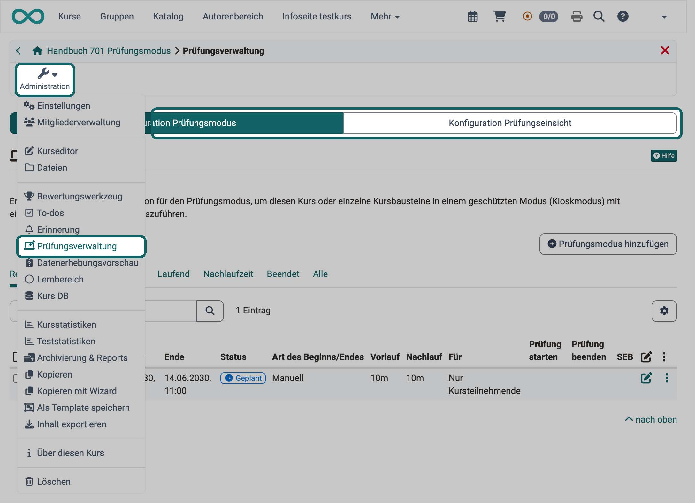

# Prüfungsverwaltung: Übersicht {: #Assessment_Management}

[:octicons-tag-16:{ title="ab Release 18.2 (OO-7425)" }](https://track.frentix.com/issue/OO-7425)

Wer in einem Kurs Prüfungen abnimmt, legt in der Prüfungsverwaltung fest, wie Teilnehmende einen Test ablegen und wie sie ihn danach noch einmal einsehen. Die Prüfungsverwaltung umfasst die Konfiguration des [Prüfungsmodus](../Assessment_mode.de.md) und die Konfiguration der [Prüfungseinsicht](../Assessment_inspection.de.md). Im Prüfungsmodus legen Teilnehmende einen Test während einer festgelegten Zeit in einem geschützten Modus ab. In der Prüfungseinsicht sehen sie die absolvierte Prüfung in einem festen Zeitfenster noch einmal, ohne eine Kopie zu erhalten.

Sie öffnen die Prüfungsverwaltung unter: 
`Kurs > Administration > Prüfungsverwaltung`

Den Eintrag "Prüfungsverwaltung" sehen Kursbesitzer:innen, Personen mit dem Recht "Kurseditor" oder "Prüfungsmodus" sowie Principals und Klassenlehrer:innen.

{ class="shadow lightbox" title="Werkzeug Prüfungsverwaltung eines Kurses · 2026.11.10" }

Welche Tabs die Prüfungsverwaltung zeigt, legen Systemadministrator:innen in der System-Administration fest, mit den Schaltern "Prüfungsmodus einschalten" und "Prüfungseinsicht einschalten": 
`Administration > e-Assessment > Prüfungsverwaltung > Tab "Prüfungsverwaltung Konfiguration"`

Der Tab "Konfiguration Prüfungsmodus" erscheint bei eingeschaltetem Prüfungsmodus, der Tab "Konfiguration Prüfungseinsicht" bei eingeschalteter Prüfungseinsicht. Ist nur einer der beiden Schalter eingeschaltet, öffnet die Prüfungsverwaltung direkt dessen Konfiguration, ohne Tabs. Die Prüfungseinsicht steht damit auch ohne Prüfungsmodus zur Verfügung. Der Eintrag "Prüfungsverwaltung" erscheint im Menü "Administration", sobald einer der beiden Schalter eingeschaltet ist.

## Weiterführende Informationen {: #further_information}

[e-Assessment Administration: Prüfungsverwaltung >](../../../manual_admin/administration/e-Assessment_AssessmentMgmt.de.md) 
[Wie bereite ich eine Prüfung mit dem Safe Exam Browser (SEB) vor? >](../../../manual_how-to/SEB/SEB.de.md)

[Zum Seitenanfang ^](#Assessment_Management)
