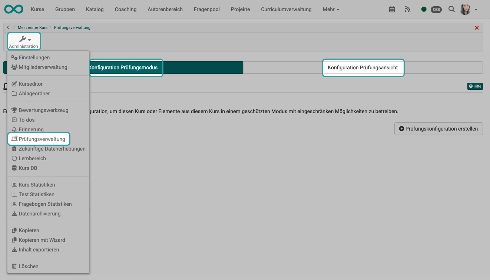

# Assessment Management: Overview {: #Assessment_Management}

[:octicons-tag-16:{ title="from Release 18.2 (OO-7425)" }](https://track.frentix.com/issue/OO-7425)

The examination administration includes the configuration of the [**Assessment mode**](../Assessment_mode.md) and the configuration of the [**Assessment inspection**](../Assessment_inspection.md). 

You will find the two tabs under `Course > Administration > Assessment Management`. 

{ class="shadow lightbox" title="Assessment Management tool of a course" }