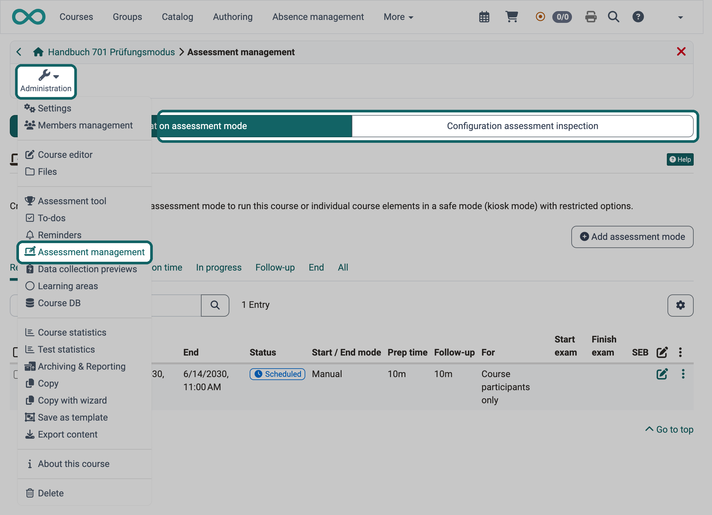

# Assessment management: Overview {: #Assessment_Management}

[:octicons-tag-16:{ title="from Release 18.2 (OO-7425)" }](https://track.frentix.com/issue/OO-7425)

If you hold exams in a course, you define in the assessment management how participants take a test and how they view it again afterwards. The assessment management includes the configuration of the [assessment mode](../Assessment_mode.md) and the configuration of the [assessment inspection](../Assessment_inspection.md). In the assessment mode, participants take a test during a fixed period in a protected mode. In the assessment inspection, they see the completed exam again in a fixed time window, without receiving a copy.

You open the assessment management under: 
`Course > Administration > Assessment management`

The entry "Assessment management" is visible to course owners, persons with the right "Course editor" or "Assessment mode", principals and master coaches.

{ class="shadow lightbox" title="Assessment management tool of a course · 2026.11.10" }

Which tabs the assessment management shows is set by system administrators in the system administration, with the switches "Enable assessment mode" and "Enable assessment inspection": 
`Administration > e-Assessment > Assessment management > Tab "Assessment management configuration"`

The tab "Configuration assessment mode" appears when the assessment mode is enabled, the tab "Configuration assessment inspection" when the assessment inspection is enabled. If only one of the two switches is enabled, the assessment management opens its configuration directly, without tabs. The assessment inspection is therefore also available without the assessment mode. The entry "Assessment management" appears in the "Administration" menu as soon as one of the two switches is enabled.

## Further information {: #further_information}

[e-Assessment Administration: Assessment management >](../../../manual_admin/administration/e-Assessment_AssessmentMgmt.md) 
[How do I prepare an exam with the Safe Exam Browser (SEB)? >](../../../manual_how-to/SEB/SEB.md)

[To the top of the page ^](#Assessment_Management)
