# Prüfungsverwaltung: Prüfungsmodus {: #Assessment_mode}

!!! note "Hinweis"

    Die Konfiguration des Prüfungsmodus finden Sie in der Prüfungsverwaltung des Kurses: `Kurs > Administration > Prüfungsverwaltung > Tab "Konfiguration Prüfungsmodus"`.

## Was versteht man unter "Prüfungsmodus"? [:octicons-tag-16:{ title="ab Release 10.2 (OO-1349)" }](https://track.frentix.com/issue/OO-1349)

Ein Prüfungsmodus ist eine Prüfungskonfiguration, mit der Teilnehmende Tests und Prüfungen während einer festgelegten Zeit in einem geschützten Modus ablegen (sogenannter Kioskmodus).

Während dieser Zeit erreichen die Teilnehmenden in OpenOlat nur den Kurs der Prüfung. Ist im Tab "Einschränkungen Kursbaustein" der Schalter "Zugriff auf Kursbaustein einschränken" eingeschaltet, sehen sie darin nur die dort ausgewählten Kursbausteine. Ist er ausgeschaltet, sehen sie den ganzen Kurs. Alle weiteren Funktionen in OpenOlat, wie andere Kurse, Gruppen, Notizen etc., werden während der Prüfungsdauer (Laufzeit des Prüfungsmodus) ausgeblendet. Nur ein Logout ist während der Prüfung möglich.

---

## Prüfungsmodus hinzufügen

Einen Prüfungsmodus erstellen und konfigurieren Sie in der Prüfungsverwaltung des Kurses:

1. Öffnen Sie den Kurs mit dem Test.
2. Wählen Sie `Kurs > Administration > Prüfungsverwaltung > Tab "Konfiguration Prüfungsmodus"`.
3. Klicken Sie auf "Prüfungsmodus hinzufügen".
4. Füllen Sie im Dialog "Prüfungsmodus erstellen" Titel, Beginn, Ende, Vorlaufzeit, Nachlaufzeit und Art des Beginns/Endes aus und klicken Sie auf "Erstellen". OpenOlat öffnet danach die Prüfung mit den Tabs, die die folgenden Abschnitte beschreiben.

Für einen Termin des Kurses entsteht der Prüfungsmodus stattdessen in der Terminliste: [Prüfungsmodus aus einem Termin](#exam_from_event)

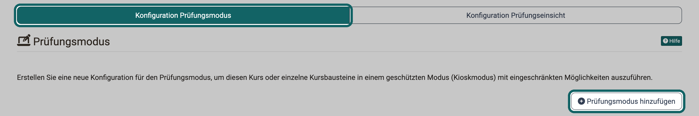{ class="shadow lightbox" title="Seite Prüfungsverwaltung im Kurs · 2026.10.22" }

Im Tab "Konfiguration Prüfungsmodus" sehen Sie alle für einen Kurs bereits abgehaltenen, laufenden oder geplanten Prüfungen. Der Modus geplanter Prüfungen kann bis zur Prüfung noch bearbeitet werden, eine nachträgliche Bearbeitung ist nicht möglich. Die Übersicht enthält Informationen zu Datum und Dauer, Vor- und Nachlaufzeiten, sowie Benutzergruppen.

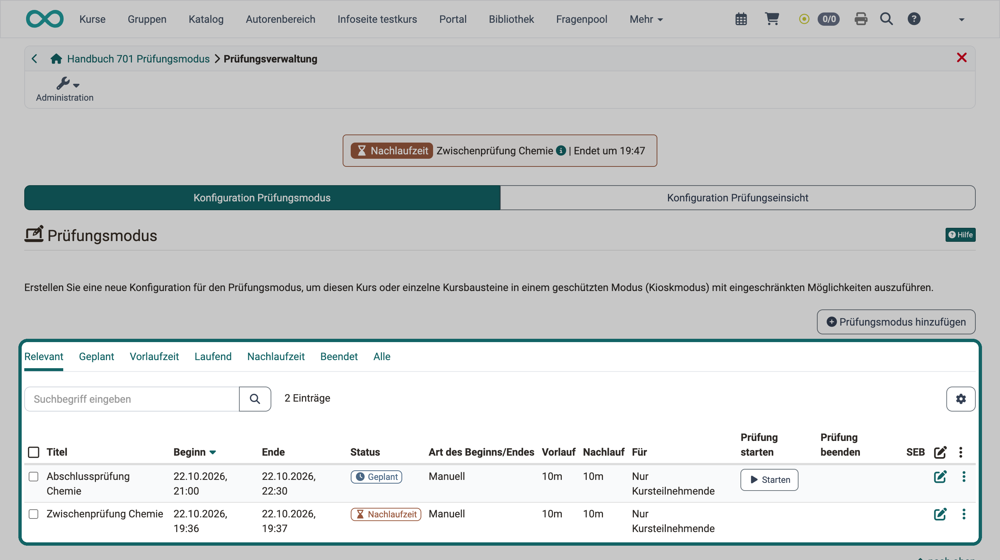{ class="shadow lightbox" title="Tab Konfiguration Prüfungsmodus · 2026.10.22" }

Sie erstellen einen Prüfungsmodus vor der Prüfung. Er enthält

* eine Start- und Endzeit,
* auf Wunsch Vor- und Nachlaufzeiten,
* auf Wunsch Einschränkungen auf bestimmte Nutzergruppen.

Ein Prüfungsmodus kann gelten

* nur für die Teilnehmenden des Kurses,
* nur für die Teilnehmenden ausgewählter Gruppen,
* nur für die Teilnehmenden ausgewählter Produkte des [Course Planner](../area_modules/Course_Planner/index.de.md), sofern das Modul Course Planner eingeschaltet ist; im Course Planner plant Ihre Organisation ihr Bildungsangebot als Produkte mit Durchführungen,
* oder für die Teilnehmenden des Kurses und der ausgewählten Gruppen oder Produkte.

Dadurch ist es möglich, zeitgleich unterschiedlich konfigurierte Prüfungen für verschiedene Nutzergruppen desselben Kurses abzuhalten.

Neben der Benutzergruppe können Sie festlegen, ob und auf welche Kursbausteine der Zugriff eingeschränkt werden soll, und ob ein Kursbaustein davon als Startbaustein verwendet wird. 
Des Weiteren kann der Zugang zur Prüfung auf spezifische IP-Adressen beschränkt oder die Nutzung des [Safe Exam Browsers](http://www.safeexambrowser.org) vorausgesetzt werden.

!!! tip "Tipp"

    Für den Prüfungsmodus wird bevorzugt ein herkömmlicher Kurs empfohlen. Einen Lernpfadkurs erkennen Sie im Kurseditor daran, dass ein Kursbaustein den Tab "Lernpfad" zeigt statt der Tabs "Sichtbarkeit" und "Zugang". Verwenden Sie einen Lernpfadkurs, prüfen Sie im Tab "Lernpfad" der Kursbausteine der Prüfung, dass sie zur Prüfungszeit offen sind: Das "Freigabedatum" liegt vor der Prüfung, die Frist "Zu bearbeiten bis" danach, und bei einer sequenziellen Abfolge der Lernschritte sind die obligatorischen Kursbausteine davor erledigt. Mehr dazu unter [Lernpfadkurs - Kurseditor](Learning_path_course_Course_editor.de.md#tab_learning_path).

    Im herkömmlichen Kurs haben Sie ausserdem die Möglichkeit, im Kurseditor bei einem Kursbaustein in den Tabs "Sichtbarkeit" und "Zugang" die Option "Nur im Prüfungsmodus" zu wählen: `Kurs > Administration > Kurseditor`. Der Kursbaustein ist dann nur sichtbar beziehungsweise zugänglich, während für die Person eine Prüfung läuft. Diese Option steht in Lernpfadkursen nicht zur Verfügung.

!!! info "Vor- und Nachlaufzeit auf 0 setzen"

    Beim Erstellen eines neuen Prüfungsmodus sind Vor- und Nachlaufzeit mit je 10 Minuten vorbelegt. Beide Felder sind Pflichtfelder. Dieser Vorschlagswert lässt sich pro Prüfungsmodus frei überschreiben: auch auf 0, wenn OpenOlat vor bzw. nach der Prüfung nicht gesperrt werden soll. Die 10 Minuten sind fest vorgegeben; tragen Sie die 0 deshalb in jedem Prüfungsmodus einzeln ein. Einen anderen Vorgabewert übernimmt nur ein Prüfungsmodus aus einem Termin: Er erhält Vor- und Nachlaufzeit aus den Vorgabewerten des Kurses oder der System-Administration, siehe [Prüfungsmodus aus einem Termin](#exam_from_event).

---

## Tab "Allgemein"

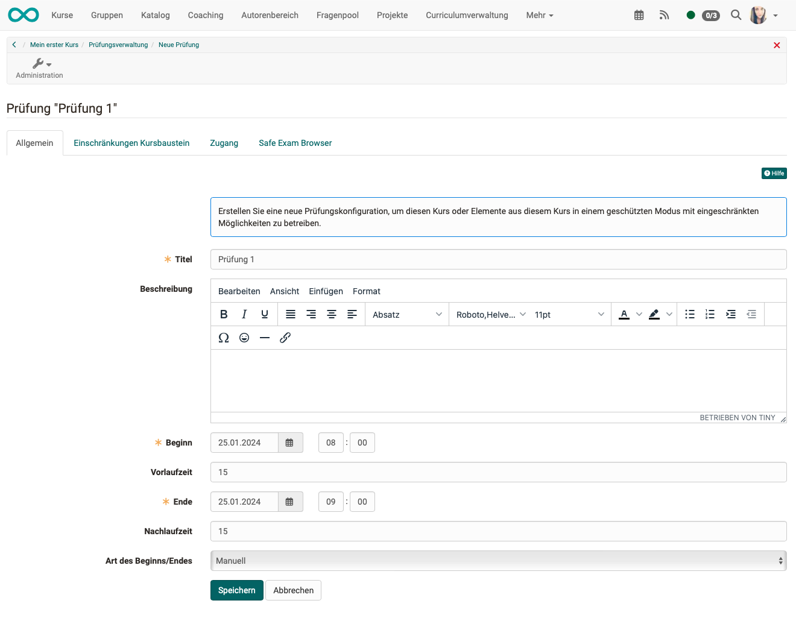{ class="shadow lightbox" title="Tab Allgemein einer Prüfung" }

Titel und Beschreibung sehen die Teilnehmenden im Fenster "Aktuelle Prüfung", das sie über die Prüfung informiert. Daneben legen Sie in diesem Tab fest:

**Beginn**: Legen Sie hier Datum und Uhrzeit für den Beginn der Prüfung fest.

**Vorlaufzeit**: Die Vorlaufzeit in Minuten sperrt OpenOlat während der angegebenen Dauer vor Prüfungsbeginn für die Personen, für die die Prüfung gilt. Sie sehen dann nur das Fenster "Aktuelle Prüfung"; den Button "Zur Prüfung" darin klicken sie erst ab dem Beginn an.

**Ende**: Legen Sie hier Datum und Uhrzeit für das Ende der Prüfung fest.

**Nachlaufzeit**: Geben Sie eine Nachlaufzeit in Minuten an, bleibt OpenOlat während dieser Dauer im Anschluss an die Prüfung noch gesperrt.

Vorlaufzeit und Nachlaufzeit regeln, wie lange OpenOlat gesperrt ist, nicht wie lange der Test dauert. Wie Prüfungsmodus, Testzeitraum, Zeitbeschränkung und Verlängerung zusammenwirken, zeigt [Wie hängen die Zeiten einer Prüfung zusammen?](../../manual_how-to/exam_preparation/exam_preparation.de.md#exam_times)

**Art des Beginns/Endes**: Wählen Sie, ob die Prüfung "Automatisch" zur konfigurierten Zeit beginnt und endet oder "Manuell". Bei "Manuell" startet und beendet eine Person die Prüfung am Prüfungstag selbst. Wer das darf, beschreibt der Abschnitt [Wer eine Prüfung manuell starten und beenden kann](#start_stop_rights).

---

## Tab "Einschränkungen Kursbaustein"

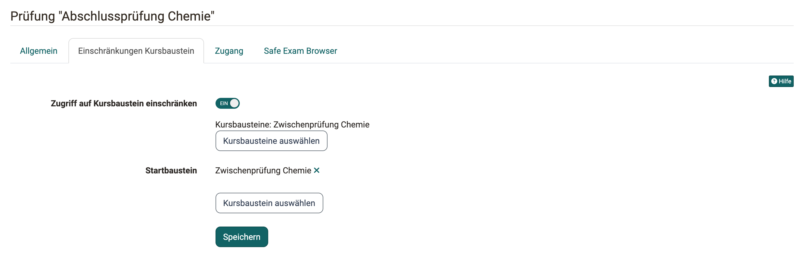{ class="shadow lightbox" title="Tab Einschränkungen Kursbaustein einer Prüfung · 2026.10.22" }

**Zugriff auf Kursbaustein einschränken**: Um die Prüfung auf ausgewählte Kursbausteine des betroffenen Kurses zu beschränken, schalten Sie hier den Schalter ein, und klicken Sie dann auf die Schaltfläche "Kursbausteine auswählen". Es öffnet sich eine Liste aller Kursbausteine des Kurses. Wählen Sie die Kursbausteine aus, die den Teilnehmenden während der Prüfung angezeigt werden sollen. Alle anderen Kursbausteine werden für die Dauer der Prüfung ausgeblendet.

**Startbaustein**: Soll den Teilnehmenden ein bestimmter Kursbaustein direkt beim Start angezeigt werden, klicken Sie auf "Kursbaustein auswählen" und wählen einen Kursbaustein aus. Ist "Zugriff auf Kursbaustein einschränken" eingeschaltet, stehen nur die Kursbausteine zur Wahl, die Sie dort ausgewählt haben. Ist der Schalter ausgeschaltet, ist jeder Kursbaustein des Kurses wählbar.

---

## Tab "Zugang"

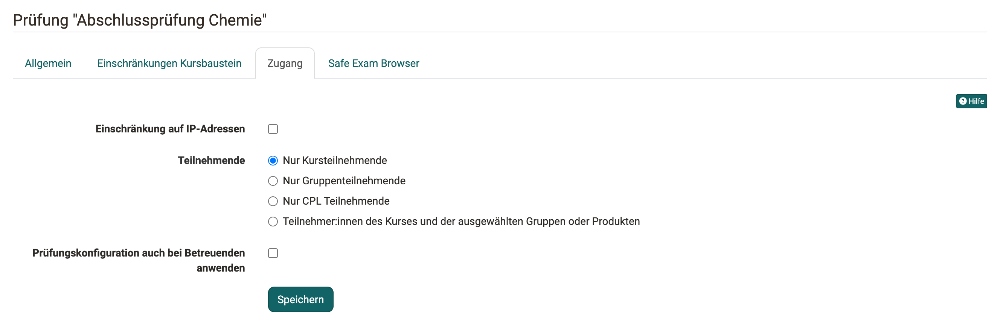{ class="shadow lightbox" title="Tab Zugang einer Prüfung · 2026.10.22" }

**Einschränkung auf IP-Adressen**: Um eine Ausführung der Prüfung nur an bestimmten Computern oder Orten zuzulassen, markieren Sie hier die Checkbox und tragen dann im Feld "Zulässige IP-Adressen" je Zeile eine Angabe ein: eine einzelne Adresse wie 192.168.1.20, einen Bereich wie 192.168.1.1-192.168.1.50 oder ein Netz wie 192.168.1.0/24. Die Adressen sollten Sie von Ihrer Informatik-Abteilung erhalten können. Sie können dadurch z.B. verhindern, dass Teilnehmende eine Prüfung von zuhause ablegen.

**Teilnehmende**: Hier legen Sie fest, für welche Teilnehmenden die Prüfung gültig ist. Wählen Sie aus den folgenden Optionen aus:

* "Nur Kursteilnehmende": die Teilnehmer:innen des Kurses, auch wenn sie über den Course Planner eingetragen sind. Mitglieder von Gruppen des Kurses gehören nur dazu, wenn sie zugleich Teilnehmer:innen des Kurses sind.
* "Nur Gruppenteilnehmende"
* "Nur CPL Teilnehmende", sofern das Modul Course Planner eingeschaltet ist. CPL steht für Course Planner.
* "Teilnehmer:innen des Kurses und der ausgewählten Gruppen", bei eingeschaltetem Course Planner "Teilnehmer:innen des Kurses und der ausgewählten Gruppen oder Produkte"

Ist eine Option mit Gruppen ausgewählt, wählen Sie über die Schaltflächen "Gruppen auswählen" oder "Lernbereiche auswählen" die betroffenen Gruppen aus. Ein Lernbereich fasst mehrere Gruppen des Kurses zusammen; wählen Sie ihn, gilt die Prüfung für alle Gruppen darin. Diese Auswahl ist Pflicht. Gilt die Prüfung für Teilnehmende des Course Planner, wählen Sie die Produkte über die Schaltfläche "Produkt auswählen" aus.

**Prüfungskonfiguration auch bei Betreuenden anwenden**:
Ist diese Option gewählt, gilt der Prüfungsmodus auch für die Betreuer:innen der gewählten Teilnehmenden: für die Betreuer:innen des Kurses, der gewählten Gruppen oder der gewählten Produkte, je nach Option unter "Teilnehmende". Wie die Teilnehmenden erreichen sie während der Prüfung in OpenOlat nur noch die Prüfung. Soll eine Betreuer:in als Aufsicht die Prüfung manuell starten, lassen Sie die Option ausgeschaltet.

!!! note "Hinweis"

    Kursbesitzer:innen können während der Prüfung weiterhin normal auf ihren Kurs zugreifen.

---

## Tab "Safe Exam Browser" [:octicons-tag-16:{ title="ab Release 20.3 (OO-9159)" }](https://track.frentix.com/issue/OO-9159) {: #tab-safe-exam-browser}

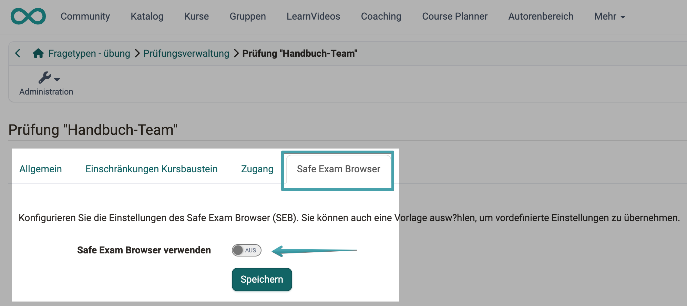{ class="shadow lightbox" title="Tab Safe Exam Browser einer Prüfung" }

**Safe Exam Browser verwenden**: Der Prüfungsmodus allein beschränkt, was die Teilnehmenden in OpenOlat erreichen. Der [Safe Exam Browser](http://www.safeexambrowser.org) (SEB) sichert zusätzlich den Computer ab, indem er ihn in den sogenannten Kioskmodus versetzt. So können Teilnehmende während der Prüfung keine unerlaubten Quellen nutzen. Öffnen die Teilnehmenden die Prüfung ohne SEB, teilt OpenOlat ihnen mit, dass die Prüfung den SEB braucht. Erst wenn OpenOlat im Safe Exam Browser geöffnet ist, können sie die Prüfung ablegen. Richten Sie zum ersten Mal eine Prüfung mit dem SEB ein, führt Sie die Anleitung zur [Vorbereitung einer Prüfung mit dem Safe Exam Browser](../../manual_how-to/SEB/SEB.de.md) durch den ganzen Ablauf, von der Installation des SEB auf den Rechnern der Teilnehmenden bis zum Beenden der Prüfung.

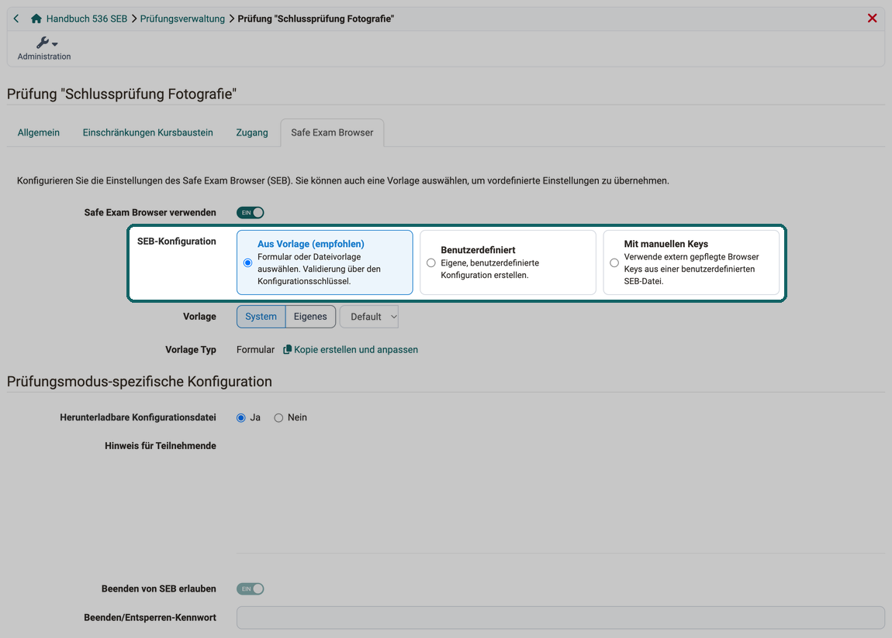{ class="shadow lightbox" title="Tab Safe Exam Browser einer Prüfung · 2026.10.02" }

**SEB-Konfiguration** [:octicons-tag-16:{ title="ab Release 20.3.10 / 21.0.4 (OO-9730)" }](https://track.frentix.com/issue/OO-9730): Legen Sie fest, woher der Safe Exam Browser seine Einstellungen für diese Prüfung bezieht. Drei Arten stehen zur Auswahl:

- **Aus Vorlage (empfohlen)**: Die Einstellungen kommen aus einer Vorlage. Über den Konfigurationsschlüssel prüft OpenOlat, ob der Safe Exam Browser der Teilnehmenden mit genau dieser Konfiguration läuft.
- **Benutzerdefiniert**: Sie erstellen eine eigene Konfiguration für diese Prüfung. Ist die als Standard markierte Vorlage ein Formular (siehe "Vorlage Typ" unten), sind ihre Werte vorbelegt, sonst die Standardwerte von OpenOlat.
- **Mit manuellen Keys**: Sie verwenden eine eigene SEB-Datei, die ausserhalb von OpenOlat gepflegt wird, und tragen deren Safe Exam Browser Keys im Feld "Safe Exam Browser Keys" ein. Den Key einer Datei, den Browser Exam Key, zeigt der Safe Exam Browser in seinen Einstellungen im Bereich "Exam": unter Windows im Konfigurationswerkzeug des SEB, unter macOS in den Einstellungen des SEB. Der Key ändert sich mit jeder Einstellung der Datei und mit der Version des SEB. Mehrere Keys trennen Sie mit einem Zeilenumbruch.

Die Wahl gilt nur für diese Prüfung. Die Einstellung "Safe Exam Browser - Art der Benutzung" der System-Administration wirkt nicht auf sie, sondern nur auf Prüfungen, die aus einem Termin entstehen: [Prüfungsmodus aus einem Termin](#exam_from_event)

**Vorlage**: Erscheint bei "Aus Vorlage (empfohlen)". Mit den beiden Schaltflächen wählen Sie die Quelle der Vorlage:

- **System**: Wählen Sie im Dropdown eine der aktiven Konfigurationsvorlagen, die Administrator:innen in der System-Administration bereitstellen. Die Vorlage, die sie dort mit "Als Standard setzen" markiert haben, ist vorausgewählt. Wurde eine gespeicherte Vorlage nachträglich deaktiviert, bleibt sie ausgewählt, bis eine andere Vorlage gewählt wird. Die Prüfung läuft weiter mit den Einstellungen dieser Vorlage; deaktiviert ist die Vorlage nur für die Auswahl in weiteren Prüfungen.
- **Eigenes**: Laden Sie mit "Hochladen" eine eigene SEB-Datei hoch. Eine SEB-Datei erstellen Sie mit dem Safe Exam Browser selbst: unter Windows mit seinem Konfigurationswerkzeug, unter macOS in seinen Einstellungen. OpenOlat liest die Einstellungen aus der Datei, berechnet den Konfigurationsschlüssel und zeigt die Einstellungen schreibgeschützt an. Die Datei darf nicht verschlüsselt sein. Ist sie verschlüsselt oder mit einem Passwort geschützt, meldet OpenOlat beim Hochladen: "Die Konfigurationsdatei kann nicht gelesen werden. Bitte stellen Sie sicher, dass die Datei nicht verschlüsselt oder passwortgeschützt ist."

!!! tip "Voraussetzung"
    Die Vorlagenauswahl "System" steht nur zur Verfügung, wenn in der System-Administration unter `Administration > e-Assessment > Prüfungsverwaltung > Tab "Safe Exam Browser Konfiguration"` mindestens eine aktive Vorlage angelegt ist.

**Vorlage Typ**: Zeigt, ob die Vorlage ein "Formular" oder eine "SEB-Datei" ist. Ein Formular haben Administrator:innen in OpenOlat Feld für Feld ausgefüllt, eine SEB-Datei haben sie hochgeladen. Bei einem Formular steht daneben der Button "Kopie erstellen und anpassen": Er übernimmt die Werte der Vorlage in eine Konfiguration "Benutzerdefiniert", die Sie für diese Prüfung ändern können.

**Hinweis für Autoren**: Haben Administrator:innen in der gewählten Vorlage einen Hinweis für die Personen hinterlegt, die Prüfungen einrichten, erscheint er hier.

Unter der Überschrift "Prüfungsmodus-spezifische Konfiguration" stehen die Einstellungen, die für genau diese Prüfung gelten:

**Herunterladbare Konfigurationsdatei**: Legt fest, ob Teilnehmende die SEB-Konfigurationsdatei für diese Prüfung herunterladen können. Öffnen sie die Datei, startet der Safe Exam Browser direkt mit der Prüfung. Ist der Download ausgeschaltet und läuft der Safe Exam Browser mit einer anderen Konfiguration, verweist OpenOlat die Teilnehmenden an die Prüfungsaufsicht. Die Konfigurationsdatei der Prüfung laden Personen mit Zugriff auf die Prüfungsverwaltung in der Liste der Prüfungen in der Spalte "SEB" herunter: `Kurs > Administration > Prüfungsverwaltung > Tab "Konfiguration Prüfungsmodus"`. Mit dieser Datei startet die Aufsicht den Safe Exam Browser für die Prüfung. Das Feld erscheint bei "Aus Vorlage (empfohlen)" und "Benutzerdefiniert".

**Hinweis für Teilnehmende**: Ein Text, den die Teilnehmenden im Fenster "Aktuelle Prüfung" sehen.

**Beenden von SEB erlauben**: Erlaubt den Prüfungsteilnehmenden, den Safe Exam Browser nach Abgabe der Prüfung zu beenden. Ist die Option ausgeschaltet, verlassen sie den Safe Exam Browser nach dem Ende der Prüfung mit dem Button "SafeExamBrowser schliessen" im Fenster "Aktuelle Prüfung". Diesen Button zeigt OpenOlat, wenn in den Detaileinstellungen der Konfiguration "Link um SEB nach der Prüfung zu verlassen" eingeschaltet ist. [:octicons-tag-16:{ title="ab Release 20.3.9 / 21.0.3 (OO-9740)" }](https://track.frentix.com/issue/OO-9740)

**Beenden/Entsperren-Kennwort**: Erscheint, wenn "Beenden von SEB erlauben" eingeschaltet ist. Mit diesem Kennwort beenden die Teilnehmenden den Safe Exam Browser. Bei einer SEB-Datei, aus dem System oder hochgeladen, überschreibt das Kennwort das Kennwort der Datei für genau diese Prüfung. Unter dem Feld steht dann der Hinweis "Überschreibt das Passwort der Vorlage. Der Config Key wird automatisch neu berechnet." Der Config Key ist der Konfigurationsschlüssel. Teilnehmende brauchen danach die Konfigurationsdatei mit dem neuen Kennwort: Läuft ihr Safe Exam Browser noch mit der alten Datei, meldet OpenOlat "Der Safe Exam Browser nutzt eine andere Konfiguration". Ist "Herunterladbare Konfigurationsdatei" eingeschaltet, laden sie die neue Datei im Fenster "Aktuelle Prüfung" herunter. Bei "Benutzerdefiniert" gehört das Kennwort zur eigenen Konfiguration, der Hinweis erscheint nicht. Das Kennwort selbst geben Sie oder die Aufsicht den Teilnehmenden bekannt, zum Beispiel wenn sie den Prüfungsraum verlassen. Bei einer SEB-Datei sieht die Aufsicht es während der Prüfung im Bewertungswerkzeug: Der Bereich "Prüfungsmodus" zeigt bei der Prüfung "Beenden-Passwort vorhanden", das Augen-Symbol ("Passwort ansehen") blendet das Kennwort ein. [:octicons-tag-16:{ title="ab Release 20.3.9 / 21.0.3 (OO-9743)" }](https://track.frentix.com/issue/OO-9743)

Welcher Wert gilt, hängt von der Vorlage ab:

- **Formular aus dem System**: Die Prüfung übernimmt "Hinweis für Teilnehmende", "Beenden von SEB erlauben" und das Kennwort aus der Vorlage. Diese Felder sind nicht änderbar. Pro Prüfung legen Sie nur "Herunterladbare Konfigurationsdatei" fest.
- **SEB-Datei und "Benutzerdefiniert"**: Die Prüfung speichert ihre eigenen Werte. Beim erneuten Öffnen der Prüfung und nach einem Tabwechsel zeigen die Felder diese gespeicherten Werte, nicht die Werte der Vorlage.

Wählen Sie eine andere Vorlage, ersetzen deren Werte die Werte in den Feldern. Speichern Sie Ihre Eingaben, bevor Sie den Tab wechseln: Beim Wechsel lädt OpenOlat den Tab neu, ungespeicherte Eingaben gehen verloren. [:octicons-tag-16:{ title="ab Release 20.3.9 / 21.0.3 (OO-9741)" }](https://track.frentix.com/issue/OO-9741)

Bei "Mit manuellen Keys" zeigt dieser Abschnitt nur "Hinweis für Teilnehmende". Darunter steht das Pflichtfeld "Safe Exam Browser Keys".

Unter der Überschrift "Konfiguration anhand der Vorlage" stehen bei einem Formular und bei "Benutzerdefiniert" die Detaileinstellungen des Safe Exam Browser, darunter der "Konfigurationsschlüssel der gespeicherten Konfiguration". Ändern lassen sie sich nur bei "Benutzerdefiniert". Bei einer SEB-Datei zeigt stattdessen der Abschnitt "Konfiguration anhand der SEB-Datei Vorlage" die Einstellungen der Datei schreibgeschützt an.

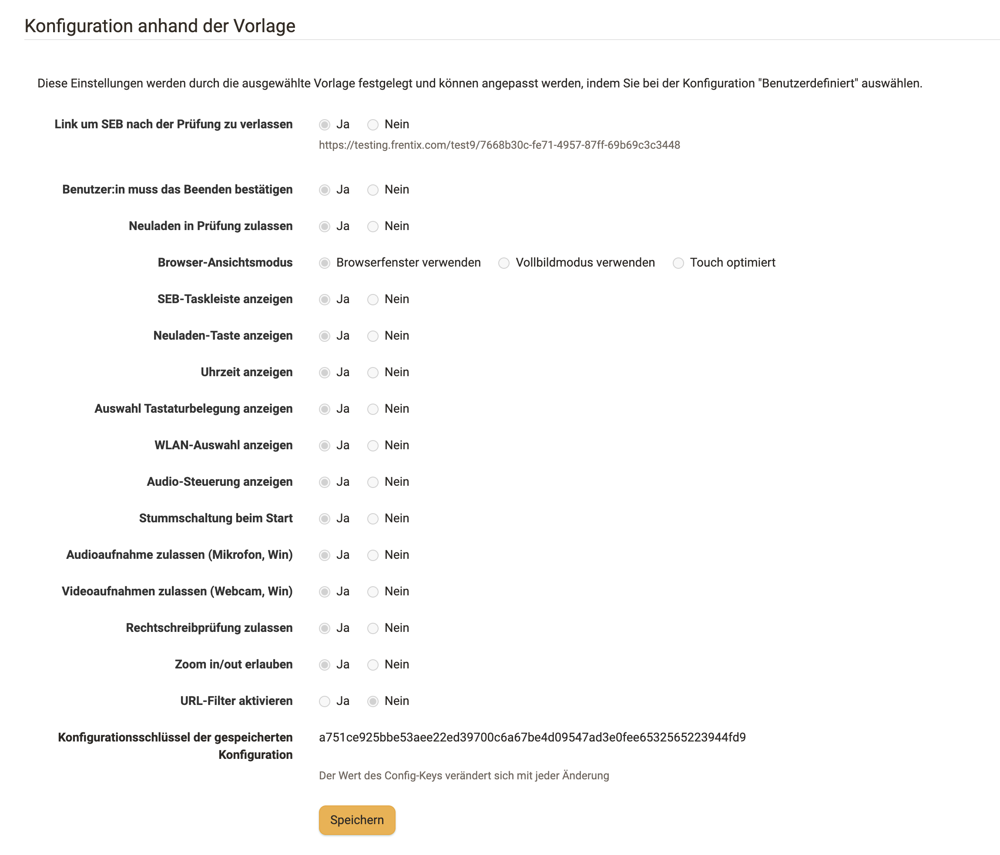{ class="shadow lightbox" title="Abschnitt Konfiguration anhand der Vorlage" }

---

## Prüfungsmodus aus einem Termin [:octicons-tag-16:{ title="ab Release 14.0 (OO-4045)" }](https://track.frentix.com/issue/OO-4045) {: #exam_from_event}

Wer im Kurs Termine führt, macht einen Termin direkt zur Prüfung, ohne einen Prüfungsmodus von Grund auf anzulegen. Wählen Betreuer:innen oder Kursbesitzer:innen im 3-Punkte-Menü eines Termins "Als Prüfung markieren", legt OpenOlat einen Prüfungsmodus an und öffnet den Dialog "Prüfung". Wer den Eintrag erhält und warum er fehlen kann, beschreibt die Seite zur Toolbar: [Termin als Prüfung markieren](../learningresources/Toolbar_Events.de.md#mark_event_as_exam)

Der Dialog ist kürzer als der eines direkt angelegten Prüfungsmodus und hat keine Tabs:

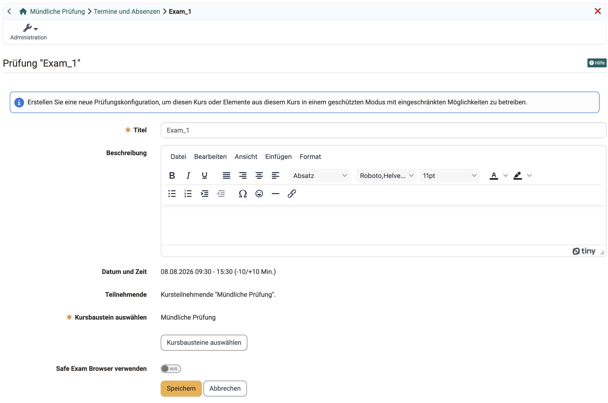{ class="shadow lightbox" title="Dialog Prüfung zu einem Termin · 2026.10.02" }

- **Titel** und **Beschreibung**: Der Titel ist ein Pflichtfeld.
- **Datum und Zeit**: übernommen aus dem Termin. In Klammern stehen Vorlaufzeit und Nachlaufzeit in Minuten, zum Beispiel "(-10/+10 Min.)". Sie kommen aus den Vorgabewerten des Kurses oder der System-Administration.
- **Teilnehmende**: übernommen aus dem Termin.
- **Kursbaustein auswählen**: Pflichtfeld. Mit "Kursbausteine auswählen" legen Sie fest, auf welche Kursbausteine die Teilnehmenden während der Prüfung zugreifen.
- **Safe Exam Browser verwenden**: schaltet den Safe Exam Browser für diese Prüfung ein.
- **Zulässige IP-Adressen**: erscheint, wenn die Vorgabewerte erlaubte IP-Adressen enthalten, und ist nicht änderbar.

Nach dem Einschalten von "Safe Exam Browser verwenden" zeigt der Dialog keine Auswahl "SEB-Konfiguration". Die Art legt die System-Administration mit der Einstellung ["Safe Exam Browser - Art der Benutzung"](../../manual_admin/administration/Modules_Events_and_Absences.de.md#seb_type_of_use) für alle Prüfungen aus Terminen fest:

- **Aus Vorlage (empfohlen)**: Im Feld "Konfiguration" wählen Sie eine der aktiven Vorlagen, die als Standard markierte ist vorausgewählt. "Bereitgestellte Konfiguration anzeigen" zeigt die Einstellungen der gewählten Vorlage. Ob Teilnehmende die Konfigurationsdatei herunterladen können, legt die System-Administration fest.
- **Mit manuellen Keys**: Das Feld "Safe Exam Browser Keys" zeigt die Keys aus den Vorgabewerten des Kurses oder der System-Administration. Im Dialog sind sie nicht änderbar.

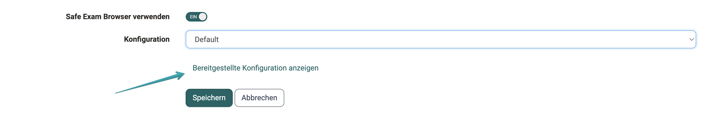{ class="shadow lightbox" title="Dialog Prüfung zu einem Termin · 2026.10.02" }

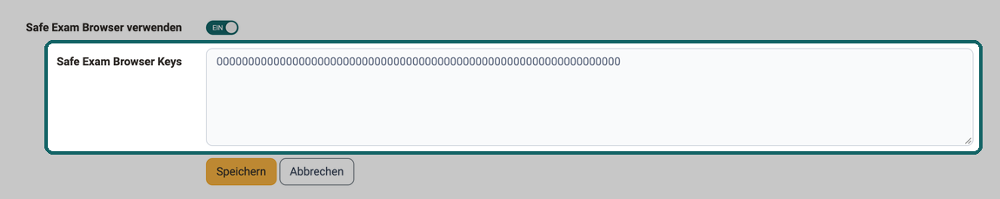{ class="shadow lightbox" title="Dialog Prüfung zu einem Termin · 2026.10.02" }

Eine Prüfung aus einem Termin erscheint auch in der Prüfungsverwaltung des Kurses und öffnet dort denselben Dialog. Direkt in der Prüfungsverwaltung angelegte Prüfungsmodi wählen die Art dagegen pro Prüfung im Feld "SEB-Konfiguration", siehe [Tab "Safe Exam Browser"](#tab-safe-exam-browser).

---

## Prüfung durchführen

Teilnehmende, die einer Prüfung zugeteilt sind, werden zu Beginn der Prüfung bzw. zu Beginn der Vorlaufzeit über den Start der Prüfung informiert: OpenOlat zeigt ihnen das Fenster "Aktuelle Prüfung". Sollte OpenOlat durch eine Nachlaufzeit am Ende der Prüfung noch gesperrt sein, werden sie ebenfalls darüber informiert.

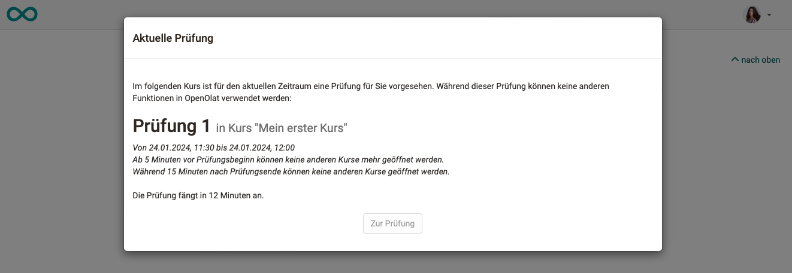{ class="shadow lightbox" title="Fenster Aktuelle Prüfung für Teilnehmende" }

Ist bei "Art des Beginns/Endes" die Option "Manuell" gewählt, startet eine Person die Prüfung selbst, zum Beispiel die Aufsicht im Prüfungsraum, sobald alle bereit sind. Dafür zeigt die Übersicht des [Bewertungswerkzeugs](Assessment_tool_overview/index.de.md) im Bereich "Prüfungsmodus" bei der Prüfung den Button "Prüfung starten". Das Bewertungswerkzeug öffnen Sie unter: `Kurs > Administration > Bewertungswerkzeug`. Der Button erscheint ab dem Tag, an dem die Prüfung beginnt, und nicht erst zur konfigurierten Uhrzeit. Wer ihn sieht, beschreibt der Abschnitt [Wer eine Prüfung manuell starten und beenden kann](#start_stop_rights).

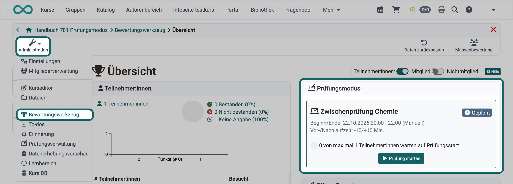{ class="shadow lightbox" title="Übersicht des Bewertungswerkzeugs · 2026.10.22" }

Bei manuellem Start beginnt die Prüfung, sobald jemand "Prüfung starten" klickt, auch vor oder nach der geplanten Uhrzeit. OpenOlat verschiebt das Ende um dieselbe Zeit, die konfigurierte Prüfungsdauer bleibt also gleich. Klickt niemand vorher, beginnt die Vorlaufzeit zur geplanten Zeit vor dem konfigurierten Beginn und dauert, bis jemand "Prüfung starten" klickt. Bis dahin sehen die Teilnehmenden das Fenster "Aktuelle Prüfung", den Button "Zur Prüfung" darin klicken sie noch nicht an. Ohne Vorlaufzeit bleibt OpenOlat bis zum Klick auf "Prüfung starten" offen: Die Prüfung behält den Status "Geplant", und die Teilnehmenden arbeiten normal weiter, auch nach der geplanten Uhrzeit. Beendet ist eine Prüfung mit manuellem Ende erst, wenn jemand "Prüfung beenden" klickt.

Während der Prüfung verfolgen Betreuer:innen den Prüfungsmodus in der Übersicht des Bewertungswerkzeugs.

Im Bewertungswerkzeug bewerten sie auch Aufgaben und Freitextfragen von Tests direkt und geben die Bewertung für die Teilnehmenden frei. So lässt sich eine Prüfung gleich im Anschluss besprechen.

### Wie viele Teilnehmende schon da sind [:octicons-tag-16:{ title="ab Release 15.2 (OO-4766)" }](https://track.frentix.com/issue/OO-4766) {: #participant_count}

Vor und während einer Prüfung wollen Sie wissen, ob alle Teilnehmenden da sind. Dafür zeigt der Bereich "Prüfungsmodus" des Bewertungswerkzeugs bei der Prüfung eine Zeile wie "3 von maximal 20 Teilnehmer:innen warten auf Prüfungsstart." Im Bild der Übersicht des Bewertungswerkzeugs oben steht sie direkt über dem Button "Prüfung starten", dort mit "0 von maximal 1".

* Die zweite Zahl, nach "maximal", zählt alle Personen, für die die Prüfung gilt: die Teilnehmenden, die Sie im Tab "Zugang" unter "Teilnehmende" festgelegt haben. Bei einer Prüfung aus einem Termin sind es die Teilnehmenden des Termins.
* Die erste Zahl zählt, wie viele davon schon in OpenOlat sind. Solange die Prüfung den Status "Geplant" hat, also vor der Vorlaufzeit, zählt jede Person mit, die gerade in OpenOlat eingeloggt ist, auch ausserhalb des Kurses. Ab der Vorlaufzeit zählt, wer im Fenster "Aktuelle Prüfung" auf den Start wartet oder die Prüfung mit dem Button "Zur Prüfung" in diesem Fenster schon geöffnet hat. Verlangt die Prüfung den Safe Exam Browser, wartet nur, wer OpenOlat im Safe Exam Browser mit der Konfiguration der Prüfung geöffnet hat.

Stimmen beide Zahlen überein, sind alle Personen da, für die die Prüfung gilt. Zählt die Zeile mehr Personen, als Ihre Gruppe hat, gilt die Prüfung auch für weitere Teilnehmende des Kurses oder weiterer Gruppen, oder die Betreuer:innen zählen mit (nächster Absatz). Welcher Grund zutrifft, zeigt der Tab "Zugang" der Prüfung: die Option unter "Teilnehmende" und die Option "Prüfungskonfiguration auch bei Betreuenden anwenden". Die Zeile aktualisiert sich von selbst, solange die Seite offen ist.

Ist im Tab "Zugang" die Option "Prüfungskonfiguration auch bei Betreuenden anwenden" eingeschaltet, zählen beide Zahlen auch die Betreuer:innen mit, obwohl die Zeile "Teilnehmer:innen" sagt. Besitzer:innen zählen nicht mit. Die Zahlen sind für alle gleich, die die Zeile sehen: Auch Betreuer:innen, die im Bewertungswerkzeug nur die Teilnehmenden ihrer Gruppen sehen, sehen in der Zeile alle Personen, für die die Prüfung gilt.

Nach dem Start lautet die Zeile zum Beispiel "18 von maximal 20 Teilnehmer:innen nehmen aktuell an der Prüfung teil." Die erste Zahl zählt weiterhin alle, die da sind: auch wer die Prüfung noch nicht mit "Zur Prüfung" geöffnet hat und wer sie schon abgegeben hat. Die Zeile sagt also, wer da ist, nicht wer gerade schreibt. Wie weit die einzelnen Teilnehmenden mit dem Test sind, zeigt der Kursbaustein "Test" im Bewertungswerkzeug im Tab "Teilnehmer:innen", in der Spalte "Status", zum Beispiel "Gestartet": [Tests einsehen und bewerten](Course_Element_Test/Test_Results.de.md#assess)

Wann die Zeile erscheint, hängt davon ab, ob Sie die Prüfung starten dürfen:

* Sie dürfen eine Prüfung mit manuellem Start starten: Die Zeile erscheint ab dem Prüfungstag zusammen mit dem Button "Prüfung starten", nach dem Start zusammen mit "Prüfung beenden".
* Die Prüfung startet automatisch, oder Sie haben das Recht zum Starten nicht: Die Zeile erscheint ab der Vorlaufzeit, ohne Vorlaufzeit ab dem Beginn, und bleibt bis zum Ende der Nachlaufzeit.

Dieselbe Zeile zeigen auch:

* der Tab "Prüfungsmodus" im [Kursbaustein "Test"](Course_Element_Test/Test_Results.de.md#assess), für Besitzer:innen und Betreuer:innen
* das Info-Symbol im Banner der Prüfung: Personen mit Zugriff auf das Bewertungswerkzeug sehen dieses Banner oben im Kurs, solange die Prüfung läuft oder in der Vor- oder Nachlaufzeit ist. Es nennt den Status und den Titel der Prüfung, das Info-Symbol steht neben dem Titel. Ist im Kurs nur eine Prüfung aktiv, zeigt das Banner Personen mit dem Recht zum Starten auch den Button "Prüfung starten" und nach dem Start "Prüfung beenden".

### Wer eine Prüfung manuell starten und beenden kann {: #start_stop_rights}

Betreuer:innen sehen eine Prüfung mit manuellem Start im Bereich "Prüfungsmodus" des Bewertungswerkzeugs, den Button "Prüfung starten" aber nur mit einem zusätzlichen Recht. Legen Sie deshalb vor dem Prüfungstag fest, wer die Prüfung startet, und geben Sie dieser Person das passende Recht.

Den Button "Prüfung starten" und danach "Prüfung beenden" sehen im Bewertungswerkzeug:

* Personen mit Besitzerrechten am Kurs, also Besitzer:innen, Lernressourcenverwalter:innen und Administrator:innen, dazu Principals, Kursplaner:innen und Klassenlehrer:innen. Was diese Rollen sonst erlauben, beschreibt [Rollen und Rechte: Welche Rollen gibt es?](../basic_concepts/Roles/index.de.md)
* Mitglieder mit dem Recht "Bewertungs-Werkzeug"
* Betreuer:innen, die im Termin der Prüfung unter "Dozent:innen" ausgewählt sind (siehe [Prüfungsmodus aus einem Termin](#exam_from_event))

Mitglieder mit dem Recht "Bewertungs-Werkzeug" und Dozent:innen des Termins finden denselben Button auch im [Kursbaustein "Test"](Course_Element_Test/index.de.md) im Tab "Prüfungsmodus".

In der Prüfungsverwaltung starten und beenden Personen mit Besitzerrechten und Mitglieder mit dem Recht "Prüfungsmodus" oder "Kurseditor" die Prüfung, mit den Buttons "Starten" und "Beenden" in der Liste der Prüfungen: 
`Kurs > Administration > Prüfungsverwaltung > Tab "Konfiguration Prüfungsmodus"`

Die Rechte vergeben Besitzer:innen in der Mitgliederverwaltung, für alle Kursbetreuer:innen oder gezielt für die Betreuer:innen einer Gruppe, zum Beispiel einer Gruppe "Aufsicht": 
`Kurs > Administration > Mitgliederverwaltung > Rechte` 
Die drei Rechte für den Prüfungsstart geben unterschiedlich viel frei. Was jedes Recht sonst noch erlaubt, beschreibt die Mitgliederverwaltung unter [Vergabe zusätzlicher Rechte](Members_management.de.md#additional_rights).

* **Bewertungs-Werkzeug**: Die Person startet und beendet die Prüfung im Bewertungswerkzeug und arbeitet dort mit allen Funktionen des Werkzeugs.
* **Prüfungsmodus**: Die Person startet und beendet die Prüfung in der Prüfungsverwaltung. Dort legt sie auch Prüfungsmodi an, bearbeitet und löscht sie.
* **Kurseditor**: Die Person verwaltet in der Prüfungsverwaltung die Prüfungen wie mit dem Recht "Prüfungsmodus" und bearbeitet zusätzlich den Kurs im Kurseditor.

!!! info "Wichtig"

    Mit dem Recht "Bewertungs-Werkzeug" sieht eine Betreuer:in im Bewertungswerkzeug alle Teilnehmer:innen des Kurses, nicht nur die Teilnehmenden ihrer Gruppe. Sie bewertet alle und kann Bewertungsdaten zurücksetzen. Wägen Sie deshalb ab, ob die Aufsicht diesen Zugriff braucht oder ob das Recht "Prüfungsmodus" genügt.

Soll eine Betreuer:in die Prüfung starten, lassen Sie im Tab "Zugang" die Option "Prüfungskonfiguration auch bei Betreuenden anwenden" ausgeschaltet. Sonst gilt der Prüfungsmodus auch für sie, und sie erreicht in OpenOlat nur noch die Prüfung.

---

## Prüfung beenden

Ein laufender Prüfungsmodus endet automatisch oder manuell, je nach Einstellung bei "Art des Beginns/Endes".

Bei "Manuell" beenden die Personen, die die Prüfung auch starten dürfen, sie mit dem Button "Prüfung beenden" im Bewertungswerkzeug, siehe [Wer eine Prüfung manuell starten und beenden kann](#start_stop_rights).

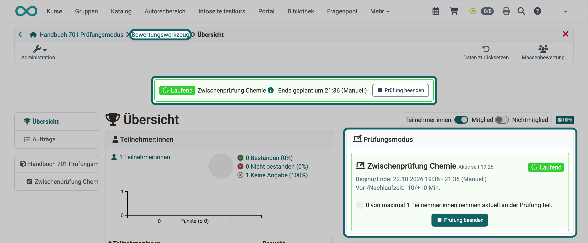{ class="shadow lightbox" title="Übersicht des Bewertungswerkzeugs · 2026.10.22" }

Der Prüfungsmodus wird auch beendet, wenn der entsprechende Kurs beendet oder gelöscht wird.

## Weiterführende Informationen {: #further_information}

**Auf dieser Seite erwähnt** 
[Course Planner: Übersicht >](../area_modules/Course_Planner/index.de.md) 
[Safe Exam Browser >](http://www.safeexambrowser.org) 
[Lernpfadkurs - Kurseditor >](Learning_path_course_Course_editor.de.md) 
[Wie bereite ich eine Online-Prüfung vor? >](../../manual_how-to/exam_preparation/exam_preparation.de.md) 
[Wie bereite ich eine Prüfung mit dem Safe Exam Browser (SEB) vor? >](../../manual_how-to/SEB/SEB.de.md) 
[Toolbar: Termine >](../learningresources/Toolbar_Events.de.md) 
[Modul Termine und Absenzen >](../../manual_admin/administration/Modules_Events_and_Absences.de.md) 
[Bewertungswerkzeug - Übersicht >](Assessment_tool_overview/index.de.md) 
[Tests auswerten und verwalten >](Course_Element_Test/Test_Results.de.md) 
[Rollen und Rechte: Welche Rollen gibt es? >](../basic_concepts/Roles/index.de.md) 
[Kursbaustein "Test" >](Course_Element_Test/index.de.md) 
[Mitgliederverwaltung >](Members_management.de.md)

**Weiterführend** 
[Prüfungsverwaltung: Prüfungseinsicht >](Assessment_inspection.de.md) 
[Test: Einstellungen >](Test_settings.de.md)

[Zum Seitenanfang ^](#Assessment_mode)
