# Assessment management: Assessment mode {: #Assessment_mode}

!!! note "Note"

    You find the configuration of the assessment mode in the assessment management of the course: `Course > Administration > Assessment management > Tab "Configuration assessment mode"`.

## What is meant by "Assessment mode"? [:octicons-tag-16:{ title="from Release 10.2 (OO-1349)" }](https://track.frentix.com/issue/OO-1349)

An assessment mode is an assessment configuration with which participants take tests and exams during a specified time in a protected mode (so-called kiosk mode).

During this time, participants can only reach the course of the exam in OpenOlat. If the toggle "Restrict access to single course elements" is switched on in the tab "Element restriction", they only see the course elements selected there. If it is switched off, they see the whole course. All other functions in OpenOlat, such as other courses, groups, notes, etc., are hidden during the duration of the assessment mode. Only a logout is possible during the test.

---

## Create configuration

You create and configure an assessment mode in the assessment management of the course:

1. Open the course with the test.
2. Select `Course > Administration > Assessment management > Tab "Configuration assessment mode"`.
3. Click on "Add assessment mode".
4. In the dialog "Create assessment mode", fill in title, start, end, prep time, follow-up and start / end mode, and click on "Create". OpenOlat then opens the exam with the tabs described in the following sections.

For an event of the course, the assessment mode is created in the event list instead: [Assessment mode from an event](#exam_from_event)

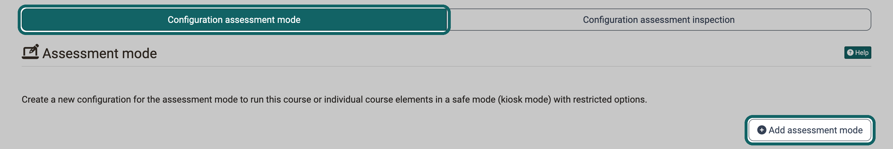{ class="shadow lightbox" title="Assessment management page of a course · 2026.10.22" }

In the tab "Configuration assessment mode", you can see all examinations that have already been held, are in progress or are planned for a course. The mode of scheduled exams can still be edited up until the exam, but it is not possible to edit them retrospectively. The overview contains information on date and duration, lead and lag times and user groups.

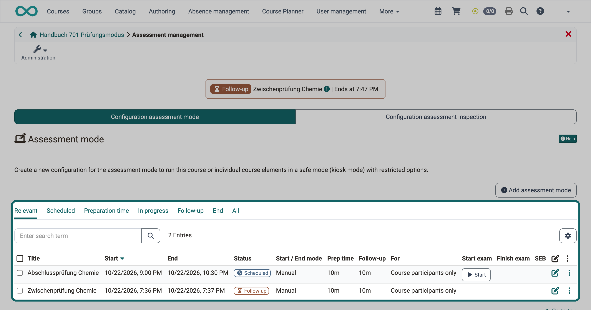{ class="shadow lightbox" title="Tab Configuration assessment mode · 2026.10.22" }

You create an assessment mode before the exam. It contains

* a start and end time,
* prep and follow-up times if desired,
* restrictions to specific user groups if desired.

One assessment mode may apply

* only for the participants of the course,
* only for the participants of selected groups,
* only for the participants of selected products of the [Course Planner](../area_modules/Course_Planner/index.md), if the Course Planner module is enabled; in the Course Planner, your organisation plans its educational offering as products with implementations,
* or for the participants of the course and of the selected groups or products.

This makes it possible to hold differently configured exams for different user groups of the same course at the same time.

In addition to the user group, you can specify whether and to which course elements access should be restricted and whether one course element should be used as the start element. 
Furthermore, access to the exam can be restricted to specific IP addresses or the use of the [Safe Exam Browser](http://www.safeexambrowser.org) can be required.

!!! tip "Tip"

    A conventional course is preferably recommended for the assessment mode. You recognise a learning path course in the course editor by the fact that a course element shows the tab "Learning path" instead of the tabs "Visibility" and "Access". If you use a learning path course, check in the tab "Learning path" of the course elements of the exam that they are open at the time of the exam: the "Release date" is before the exam, the "Due date" after it, and with a sequential order of the learning steps the mandatory course elements before them are completed. More on this under [Learning path course - Course editor](Learning_path_course_Course_editor.md#tab_learning_path).

    In conventional courses, you also have the option of selecting the option "Only in assessment mode" for a course element in the course editor, in the tabs "Visibility" and "Access": `Course > Administration > Course editor`. The course element is then only visible or accessible while an exam is running for the person. This option is not available in learning path courses.

!!! info "Set Pre- and Post-Exam Time to 0"

    When creating a new exam mode, the pre- and post-exam times are preset to 10 minutes each. Both fields are mandatory. This default value can be freely overridden for each exam mode: including to 0, if OpenOlat is not to be locked before or after the exam. The 10 minutes are fixed; therefore, enter the 0 individually in each assessment mode. Only an assessment mode from an event takes a different default value: it gets the pre- and post-exam times from the default values of the course or the system administration, see [Assessment mode from an event](#exam_from_event).

---

## Tab "General"

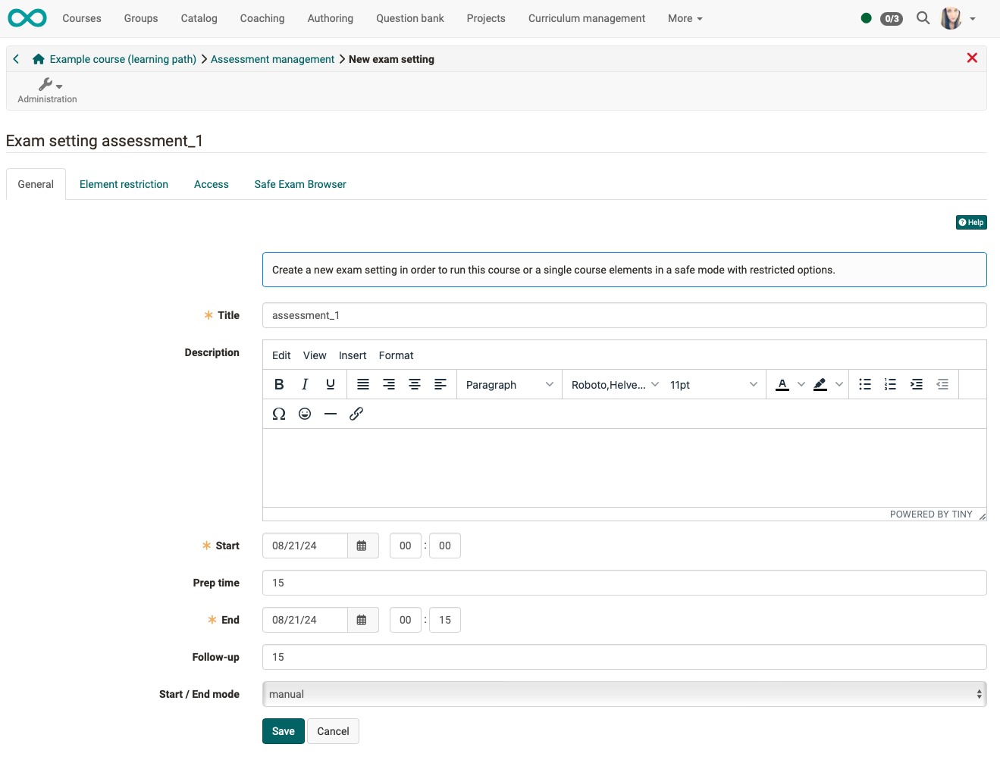{ class="shadow lightbox" title="Tab General of an exam setting" }

Participants see the title and description in the window "Current exam", which informs them about the exam. In addition, you define in this tab:

**Start**: Specify the date and time for the start of the exam here.

**Prep time**: The prep time in minutes locks OpenOlat for the specified duration before the exam starts for the persons the exam applies to. They then only see the window "Current exam"; they can click the button "Go to exam" in it only from the start.

**End**: Specify the date and time for the end of the exam here.

**Follow-up**: If you specify a follow-up time in minutes, OpenOlat remains locked for this duration after the exam.

Prep time and follow-up time control how long OpenOlat is locked, not how long the test lasts. How assessment mode, test period, time limit and extension work together is shown in [How do the times of an exam fit together?](../../manual_how-to/exam_preparation/exam_preparation.md#exam_times)

**Start / End mode**: Choose whether the exam starts and ends "Automatic" at the configured time or "Manual". With "Manual", a person starts and ends the exam on the day of the exam themselves. Who may do this is described in the section [Who can start and finish an exam manually](#start_stop_rights).

---

## Tab "Element restriction"

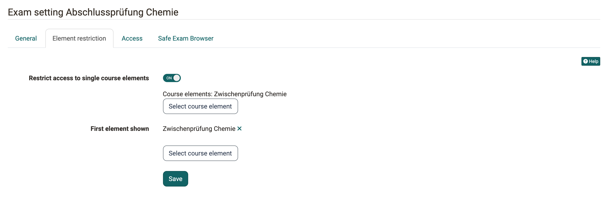{ class="shadow lightbox" title="Tab Element restriction of an exam setting · 2026.10.22" }

**Restrict access to single course elements**: To restrict the exam to selected course elements of the relevant course, switch on the toggle here and then click on the "Select course element" button. A list of all course elements of the course opens. Select the course elements that you want to be displayed to the participants during the exam. All other course elements are hidden for the duration of the exam.

**First element shown**: If you want a specific course element to be displayed to the participants directly at the start, click on "Select course element" and select a course element. If "Restrict access to single course elements" is switched on, only the course elements you selected there are available. If the toggle is switched off, you can choose any course element of the course.

---

## Tab "Access"

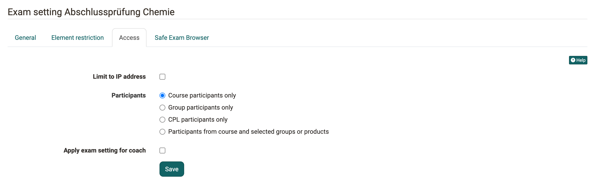{ class="shadow lightbox" title="Tab Access of an exam setting · 2026.10.22" }

**Limit to IP address**: To only allow the exam to be taken on certain computers or locations, select the checkbox here and then enter one entry per line in the field "Admissible IP addresses": a single address such as 192.168.1.20, a range such as 192.168.1.1-192.168.1.50 or a network such as 192.168.1.0/24. You should be able to obtain the addresses from your IT department. For example, you can use it to prevent participants from taking an exam from home.

**Participants**: Here you define for which participants the exam is valid. Select from the following options:

* "Course participants only": the participants of the course, also if they are enrolled via the Course Planner. Members of groups of the course only belong to it if they are also participants of the course.
* "Group participants only"
* "CPL participants only", if the Course Planner module is enabled. CPL stands for Course Planner.
* "Participants of courses and selected groups", with the Course Planner enabled "Participants from course and selected groups or products"

If an option with groups is selected, select the relevant groups with the buttons "Select groups" or "Select learning areas". A learning area groups several groups of the course; if you select it, the exam applies to all groups in it. This selection is mandatory. If the exam applies to participants of the Course Planner, select the products with the "Select product" button.

**Apply exam setting for coach**:
If this option is selected, the assessment mode also applies to the coaches of the selected participants: to the coaches of the course, of the selected groups or of the selected products, depending on the option under "Participants". Like the participants, they only reach the exam in OpenOlat during the exam. If a coach is to start the exam manually as supervisor, leave the option switched off.

!!! note "Note"

    Course owners can continue to access their course as normal during the exam.

---

## Tab "Safe Exam Browser" [:octicons-tag-16:{ title="from Release 20.3 (OO-9159)" }](https://track.frentix.com/issue/OO-9159) {: #tab-safe-exam-browser}

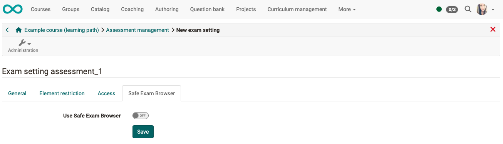{ class="shadow lightbox" title="Tab Safe Exam Browser of an exam setting" }

**Use Safe Exam Browser**: The assessment mode alone restricts what participants can reach in OpenOlat. The [Safe Exam Browser](http://www.safeexambrowser.org) (SEB) additionally secures the computer by putting it into the so-called kiosk mode. This way, participants cannot use unauthorized sources during the exam. If participants open the exam without the SEB, OpenOlat tells them that the exam requires the SEB. Only once OpenOlat is open in the Safe Exam Browser can they take the exam. If you set up an exam with the SEB for the first time, the guide to [preparing an exam with the Safe Exam Browser](../../manual_how-to/SEB/SEB.md) takes you through the whole procedure, from installing the SEB on the participants' computers to ending the exam.

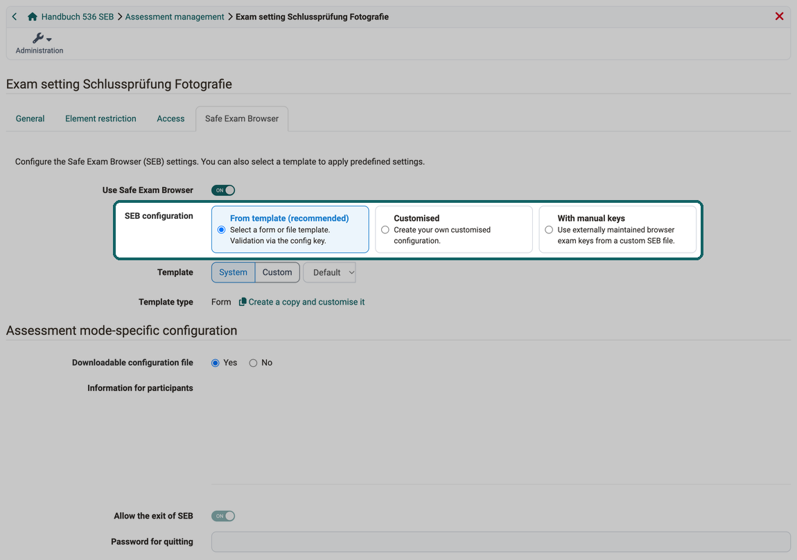{ class="shadow lightbox" title="Tab Safe Exam Browser of an exam setting · 2026.10.02" }

**SEB configuration** [:octicons-tag-16:{ title="from Release 20.3.10 / 21.0.4 (OO-9730)" }](https://track.frentix.com/issue/OO-9730): Define where the Safe Exam Browser takes its settings for this exam from. Three types are available:

- **From template (recommended)**: The settings come from a template. Via the config key, OpenOlat checks whether the participants' Safe Exam Browser runs with exactly this configuration.
- **Customised**: You create your own configuration for this exam. If the template marked as default is a form (see "Template type" below), its values are prefilled, otherwise the default values of OpenOlat.
- **With manual keys**: You use your own SEB-File that is maintained outside of OpenOlat and enter its Safe Exam Browser Keys in the field "Safe Exam Browser Keys". The key of a file, the Browser Exam Key, is shown by the Safe Exam Browser in its settings in the pane "Exam": on Windows in the configuration tool of the SEB, on macOS in the settings of the SEB. The key changes with every setting of the file and with the version of the SEB. Separate several keys with a line break.

The choice only applies to this exam. The setting "Safe Exam Browser - Type of use" of the system administration does not affect it, but only exams created from an event: [Assessment mode from an event](#exam_from_event)

**Template**: Appears with "From template (recommended)". With the two buttons you choose the source of the template:

- **System**: Select one of the active configuration templates that administrators provide in the system administration from the dropdown. The template they marked there with "Set as default" is preselected. If a saved template is subsequently deactivated, it remains selected until another template is chosen. The exam continues to run with the settings of this template; the template is only deactivated for the selection in further exams.
- **Custom**: Upload your own SEB-File with "Upload". You create a SEB-File with the Safe Exam Browser itself: on Windows with its configuration tool, on macOS in its settings. OpenOlat reads the settings from the file, calculates the config key and displays the settings read-only. The file must not be encrypted. If it is encrypted or password-protected, OpenOlat reports on upload: "The configuration file cannot be read. Please ensure that the file is not encrypted or password-protected."

!!! tip "Prerequisite"
    The template selection "System" is only available if at least one active template exists in the System Administration under `Administration > e-Assessment > Assessment management > Tab "Safe Exam Browser configuration"`.

**Template type**: Shows whether the template is a "Form" or a "SEB-File". Administrators fill in a form field by field in OpenOlat; a SEB-File they upload. For a form, the button "Create a copy and customise it" appears next to it: it takes the values of the template into a "Customised" configuration that you can change for this exam.

**Information for authors**: If administrators have stored a note in the selected template for the persons who set up exams, it is displayed here.

Under the heading "Assessment mode-specific configuration" you find the settings that apply to this specific exam:

**Downloadable configuration file**: Defines whether participants can download the SEB configuration file for this exam. If they open the file, the Safe Exam Browser starts directly with the exam. If the download is switched off and the Safe Exam Browser runs with a different configuration, OpenOlat refers the participants to the exam supervision. Persons with access to the assessment management download the configuration file of the exam in the list of exams in the column "SEB": `Course > Administration > Assessment management > Tab "Configuration assessment mode"`. With this file, the supervision starts the Safe Exam Browser for the exam. The field appears with "From template (recommended)" and "Customised".

**Information for participants**: A text that the participants see in the window "Current exam".

**Allow the exit of SEB**: Allows exam participants to quit the Safe Exam Browser after submitting the exam. If the option is switched off, they leave the Safe Exam Browser after the end of the exam with the button "Close SafeExamBrowser" in the window "Current exam". OpenOlat shows this button if "Link to quit SEB after exam" is switched on in the detailed settings of the configuration. [:octicons-tag-16:{ title="from Release 20.3.9 / 21.0.3 (OO-9740)" }](https://track.frentix.com/issue/OO-9740)

**Password for quitting**: Appears if "Allow the exit of SEB" is switched on. With this password, participants quit the Safe Exam Browser. For a SEB-File, from the system or uploaded, the password overwrites the password of the file for this specific exam. The note "Overwrites the template's password. The config key is automatically recalculated." then appears below the field. Participants then need the configuration file with the new password: if their Safe Exam Browser still runs with the old file, OpenOlat reports "The Safe Exam Browser uses a different configuration". If "Downloadable configuration file" is switched on, they download the new file in the window "Current exam". With "Customised", the password belongs to your own configuration, and the note does not appear. You or the supervision tell the participants the password itself, for example when they leave the exam room. For a SEB-File, the supervision sees it during the exam in the assessment tool: the area "Assessment mode" shows "Exit password available" next to the exam, and the eye icon ("View password") reveals the password. [:octicons-tag-16:{ title="from Release 20.3.9 / 21.0.3 (OO-9743)" }](https://track.frentix.com/issue/OO-9743)

Which value applies depends on the template:

- **Form from the system**: The exam takes "Information for participants", "Allow the exit of SEB" and the password from the template. These fields cannot be changed. Per exam, you only set "Downloadable configuration file".
- **SEB-File and "Customised"**: The exam saves its own values. When you reopen the exam and after switching tabs, the fields show these saved values, not the values of the template.

If you select another template, its values replace the values in the fields. Save your entries before you switch tabs: when switching, OpenOlat reloads the tab, and unsaved entries are lost. [:octicons-tag-16:{ title="from Release 20.3.9 / 21.0.3 (OO-9741)" }](https://track.frentix.com/issue/OO-9741)

With "With manual keys", this section only shows "Information for participants". Below it, the mandatory field "Safe Exam Browser Keys" appears.

Under the heading "Configuration from the template", a form and "Customised" show the detailed settings of the Safe Exam Browser, below them the "Config-Key of the saved configuration". They can only be changed with "Customised". For a SEB-File, the section "Configuration from the SEB-File template" shows the settings of the file read-only instead.

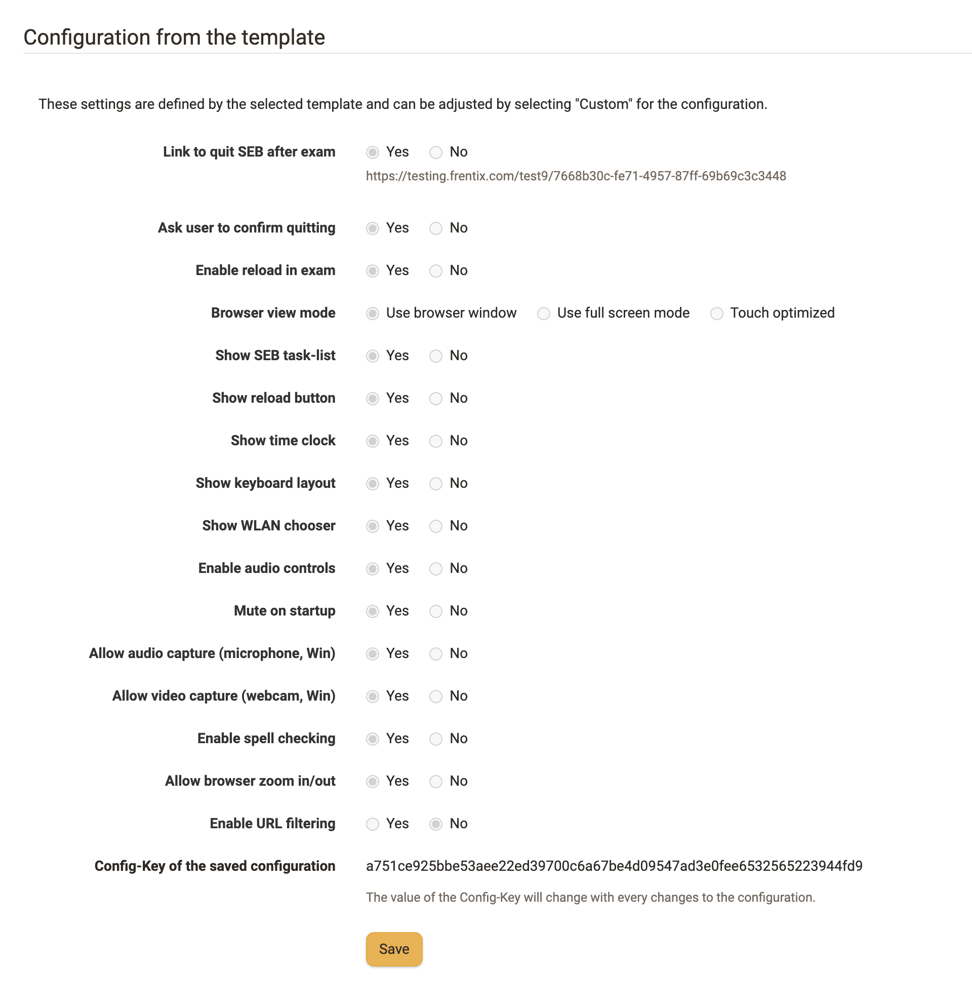{ class="shadow lightbox" title="Section Configuration from the template" }

---

## Assessment mode from an event [:octicons-tag-16:{ title="from Release 14.0 (OO-4045)" }](https://track.frentix.com/issue/OO-4045) {: #exam_from_event}

Anyone who runs events in the course turns an event directly into an exam, without creating an assessment mode from scratch. If coaches or course owners choose "Mark as exam" in the 3-dot menu of an event, OpenOlat creates an assessment mode and opens the dialog "Exam setting". The page on the toolbar describes who receives the entry and why it can be missing: [Mark an event as an exam](../learningresources/Toolbar_Events.md#mark_event_as_exam)

The dialog is shorter than that of a directly created assessment mode and has no tabs:

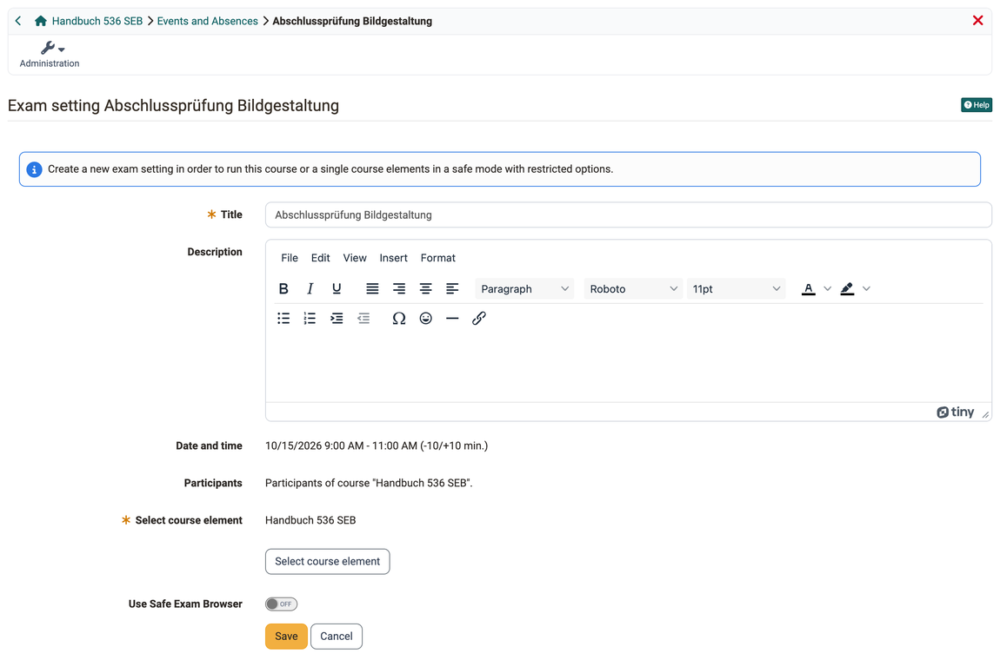{ class="shadow lightbox" title="Dialog Exam setting for an event · 2026.10.02" }

- **Title** and **Description**: The title is a mandatory field.
- **Date and time**: taken from the event. The prep time and follow-up in minutes are shown in brackets, for example "(-10/+10 Min.)". They come from the default values of the course or of the system administration.
- **Participants**: taken from the event.
- **Select course element**: Mandatory field. With "Select course element" you define which course elements the participants access during the exam.
- **Use Safe Exam Browser**: switches on the Safe Exam Browser for this exam.
- **Admissible IP addresses**: appears if the default values contain admissible IP addresses, and cannot be changed.

After switching on "Use Safe Exam Browser", the dialog shows no choice "SEB configuration". The system administration defines the type with the setting ["Safe Exam Browser - Type of use"](../../manual_admin/administration/Modules_Events_and_Absences.md#seb_type_of_use) for all exams from events:

- **From template (recommended)**: In the field "Configuration" you select one of the active templates, the one marked as default is preselected. "Show the provided configuration" shows the settings of the selected template. The system administration defines whether participants can download the configuration file.
- **With manual keys**: The field "Safe Exam Browser Keys" shows the keys from the default values of the course or of the system administration. They cannot be changed in the dialog.

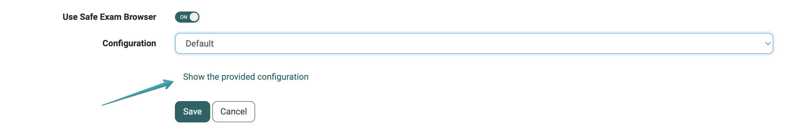{ class="shadow lightbox" title="Dialog Exam setting for an event · 2026.10.02" }

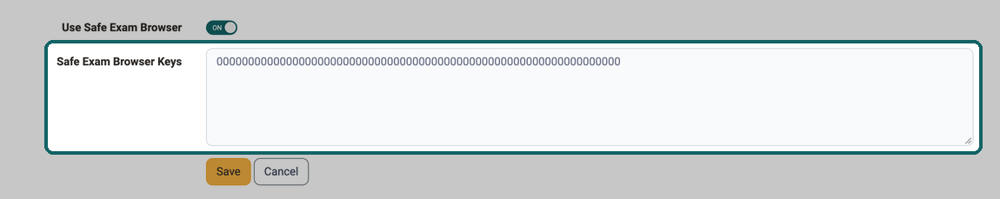{ class="shadow lightbox" title="Dialog Exam setting for an event · 2026.10.02" }

An exam from an event also appears in the assessment management of the course and opens the same dialog there. Assessment modes created directly in the assessment management, in contrast, choose the type per exam in the field "SEB configuration", see [Tab "Safe Exam Browser"](#tab-safe-exam-browser).

---

## Perform Exam

Participants who are assigned to an exam are informed about the start of the exam at the beginning of the exam or at the beginning of the prep time: OpenOlat shows them the window "Current exam". If OpenOlat is still blocked at the end of the exam due to a follow-up time, they are also informed of this.

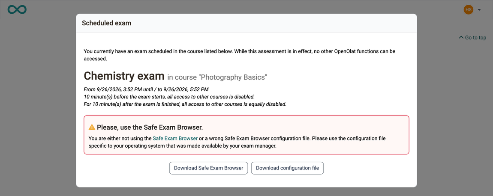{ class="shadow lightbox" title="Window Current exam for participants" }

If the option "Manual" is selected under "Start / End mode", a person starts the exam themselves, for example the supervisor in the exam room as soon as everyone is ready. For this, the overview of the [assessment tool](Assessment_tool_overview/index.md) shows the button "Start exam" next to the exam in the area "Assessment mode". You open the assessment tool under: `Course > Administration > Assessment tool`. The button appears from the day on which the exam begins, not only at the configured time. Who sees it is described in the section [Who can start and finish an exam manually](#start_stop_rights).

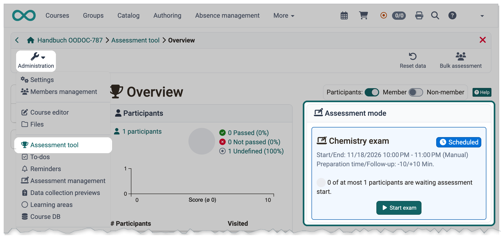{ class="shadow lightbox" title="Overview of the assessment tool · 2026.11.18" }

With manual start, the exam begins as soon as someone clicks "Start exam", also before or after the planned time. OpenOlat moves the end by the same time, so the configured exam duration remains the same. If nobody clicks earlier, the prep time begins at the planned time before the configured start and lasts until someone clicks "Start exam". Until then, the participants see the window "Current exam", and they cannot click the button "Go to exam" in it yet. Without prep time, OpenOlat remains open until someone clicks "Start exam": the exam keeps the status "Scheduled", and the participants continue to work normally, also after the planned time. An exam with manual end only ends when someone clicks "Finish exam".

During the exam, coaches follow the assessment mode in the overview of the assessment tool.

In the assessment tool, they also assess tasks and essay questions of tests directly and release the assessment for the participants. This allows the exam to be discussed right afterwards.

### How many participants are already there [:octicons-tag-16:{ title="from Release 15.2 (OO-4766)" }](https://track.frentix.com/issue/OO-4766) {: #participant_count}

Before and during an exam, you want to know whether all participants are there. For this, the area "Assessment mode" of the assessment tool shows a line such as "3 of at most 20 participants are waiting for assessment start." next to the exam. In the image of the assessment tool overview above, it is directly above the button "Start exam", there with "0 of at most 1".

* The second number, after "at most", counts all persons the exam applies to: the participants you defined in the tab "Access" under "Participants". For an exam from an event, these are the participants of the event.
* The first number counts how many of them are already in OpenOlat. As long as the exam has the status "Scheduled", i.e. before the prep time, it counts every person who is currently logged in to OpenOlat, also outside the course. From the prep time on, it counts who waits for the start in the window "Current exam" or has already opened the exam with the button "Go to exam" in this window. If the exam requires the Safe Exam Browser, only those wait who have opened OpenOlat in the Safe Exam Browser with the configuration of the exam.

If both numbers match, all persons the exam applies to are there. If the line counts more persons than your group has, the exam also applies to further participants of the course or of further groups, or the coaches are counted (next paragraph). Which reason applies is shown in the tab "Access" of the exam: the option under "Participants" and the option "Apply exam setting for coach". The line updates itself while the page is open.

If the option "Apply exam setting for coach" is switched on in the tab "Access", both numbers also count the coaches, although the line says "participants". Owners are not counted. The numbers are the same for everyone who sees the line: coaches who only see the participants of their groups in the assessment tool also see all persons the exam applies to in the line.

After the start, the line reads, for example, "18 of at most 20 participants are currently taking the exam." The first number still counts everyone who is there: also those who have not yet opened the exam with "Go to exam" and those who have already submitted it. So the line says who is there, not who is currently writing. How far the individual participants are with the test is shown by the course element "Test" in the assessment tool in the tab "Participants", in the column "Status", for example "Started": [View and assess tests](Course_Element_Test/Test_Results.md#assess)

When the line appears depends on whether you may start the exam:

* You may start an exam with manual start: the line appears from the day of the exam together with the button "Start exam", after the start together with "Finish exam".
* The exam starts automatically, or you do not have the right to start: the line appears from the prep time, without prep time from the start, and remains until the end of the follow-up time.

The same line is also shown in:

* the tab "Assessment mode" of the [course element "Test"](Course_Element_Test/Test_Results.md#assess), for owners and coaches
* the info icon in the banner of the exam: persons with access to the assessment tool see this banner at the top of the course while the exam is running or in the prep or follow-up time. It shows the status and the title of the exam, the info icon is next to the title. If only one exam is active in the course, the banner also shows persons with the right to start the button "Start exam" and, after the start, "Finish exam".

### Who can start and finish an exam manually {: #start_stop_rights}

Coaches see an exam with manual start in the area "Assessment mode" of the assessment tool, but the button "Start exam" only with an additional right. Therefore, decide before the day of the exam who starts the exam, and give this person the appropriate right.

The buttons "Start exam" and then "Finish exam" in the assessment tool are shown to:

* persons with owner rights in the course, i.e. owners, learning resource managers and administrators, as well as principals, course planners and master coaches. What else these roles allow is described in [Roles and Rights: Which roles are available?](../basic_concepts/Roles/index.md)
* members with the right "Assessment tool"
* coaches who are selected under "Teacher" in the event of the exam (see [Assessment mode from an event](#exam_from_event))

Members with the right "Assessment tool" and teachers of the event also find the same button in the [course element "Test"](Course_Element_Test/index.md) in the tab "Assessment mode".

In the assessment management, persons with owner rights and members with the right "Assessment mode" or "Course editor" start and finish the exam with the buttons "Start" and "Finish" in the list of exams: 
`Course > Administration > Assessment management > Tab "Configuration assessment mode"`

Owners assign the rights in the members management, for all course coaches or specifically for the coaches of a group, for example a group "Supervision": 
`Course > Administration > Members management > Rights` 
The three rights for starting the exam grant different amounts of access. What else each right allows is described in the members management under [Assignment of additional rights](Members_management.md#additional_rights).

* **Assessment tool**: The person starts and finishes the exam in the assessment tool and works there with all functions of the tool.
* **Assessment mode**: The person starts and finishes the exam in the assessment management. There, they also create, edit and delete assessment modes.
* **Course editor**: The person manages the exams in the assessment management as with the right "Assessment mode" and additionally edits the course in the course editor.

!!! info "Important"

    With the right "Assessment tool", a coach sees all participants of the course in the assessment tool, not only the participants of their group. They assess all of them and can reset assessment data. Therefore, consider whether the supervisor needs this access or whether the right "Assessment mode" is sufficient.

If a coach is to start the exam, leave the option "Apply exam setting for coach" switched off in the tab "Access". Otherwise, the assessment mode also applies to them, and they only reach the exam in OpenOlat.

---

## End Exam

A running assessment mode ends automatically or manually, depending on the setting under "Start / End mode".

With "Manual", the persons who may also start the exam finish it with the button "Finish exam" in the assessment tool, see [Who can start and finish an exam manually](#start_stop_rights).

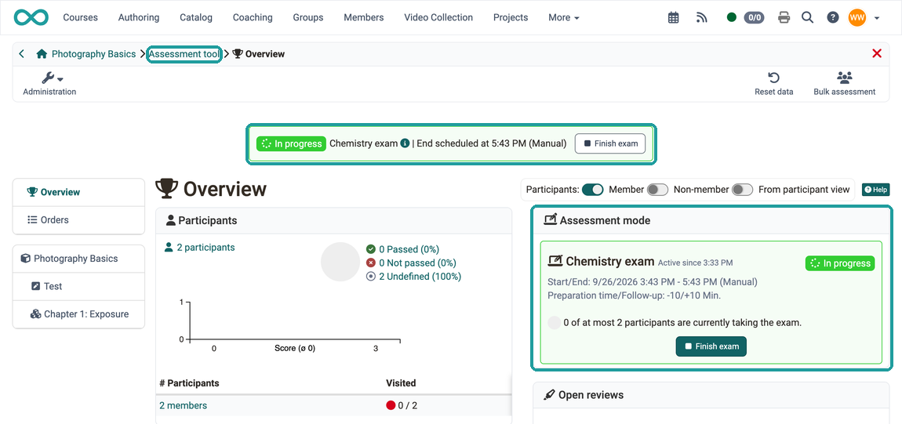{ class="shadow lightbox" title="Overview of the assessment tool" }

The assessment mode is also ended when the corresponding course is ended or deleted.

## Further information {: #further_information}

**Mentioned on this page** 
[Course Planner: Overview >](../area_modules/Course_Planner/index.md) 
[Safe Exam Browser >](http://www.safeexambrowser.org) 
[Learning path course - Course editor >](Learning_path_course_Course_editor.md) 
[How do I prepare an online exam? >](../../manual_how-to/exam_preparation/exam_preparation.md) 
[How do I prepare an exam with the Safe Exam Browser (SEB)? >](../../manual_how-to/SEB/SEB.md) 
[Toolbar: Events >](../learningresources/Toolbar_Events.md) 
[Module Events and Absences >](../../manual_admin/administration/Modules_Events_and_Absences.md) 
[Assessment tool - overview >](Assessment_tool_overview/index.md) 
[Evaluate and manage tests >](Course_Element_Test/Test_Results.md) 
[Roles and Rights: Which roles are available? >](../basic_concepts/Roles/index.md) 
[Course Element "Test" >](Course_Element_Test/index.md) 
[Members management >](Members_management.md)

**Further reading** 
[Assessment management: assessment inspection >](Assessment_inspection.md) 
[Test: Settings >](Test_settings.md)

[To the top of the page ^](#Assessment_mode)

