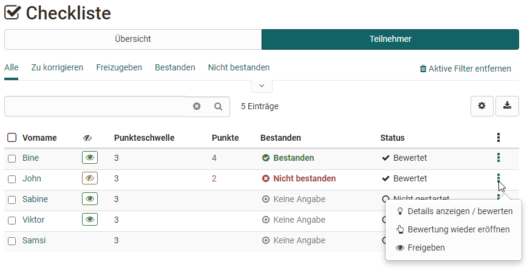
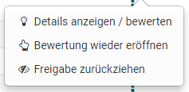
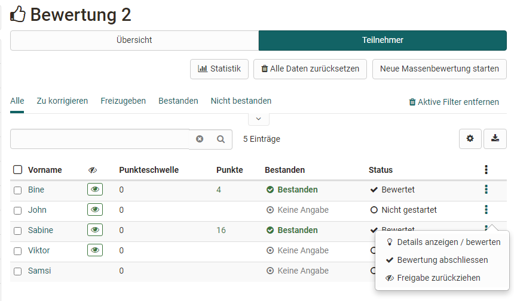
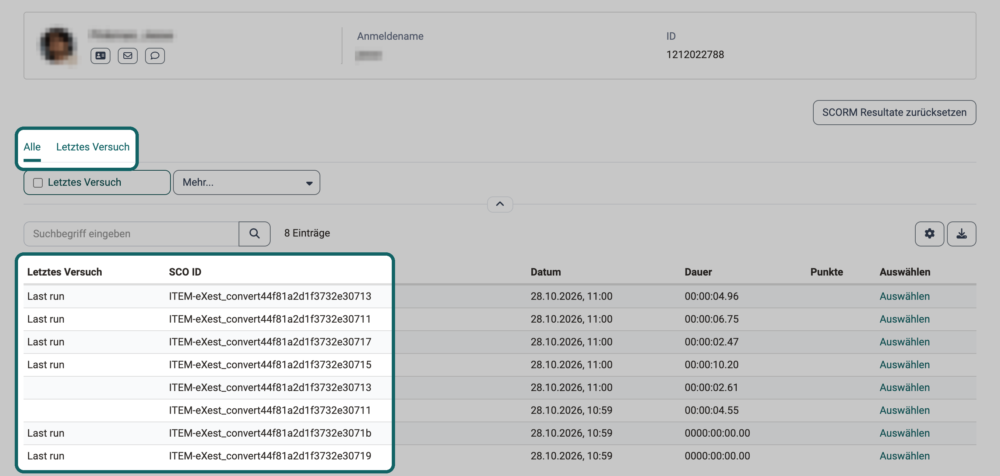
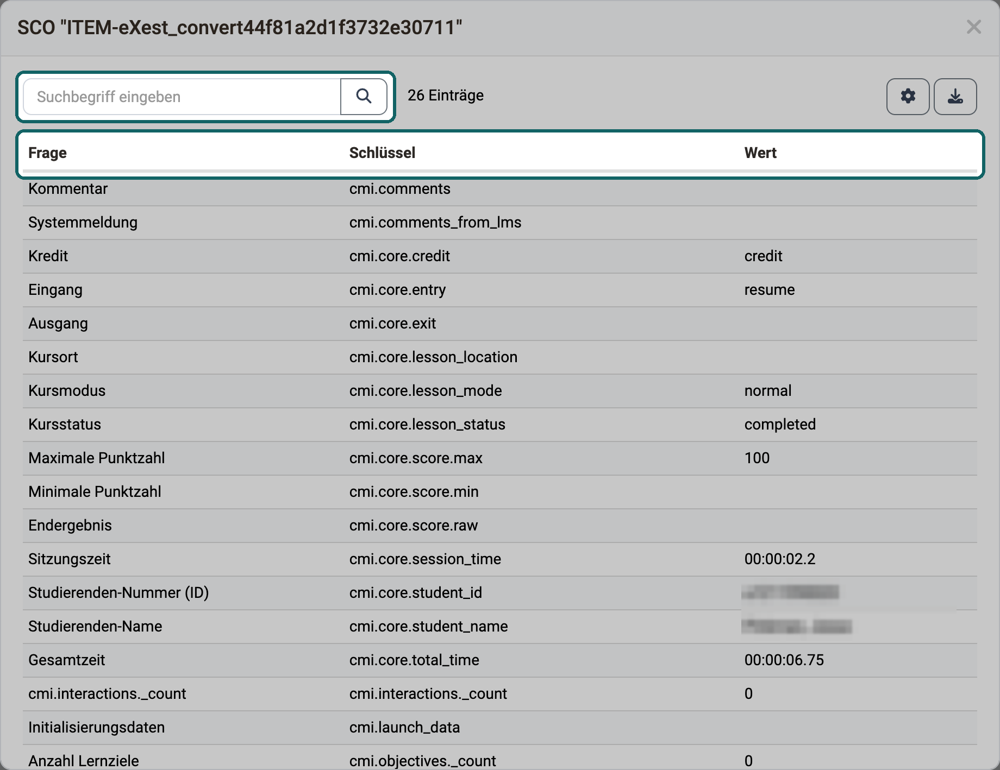

# Bewertung von Kursbausteinen

Im Bewertungswerkzeug bewerten Besitzer:innen und Betreuer:innen eines Kurses die Leistungen der Teilnehmenden. Welche Möglichkeiten Sie dabei haben, hängt vom Kursbaustein ab. Im Bewertungswerkzeug bewerten Sie diese Kursbausteine:

* Checkliste
* Bewertung
* Portfolioaufgabe
* Kursbaustein "Struktur" sowie gesamte Kursbewertung
* Kursbaustein "Teilnehmer:innen Ordner"
* Integrierte externe Bausteine wie SCORM und LTI
* [Aufgabe und Gruppenaufgabe](Assessing_tasks_and_group_tasks.de.md)
* [Tests](Assessing_tests.de.md)

Zuerst folgt das 3-Punkte-Menü, das für alle Kursbausteine gilt, danach die Besonderheiten der einzelnen Kursbausteine. Die Bewertung von Aufgaben, Gruppenaufgaben und Tests beschreiben eigene Seiten.

## Das 3-Punkte-Menü
{ class="shadow lightbox" title="3-Punkte-Menü in der Teilnehmerliste einer Checkliste" }

Das 3-Punkte-Menü in der Zeile einer Person führt direkt zu den wichtigsten Aktionen ihrer Bewertung:

* **Details anzeigen / bewerten:** öffnet die Bewertung der Person mit dem Bewertungsformular und, je nach Kursbaustein, ihren Resultaten.

* **Bewertung abschliessen** bzw. **Bewertung wieder eröffnen:** je nach aktuellem Status der Bewertung.

* **Freigeben** bzw. **Freigabe zurückziehen:** legt fest, ob die Person ihre Bewertung sieht. Das Auge in der Liste zeigt den Stand.

Für Tests stehen zusätzlich diese Aktionen zur Wahl:

* **Resultate als PDF:** lädt die Testresultate als PDF herunter.
* **Beendeten Testdurchlauf wieder öffnen:** Die Person setzt den Test dort fort, wo sie aufgehört hat. Ist der Test auf 1 Versuch beschränkt, setzen Sie zusätzlich die Versuche zurück, damit die Person weiterarbeiten kann.
* **Anzahl Versuche zurücksetzen:** setzt die Anzahl Versuche des Kursbausteins auf 0. Die Daten der Versuche bleiben erhalten.
* **Daten von Test zurücksetzen:** setzt die Bewertung der Person in diesem Test zurück. Die Testdurchläufe bleiben erhalten und gelten als ungültig. Was genau zurückgesetzt wird, beschreibt die Seite [Bewertungswerkzeug - Daten zurücksetzen](Assessment_tool_reset_data.de.md#impact_on_course_elements).
* **Nachteilsausgleich hinzufügen:** gibt einer einzelnen Person zusätzliche Zeit für die Bearbeitung eines Tests, z.B. aufgrund einer Beeinträchtigung.
* **Testzeit verlängern:** verlängert die Zeit eines Tests im Status "gestartet".
* **Laufenden Test einziehen:** beendet den laufenden Test. Die bisher ausgefüllten Daten zählen für die Bewertung, und Betreuer:innen sehen sie ein.

!!! tip "Tipp"

    Achten Sie darauf, dass in der Tabelle die Spalte mit dem 3-Punkte-Symbol eingeblendet ist. Darüber erreichen Sie die Aktionen zur Bewertung einer Person mit einem Klick.

## Checkliste
Für den Kursbaustein "Checkliste" bietet das 3-Punkte-Menü die drei oben genannten Aktionen:

{ class="shadow lightbox" title="Geöffnetes 3-Punkte-Menü im Bewertungswerkzeug" }

Ein Klick auf den Namen einer Person öffnet ihre Bewertung.

Dort haken Sie Checkboxen für die Person von Hand nach und füllen das Bewertungsformular aus. Je nach Konfiguration des Kursbausteins vergeben Sie Punkte, das Attribut "Bestanden" oder beides. Wie Sie eine Checkliste einrichten, beschreibt die Seite [Kursbaustein "Checkliste"](Course_Element_Checklist.de.md).

{ class="shadow lightbox" title="Bewertungsformular einer Checkliste im Bewertungswerkzeug" }

## Bewertung
Für den Kursbaustein "Bewertung" stehen über der Teilnehmerliste zusätzliche Buttons zur Wahl:

{ class="shadow lightbox" title="Teilnehmerliste des Kursbausteins Bewertung im Bewertungswerkzeug" }

Der Button "Statistik" erscheint nur, wenn der Kursbaustein eine Rubrik-Bewertung verwendet.

Der Button "Bewertungsskala anpassen" erscheint nur, wenn im Kurseditor eine Bewertungsskala für den Kursbaustein aktiviert ist.

Ein Klick auf den Namen einer Person öffnet ihre Bewertung. Dort füllen Sie das Bewertungsformular aus und nutzen, sofern verknüpft, die zugeordnete Rubrik.

{ class="shadow lightbox" title="Bewertungsformular mit Rubrik im Kursbaustein Bewertung" }

Ist eine [Rubrik](Form_Element_Rubric.de.md) als Bewertungsgrundlage hinterlegt, bewerten Sie jede Person Kriterium für Kriterium.

Für den Kursbaustein "Bewertung" steht zusätzlich die [Massenbewertung](Assessment_tool_overview.de.md#mass_assessment) zur Verfügung.

## Portfolioaufgabe [:octicons-tag-16:{ title="ab Release 12.0 (OO-2923)" }](https://track.frentix.com/issue/OO-2923)
Für den Kursbaustein "[Portfolioaufgabe](Creating_Portfolio_Tasks.de.md)" bietet das 3-Punkte-Menü diese Aktionen:

{ class="shadow lightbox" title="Teilnehmerliste einer Portfolioaufgabe im Bewertungswerkzeug" }

Die Bewertung im Bewertungswerkzeug ist dieselbe wie im Tab ["Bewertung" im Portfolio](Portfolio_assignment_Grading.de.md) selbst. Im Bewertungswerkzeug öffnen Sie die einzelnen Bereiche jedoch nicht, Sie bewerten sie nur. Bewerten Sie deshalb am besten direkt im Portfolio.

{ class="shadow lightbox" title="Bewertung einer Portfoliomappe im Bewertungswerkzeug" }

## Kursbaustein "Struktur" oder gesamte Kursbewertung

Der Kursbaustein "Struktur" erscheint ebenfalls im Bewertungswerkzeug. Sind für den Kurs Punkte aktiviert, zeigt er die zusammengezählten Punkte der untergeordneten bewertbaren Kursbausteine. Punkte vergeben oder bewerten können Sie hier nicht, Sie sehen nur den aktuellen Punktestand.

In Lernpfadkursen zählt OpenOlat die Ergebnisse aller untergeordneten bewertbaren Kursbausteine automatisch zusammen. In herkömmlichen Kursen wählen Sie die Kursbausteine, die zählen sollen, im Kurseditor im Tab "Punkte" des Kursbausteins "Struktur". Der oberste Kursbaustein ist ebenfalls ein Strukturbaustein, deshalb zählt er die Punkte des gesamten Kurses zusammen.

!!! tip "Tipp"

    Die Punkte eines Kursbausteins "Struktur" eignen sich immer dann, wenn OpenOlat für den gesamten Kurs oder für einzelne Abschnitte Punkte automatisch zusammenzählen soll. Verwenden Sie in diesem Fall am besten einen herkömmlichen Kurs.

## Integrierte externe Bausteine
### SCORM
Auch für den Kursbaustein "SCORM 1.2" können Sie das Bewertungsformular ausfüllen. Dafür muss im Kurseditor unter "Resultat aus SCORM übertragen" die Option "Score übertragen" oder "Passed übertragen" gewählt sein: 
`Kurs > Administration > Kurseditor > Kursbaustein "SCORM 1.2" > Tab "Lerninhalt"` 
Was die beiden Optionen übernehmen, beschreibt die Seite [Kursbaustein "SCORM 1.2"](Course_Element_SCORM_Learning_Content.de.md#transfer_score).

Das Resultat aus SCORM bildet den Lernstand ab. Für Prüfungen und Zertifizierungen ist der [Kursbaustein "Test"](Course_Element_Test.de.md) vorgesehen.

### Details eines SCORM-Kursbausteins [:octicons-tag-16:{ title="ab Release 20.3.11 / 21.0.6 / 21.1.1 (OO-9935)" }](https://track.frentix.com/issue/OO-9935) {: #scorm_details}

Fragt eine Person nach ihrem Resultat aus SCORM, sehen Sie in der Liste über ihrem Bewertungsformular, welche Daten das SCORM-Paket übermittelt hat und welche Zeile den aktuellen Stand zeigt. Ein SCORM-Paket kann aus mehreren Kapiteln bestehen, den "Sharable Content Objects" (SCO). Jedes SCO hat eine eigene SCO ID, und die Liste zeigt seine Daten in eigenen Zeilen.

Besitzer:innen und Betreuer:innen öffnen die Liste einer Person auf zwei Wegen, beide zeigen dieselbe Liste:

* **Im Bewertungswerkzeug:** Kursbaustein "SCORM 1.2" wählen, im Tab "Teilnehmer:innen" auf den Namen der Person klicken oder in ihrem 3-Punkte-Menü "Details anzeigen / bewerten" wählen. 
`Kurs > Administration > Bewertungswerkzeug > Kursbaustein "SCORM 1.2" > Tab "Teilnehmer:innen" > "Name der Person"`
* **Im Kurs:** Kursbaustein "SCORM 1.2" öffnen, im Tab "Teilnehmer:innen" auf den Namen der Person klicken. 
`Kurs > Kursbaustein "SCORM 1.2" > Tab "Teilnehmer:innen" > "Name der Person"`

Gehen Sie im Bewertungswerkzeug von der Person aus, öffnet "Auswählen" beim Kursbaustein "SCORM 1.2" dieselbe Liste, siehe [Lernende bewerten](Assessment_of_learners.de.md#assess_all_course_element).

{ class="shadow lightbox" title="Details eines SCORM-Kursbausteins im Bewertungswerkzeug · 2026.10.28" }

Die Liste zeigt die neueste Zeile zuoberst und hat diese Spalten:

* **Letztes Versuch:** markiert je SCO die Zeile mit dem aktuellen Stand, mit dem Text "Last run". Bei den übrigen Zeilen bleibt die Zelle leer.
* **SCO ID:** das SCO, zu dem die Zeile gehört.
* **Datum:** der Zeitpunkt, zu dem OpenOlat diesen Stand gespeichert hat.
* **Dauer:** die Gesamtzeit, die das SCO für diesen Stand gemeldet hat.
* **Punkte:** die Punkte, die das SCO für diesen Stand gemeldet hat.
* **Auswählen:** öffnet die übermittelten Daten dieser Zeile.

Jedes Mal, wenn eine Person ein SCO beendet, legt OpenOlat zusätzlich eine Kopie des Stands ab. Diese Kopien erscheinen als weitere Zeilen desselben SCO, ohne Markierung. Ist die jüngste Kopie identisch mit dem aktuellen Stand, blendet OpenOlat sie aus. Ein SCO kann deshalb mehrmals in der Liste stehen, und die markierte Zeile zeigt den Stand, den es zuletzt übermittelt hat.

Über der Liste wählen Sie zwischen "Alle" und "Letztes Versuch". "Letztes Versuch" zeigt nur die markierten Zeilen, also den aktuellen Stand jedes SCO. "Alle" zeigt auch die früheren Stände. "Letztes Versuch" steht ausserdem bei den Filtern der Liste zur Wahl. Das Suchfeld findet Zeilen über die SCO ID.

"Auswählen" öffnet ein Fenster mit der SCO ID im Titel. Es listet alle Daten, die das SCO übermittelt hat, in den Spalten "Frage", "Schlüssel" und "Wert". "Schlüssel" ist der technische Name des SCORM-Datenfelds, etwa `cmi.core.score.raw`, "Frage" dessen Bezeichnung in OpenOlat, etwa "Endergebnis", und "Wert" der übermittelte Inhalt. Das Suchfeld im Fenster findet Einträge über Frage, Schlüssel oder Wert.

{ class="shadow lightbox" title="Übermittelte Daten eines SCO im Bewertungswerkzeug · 2026.10.28" }

Die Liste und die Tabelle im Fenster exportieren Sie je mit dem Symbol "Herunterladen". Die SCORM-Daten aller Teilnehmenden eines Kurses exportieren Sie dagegen unter `Kurs > Administration > Archivierung & Reports`, siehe [SCORM Resultate](Course_Archiving.de.md#scorm-resultate).

Mit "SCORM Resultate zurücksetzen" oben rechts löschen Sie nach einer Rückfrage alle übermittelten SCORM-Daten der Person in diesem Kursbaustein. Ein als abgeschlossen markiertes SCORM-Paket kann die Person danach erneut durcharbeiten. Die beim letzten Versuch übertragenen Punkte bleiben unverändert. OpenOlat archiviert die gelöschten Daten nicht. Sollen auch Punkte, Status und Anzahl Versuche zurückgesetzt und die Daten vorher archiviert werden, verwenden Sie "Daten zurücksetzen", siehe [Bewertungswerkzeug - Daten zurücksetzen](Assessment_tool_reset_data.de.md). In einem schreibgeschützten Kurs fehlt der Button "SCORM Resultate zurücksetzen".

Wie das Bewertungsformular erscheint die Liste nur, wenn im Kurseditor unter "Resultat aus SCORM übertragen" die Option "Score übertragen" oder "Passed übertragen" gewählt ist.

### LTI [:octicons-tag-16:{ title="ab Release 9.0.0 (OO-558)" }](https://track.frentix.com/issue/OO-558)
Auch für den Kursbaustein "LTI-Seite" füllen Sie das Bewertungsformular aus. Dafür muss im Kurseditor im Bereich "Konfiguration Bewertung" der Schalter "Punkte übertragen" eingeschaltet sein: 
`Kurs > Administration > Kurseditor > Kursbaustein "LTI-Seite" > Tab "Seiteninhalt"` 
Ist der Schalter eingeschaltet, erscheinen dort zusätzlich die Felder "Skalierungsfaktor" und "Notwendige Punktzahl für 'bestanden'". Wie Sie den Kursbaustein einrichten, beschreibt die Seite [Kursbaustein "LTI-Seite"](Course_Element_LTI_Page.de.md).

## Weiterführende Informationen {: #further_information}

**Auf dieser Seite erwähnt** 
[Aufgaben und Gruppenaufgaben bewerten >](Assessing_tasks_and_group_tasks.de.md) 
[Tests bewerten >](Assessing_tests.de.md) 
[Bewertungswerkzeug - Daten zurücksetzen >](Assessment_tool_reset_data.de.md) 
[Kursbaustein "Checkliste" >](Course_Element_Checklist.de.md) 
[Das Formular-Element Rubrik >](Form_Element_Rubric.de.md) 
[Bewertungswerkzeug - Übersicht >](Assessment_tool_overview.de.md) 
[Portfolioaufgabe erstellen >](Creating_Portfolio_Tasks.de.md) 
[Portfolioaufgabe: kommentieren und bewerten >](Portfolio_assignment_Grading.de.md) 
[Kursbaustein "SCORM 1.2" >](Course_Element_SCORM_Learning_Content.de.md) 
[Kursbaustein "Test" >](Course_Element_Test.de.md) 
[Lernende bewerten >](Assessment_of_learners.de.md) 
[Kursadministration - Archivierung & Reports >](Course_Archiving.de.md) 
[Kursbaustein "LTI-Seite" >](Course_Element_LTI_Page.de.md)

**Weiterführend** 
[Kursbaustein "Struktur" >](Course_Element_Structure.de.md) 
[Bewertungswerkzeug: Tab Teilnehmer:innen >](Assessment_tool_tab_Users.de.md)

[Zum Seitenanfang ^](#bewertung-von-kursbausteinen)