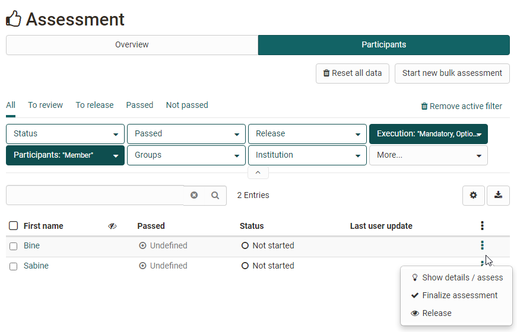
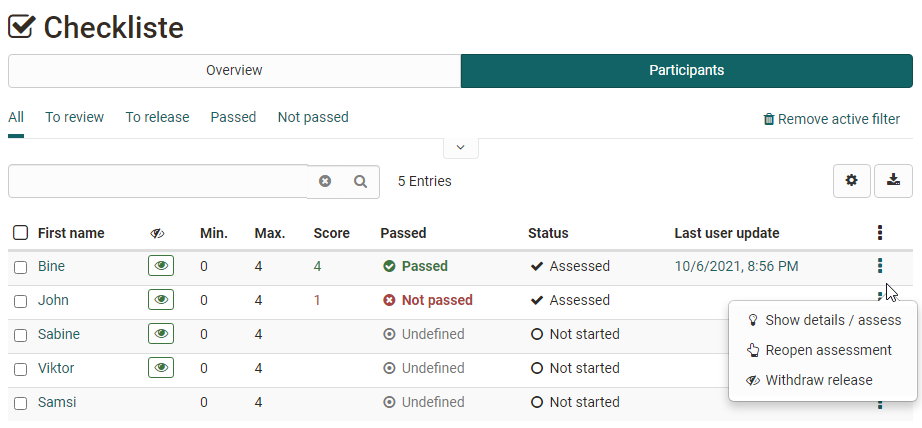
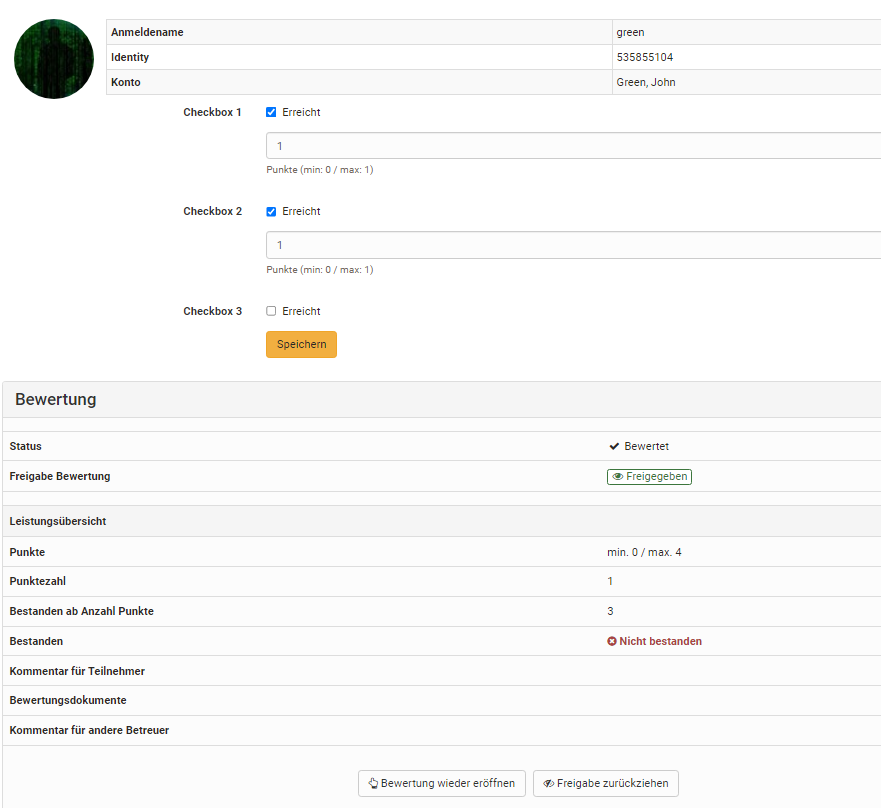
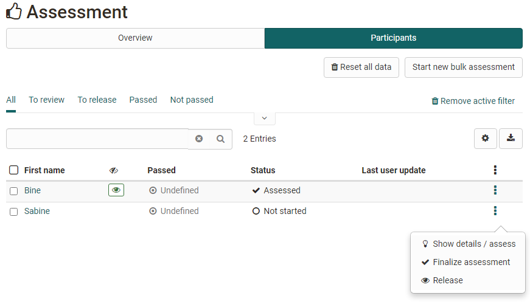
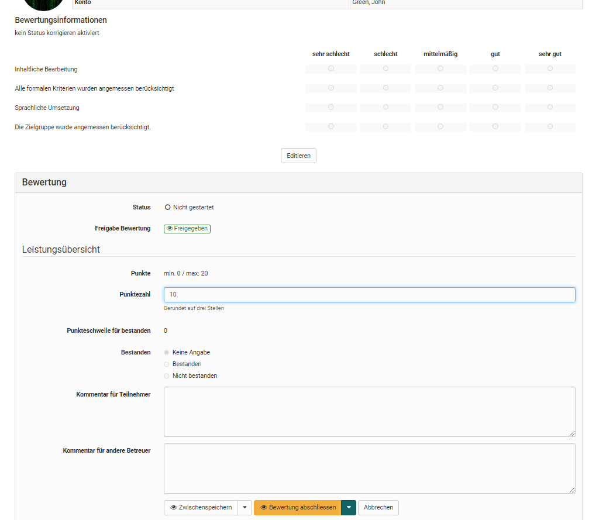
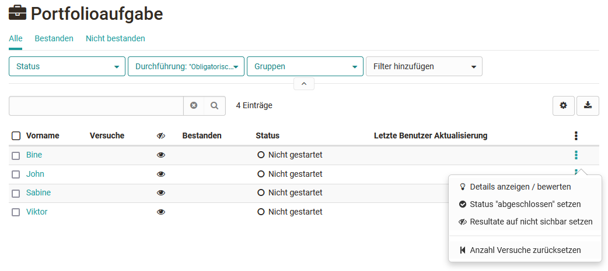
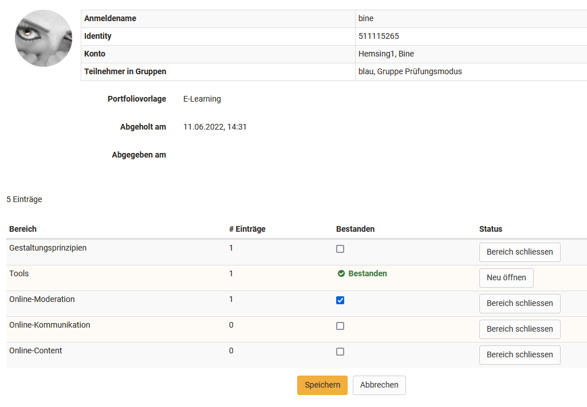
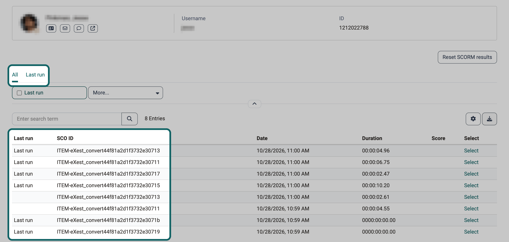
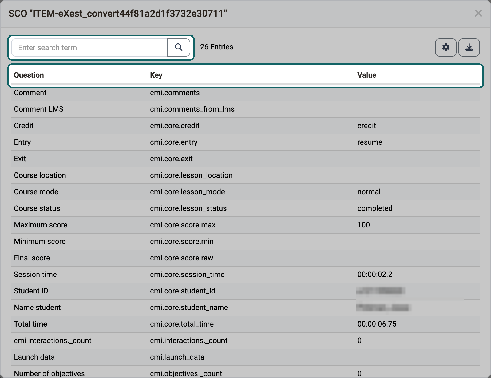

# Assessment of course modules

In the assessment tool, owners and coaches of a course assess the performance of the participants. The options you have depend on the course element. In the assessment tool, you assess these course elements:

* Check list
* Assessment
* Portfolio task
* Course element "Structure" and the overall course assessment
* Course element "Participant Folder"
* Integrated external modules such as SCORM and LTI
* [Task and group task](Assessing_tasks_and_group_tasks.md)
* [Tests](Assessing_tests.md)

First comes the 3-point menu, which applies to all course elements, then the specifics of the individual course elements. The assessment of tasks, group tasks and tests is described on separate pages.

## The 3-point menu
{ class="shadow lightbox" title="3-point menu in the participant list of an assessment" }

The 3-point menu in the row of a person leads directly to the most important actions of their assessment:

* **Show details / assess:** opens the assessment of the person with the assessment form and, depending on the course element, their results.

* **Finalize assessment** or **Reopen assessment:** depending on the current status of the assessment.

* **Release** or **Withdraw release:** determines whether the person sees their assessment. The eye in the list shows the state.

For tests, these actions are also available:

* **Results as PDF:** downloads the test results as a PDF.
* **Reopen finished test run:** The person continues the test where they left off. If the test is limited to 1 attempt, also reset the attempts so that the person can continue.
* **Reset number of attempts:** sets the number of attempts of the course element to 0. The data of the attempts is kept.
* **Reset data of test:** resets the assessment of the person in this test. The test runs are kept and count as invalid. The page [Assessment tool - reset data](Assessment_tool_reset_data.md#impact_on_course_elements) describes exactly what is reset.
* **Add disadvantage compensation:** gives an individual person additional time to complete a test, e.g. due to an impairment.
* **Extend test time:** extends the time of a test in the status "started".
* **Pull running test:** ends the running test. The data filled in so far counts for the assessment, and coaches can view it.

!!! tip "Tip"

    Make sure that the column with the 3-point icon is displayed in the table. It gives you access to the actions for assessing a person with one click.

## Check list
For the course element "Check list", the 3-point menu offers the three actions described above:

{ class="shadow lightbox" title="Opened 3-point menu in the assessment tool" }

A click on the name of a person opens their assessment.

There you tick checkboxes for the person by hand and fill in the assessment form. Depending on the configuration of the course element, you award a score, the attribute "Passed" or both. The page [Course Element "Checklist"](Course_Element_Checklist.md) describes how to set up a check list.

{ class="shadow lightbox" title="Assessment form of a checklist in the assessment tool" }

## Assessment
For the course element "Assessment", additional buttons are available above the participant list:

{ class="shadow lightbox" title="Participant list of the course element Assessment" }

The button "Statistic" only appears if the course element uses a rubric assessment.

The button "Adjust grade scale" only appears if a grade scale is activated for the course element in the course editor.

A click on the name of a person opens their assessment. There you fill in the assessment form and, if linked, use the assigned rubric.

{ class="shadow lightbox" title="Assessment form with rubric in the course element Assessment" }

If a [rubric](Form_Element_Rubric.md) is stored as the basis for the assessment, you assess each person criterion by criterion.

For the course element "Assessment", the [bulk assessment](Assessment_tool_overview.md#mass_assessment) is also available.

## Portfolio task [:octicons-tag-16:{ title="from Release 12.0 (OO-2923)" }](https://track.frentix.com/issue/OO-2923)
For the course element "[Portfolio task](Creating_Portfolio_Tasks.md)", the 3-point menu offers these actions:

{ class="shadow lightbox" title="Participant list of a portfolio task in the assessment tool" }

The assessment in the assessment tool is the same as in the ["Assessment" tab in the portfolio](Portfolio_assignment_Grading.md) itself. In the assessment tool, however, you do not open the individual areas, you only assess them. It is therefore best to assess directly in the portfolio.

{ class="shadow lightbox" title="Assessment of a portfolio binder in the assessment tool" }

## Course element "Structure" or total course assessment

The course element "Structure" also appears in the assessment tool. If scores are activated for the course, it shows the added-up score of the subordinate assessable course elements. You cannot award a score or assess here, you only see the current score.

In learning path courses, OpenOlat automatically adds up the results of all subordinate assessable course elements. In conventional courses, you select the course elements that count in the course editor in the tab "Score" of the course element "Structure". The top course element is also a structure element, which is why it adds up the score of the entire course.

!!! tip "Tip"

    The score of a course element "Structure" is useful whenever OpenOlat is to add up scores automatically for the entire course or for individual sections. In this case, it is best to use a conventional course.

## Integrated external modules
### SCORM
You can also fill in the assessment form for the course element "SCORM 1.2". For this, the option "Transfer score value" or "Transfer passed value" must be selected under "Transfer score from SCORM" in the course editor: 
`Course > Administration > Course editor > Course element "SCORM 1.2" > Tab "Learning content"` 
The page [Course Element "SCORM 1.2"](Course_Element_SCORM_Learning_Content.md#transfer_score) describes what the two options transfer.

The result from SCORM reflects the learning status. Use the [Course Element "Test"](Course_Element_Test.md) for exams and certifications.

### Details of a SCORM course element [:octicons-tag-16:{ title="from Release 20.3.11 / 21.0.6 / 21.1.1 (OO-9935)" }](https://track.frentix.com/issue/OO-9935) {: #scorm_details}

If a person asks about their result from SCORM, the list above their assessment form shows you which data the SCORM package has transmitted and which row shows the current state. A SCORM package can consist of several chapters, the "Sharable Content Objects" (SCO). Each SCO has its own SCO ID, and the list shows its data in rows of its own.

Owners and coaches open the list of a person in two ways, both show the same list:

* **In the assessment tool:** select the course element "SCORM 1.2", then in the tab "Participants" click the name of the person or select "Show details / assess" in their 3-point menu. 
`Course > Administration > Assessment tool > Course element "SCORM 1.2" > Tab "Participants" > "Name of the person"`
* **In the course:** open the course element "SCORM 1.2", then in the tab "Participants" click the name of the person. 
`Course > Course element "SCORM 1.2" > Tab "Participants" > "Name of the person"`

If you start from the person in the assessment tool, "Select" next to the course element "SCORM 1.2" opens the same list, see [Assessment of learners](Assessment_of_learners.md#assess_all_course_element).

{ class="shadow lightbox" title="Details of a SCORM course element in the assessment tool · 2026.10.28" }

The list shows the newest row at the top and has these columns:

* **Last run:** marks the row with the current state of each SCO, with the text "Last run". In the other rows the cell stays empty.
* **SCO ID:** the SCO the row belongs to.
* **Date:** the time at which OpenOlat saved this state.
* **Duration:** the total time the SCO reported for this state.
* **Score:** the score the SCO reported for this state.
* **Select:** opens the transmitted data of this row.

Each time a person finishes a SCO, OpenOlat also stores a copy of the state. These copies appear as further rows of the same SCO, without a mark. If the most recent copy is identical to the current state, OpenOlat hides it. A SCO can therefore appear several times in the list, and the marked row shows the state it transmitted last.

Above the list you choose between "All" and "Last run". "Last run" shows only the marked rows, that is the current state of each SCO. "All" also shows the earlier states. "Last run" is also available among the filters of the list. The search field finds rows by their SCO ID.

"Select" opens a window with the SCO ID in its title. It lists all data the SCO has transmitted, in the columns "Question", "Key" and "Value". "Key" is the technical name of the SCORM data field, such as `cmi.core.score.raw`, "Question" its name in OpenOlat, such as "Final score", and "Value" the transmitted content. The search field in the window finds entries by question, key or value.

{ class="shadow lightbox" title="Transmitted data of a SCO in the assessment tool · 2026.10.28" }

You export the list and the table in the window with the icon "Download" of each. To export the SCORM data of all participants of a course, use `Course > Administration > Archiving & Reporting` instead, see [SCORM results](Course_Archiving.md#scorm-results).

With "Reset SCORM results" at the top right, you delete all transmitted SCORM data of the person in this course element after a confirmation. The person can then work through a SCORM package marked as completed again. The score transmitted in the last attempt stays unchanged. OpenOlat does not archive the deleted data. To also reset the score, the status and the number of attempts and to archive the data first, use "Reset data", see [Assessment tool - reset data](Assessment_tool_reset_data.md). In a read-only course, the button "Reset SCORM results" is missing.

Like the assessment form, the list only appears if the option "Transfer score value" or "Transfer passed value" is selected under "Transfer score from SCORM" in the course editor.

### LTI [:octicons-tag-16:{ title="from Release 9.0.0 (OO-558)" }](https://track.frentix.com/issue/OO-558)
You can also fill in the assessment form for the course element "LTI page". For this, the switch "Transfer score" in the area "Configuration assessment" must be switched on in the course editor: 
`Course > Administration > Course editor > Course element "LTI page" > Tab "Page content"` 
When the switch is on, the fields "Scaling factor" and "Score needed to pass" also appear there. The page [Course Element "LTI Page"](Course_Element_LTI_Page.md) describes how to set up the course element.

## Further information {: #further_information}

**Mentioned on this page** 
[Assessing tasks and group tasks >](Assessing_tasks_and_group_tasks.md) 
[Assessing tests >](Assessing_tests.md) 
[Assessment tool - reset data >](Assessment_tool_reset_data.md) 
[Course Element "Checklist" >](Course_Element_Checklist.md) 
[The form element rubric >](Form_Element_Rubric.md) 
[Assessment tool - overview >](Assessment_tool_overview.md) 
[Creating Portfolio Tasks >](Creating_Portfolio_Tasks.md) 
[Portfolio assignment: Grading >](Portfolio_assignment_Grading.md) 
[Course Element "SCORM 1.2" >](Course_Element_SCORM_Learning_Content.md) 
[Course Element "Test" >](Course_Element_Test.md) 
[Assessment of learners >](Assessment_of_learners.md) 
[Course administration - Archiving & Reports >](Course_Archiving.md) 
[Course Element "LTI Page" >](Course_Element_LTI_Page.md)

**Further** 
[Course Element "Structure" >](Course_Element_Structure.md) 
[Assessment tool: Tab Participants >](Assessment_tool_tab_Users.md)

[To the top of the page ^](#assessment-of-course-modules)