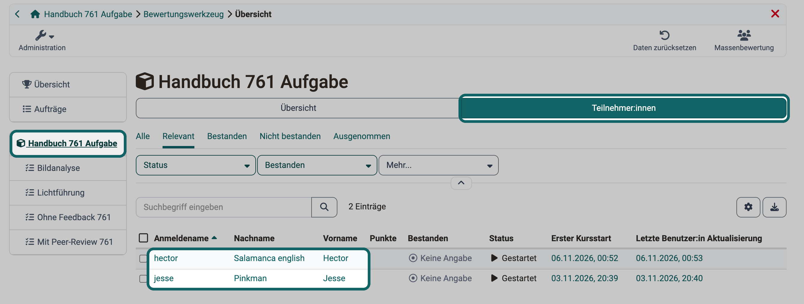
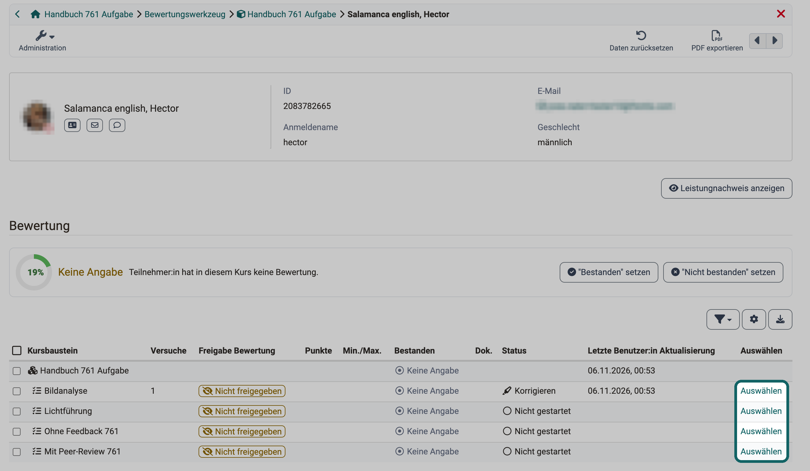
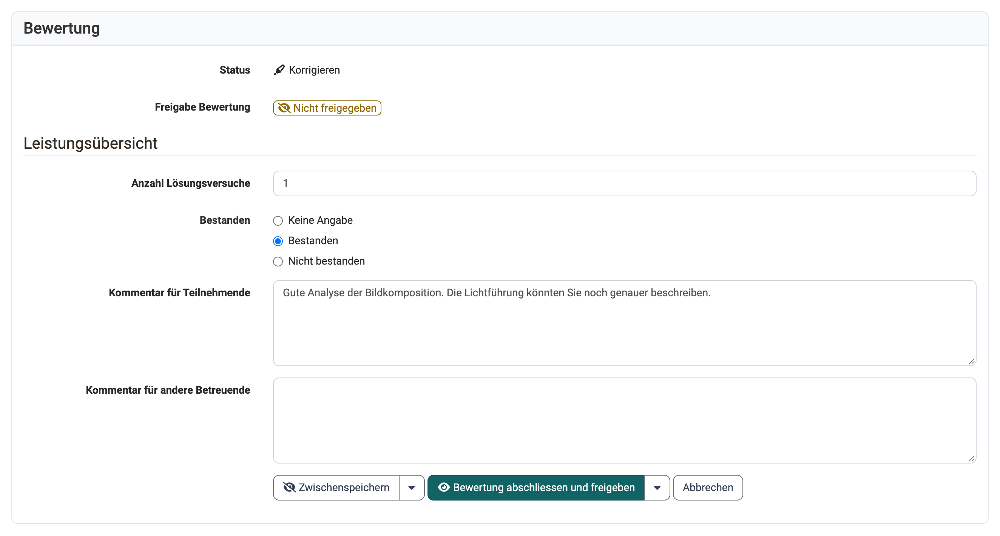
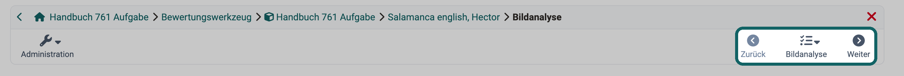
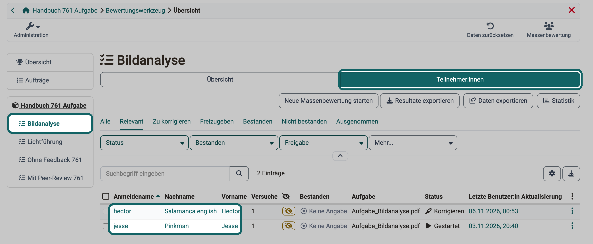

# Lernende bewerten {: #assessment_of_learners}

Im Bewertungswerkzeug bewerten Sie die Teilnehmenden eines Kurses. Zwei Wege führen zum Bewertungsformular: Gehen Sie von einer Person aus, bewerten Sie nacheinander alle ihre Kursbausteine. Gehen Sie von einem Kursbaustein aus, bewerten Sie nacheinander alle Personen in diesem Kursbaustein.

Kursbesitzer:innen, Betreuer:innen und Mitglieder mit dem Recht ["Bewertungs-Werkzeug"](Members_management.de.md#right_assessment_tool) öffnen das Bewertungswerkzeug unter `Kurs > Administration > Bewertungswerkzeug`.

## So bewerten Sie alle bewertbaren Kursbausteine einer Person {: #assess_all_course_element}

1. Klicken Sie in der linken Spalte auf den Namen des Kurses, über den Kursbausteinen, und wählen Sie den Tab "Teilnehmer:innen".

    { class="shadow lightbox" title="Bewertungswerkzeug, Kurs, Tab Teilnehmer:innen · 2026.11.10" }

2. Die Liste zeigt den aktuellen Bewertungsstand aller Teilnehmenden. Klicken Sie auf den Namen der Person, die Sie bewerten wollen.

3. Die Übersicht der Person zeigt ihren Bewertungsstand in allen bewertbaren Kursbausteinen.

    { class="shadow lightbox" title="Bewertungswerkzeug, Übersicht einer Person · 2026.11.10" }

    Klicken Sie in der Zeile des Kursbausteins, den Sie bewerten wollen, auf "Auswählen".

4. Das [Bewertungsformular](The_assessment_form.de.md) des Kursbausteins öffnet sich. Welche Felder und Buttons es zeigt, hängt vom Typ des Kursbausteins und von seinen Einstellungen ab.

    { class="shadow lightbox" title="Bewertungswerkzeug, Bewertungsformular eines Kursbausteins · 2026.11.10" }

5. Mit "Weiter" rechts oben wechseln Sie zum nächsten bewertbaren Kursbaustein dieser Person, mit "Zurück" zum vorherigen. Das Menü dazwischen trägt den Namen des aktuellen Kursbausteins. Es öffnet die Kursstruktur, in der Sie einen anderen bewertbaren Kursbaustein direkt auswählen.

{ class="shadow lightbox" title="Bewertungswerkzeug, Bewertungsformular, Navigation rechts oben · 2026.11.10" }

## So bewerten Sie die Lösungen ausgehend von einem bestimmten Kursbaustein {: #assess_solutions}

1. Wählen Sie in der linken Spalte den gewünschten Kursbaustein aus und klicken Sie auf den Tab "Teilnehmer:innen".

    { class="shadow lightbox" title="Bewertungswerkzeug, Kursbaustein, Tab Teilnehmer:innen · 2026.11.10" }

    Die Liste zeigt wieder alle Teilnehmenden, die Sie bewerten, diesmal nur für den gewählten Kursbaustein.

2. Klicken Sie auf den Namen der Person, die Sie bewerten wollen. Das passende [Bewertungsformular](The_assessment_form.de.md) öffnet sich.

    { class="shadow lightbox" title="Bewertungswerkzeug, Bewertungsformular eines Kursbausteins · 2026.11.10" }

    Welche Felder und Buttons es zeigt, hängt vom Typ des Kursbausteins und von seinen Einstellungen ab.

3. Mit den Pfeilen rechts oben wechseln Sie bei Bedarf zur nächsten oder vorherigen Person in diesem Kursbaustein.

## Massenbewertung [:octicons-tag-16:{ title="ab Release 9.2 (OO-852)" }](https://track.frentix.com/issue/OO-852) {: #bulk_assessment}

Wollen Sie alle oder sehr viele Teilnehmende auf einmal bewerten, nutzen Sie die Massenbewertung. Sie bewerten dann alle Personen in einem Arbeitsgang statt jede einzeln. Die Massenbewertung steht für die Kursbausteine ["Aufgabe", "Gruppenaufgabe"](Assessing_tasks_and_group_tasks.de.md), ["Bewertung"](Assessment_of_course_modules.de.md) und ["Videoaufgabe"](Course_Element_Video_Task.de.md) zur Verfügung, sofern sie Punkte, "Bestanden" oder Kommentare vorsehen.

Klicken Sie im Bewertungswerkzeug rechts oben auf "Massenbewertung" und danach auf "Neue Massenbewertung starten". Die Bewertungen erstellen Sie in einem Tabellenprogramm und fügen sie mit Kopieren und Einfügen in das Feld der Massenbewertung ein. Wie das im Einzelnen geht, beschreibt das How-to [Wie und wo kann ich eine Massenbewertung vornehmen?](../../manual_how-to/bulk_assessment/bulk_assessment.de.md)

## Filtermöglichkeiten {: #filter_options}

Mit Filtern grenzen Sie die Liste der Teilnehmenden auf die Personen ein, die Sie gerade bewerten wollen. Die Filter stehen in der Liste des Kurses und in der Liste jedes Kursbausteins über der Tabelle, zum Beispiel "Status" und "Bestanden". So zeigen Sie etwa nur die Mitglieder einer bestimmten Gruppe oder alle Personen, die den Kurs oder Kursbaustein noch nicht bestanden haben.

## Weiterführende Informationen {: #further_information}

**Auf dieser Seite erwähnt** 
[Mitgliederverwaltung >](Members_management.de.md) 
[Das Bewertungsformular >](The_assessment_form.de.md) 
[Aufgaben und Gruppenaufgaben bewerten >](Assessing_tasks_and_group_tasks.de.md) 
[Bewertung von Kursbausteinen >](Assessment_of_course_modules.de.md) 
[Kursbaustein "Videoaufgabe" >](Course_Element_Video_Task.de.md) 
[Wie und wo kann ich eine Massenbewertung vornehmen? >](../../manual_how-to/bulk_assessment/bulk_assessment.de.md)

**Weiterführend** 
[Bewertungswerkzeug - Übersicht >](Assessment_tool_overview/index.de.md) 
[Bewertungswerkzeug: Tab Teilnehmer:innen >](Assessment_tool_tab_Users.de.md) 
[Tests bewerten >](Assessing_tests.de.md)

[Zum Seitenanfang ^](#assessment_of_learners)
