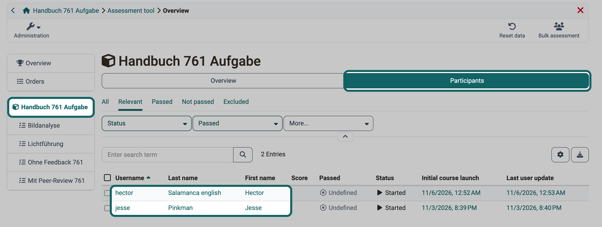
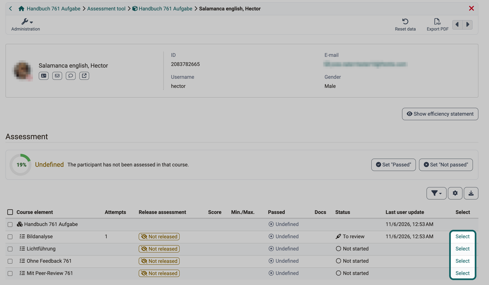
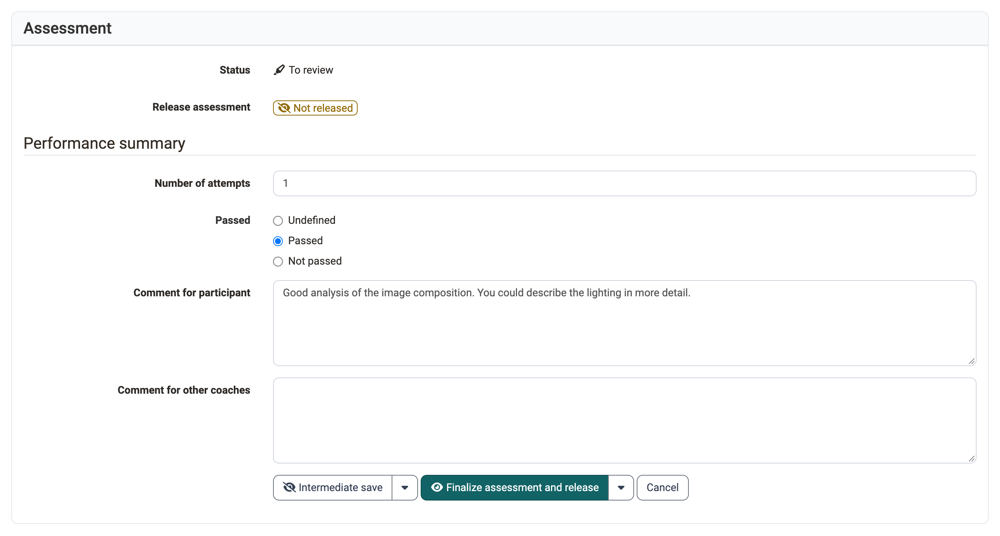
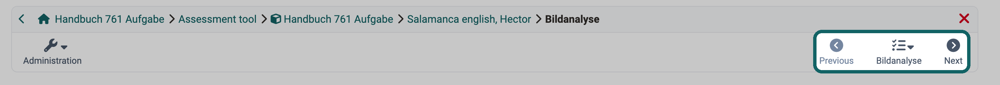
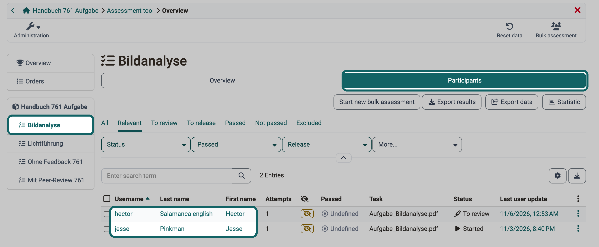

# Assessment of learners {: #assessment_of_learners}

In the assessment tool, you assess the participants of a course. Two ways lead to the assessment form: If you start from a person, you assess all their course elements one after the other. If you start from a course element, you assess all persons in this course element one after the other.

Course owners, coaches and members with the right ["Assessment tool"](Members_management.md#right_assessment_tool) open the assessment tool under `Course > Administration > Assessment tool`.

## This is how you assess all assessable course elements of a person {: #assess_all_course_element}

1. In the left column, click on the name of the course, above the course elements, and select the tab "Participants".

    { class="shadow lightbox" title="Assessment tool, course, tab Participants · 2026.11.10" }

2. The list shows the current assessment status of all participants. Click on the name of the person you want to assess.

3. The overview of the person shows their assessment status in all assessable course elements.

    { class="shadow lightbox" title="Assessment tool, overview of a person · 2026.11.10" }

    In the row of the course element you want to assess, click on "Select".

4. The [assessment form](The_assessment_form.md) of the course element opens. Which fields and buttons it shows depends on the type of the course element and on its settings.

    { class="shadow lightbox" title="Assessment tool, assessment form of a course element · 2026.11.10" }

5. With "Next" in the top right corner, you move to the next assessable course element of this person, with "Previous" to the previous one. The menu between them carries the name of the current course element. It opens the course structure, in which you select another assessable course element directly.

{ class="shadow lightbox" title="Assessment tool, assessment form, navigation in the top right corner · 2026.11.10" }

## This is how you assess the solutions of a particular course element {: #assess_solutions}

1. Select the desired course element in the left column and click on the tab "Participants".

    { class="shadow lightbox" title="Assessment tool, course element, tab Participants · 2026.11.10" }

    The list again shows all participants you assess, this time only for the selected course element.

2. Click on the name of the person you want to assess. The matching [assessment form](The_assessment_form.md) opens.

    { class="shadow lightbox" title="Assessment tool, assessment form of a course element · 2026.11.10" }

    Which fields and buttons it shows depends on the type of the course element and on its settings.

3. With the arrows in the top right corner, you move to the next or previous person in this course element, if needed.

## Bulk assessment [:octicons-tag-16:{ title="from Release 9.2 (OO-852)" }](https://track.frentix.com/issue/OO-852) {: #bulk_assessment}

If you want to assess all or very many participants at once, use the bulk assessment. You then assess all persons in one step instead of each one individually. The bulk assessment is available for the course elements ["Task", "Group task"](Assessing_tasks_and_group_tasks.md), ["Assessment"](Assessment_of_course_modules.md) and ["Video task"](Course_Element_Video_Task.md), provided they use points, "Passed" or comments.

In the assessment tool, click on "Bulk assessment" in the top right corner and then on "Start new bulk assessment". You create the assessments in a spreadsheet program and paste them into the bulk assessment field with copy and paste. How this works in detail is described in the how-to [How and where can I do a bulk assessment?](../../manual_how-to/bulk_assessment/bulk_assessment.md)

## Filter options {: #filter_options}

With filters, you narrow down the list of participants to the persons you want to assess right now. The filters are located above the table in the list of the course and in the list of each course element, for example "Status" and "Passed". In this way, you show for example only the members of a certain group or all persons who have not yet passed the course or course element.

## Further information {: #further_information}

**Mentioned on this page** 
[Members management >](Members_management.md) 
[The assessment form >](The_assessment_form.md) 
[Assessing tasks and group tasks >](Assessing_tasks_and_group_tasks.md) 
[Assessment of course modules >](Assessment_of_course_modules.md) 
[Course Element "Video task" >](Course_Element_Video_Task.md) 
[How and where can I do a bulk assessment? >](../../manual_how-to/bulk_assessment/bulk_assessment.md)

**Further** 
[Assessment tool - overview >](Assessment_tool_overview/index.md) 
[Assessment tool: Tab Participants >](Assessment_tool_tab_Users.md) 
[Assessing tests >](Assessing_tests.md)

[To the top of the page ^](#assessment_of_learners)
