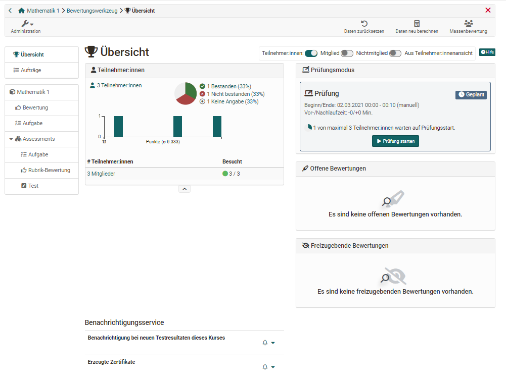
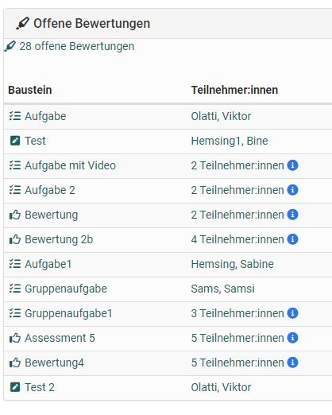
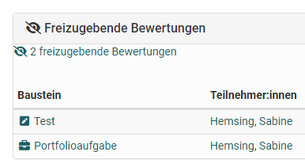
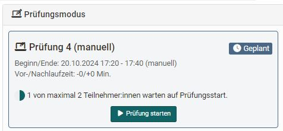

# Bewertungswerkzeug - Übersicht {: #assessment_tool_overview}

Das Bewertungswerkzeug ist die zentrale Schaltstelle für die Bewertungen eines OpenOlat-Kurses. Kursbesitzer:innen und Betreuende erhalten hier einen Gesamtüberblick über sämtliche im Kurs enthaltenen bewertbaren Kursbausteine und können die Bewertungen vornehmen.

Sie erreichen das Bewertungswerkzeug über `Kurs > Administration > Bewertungswerkzeug`. Wenn Sie das Bewertungswerkzeug aufrufen, erscheint zunächst die Übersichtsseite mit zentralen Informationen sowie eine Übersicht der aktuell anstehenden Bewertungen und Aktionen. So wissen Sie schnell, was aktuell zu tun ist. Von der Übersichtsseite aus gelangen Sie auch zu den konkreten Bewertungsbereichen der einzelnen Kursbausteine und Personen.

{ class="shadow lightbox" title="Übersicht des Bewertungswerkzeugs" }

Schauen wir uns die einzelnen Bereiche der Übersicht genauer an:

## "Übersicht" des Bewertungswerkzeugs

### "Offene Bewertungen" (Übersicht)

Auf einen Blick ist hier ersichtlich, ob bzw. für wen eine oder mehrere Bewertung(en) offen sind. Auch wird angezeigt, wie viele Bausteine der jeweiligen Person zu bewerten sind. Sofern nur ein Baustein bewertet werden muss, wird dieser direkt aufgelistet. Mit einem Klick auf den Baustein kommt man zur entsprechenden Bewertung.

{ class="shadow lightbox" title="Bereich Offene Bewertungen" }

In der Übersicht werden nur die unerledigten Bewertungen angezeigt. Bereits durchgeführte Bewertungen werden an dieser Stelle nicht aufgelistet.

### "Freizugebende Bewertungen" (Übersicht)

Gibt es im Kurs Bewertungen, die für die Teilnehmenden noch nicht sichtbar sind, erscheinen sie hier.

{ class="shadow lightbox" title="Bereich Freizugebende Bewertungen" }

### "Teilnehmer:innen" (Übersicht)

In diesem Bereich wird angezeigt, wie viele Teilnehmende, Gruppen und Curriculumelemente generell im konkreten Kurs vorhanden sind.

Wurde für den gesamten Kurs ein "Bestehen" konfiguriert, wird die Anzahl der jeweiligen Kursmitglieder angezeigt, die den Kurs bestanden bzw. nicht bestanden haben. Auch die durchschnittliche Verteilung der Punkte ist, sofern Punkte im Kurs aktiviert sind, erkennbar. 

{ class="shadow lightbox" title="Bereich Teilnehmer:innen" }

### Prüfungsmodus (Übersicht)

Ist für den Kurs eine Prüfung im [Prüfungsmodus](../learningresources/Assessment_mode.de.md) geplant oder läuft gerade eine Prüfung, zeigt das Bewertungswerkzeug sie in diesem Bereich an.

{ class="shadow lightbox" title="Bereich Prüfungsmodus" }

Hier sehen Sie auch, wie viele Personen bereits eingeloggt sind und auf den Start der Prüfung warten.

Hat die Prüfung einen manuellen Start, zeigt der Bereich ab dem Prüfungstag den Button "Prüfung starten" und nach dem Start den Button "Prüfung beenden". Betreuer:innen sehen diese Buttons nur mit einem zusätzlichen Recht. Wer die Buttons sieht, beschreibt der Abschnitt [Wer eine Prüfung manuell starten und beenden kann](../learningresources/Assessment_mode.de.md#start_stop_rights).

{ class="shadow lightbox" title="Bereich Prüfungsmodus vor dem Start" }

### "Benachrichtigungsservice"

Hier können Betreuende über den Abonnieren Schieberegler einschalten, dass sie bei neuen Einsendungen, Testresultaten und sonstigen Einreichungen eine E-Mail erhalten. Auch können Benachrichtigungen über neu erzeugte Zertifikate (sofern generell aktiviert) abonniert werden.

{ class="shadow lightbox" title="Benachrichtigungen im Bewertungswerkzeug" }

## Aufträge

Unterhalb der Übersicht befindet sich der Link zum Bereich "Aufträge". Hier sehen Sie, ob es offene Bewertungen gibt, ob Einstufungen/Noten von Hand zu setzen sind und ob es freizugebende Bewertungen gibt.

{ class="shadow lightbox" title="Bereich Aufträge des Bewertungswerkzeugs" }

## Prüfungseinsicht [:octicons-tag-16:{ title="ab Release 18.2 (OO-7425)" }](https://track.frentix.com/issue/OO-7425)

Dieser Menübereich ist nur sichtbar, wenn für den Kurs eine Prüfung konfiguriert und auch die Prüfungseinsichtsoption aktiviert wurde. 

Betreuende können dann Teilnehmende hinzufügen, definieren auf welche Prüfung sich die Einsicht bezieht und zu welchem konkreten Zeitpunkt die Einsicht möglich ist. Bei Bedarf kann auch noch ein Zugangscode für die Einsicht vergeben und eine Infomail verschickt werden. 

{ class="shadow lightbox" title="Tab Prüfungseinsicht eines Tests" }

Nähere Informationen finden Sie auf der Seite [Prüfungsverwaltung: Prüfungseinsicht](../learningresources/Assessment_inspection.de.md).

## Übersicht der Bewertungsbausteine des Kurses

In der linken Navigation des Bewertungswerkzeugs sieht man alle bewertbaren Kursbausteine. Für alle Kursbausteine werden die Tabs "Übersicht" und "Teilnehmer:innen" angezeigt. 

Im Übersichtstab erscheinen ähnliche Informationen wie im Übersichtsbereich des Bewertungswerkzeugs, nur Kursbaustein bezogen, also z.B. die Punkteverteilung, Anzahl der Bewertungen, Infos zum Bestehen usw. 

### Tab Teilnehmer:innen

Im Tab "Teilnehmer:innen" wird die eigentliche Bewertung vorgenommen und die Personen können ausgewählt, Punkte und Feedbacks hinterlegt und die Freigabe der Sichtbarkeit eingestellt werden. 
Die Tabelle zeigt dann den Bearbeitungsstand aller Teilnehmenden des konkreten Kursbausteins an. 
Ferner können bei Aufgaben im Tab "Teilnehmer:innen" auch alle abgegebenen Dokumente heruntergeladen werden. 

Der automatisch generierte oberste Kursknoten zählt ebenfalls als bewertbarer Baustein. Er entspricht einem ["Struktur"](../learningresources/Course_Element_Structure.de.md) Baustein. 
Klickt man beim obersten Kursbaustein auf eine Person, erhält man eine Gesamtübersicht über den Bearbeitungsstand der Assessmentbausteine des Kurses für diese Person und kann sich so auch den Leistungsnachweis der Person anzeigen lassen. 

Ist auf dem obersten Kursbaustein eine Punkteberechnung eingerichtet, können auf der obersten Ebene der Benutzeransicht auch die *Gesamtpunkte* eines Kurses bzw. die für den obersten Baustein definierten Punkte, angezeigt und die Gesamtergebnisse der Teilnehmenden heruntergeladen werden.

!!! tip "Tipp"

    Nutzen Sie die Filtereinstellungen um nur bestimmte Teilnehmende in der Tabelle anzuzeigen. Nutzen Sie auch die Spaltenkonfiguration über das Zahnrad um die für Sie relevanten Spalten anzuzeigen.   

Wie genau Bewertungen vorgenommen werden erfahren Sie im Kapitel ["Bewertung von Kursbausteinen"](../learningresources/Assessment_of_course_modules.de.md) bzw. ["Lernende bewerten"](../learningresources/Assessment_of_learners.de.md).

!!! info "Wichtig"

    Sofern eine Prüfungseinsicht für Teilnehmende aktiviert wurde erscheint beim entsprechenden Kursbaustein auch noch der Tab "Prüfungseinsicht". 

Ausführliche Informationen zur Bearbeitung und Bewertung im Tab Teilnehmer:innen finden Sie im Kapitel ["Tab Teilnehmer"](../learningresources/Assessment_tool_tab_Users.de.md)

## Daten zurücksetzen [:octicons-tag-16:{ title="ab Release 17.2.4 (OO-6792)" }](https://track.frentix.com/issue/OO-6792) {: #course_reset}

Mit Hilfe des Wizards können die Daten von Teilnehmer:innen eines Kurses zurückgesetzt werden. Dabei kann das Zurücksetzen für den gesamten Kurs oder nur für ausgewählte Kursbausteine für alle oder ausgewählte Teilnehmer:innen erfolgen.

[Mehr dazu >](../../manual_user/learningresources/Assessment_tool_reset_data.de.md)

## Massenbewertung [:octicons-tag-16:{ title="ab Release 9.2 (OO-852)" }](https://track.frentix.com/issue/OO-852) {: #mass_assessment}

Mit dem Werkzeug "Massenbewertung" können für mehrere Teilnehmer:innen Bewertungsdaten wie Punkte, Statusinformationen, Kommentare sowie Rückgabedateien in einem Schritt übermittelt werden. 

{ class="shadow lightbox" title="Assistent Massenbewertung" }

Wie man eine Massenbewertung erstellt, erfahren Sie im Bereich [How to](../../manual_how-to/bulk_assessment/bulk_assessment.de.md).

## Weiterführende Informationen {: #further_information}

**Weiterführend** 
[Prüfungsverwaltung: Übersicht >](../learningresources/Assessment_Management.de.md) 
[Mitgliederverwaltung >](../learningresources/Members_management.de.md) 
[Rollen und Rechte: Welche Rollen gibt es? >](../basic_concepts/Roles.de.md)

[Zum Seitenanfang ^](#assessment_tool_overview)