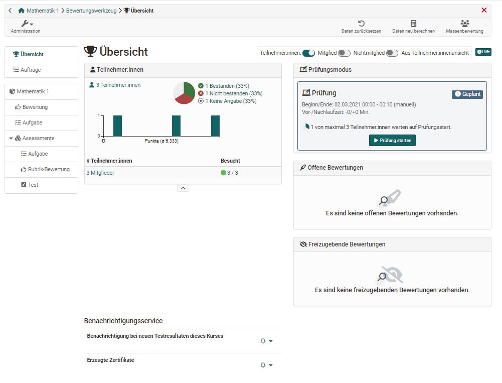
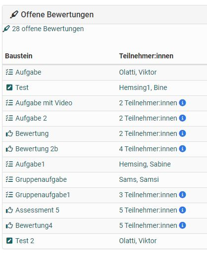
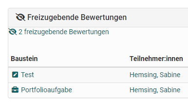
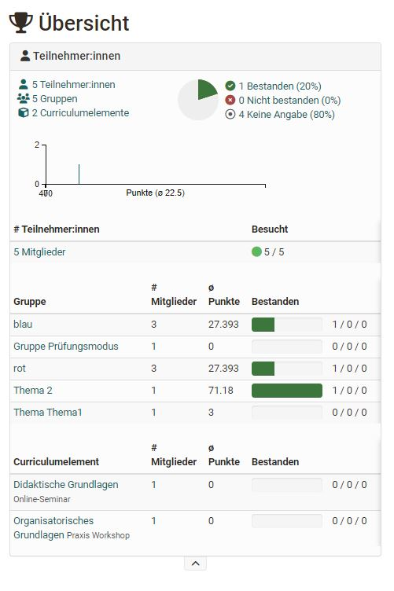
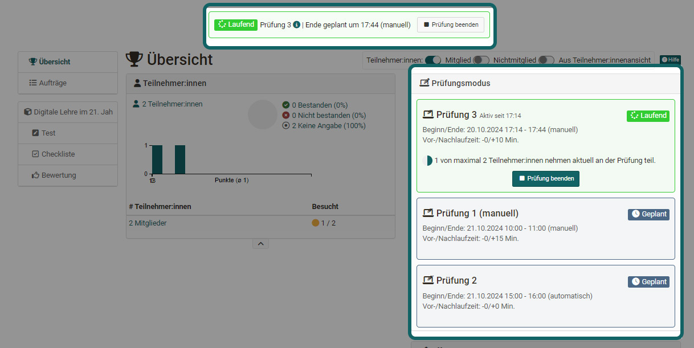
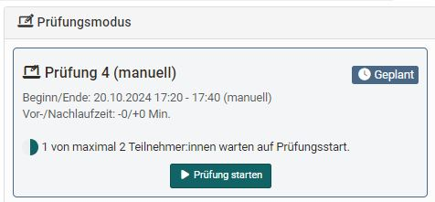
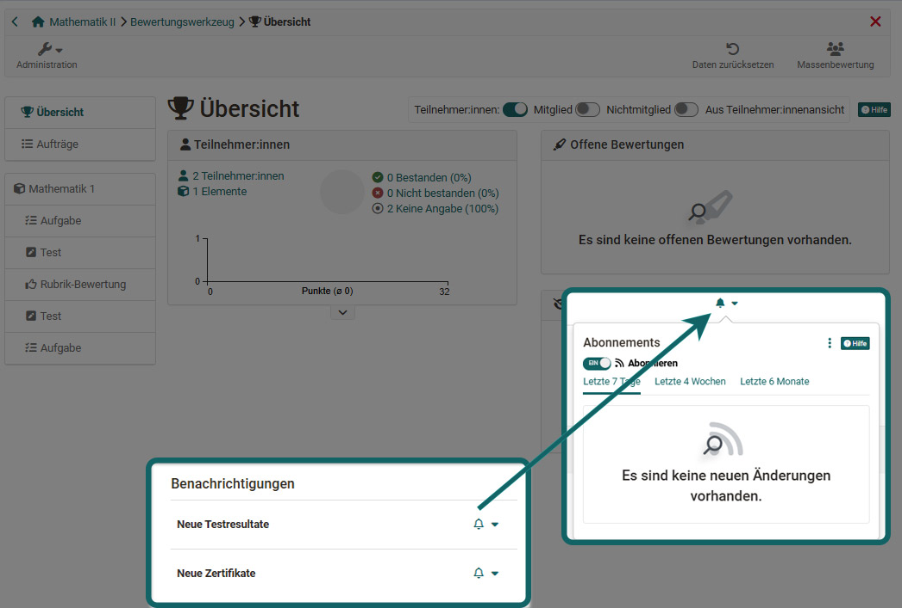
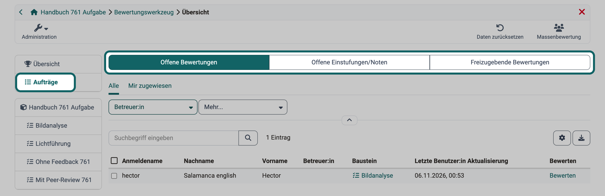
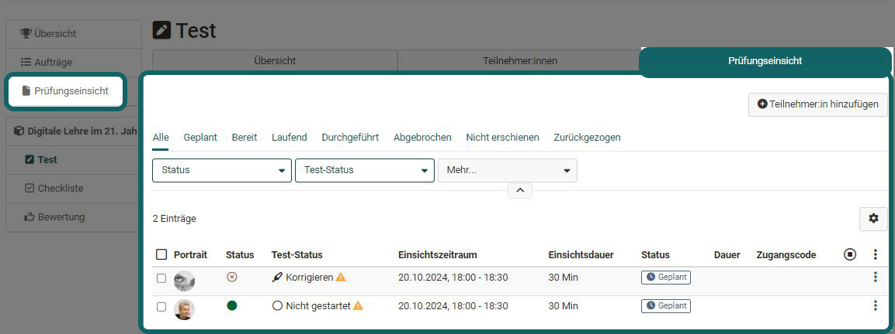
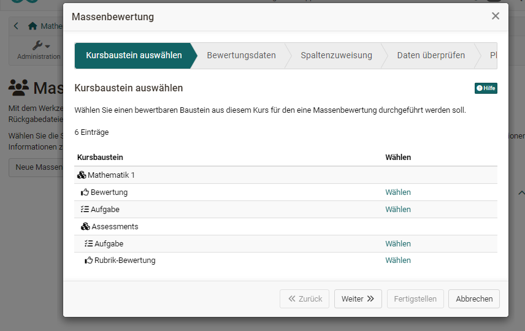

# Bewertungswerkzeug - Übersicht {: #assessment_tool_overview}

Das Bewertungswerkzeug ist die zentrale Stelle für die Bewertungen eines Kurses. Kursbesitzer:innen, Betreuende und Mitglieder mit dem Recht ["Bewertungs-Werkzeug"](../Members_management.de.md#right_assessment_tool) sehen hier alle bewertbaren Kursbausteine des Kurses und bewerten die Teilnehmenden.

Sie öffnen das Bewertungswerkzeug unter `Kurs > Administration > Bewertungswerkzeug`. Zuerst erscheint die Übersicht: Sie zeigt, wie der Kurs steht und welche Bewertungen und Aktionen anstehen. So sehen Sie schnell, was zu tun ist. Von der Übersicht aus gelangen Sie zu den Bewertungen der einzelnen Kursbausteine und Personen.

{ class="shadow lightbox" title="Übersicht des Bewertungswerkzeugs" }

Die folgenden Abschnitte beschreiben zuerst die Bereiche der Übersicht, danach die weiteren Einträge im Menü links und die Buttons oben rechts.

## "Übersicht" des Bewertungswerkzeugs

### "Offene Bewertungen" (Übersicht)

Hier sehen Sie auf einen Blick, für wen Bewertungen offen sind und wie viele Kursbausteine bei der jeweiligen Person noch zu bewerten sind. Ist nur ein Kursbaustein offen, steht er direkt in der Liste. Ein Klick auf den Kursbaustein öffnet die Bewertung.

{ class="shadow lightbox" title="Bereich Offene Bewertungen" }

Die Übersicht zeigt nur die offenen Bewertungen, erledigte Bewertungen erscheinen hier nicht.

### "Freizugebende Bewertungen" (Übersicht)

Gibt es im Kurs Bewertungen, die für die Teilnehmenden noch nicht sichtbar sind, erscheinen sie hier.

{ class="shadow lightbox" title="Bereich Freizugebende Bewertungen" }

### "Teilnehmer:innen" (Übersicht)

Dieser Bereich zeigt, wie viele Teilnehmende, Gruppen und Curriculumelemente der Kurs hat.

Ist für den ganzen Kurs ein "Bestehen" konfiguriert, zeigt der Bereich, wie viele Kursmitglieder den Kurs bestanden und nicht bestanden haben. Sind im Kurs Punkte aktiviert, sehen Sie auch die Verteilung der Punkte.

{ class="shadow lightbox" title="Bereich Teilnehmer:innen" }

### Prüfungsmodus (Übersicht)

Ist für den Kurs eine Prüfung im [Prüfungsmodus](../Assessment_mode.de.md) geplant oder läuft gerade eine Prüfung, zeigt das Bewertungswerkzeug sie in diesem Bereich an.

{ class="shadow lightbox" title="Bereich Prüfungsmodus" }

Hier sehen Sie auch, wie viele Personen bereits eingeloggt sind und auf den Start der Prüfung warten.

Hat die Prüfung einen manuellen Start, zeigt der Bereich ab dem Prüfungstag den Button "Prüfung starten" und nach dem Start den Button "Prüfung beenden". Betreuer:innen sehen diese Buttons nur mit einem zusätzlichen Recht. Wer die Buttons sieht, beschreibt der Abschnitt [Wer eine Prüfung manuell starten und beenden kann](../Assessment_mode.de.md#start_stop_rights).

{ class="shadow lightbox" title="Bereich Prüfungsmodus vor dem Start" }

### "Benachrichtigungen"

Hier abonnieren Betreuende mit dem Schalter "Abonnieren" Benachrichtigungen per E-Mail: "Neue Testresultate" meldet neue Resultate in bewertbaren Kursbausteinen, "Neue Zertifikate" neu ausgestellte Zertifikate, sofern im Kurs Zertifikate aktiviert sind.

{ class="shadow lightbox" title="Benachrichtigungen im Bewertungswerkzeug" }

## Aufträge {: #orders}

Unter "Aufträge" sammelt das Bewertungswerkzeug alle Bewertungen, die im Kurs noch zu erledigen sind. So arbeiten Sie die anstehenden Bewertungen ab, ohne jeden Kursbaustein einzeln zu öffnen. Sie finden "Aufträge" im Menü links direkt unter "Übersicht". Drei Tabs teilen sie auf:

* **Offene Bewertungen:** Bewertungen im Status "Korrigieren", zum Beispiel nach der Abgabe einer Aufgabe. Mit "Bewerten" öffnen Sie die Bewertung der Person.
* **Offene Einstufungen/Noten:** Kursbausteine mit einer [Bewertungsskala](../Assessment_translate_points_in_grades.de.md), bei denen die Note von Hand zugewiesen wird und noch fehlt. Mit "Zuweisen" vergeben Sie die Note.
* **Freizugebende Bewertungen:** abgeschlossene Bewertungen, die Teilnehmende noch nicht sehen. Mit "Freigeben" machen Sie ausgewählte Bewertungen für die Teilnehmenden sichtbar.

In jedem Tab schreiben Sie den ausgewählten Personen mit "E-Mail". Dieselben Tabs zeigt das Coaching kursübergreifend unter [Bewertungsaufträge](../../area_modules/Coaching_Assessment_Orders.de.md).

{ class="shadow lightbox" title="Bereich Aufträge des Bewertungswerkzeugs · 2026.11.09" }

## Prüfungseinsicht [:octicons-tag-16:{ title="ab Release 18.2 (OO-7425)" }](https://track.frentix.com/issue/OO-7425)

Diesen Eintrag im Menü links sehen Sie, wenn für den Kurs eine Prüfungseinsicht konfiguriert ist, unter `Kurs > Administration > Prüfungsverwaltung > Tab "Konfiguration Prüfungseinsicht"`. Voraussetzung ist, dass die Prüfungseinsicht in der System-Administration unter `Administration > e-Assessment > Prüfungsverwaltung` eingeschaltet ist.

Betreuende fügen hier Teilnehmende hinzu und legen fest, auf welche Prüfung sich die Einsicht bezieht und wann die Einsicht möglich ist. Bei Bedarf vergeben sie einen Zugangscode und verschicken eine Infomail.

{ class="shadow lightbox" title="Tab Prüfungseinsicht eines Tests" }

Nähere Informationen finden Sie auf der Seite [Prüfungsverwaltung: Prüfungseinsicht](../Assessment_inspection.de.md).

## Übersicht der Bewertungsbausteine des Kurses

Im Menü links des Bewertungswerkzeugs stehen alle bewertbaren Kursbausteine. Jeder Kursbaustein hat die Tabs "Übersicht" und "Teilnehmer:innen".

Der Tab "Übersicht" zeigt ähnliche Angaben wie die Übersicht des Bewertungswerkzeugs, aber für den einzelnen Kursbaustein, zum Beispiel die Punkteverteilung, die Anzahl der Bewertungen und das Bestehen.

### Tab Teilnehmer:innen

Im Tab "Teilnehmer:innen" bewerten Sie: Sie wählen eine Person, erfassen Punkte und Feedback und geben die Bewertung frei. Die Tabelle zeigt den Bearbeitungsstand aller Teilnehmenden des Kursbausteins. 
Bei Aufgaben laden Sie im Tab "Teilnehmer:innen" auch alle abgegebenen Dokumente herunter.

Der oberste Kursbaustein zählt ebenfalls als bewertbarer Kursbaustein. Er entspricht einem Kursbaustein ["Struktur"](../Course_Element_Structure.de.md). 
Ein Klick auf eine Person beim obersten Kursbaustein zeigt den Bearbeitungsstand aller bewertbaren Kursbausteine dieser Person. Von dort öffnen Sie auch ihren Leistungsnachweis.

Ist auf dem obersten Kursbaustein eine Punkteberechnung eingerichtet, zeigt die oberste Ebene die Gesamtpunkte des Kurses. Dort laden Sie auch die Gesamtergebnisse der Teilnehmenden herunter.

!!! tip "Tipp"

    Mit den Filtern zeigen Sie nur bestimmte Teilnehmende in der Tabelle. Über das Zahnrad wählen Sie die Spalten, die Sie brauchen.

Wie Sie bewerten, beschreiben die Seiten ["Bewertung von Kursbausteinen"](../Assessment_of_course_modules.de.md) und ["Lernende bewerten"](../Assessment_of_learners.de.md).

!!! info "Wichtig"

    Ist für Teilnehmende eine Prüfungseinsicht aktiviert, hat der betreffende Kursbaustein zusätzlich den Tab "Prüfungseinsicht".

Den Tab "Teilnehmer:innen" beschreibt die Seite ["Bewertungswerkzeug: Tab Teilnehmer:innen"](../Assessment_tool_tab_Users.de.md) im Detail.

## Daten zurücksetzen [:octicons-tag-16:{ title="ab Release 17.2.4 (OO-6792)" }](https://track.frentix.com/issue/OO-6792) {: #course_reset}

Mit dem Button "Daten zurücksetzen" oben rechts setzen Sie die Daten von Teilnehmer:innen zurück. Ein Wizard führt Sie durch die Auswahl: den ganzen Kurs oder einzelne Kursbausteine, alle oder ausgewählte Teilnehmer:innen.

[Mehr dazu >](../Assessment_tool_reset_data.de.md)

## Massenbewertung [:octicons-tag-16:{ title="ab Release 9.2 (OO-852)" }](https://track.frentix.com/issue/OO-852) {: #mass_assessment}

Müssen Sie viele Teilnehmer:innen auf einmal bewerten, etwa nach einer Prüfung auf Papier, nehmen Sie die Massenbewertung. Sie übermitteln Punkte, Status, Kommentare und Rückgabedateien für mehrere Teilnehmer:innen in einem Schritt, statt jede Person einzeln zu öffnen.

Sie öffnen die Massenbewertung mit dem Button "Massenbewertung" oben rechts im Bewertungswerkzeug. Die Seite "Geplante Massenbewertungen" listet die Massenbewertungen, die noch ausgeführt werden. Mit "Neue Massenbewertung starten" öffnen Sie den Wizard. Im Wizard wählen Sie den Kursbaustein, laden die Daten hoch und legen fest, ob OpenOlat die Bewertung "Sofort" oder "Später, nach Datum" ausführt.

Den Button sehen alle Personen, die das Bewertungswerkzeug öffnen. Ausgenommen sind Personen, die den Kurs nur in der Rolle Principal öffnen, ohne Mitglied zu sein oder den Kurs zu administrieren.

{ class="shadow lightbox" title="Assistent Massenbewertung" }

Schritt für Schritt beschreibt die Anleitung ["Wie und wo kann ich eine Massenbewertung vornehmen?"](../../../manual_how-to/bulk_assessment/bulk_assessment.de.md) die Massenbewertung.

## Weiterführende Informationen {: #further_information}

**Weiterführend** 
[Prüfungsverwaltung: Übersicht >](../Assessment_Management/index.de.md) 
[Mitgliederverwaltung >](../Members_management.de.md) 
[Rollen und Rechte: Welche Rollen gibt es? >](../../basic_concepts/Roles/index.de.md)

[Zum Seitenanfang ^](#assessment_tool_overview)