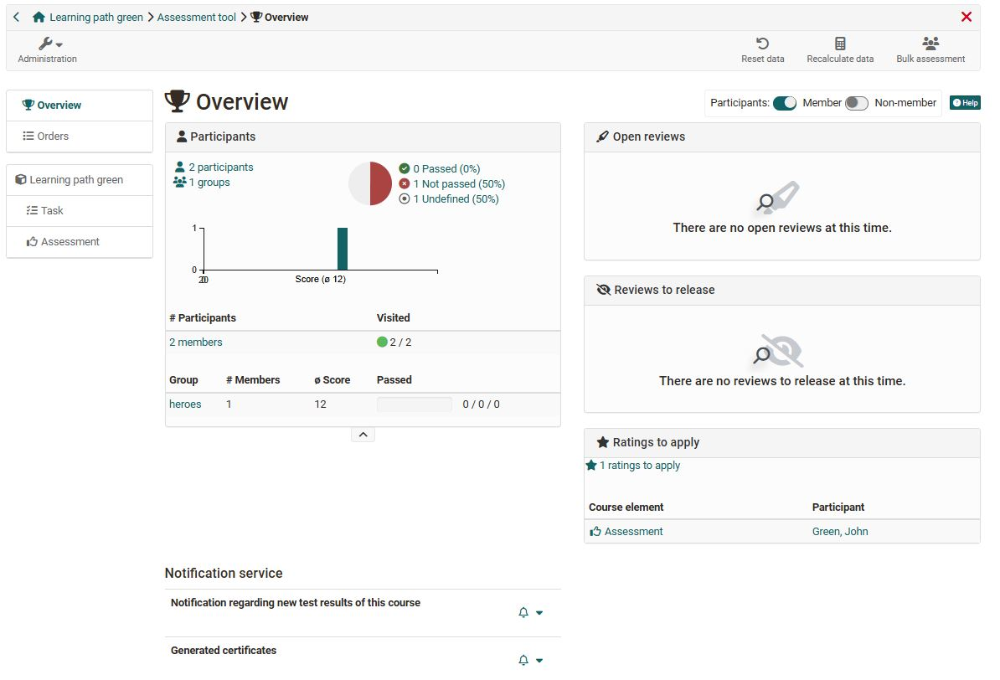
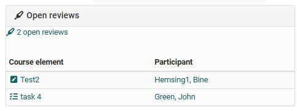
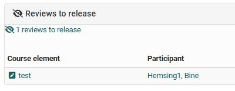
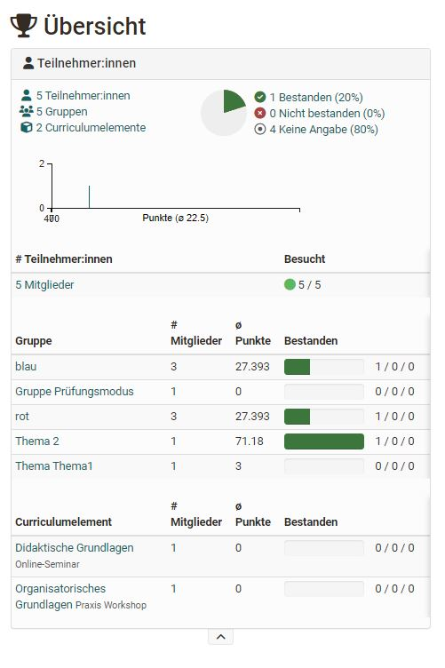
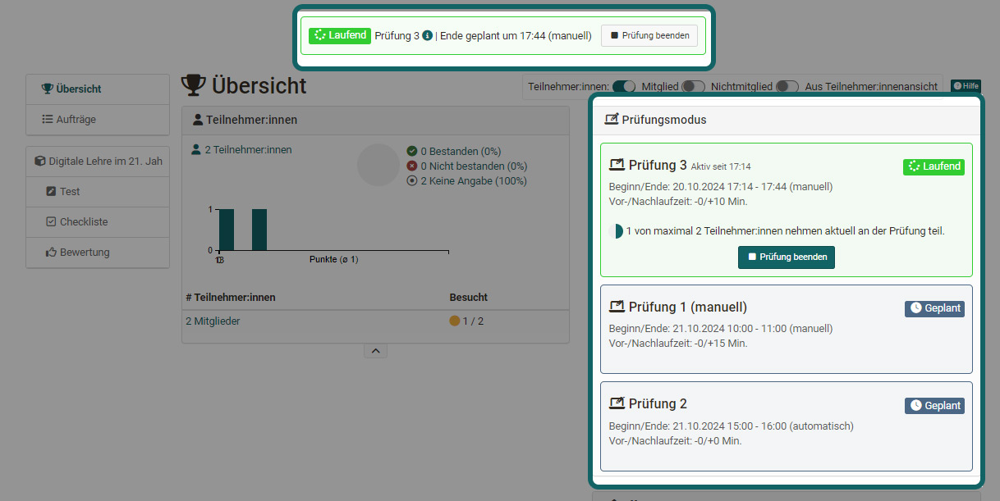
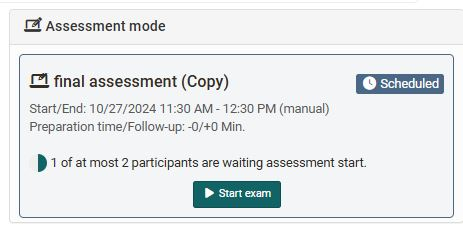
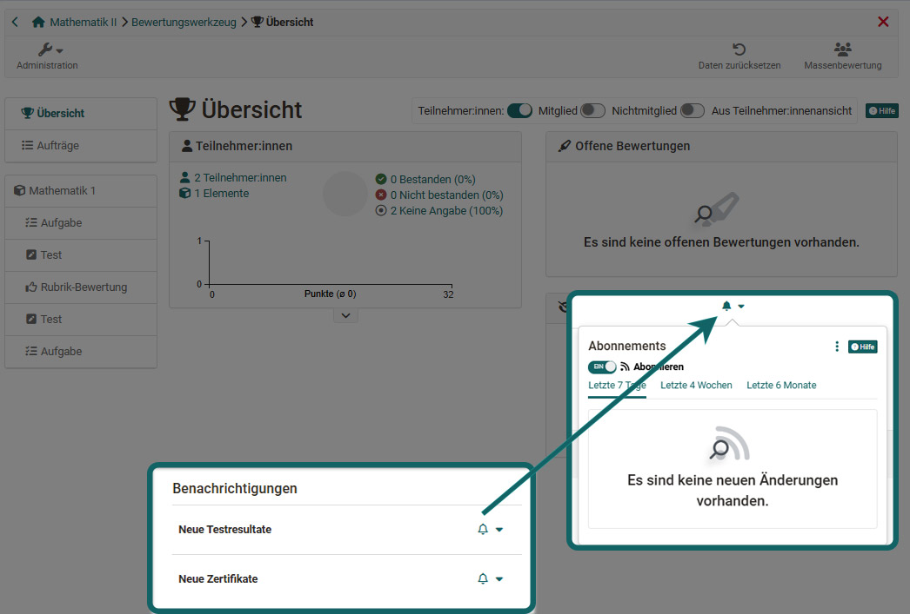
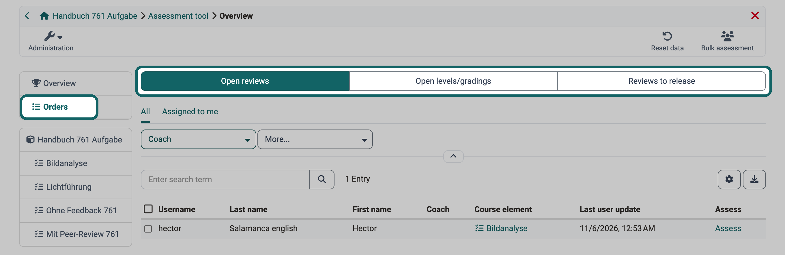
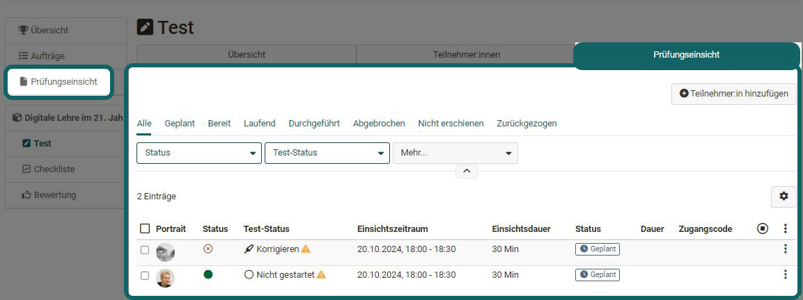
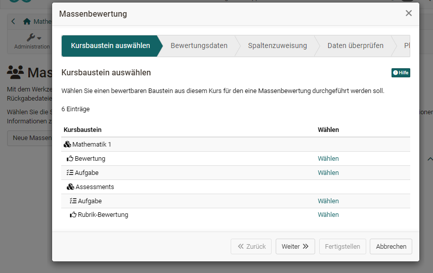

# Assessment tool - overview {: #assessment_tool_overview}

The assessment tool is the central place for the assessments of a course. Course owners, coaches and members with the right ["Assessment tool"](../Members_management.md#right_assessment_tool) see all assessable course elements of the course here and assess the participants.

You open the assessment tool under `Course > Administration > Assessment tool`. The overview appears first: it shows how the course is doing and which assessments and actions are pending. This way you quickly see what needs to be done. From the overview you get to the assessments of the individual course elements and persons.

{ class="shadow lightbox" title="Overview of the assessment tool" }

The following sections first describe the areas of the overview, then the further entries in the menu on the left and the buttons at the top right.

## "Overview" of the assessment tool

### "Open reviews" (Overview)

Here you see at a glance for whom reviews are open and how many course elements still need to be reviewed for the respective person. If only one course element is open, it is listed directly. A click on the course element opens the review.

{ class="shadow lightbox" title="Area Open reviews" }

The overview only shows the open reviews; completed reviews do not appear here.

### "Reviews to release" (Overview)

If there are reviews in the course that are not yet visible to the participants, they appear here.

{ class="shadow lightbox" title="Area Reviews to release" }

### "Participants" (Overview)

This area shows how many participants, groups and curriculum elements the course has.

If "passed" is configured for the entire course, the area shows how many course members have passed and not passed the course. If points are activated in the course, you also see the distribution of points.

{ class="shadow lightbox" title="Area Participants" }

### Assessment mode (Overview)

If an exam in [assessment mode](../Assessment_mode.md) is planned for the course or an exam is currently running, the assessment tool shows it in this area.

{ class="shadow lightbox" title="Area Assessment mode" }

Here you also see how many people are already logged in and waiting for the exam to start.

If the exam has a manual start, the area shows the button "Start exam" from the day of the exam and, after the start, the button "Finish exam". Coaches only see these buttons with an additional right. Who sees the buttons is described in the section [Who can start and finish an exam manually](../Assessment_mode.md#start_stop_rights).

{ class="shadow lightbox" title="Area Assessment mode before the start" }

### "Notifications"

Here coaches subscribe to e-mail notifications with the "Subscribe" switch: "New test results" reports new results in assessable course elements, "New certificates" newly issued certificates, provided certificates are activated in the course.

{ class="shadow lightbox" title="Notifications in the assessment tool" }

## Orders {: #orders}

Under "Orders" the assessment tool collects all assessments that still need to be done in the course. This way you work through the pending assessments without opening each course element individually. You find "Orders" in the menu on the left directly below "Overview". Three tabs divide them:

* **Open reviews:** assessments in the status "To review", for example after a task has been submitted. With "Assess" you open the assessment of the person.
* **Open levels/gradings:** course elements with a [rating scale](../Assessment_translate_points_in_grades.md) where the grade is applied by hand and is still missing. With "Apply" you award the grade.
* **Reviews to release:** completed assessments that participants do not see yet. With "Release" you make selected assessments visible to the participants.

In every tab you write to the selected persons with "E-Mail". Coaching shows the same tabs across courses under [Assessment orders](../../area_modules/Coaching_Assessment_Orders.md).

{ class="shadow lightbox" title="Area Orders of the assessment tool · 2026.11.09" }

## Assessment inspection [:octicons-tag-16:{ title="from Release 18.2 (OO-7425)" }](https://track.frentix.com/issue/OO-7425)

You see this entry in the menu on the left if an assessment inspection is configured for the course, under `Course > Administration > Assessment management > Tab "Configuration assessment inspection"`. It requires that the assessment inspection is switched on in the system administration under `Administration > e-Assessment > Assessment management`.

Coaches add participants here and define which exam the inspection applies to and when the inspection is possible. If required, they assign an access code and send an info e-mail.

{ class="shadow lightbox" title="Tab Assessment inspection of a test" }

You can find more information on the page [Assessment management: assessment inspection](../Assessment_inspection.md).

## Overview of the assessment elements of the course

The menu on the left of the assessment tool lists all assessable course elements. Each course element has the tabs "Overview" and "Participants".

The "Overview" tab shows information similar to the overview of the assessment tool, but for the single course element, for example the distribution of points, the number of assessments and passing.

### Tab Participants

In the "Participants" tab you assess: you select a person, enter points and feedback and release the assessment. The table shows the processing status of all participants of the course element. 
For tasks, you also download all submitted documents in the "Participants" tab.

The top course element also counts as an assessable course element. It corresponds to a ["Structure"](../Course_Element_Structure.md) course element. 
A click on a person at the top course element shows the processing status of all assessable course elements of this person. From there you also open their evidence of achievement.

If a point calculation is set up on the top course element, the top level shows the total points of the course. There you also download the overall results of the participants.

!!! tip "Tip"

    With the filters you show only certain participants in the table. Via the gear icon you choose the columns you need.

How you assess is described on the pages ["Assessment of course elements"](../Assessment_of_course_modules.md) and ["Assessing learners"](../Assessment_of_learners.md).

!!! info "Important"

    If an assessment inspection is activated for participants, the course element concerned also has the tab "Assessment inspection".

The "Participants" tab is described in detail on the page ["Assessment tool: Tab Participants"](../Assessment_tool_tab_Users.md).

## Reset data [:octicons-tag-16:{ title="from Release 17.2.4 (OO-6792)" }](https://track.frentix.com/issue/OO-6792) {: #course_reset}

With the button "Reset data" at the top right you reset the data of participants. A wizard guides you through the selection: the entire course or individual course elements, all or selected participants.

[Find out more >](../Assessment_tool_reset_data.md)

## Bulk assessment [:octicons-tag-16:{ title="from Release 9.2 (OO-852)" }](https://track.frentix.com/issue/OO-852) {: #mass_assessment}

If you have to assess many participants at once, for example after an exam on paper, use the bulk assessment. You submit points, status, comments and return files for several participants in one step instead of opening each person individually.

You open the bulk assessment with the button "Bulk assessment" at the top right of the assessment tool. The page "Planned bulk assessments" lists the bulk assessments that are still to be executed. With "Start new bulk assessment" you open the wizard. In the wizard you select the course element, upload the data and define whether OpenOlat executes the assessment "Immediately" or "Later, scheduled by date".

The button is visible to all persons who open the assessment tool. Excepted are persons who open the course only in the role Principal, without being a member or administering the course.

{ class="shadow lightbox" title="Bulk assessment wizard" }

The guide ["How and where can I do a bulk assessment?"](../../../manual_how-to/bulk_assessment/bulk_assessment.md) describes the bulk assessment step by step.

## Further information {: #further_information}

**Further reading** 
[Assessment Management: Overview >](../Assessment_Management/index.md) 
[Members management >](../Members_management.md) 
[Roles and Rights: Which roles are available? >](../../basic_concepts/Roles/index.md)

[To the top of the page ^](#assessment_tool_overview)
