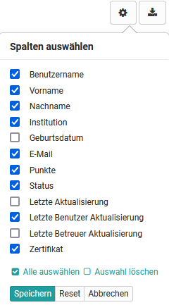
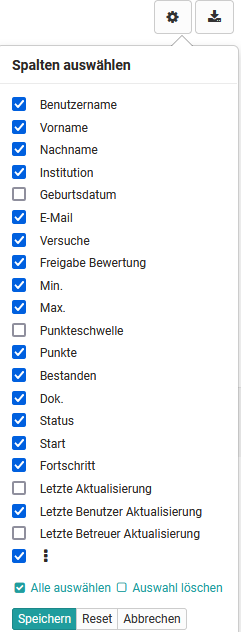
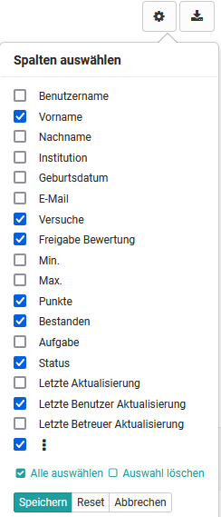
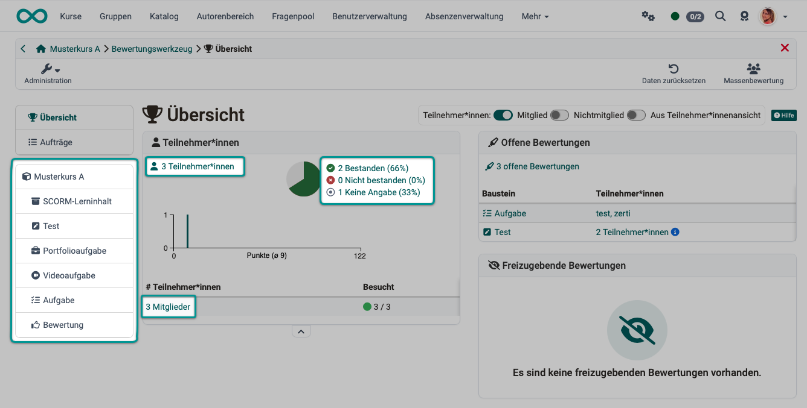
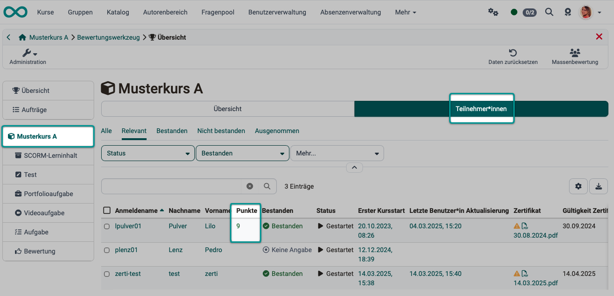
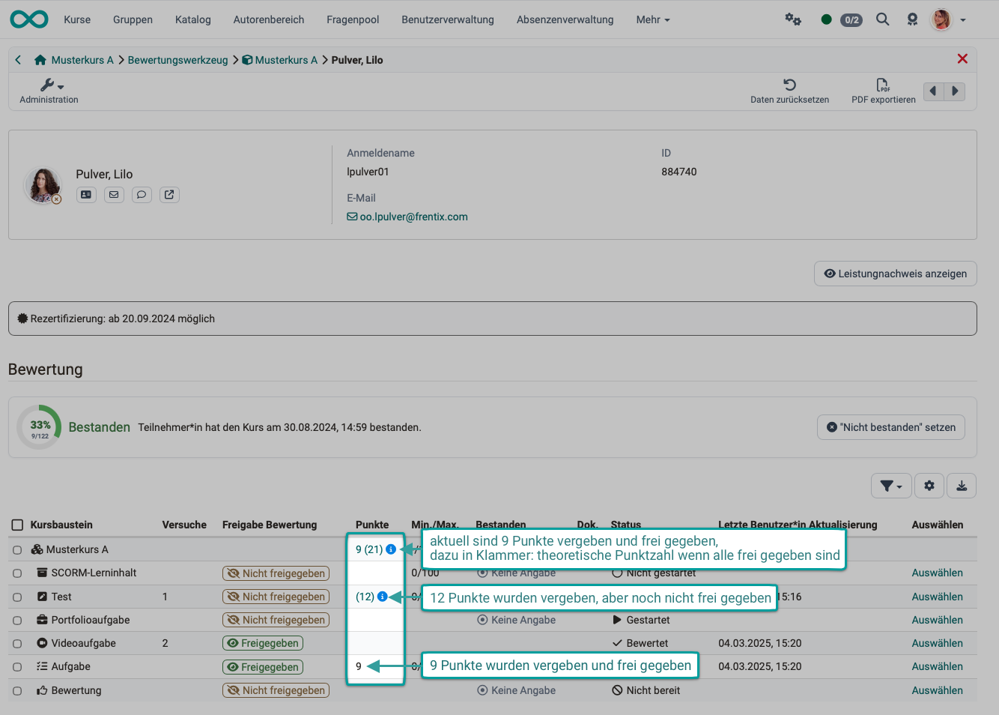
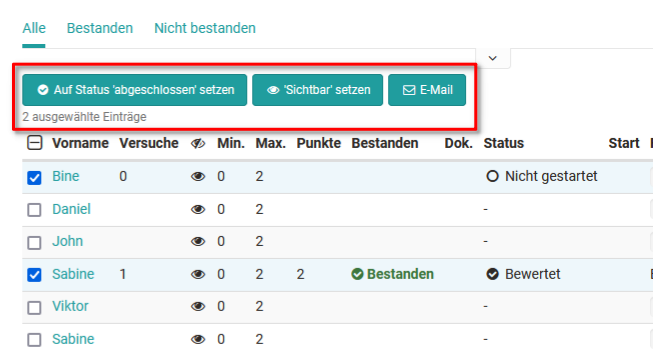

# Assessment tool: Tab Participants {: #assessment_tool_users}

You have two general options for carrying out an assessment in the assessment tool. Either you start from one person and assess the work done by this person, or you start from the course structure and a specific assessment element and assess all persons for this task, this test, or other assessment course element.

In the left column of the assessment tool you see the course structure with all assessable course elements. Here you can navigate directly to one of the course elements to make your assessment. For each course element, a tab with "Overview" and a tab with "Participants" is displayed.

{ class="shadow lightbox" title="Tab Participants of the Test course element in the assessment tool · 2026.10.07" }

The exact procedure is described in the chapters [Assessing learners](../learningresources/Assessment_of_learners.md) and [Assessment of course elements](../learningresources/Assessment_of_course_modules.md).

---

## Search for participants {: #assessment_tool_participants}

In the "Participants" tab, all participants who can be assessed are listed. They can be filtered by various criteria, e.g. all participants who have "not yet passed" this course element, or all participants of a specific group. Individual persons can also be searched for.

### Display and column selection {: #display_column}

The information displayed in the "Participants" tab can be further customized by selecting the desired columns. To do this, click on the gear icon.

The specific display options vary depending on the assessment element. In addition to basic information such as name or matriculation number, information on status or the last update can also be displayed here. Customizing the columns is therefore helpful to get a quick overview. The information on points, attempts, status, and the last update in particular is often needed.

Set up the columns as it makes sense for your context, and check in the settings whether a column is activated if you happen to miss a piece of information.

Here are examples of the column selection via the gear icon:

{ class="shadow lightbox" title="Column selection for the course element Structure" }

Course element "Structure"

{ class="shadow lightbox" title="Column selection for the course element Test" }

Course element "Test"

{ class="shadow lightbox" title="Column selection for the course element Task" }

Course element "Task"

[To the top of the page ^](#assessment_tool_users)

---

### View points earned {: #points}

To check as a coach how many points specific participants have earned, open the assessment tool in the relevant course: `Course > Administration > Assessment tool`. On the overview, a click on one of the numbers opens a pre-filtered list, for example all persons who have passed. If a list is open, click on the name of the person in question.

{ class="shadow lightbox" title="Overview of the assessment tool" }

#### Points for the entire course

To view the points for the entire course, select the course name on the left and then the "Participants" tab.

{ class="shadow lightbox" title="Tab Participants of the top course element in the assessment tool" }

Awarded points only count towards the total score of the course once the assessment is released. In a learning path course, the course settings define whether coaches may release an assessment themselves: `Course > Administration > Settings > Tab "Assessment"`, section "User rights", option "release assessment" under "Coaches can". More on this in the [section User rights](Course_Settings_Assessment.md#section_assessment_rights).

To let coaches still see how many points a person has after the release, the assessment of the person shows the points not yet released in parentheses. A click on the name of the person opens this view. In a learning path course, the course row first shows the total score from the released assessments, followed in parentheses by the total score after the release of all assessments. [:octicons-tag-16:{ title="from Release 20.1.2 (OO-8839)" }](https://track.frentix.com/issue/OO-8839)

Points that do not count towards the total score are also shown in parentheses. A click on a value with an info icon shows why it is in parentheses.

The following example shows the assessment of a person in a learning path course in which not all assessments are released yet.

{ class="shadow lightbox" title="Assessment of a person in the assessment tool" }

In the example, the values in the "Score" column mean:

* **Musterkurs A** (course row): "9 (21)" means that 9 points are awarded and released. Once all awarded points are released, the person has 21 points.
* **Test**: "(12)" means that 12 points are awarded but not yet released.
* **Aufgabe**: "9" without parentheses means that 9 points are awarded and released.

#### Points for a specific course element

To view the points for a specific course element only, select the course element on the left and then the desired person in the "Participants" tab.

For a test, this opens the list of test runs of this person. There the column "Score" shows the result, "Score (auto)" the automatically calculated share including any adjustments, and "Score (manual)" the share awarded by hand. How the list is structured and how you correct from there is described on the page [Assessing tests](Assessing_tests.md#test_runs). [:octicons-tag-16:{ title="from Release 21.1 (OO-9599)" }](https://track.frentix.com/issue/OO-9599)

[To the top of the page ^](#assessment_tool_users)

---

## Activate further options {: #further_options}

After selecting one or more people in an assessment element, further functions appear, e.g. the status can be set to completed, visibility can be activated, an email can be sent, or a test can be extended. The options vary depending on the assessment course element.

{ class="shadow lightbox" title="List of participants in the assessment tool" }

[To the top of the page ^](#assessment_tool_users)

---

## Further information {: #further_information}

**Mentioned on this page** 
[Assessing learners >](Assessment_of_learners.md) 
[Assessment of course elements >](Assessment_of_course_modules.md) 
[Course Settings - Tab Assessment >](Course_Settings_Assessment.md) 
[Assessing tests >](Assessing_tests.md)

**Further** 
[Assessment tool - overview >](Assessment_tool_overview.md) 
[The assessment form >](The_assessment_form.md)

[To the top of the page ^](#assessment_tool_users)
