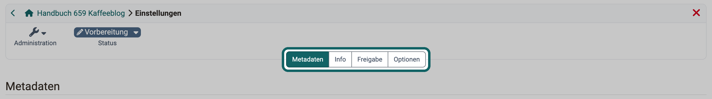

# Blog: Administration {: #blog_configuration_learningresource}

Ob die Beiträge eines Blogs bewertet und kommentiert werden können und wer bei neuen Kommentaren eine E-Mail erhält, legen Sie einmal in der Blog-Lernressource fest. Diese Einstellungen gelten in allen Kursen und Kursbausteinen, in denen Sie die Blog-Lernressource einbinden. Wer im einzelnen Kurs moderiert und Beiträge erstellt, legen Sie dagegen im Kursbaustein fest, siehe [Blog im Kursbaustein konfigurieren](Blog_Configuration.de.md).

Die Blog-Lernressource öffnen Sie auf zwei Wegen:

* Sie wählen die Lernressource im Autorenbereich aus.
* Sie klicken im Kurseditor im Tab "Blog-Lerninhalt" des Kursbausteins auf "Lernressource bearbeiten".

Das Menü "Administration" der Blog-Lernressource sehen Besitzer:innen der Lernressource, Lernressourcenverwalter:innen und Administrator:innen. Bei einem externen Blog ändern sie dort mit "URL ersetzen" die Adresse des Feeds.

## Einstellungen {: #settings}

Die Einstellungen der Blog-Lernressource öffnen Sie unter `Blog > Administration > Einstellungen`. Die Tabs erscheinen in dieser Reihenfolge: "Metadaten", "Info", "Freigabe", "Katalog", "Quota" und "Optionen". "Katalog" und "Quota" erscheinen nur unter den Bedingungen, die in den Abschnitten unten stehen.

{ class="shadow lightbox" title="Einstellungen der Blog-Lernressource · 2026.11.06" }

### Metadaten {: #tab_metadata}

Hier legen Sie Titel, Kennzeichen, Fachbereiche und Lizenz der Blog-Lernressource fest. Bei einem externen Blog zeigt der Tab zusätzlich die URL des Feeds. Die Felder beschreibt die Seite [Kurseinstellungen - Tab Metadaten](Course_Settings_Metadata.de.md). Das Feld "Durchführungsformat" gibt es nur bei Kursen.

### Info {: #tab_info}

Hier erfassen Sie die Angaben der Infoseite, etwa Titelbild, Teaser und Beschreibung. Diese Angaben zeigt der Kursbaustein, wenn Sie dort "Beschreibung anzeigen", "Titel anzeigen" oder "Bild anzeigen" einschalten. Die Felder beschreibt die Seite [Kurseinstellungen - Tab Info](Course_Settings_Info.de.md).

### Freigabe {: #tab_share}

Hier legen Sie unter anderem den Verwendungszweck fest: Standard ist die Einbindung in einen Kurs, alternativ bieten Sie den Blog als eigenständige Lernressource an. Die Abschnitte des Tabs entsprechen denen eines Kurses, siehe [Kurseinstellungen - Tab Freigabe](Course_Settings_Share/index.de.md).

### Katalog {: #tab_catalog}

Den Tab "Katalog" sehen Sie nur, wenn in Ihrer Instanz der Katalog in der Version 1 eingeschaltet ist und der Blog eigenständig verwendet wird. Dort tragen Sie die Blog-Lernressource in den Katalog ein, siehe [Kurseinstellungen, Tab Katalog](Course_Settings/index.de.md#catalog).

### Quota {: #tab_quota}

Hier legen Sie fest, wie viel Speicherplatz die Blog-Lernressource höchstens belegen darf: "Quota (KB)" begrenzt die ganze Lernressource, "Upload Limite (KB)" eine einzelne hochgeladene Datei. Ohne eigenen Wert gilt der systemweite Standardwert für Blogs und Podcasts, siehe [Dateien und Ordner](../../manual_admin/administration/Files_and_Folders.de.md#files_and_folders_quotas).

Den Tab "Quota" sehen nur Administrator:innen, Systemadministrator:innen, Lernressourcenverwalter:innen, Benutzerverwalter:innen und Rollenverwalter:innen.

### Optionen [:octicons-tag-16:{ title="ab Release 19.0 (OO-7728)" }](https://track.frentix.com/issue/OO-7728) {: #tab_options}

Im Bereich "Benutzerfeedback" legen Sie mit "Beiträge bewerten" und "Beiträge kommentieren" fest, ob die Beiträge des Blogs mit Sternen bewertet und kommentiert werden können. Der Kursbaustein zeigt beide Einstellungen im Tab "Blog-Lerninhalt" an.

Mit "Push-Email bei Kommentaren" erhalten die Besitzer:innen des Blogs und der Kurse, die ihn einbinden, zu jedem neuen Kommentar eine E-Mail. [:octicons-tag-16:{ title="ab Release 20.1 (OO-7731)" }](https://track.frentix.com/issue/OO-7731)

Bei eigenständiger Verwendung legen Sie im Bereich "Zugriff" zusätzlich fest, welchen Zugriff Teilnehmende im Status "Beendet" haben. Die Auswahl entspricht der eines Kurses, siehe [Kurseinstellungen - Tab Optionen](Course_Settings_Options.de.md). [:octicons-tag-16:{ title="ab Release 21.0 (OO-9298)" }](https://track.frentix.com/issue/OO-9298)

## Weiterführende Informationen {: #further_information}

**Auf dieser Seite erwähnt** 
[Blog im Kursbaustein konfigurieren >](Blog_Configuration.de.md) 
[Kurseinstellungen - Tab Metadaten >](Course_Settings_Metadata.de.md) 
[Kurseinstellungen - Tab Info >](Course_Settings_Info.de.md) 
[Kurseinstellungen - Tab Freigabe >](Course_Settings_Share/index.de.md) 
[Kurseinstellungen >](Course_Settings/index.de.md) 
[Dateien und Ordner >](../../manual_admin/administration/Files_and_Folders.de.md) 
[Kurseinstellungen - Tab Optionen >](Course_Settings_Options.de.md)

**Weiterführend** 
[Blog: Übersicht >](Blog/index.de.md) 
[Blog erstellen >](Blog_Create.de.md) 
[Bloggen >](Blog_Blogging.de.md) 
[Podcast: Administration >](Podcast_Administration.de.md)

[Zum Seitenanfang ^](#blog_configuration_learningresource)
