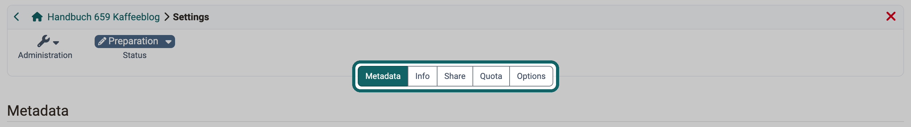

# Blog: Administration {: #blog_configuration_learningresource}

Whether the posts of a blog can be rated and commented on and who receives an e-mail for new comments, you define once in the blog learning resource. These settings apply in all courses and course elements in which you embed the blog learning resource. Who moderates and creates posts in a single course, on the other hand, you define in the course element, see [Configure a blog in the course element](Blog_Configuration.md).

You open the blog learning resource in two ways:

* You select the learning resource in the authoring area.
* In the course editor, you click on "Edit learning resource" in the "Blog learning content" tab of the course element.

Owners of the learning resource, learning resource managers and administrators see the "Administration" menu of the blog learning resource. For an external blog, they change the address of the feed there with "Replace URL".

## Settings {: #settings}

You open the settings of the blog learning resource under `Blog > Administration > Settings`. The tabs appear in this order: "Metadata", "Info", "Share", "Catalog", "Quota" and "Options". "Catalog" and "Quota" only appear under the conditions given in the sections below.

{ class="shadow lightbox" title="Settings of the blog learning resource · 2026.11.06" }

### Metadata {: #tab_metadata}

Here you define the title, reference, subjects and license of the blog learning resource. For an external blog, the tab also shows the URL of the feed. The fields are described on the page [Course Settings - Tab Metadata](Course_Settings_Metadata.md). The field "Implementation format" only exists for courses.

### Info {: #tab_info}

Here you enter the information of the info page, for example cover image, teaser and description. The course element shows this information when you switch on "Show description", "Show title" or "Show image" there. The fields are described on the page [Course Settings - Tab Info](Course_Settings_Info.md).

### Share {: #tab_share}

Here you define, among other things, the usage: the default is embedding in a course, alternatively you offer the blog as a standalone learning resource. The sections of the tab correspond to those of a course, see [Course settings - Tab Share](Course_Settings_Share/index.md).

### Catalog {: #tab_catalog}

You only see the "Catalog" tab if catalog version 1 is switched on in your instance and the blog is used standalone. There you add the blog learning resource to the catalog, see [Course Settings - Tab Catalog](Course_Settings_Catalog.md).

### Quota {: #tab_quota}

Here you define how much storage space the blog learning resource may use at most: "Quota (KB)" limits the whole learning resource, "Upload limit (KB)" a single uploaded file. Without a value of its own, the system-wide default value for blogs and podcasts applies, see [Files and Folders](../../manual_admin/administration/Files_and_Folders.md#files_and_folders_quotas).

Only administrators, system administrators, learning resource managers, user managers and roles managers see the tab "Quota".

### Options [:octicons-tag-16:{ title="from Release 19.0 (OO-7728)" }](https://track.frentix.com/issue/OO-7728) {: #tab_options}

In the section "User feedback" you define with "Posts are rateable" and "Posts are commentable" whether the posts of the blog can be rated with stars and commented on. The course element shows both settings in the "Blog learning content" tab.

With "Push E-mail by comments" the owners of the blog and of the courses that embed it receive an e-mail for each new comment. [:octicons-tag-16:{ title="from Release 20.1 (OO-7731)" }](https://track.frentix.com/issue/OO-7731)

For standalone use, you also define in the section "Access" which access participants in status "Finished" have. The selection corresponds to that of a course, see [Course Settings - Tab Options](Course_Settings_Options.md). [:octicons-tag-16:{ title="from Release 21.0 (OO-9298)" }](https://track.frentix.com/issue/OO-9298)

## Further information {: #further_information}

**Mentioned on this page** 
[Configure a blog in the course element >](Blog_Configuration.md) 
[Course Settings - Tab Metadata >](Course_Settings_Metadata.md) 
[Course Settings - Tab Info >](Course_Settings_Info.md) 
[Course settings - Tab Share >](Course_Settings_Share/index.md) 
[Course Settings - Tab Catalog >](Course_Settings_Catalog.md) 
[Files and Folders >](../../manual_admin/administration/Files_and_Folders.md) 
[Course Settings - Tab Options >](Course_Settings_Options.md)

**Further** 
[Blog: Overview >](Blog/index.md) 
[Create a blog >](Blog_Create.md) 
[Blogging >](Blog_Blogging.md) 
[Podcast: Administration >](Podcast_Administration.md)

[To the top of the page ^](#blog_configuration_learningresource)
