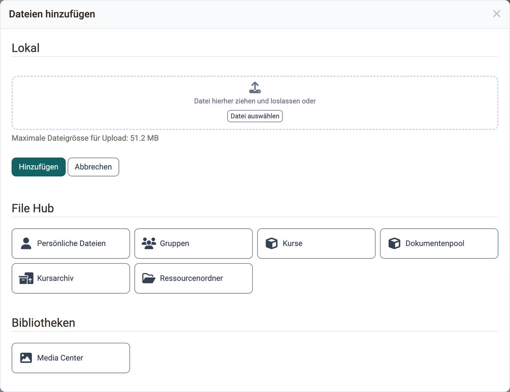
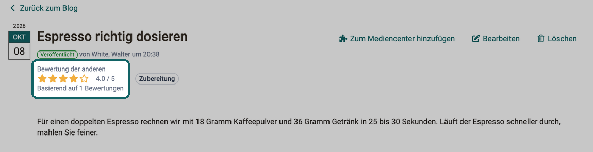

# Bloggen {: #blog_blogging}

Ist in einem veröffentlichten Kurs ein Blog eingebunden, arbeiten Teilnehmer:innen und Betreuer:innen damit: Sie lesen Beiträge, schreiben eigene, kommentieren und bewerten sie. Das heisst bloggen.

Was Teilnehmer:innen und Betreuer:innen im Blog tun dürfen, legen die Besitzer:innen des Kurses im Kursbaustein fest. Die Berechtigung "Beiträge erstellen" bestimmt, wer eigene Beiträge schreibt, die Berechtigung "Moderator", wer alle Beiträge bearbeitet und löscht, siehe [Blog im Kursbaustein konfigurieren](Blog_Configuration.de.md#blog_configuration_permissions). Den Button "Eintrag hinzufügen" sehen deshalb nur Personen mit einer dieser Berechtigungen und die Besitzer:innen des Kurses. Im Blog der Toolbar erstellen und moderieren Besitzer:innen und Betreuer:innen des Kurses die Beiträge.

!!! note "Quick Links"

    Je nach Berechtigung können Sie als Teilnehmer:in oder Betreuer:in

    * [Beiträge aufrufen und lesen](#blog_blogging_read_posts)
    * [Beiträge hinzufügen und editieren](#blog_blogging_add_posts)
    * [Beiträge löschen](#blog_blogging_delete_posts)
    * [Beiträge kommentieren](#blog_blogging_comment_posts)
    * [Beiträge bewerten](#blog_blogging_assess_posts)
    * [einen Blog moderieren](#blog_blogging_moderate)
    * [Beiträge abonnieren](#blog_blogging_abo)
    * [Beiträge im Media Center ablegen](#blog_blogging_media_center)

## Beiträge aufrufen und lesen {: #blog_blogging_read_posts}

Einen Blog öffnen Sie im Kursmenü links mit einem Klick auf seinen Kursbaustein, einen Blog für den ganzen Kurs mit dem Blog-Icon in der [Toolbar](Course_Settings_Toolbar.de.md#blog). Anschliessend wählen Sie den Beitrag, der Sie interessiert.

Zum Umschalten zwischen "Listenansicht" und "Tabellenansicht" verwenden Sie die Buttons rechts über der Liste.

Mit dem Schalter "Zeitleiste & Tags" blenden Sie rechts neben der Liste zusätzlich eine Zeitleiste und die Tags der Einträge ein und aus.

Über der Liste stehen Filter zur Verfügung, um die angezeigten Beiträge einzuschränken: "Alle", "Meine Einträge" und "Entwürfe".

!!! info "Wichtig"

    Haben Sie im Blog nur Leserechte, etwa als Teilnehmer:in ohne die Berechtigung "Beiträge erstellen", steht Ihnen nur der Filter "Alle" zur Verfügung [:octicons-tag-16:{ title="ab Release 20.3.0 (OO-9220)" }](https://track.frentix.com/issue/OO-9220){:target="_blank"}.

{ class="shadow lightbox" title="Blog in der Kursansicht · 2026.10.08" }

!!! note "Hinweis"

    Eine Blog-Lernressource lässt sich auch eigenständig verwenden, ohne Kurs. Nach der Freigabe öffnen Personen sie dann zum Beispiel über einen Link in einer E-Mail oder über den Katalog. Auch auf einen einzelnen Kursbaustein, etwa den Blog, verschicken Sie in einer E-Mail einen direkten Link.

[Zum Seitenanfang ^](#blog_blogging)

## Beiträge hinzufügen und editieren {: #blog_blogging_add_posts}

!!! tip "Voraussetzung"

    Eigene Beiträge schreiben Sie als Teilnehmer:in oder Betreuer:in, wenn Ihnen die Besitzer:innen des Kurses im Kursbaustein die Berechtigung "Beiträge erstellen" oder "Moderator" gegeben haben und ein dort gesetzter Zeitraum ("Beginn", "Ende") gerade gilt, siehe [Blog im Kursbaustein konfigurieren](../learningresources/Blog_Configuration.de.md#create_entries). 
    Die Beiträge eines externen Blogs, den die Lernressource per URL einbindet, entstehen ausserhalb von OpenOlat und werden dort bearbeitet.

Einen eigenen Beitrag fügen Sie mit dem Button "Eintrag hinzufügen" hinzu. Zum erneuten Öffnen und Bearbeiten wählen Sie "Bearbeiten" im Menü mit den drei Punkten oder klicken in der Listenansicht auf den Titel. In der Kursansicht finden Sie bei jedem Ihrer Beiträge einen Link "Bearbeiten".

Beim Hinzufügen und Editieren füllen Sie folgende Felder aus.

#### Titel {: #entry_title}

Geben Sie einen Titel ein, der den Blogeintrag beschreibt. Dieses Feld ist obligatorisch.

#### Tags {: #entry_tags}

Optional ordnen Sie dem Eintrag Tags zu. Sie wählen ein vorhandenes Tag oder legen ein neues an. Mit dem Schalter "Zeitleiste & Tags" erscheinen die Tags neben der Liste der Einträge.

#### Inhalt {: #entry_content}

Der Inhalt ist der eigentliche Blogeintrag, füllen Sie dieses Feld deshalb immer aus. Formatierungen und Bilder sind erlaubt. Dafür wechseln Sie oben rechts am Feld von "Mehrere Zeilen" auf "Formatiert". Sie schreiben den Inhalt im selben HTML-Editor wie im Kursbaustein "HTML-Seite", hier aber ohne das Menü "Tabelle". Wie Sie mehrere Bilder nebeneinander anordnen, beschreibt der Abschnitt [Mehrere Bilder nebeneinander](Course_Element_HTML_Page.de.md#images_side_by_side).

{ class="shadow lightbox" title="Veröffentlichter Blogeintrag" }

#### Zusammenfassung {: #entry_summary}

Die Zusammenfassung ist optional. OpenOlat zeigt sie als Vorschau des Eintrags, sie kann also auch eine kurze Einleitung sein.

#### Audio- oder Videodatei {: #entry_media_file}

Optional hängen Sie dem Eintrag eine Datei in den Formaten MP3, MP4, M4V, M4A oder AAC an. Bei einem Video füllt OpenOlat "Breite" und "Höhe" beim Hochladen mit den Angaben aus der Datei vor.

#### Datum und Zeit der Veröffentlichung {: #entry_publication_date}

Mit Datum und Zeit der Veröffentlichung legen Sie fest, ab wann andere Teilnehmende den Eintrag sehen. Liegt der Zeitpunkt in der Vergangenheit, ist der Eintrag sichtbar. Liegt er in der Zukunft, ist die Veröffentlichung geplant.

Mit "Veröffentlichen" machen Sie den Eintrag ab dem angegebenen Datum für andere zugänglich. Wenn Sie an Ihrem Eintrag zu einem späteren Zeitpunkt weiterschreiben wollen, klicken Sie auf "Entwurf speichern". "Abbrechen" verwirft Ihre Änderungen und schliesst das Formularfenster. In der Liste der Einträge zeigt eine farbige Markierung den Status: "Entwurf" in Gelb, "Geplant" in Blau für eine Veröffentlichung in der Zukunft und "Veröffentlicht" in Grün. Veröffentlichte Einträge sind für andere sichtbar.

[Zum Seitenanfang ^](#blog_blogging)

## Beiträge löschen {: #blog_blogging_delete_posts}

Am Beitrag erscheint "Löschen" bei Ihren eigenen Beiträgen, als Moderator:in oder Besitzer:in des Kurses bei allen Beiträgen.

In der Tabellenansicht löschen Sie mit einer Massenaktion mehrere Beiträge auf einmal. Wählen Sie dazu die Checkboxen in der ersten Spalte und klicken Sie auf "Löschen". Filter und Suche helfen, bestimmte Beiträge zu finden.

[Zum Seitenanfang ^](#blog_blogging)

## Beiträge kommentieren {: #blog_blogging_comment_posts}

Ist in der Blog-Lernressource "Beiträge kommentieren" eingeschaltet, kommentieren die Kursmitglieder Blogbeiträge mit einem Text und hängen Dateien an, siehe [Blog: Administration](Blog_Administration.de.md#tab_options).

Um einen Kommentar zu verfassen oder bestehende Kommentare zu lesen, klicken Sie in die Kommentarzeile. Es öffnet sich ein kleiner Texteditor. Mit Klick auf den Button "Kommentieren" schicken Sie den Kommentar ab.

{ class="shadow lightbox" title="Kommentare unter einem Blogbeitrag · 2026.10.08" }

Mit "Datei anhängen" hängen Sie Ihrem Kommentar eine Datei an. Im Dialog "Dateien hinzufügen" laden Sie unter "Lokal" eine Datei von Ihrem Rechner hoch oder wählen eine Datei aus dem "File Hub" oder aus dem "Media Center".

{ class="shadow lightbox" title="Dialog Dateien hinzufügen · 2026.10.08" }

[Zum Seitenanfang ^](#blog_blogging)

## Beiträge bewerten {: #blog_blogging_assess_posts}

Ist in der Blog-Lernressource "Beiträge bewerten" eingeschaltet, bewerten die Kursmitglieder Beiträge mit 1 bis 5 Sternen. 
Die Sterne zeigen zuerst die Bewertungen der anderen Lesenden. Fahren Sie mit der Maus über die Sterne und klicken Sie auf den Stern Ihrer eigenen Bewertung.

{ class="shadow lightbox" title="Blogbeitrag in der Kursansicht · 2026.10.08" }

[Zum Seitenanfang ^](#blog_blogging)

## Einen Blog moderieren {: #blog_blogging_moderate}

Moderieren heisst, lenkend in eine Kommunikation einzugreifen. Im Blog prüfen Moderator:innen, ob die Beiträge angemessen sind, und korrigieren oder löschen sie bei Bedarf. Moderator:innen eines OpenOlat-Blogs lesen, kommentieren, bearbeiten und löschen alle Einträge und erstellen neue. Mit dem Button "Blog bearbeiten" passen sie zudem Titel und Beschreibung des ganzen Blogs an.

Besitzer:innen des Kurses moderieren immer. Das Recht "Moderator" vergeben Sie im Kursbaustein zusätzlich an Betreuer:innen oder gezielt an einzelne Personen, siehe [Blog im Kursbaustein konfigurieren](../learningresources/Blog_Configuration.de.md#moderator).

!!! info "Wichtig"

    Blogeinträge aus einem Blog, der als Datei importiert wurde, löschen nur Moderator:innen und Besitzer:innen des Kurses. Als Ersteller:innen zeigen die Beiträge weiterhin die ursprünglichen Autor:innen.

[Zum Seitenanfang ^](#blog_blogging)

## Beiträge abonnieren [:octicons-tag-16:{ title="ab Release 11.5 (OO-1620)" }](https://track.frentix.com/issue/OO-1620) {: #blog_blogging_abo}

Mit einem Abonnement verpassen Sie keine neuen Einträge. Wie Sie Abonnements einrichten, zeigt das Video [Abonnements einrichten](https://www.youtube.com/embed/h9gOqt7TR7Q).

Wenn Sie benachrichtigt werden möchten, sobald irgendein neuer Beitrag eingefügt wird, abonnieren Sie den Blog als Ganzes. Dazu dient das Glockensymbol "Abonnieren" rechts über der Liste der Einträge.
Möchten Sie nur bei neuen Kommentaren zu den Blogeinträgen benachrichtigt werden, wählen Sie beim Glockensymbol "Nur Kommentare abonnieren".

Wenn Sie den Link zum Blog weitergeben möchten, finden Sie den Link links über der Beitragsliste unter "RSS".

Möchten Sie den direkten Link zu einem einzelnen Beitrag weitergeben, können Sie sich die URL aus Ihrem Browserfenster kopieren. Dort wird der Direktlink angezeigt.

[Zum Seitenanfang ^](#blog_blogging)

## Beiträge im Media Center ablegen {: #blog_blogging_media_center}

Als Ersteller:in können Sie Ihre Blogbeiträge auch im Media Center ablegen. An Ihren eigenen Beiträgen erscheint dafür der Button "Zum Media Center hinzufügen".

[Zum Seitenanfang ^](#blog_blogging)

## Weiterführende Informationen {: #further_information}

**Auf dieser Seite erwähnt** 
[Blog im Kursbaustein konfigurieren >](../learningresources/Blog_Configuration.de.md) 
[Toolbar >](Course_Settings_Toolbar.de.md) 
[Kursbaustein "HTML-Seite" >](../learningresources/Course_Element_HTML_Page.de.md) 
[Blog: Administration >](Blog_Administration.de.md)

**Weiterführend** 
[Blog: Übersicht >](Blog/index.de.md) 
[Blog erstellen >](../learningresources/Blog_Create.de.md) 
[Wie erstelle ich einen Blog? >](../../manual_how-to/blog/blog.de.md)

**youtube** 
[Abonnements einrichten](<https://www.youtube.com/embed/h9gOqt7TR7Q>)

[Zum Seitenanfang ^](#blog_blogging)

