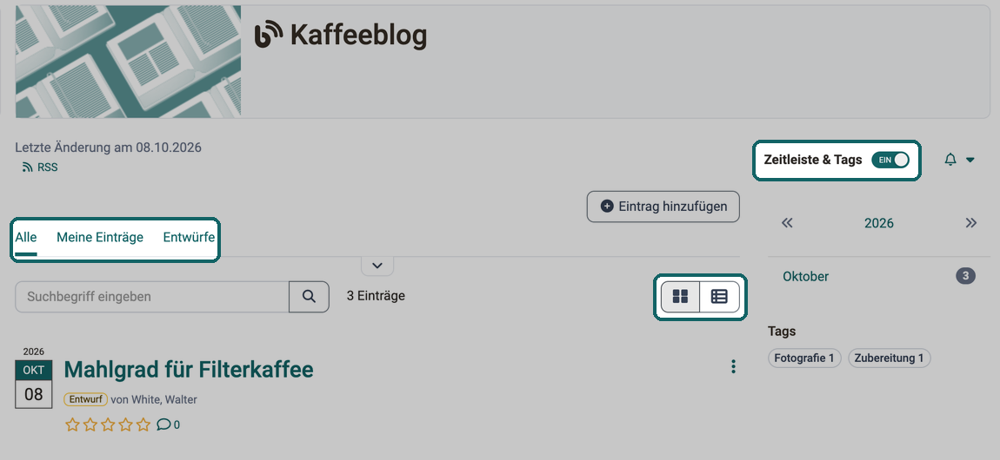
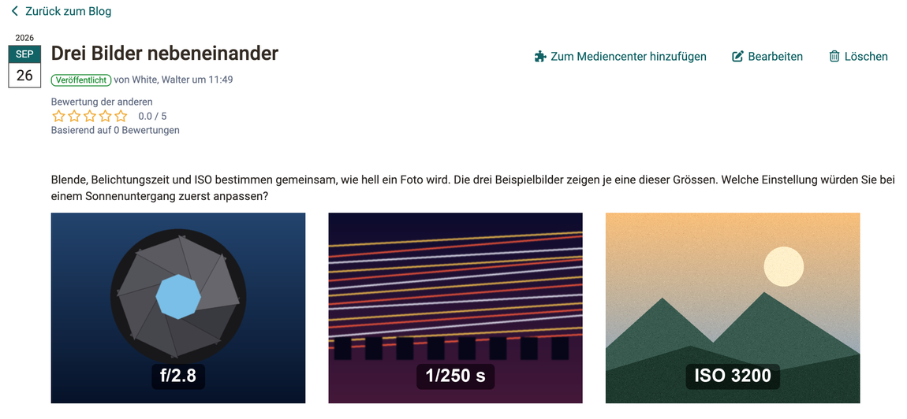
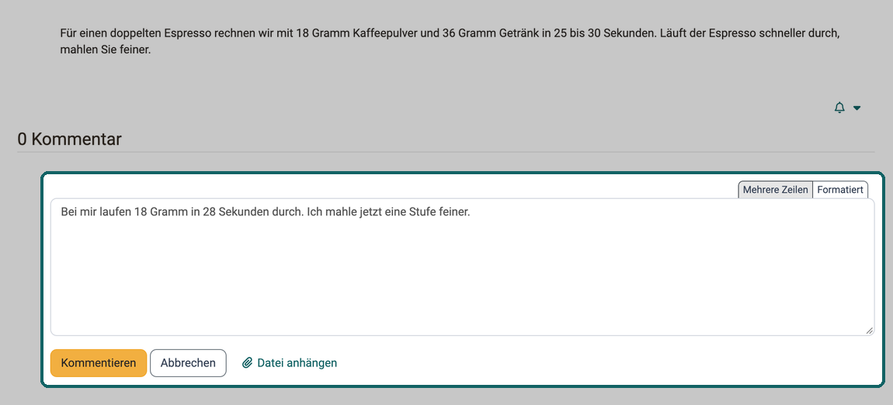
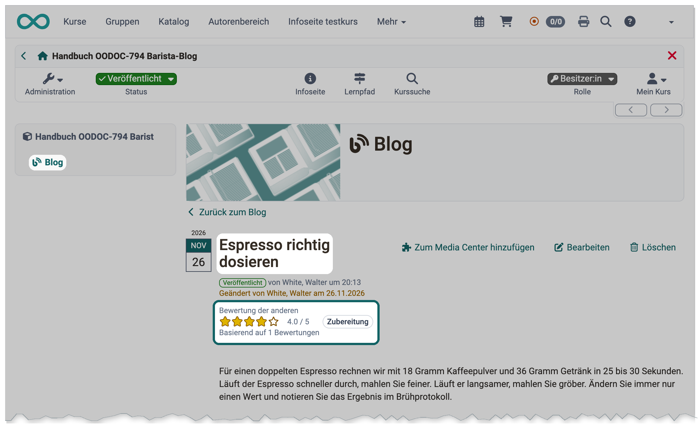

# Bloggen {: #blog_blogging}

Ist ein Blog in einen Kurs eingebunden, den die Teilnehmer:innen öffnen können, also einen Kurs mit dem Status ["Veröffentlicht"](Access_configuration.de.md), arbeiten Teilnehmer:innen und [Betreuer:innen](../basic_concepts/Roles/index.de.md#coach) damit: Sie lesen Einträge (Blogbeiträge), schreiben eigene, kommentieren und bewerten sie. Das heisst bloggen. Die Oberfläche spricht teils von Beiträgen, etwa bei der Berechtigung "Beiträge erstellen". Gemeint sind immer die Einträge.

Was Teilnehmer:innen und Betreuer:innen im Blog tun dürfen, legen die [Besitzer:innen](../basic_concepts/Roles/index.de.md#owner) des Kurses im Kursbaustein "Blog" fest, dem Punkt des Blogs im Kursmenü. Die Berechtigung "Beiträge erstellen" bestimmt, wer eigene Einträge schreibt, die Berechtigung "Moderator", wer alle Einträge bearbeitet und löscht, siehe [Blog im Kursbaustein konfigurieren](Blog_Configuration.de.md#blog_configuration_permissions). Bei einem neuen Kursbaustein haben Betreuer:innen und Teilnehmer:innen die Berechtigung "Beiträge erstellen" bereits, Betreuer:innen zusätzlich die Berechtigung "Moderator". Begrenzt ein Zeitraum ("Beginn", "Ende") die Berechtigung, gilt sie nur in dieser Zeit. Den Button "Eintrag hinzufügen" sehen deshalb nur Personen, die eine dieser Berechtigungen gerade haben, und die Besitzer:innen des Kurses. Einen Blog, den der Kurs über die [Toolbar](Course_Settings_Toolbar.de.md#blog) oben im Kurs anbietet, steuert kein Kursbaustein: Dort erstellen und moderieren Besitzer:innen und Betreuer:innen des Kurses die Einträge.

!!! note "Quick Links"

    Je nach Berechtigung können Sie als Teilnehmer:in oder Betreuer:in

    * [Einträge aufrufen und lesen](#blog_blogging_read_posts)
    * [Einträge hinzufügen und bearbeiten](#blog_blogging_add_posts)
    * [Einträge löschen](#blog_blogging_delete_posts)
    * [Einträge kommentieren](#blog_blogging_comment_posts)
    * [Einträge bewerten](#blog_blogging_assess_posts)
    * [einen Blog moderieren](#blog_blogging_moderate)
    * [Einträge abonnieren](#blog_blogging_abo)
    * [Einträge im Media Center ablegen](#blog_blogging_media_center)

## Einträge aufrufen und lesen {: #blog_blogging_read_posts}

Einen Blog öffnen Sie im Kursmenü links mit einem Klick auf seinen Kursbaustein, einen Blog für den ganzen Kurs mit dem Blog-Icon in der [Toolbar](Course_Settings_Toolbar.de.md#blog). Anschliessend wählen Sie den Eintrag, der Sie interessiert.

Zum Umschalten zwischen "Listenansicht" und "Tabellenansicht" verwenden Sie die Buttons rechts über der Liste.

Mit dem Schalter "Zeitleiste & Tags" blenden Sie rechts neben der Liste zusätzlich eine Zeitleiste und die Tags der Einträge ein und aus.

Über der Liste stehen Filter zur Verfügung, um die angezeigten Einträge einzuschränken: "Alle", "Meine Einträge" und "Entwürfe".

!!! info "Wichtig"

    Haben Sie im Blog nur Leserechte, etwa als Teilnehmer:in ohne die Berechtigung "Beiträge erstellen", steht Ihnen nur der Filter "Alle" zur Verfügung [:octicons-tag-16:{ title="ab Release 20.3.0 (OO-9220)" }](https://track.frentix.com/issue/OO-9220){:target="_blank"}.

{ class="shadow lightbox" title="Blog in der Kursansicht · 2026.10.08" }

!!! note "Hinweis"

    Eine Blog-Lernressource lässt sich auch eigenständig verwenden, ohne Kurs, siehe [Funktionskonzept Kurse und Lernressourcen](General_Functions_Concept.de.md). Nach der [Freigabe](Access_configuration.de.md) öffnen Personen sie dann zum Beispiel über einen Link in einer E-Mail oder über den [Katalog](../area_modules/catalog2.0/index.de.md). Auch auf einen einzelnen Kursbaustein, etwa den Blog, verschicken Sie in einer E-Mail einen direkten Link. Den Link kopieren Sie aus der Adresszeile Ihres Browsers, während der Kursbaustein geöffnet ist.

[Zum Seitenanfang ^](#blog_blogging)

## Einträge hinzufügen und bearbeiten {: #blog_blogging_add_posts}

!!! tip "Voraussetzung"

    Eigene Einträge schreiben Sie als Teilnehmer:in oder Betreuer:in, wenn Ihnen die Besitzer:innen des Kurses im Kursbaustein die Berechtigung "Beiträge erstellen" oder "Moderator" gegeben haben und ein dort gesetzter Zeitraum ("Beginn", "Ende") gerade gilt, siehe [Blog im Kursbaustein konfigurieren](../learningresources/Blog_Configuration.de.md#create_entries). 
    Im Blog der Toolbar schreiben nur Besitzer:innen und Betreuer:innen des Kurses. 
    Bindet die Lernressource einen externen Blog per URL ein, also einen Blog, den jemand ausserhalb von OpenOlat führt, entstehen seine Einträge dort und werden auch dort bearbeitet.

Einen eigenen Eintrag fügen Sie mit dem Button "Eintrag hinzufügen" hinzu. Zum Bearbeiten wählen Sie in der Liste am Eintrag "Bearbeiten" im Menü mit den drei Punkten. Oder Sie öffnen den Eintrag mit einem Klick auf seinen Titel und klicken dort auf "Bearbeiten".

Beim Hinzufügen und Bearbeiten füllen Sie folgende Felder aus.

#### Titel {: #entry_title}

Geben Sie einen Titel ein, der den Eintrag beschreibt. Dieses Feld ist obligatorisch.

#### Tags {: #entry_tags}

Optional ordnen Sie dem Eintrag Tags zu. Sie wählen ein vorhandenes Tag oder legen ein neues an. Mit dem Schalter "Zeitleiste & Tags" erscheinen die Tags neben der Liste der Einträge.

#### Inhalt {: #entry_content}

Der Inhalt ist der eigentliche Text des Eintrags. Anders als den Titel verlangt OpenOlat ihn nicht. Formatierungen und Bilder sind erlaubt. Dafür wechseln Sie oben rechts am Feld von "Mehrere Zeilen" auf "Formatiert". Sie schreiben den Inhalt im selben HTML-Editor wie im Kursbaustein "HTML-Seite", hier aber ohne das Menü "Tabelle". Wie Sie mehrere Bilder nebeneinander anordnen, beschreibt der Abschnitt [Mehrere Bilder nebeneinander](Course_Element_HTML_Page.de.md#images_side_by_side).

{ class="shadow lightbox" title="Veröffentlichter Eintrag" }

#### Zusammenfassung {: #entry_summary}

Die Zusammenfassung ist optional. OpenOlat zeigt sie als Vorschau des Eintrags, sie kann also auch eine kurze Einleitung sein.

#### Audio- oder Videodatei {: #entry_media_file}

Optional hängen Sie dem Eintrag eine Datei in den Formaten MP3, MP4, M4V, M4A oder AAC an. Bei einem Video füllt OpenOlat "Breite" und "Höhe" beim Hochladen mit den Angaben aus der Datei vor.

#### Datum und Zeit der Veröffentlichung {: #entry_publication_date}

Mit Datum und Zeit der Veröffentlichung legen Sie fest, ab wann andere den Eintrag sehen. Liegt der Zeitpunkt in der Vergangenheit, ist der Eintrag sichtbar. Liegt er in der Zukunft, ist die Veröffentlichung geplant.

Mit "Veröffentlichen" machen Sie den Eintrag ab dem angegebenen Datum für andere zugänglich. Wenn Sie an Ihrem Eintrag zu einem späteren Zeitpunkt weiterschreiben wollen, klicken Sie auf "Entwurf speichern". "Abbrechen" verwirft Ihre Änderungen und schliesst das Formularfenster. In der Liste der Einträge zeigt eine farbige Markierung den Status: "Entwurf" in Gelb, "Geplant" in Blau für eine Veröffentlichung in der Zukunft und "Veröffentlicht" in Grün. Veröffentlichte Einträge sind für andere sichtbar.

[Zum Seitenanfang ^](#blog_blogging)

## Einträge löschen {: #blog_blogging_delete_posts}

Am Eintrag erscheint "Löschen" bei Ihren eigenen Einträgen, als Moderator:in oder Besitzer:in des Kurses bei allen Einträgen.

In der Tabellenansicht löschen Sie mit einer Massenaktion mehrere Einträge auf einmal. Wählen Sie dazu die Checkboxen in der ersten Spalte und klicken Sie auf "Löschen". Filter und Suche helfen, bestimmte Einträge zu finden.

[Zum Seitenanfang ^](#blog_blogging)

## Einträge kommentieren {: #blog_blogging_comment_posts}

Ob Einträge kommentiert werden, legt die Blog-Lernressource fest, also der Blog selbst, der die Einträge enthält und den der Kursbaustein im Kurs zeigt. Ist dort unter `Blog > Administration > Einstellungen > Tab "Optionen"` die Option "Beiträge kommentieren" eingeschaltet, kommentieren alle Personen, die den Blog öffnen, ausser [Gästen](../basic_concepts/guest_access.de.md) die Einträge mit einem Text und hängen Dateien an, siehe [Blog: Administration](Blog_Administration.de.md#tab_options). Diese Option legen die Besitzer:innen der Blog-Lernressource fest, das heisst, wer sie erstellt hat oder später als Besitzer:in eingetragen wurde. Als Besitzer:in öffnen Sie die Lernressource zum Beispiel im Kurseditor im Kursbaustein "Blog" mit "Lernressource bearbeiten", siehe [Blog im Kursbaustein konfigurieren](Blog_Configuration.de.md#blog_configuration_course_element).

Die Kommentare stehen unter dem Eintrag, sobald Sie ihn mit einem Klick auf seinen Titel öffnen. In der Liste der Einträge zeigt ein Sprechblasen-Symbol unter dem Titel die Anzahl Kommentare. Ein Klick darauf öffnet den Eintrag direkt bei seinen Kommentaren.

Für einen neuen Kommentar klicken Sie unter dem Eintrag in das Feld "Schreiben Sie einen Kommentar...". Es öffnet sich ein kleiner Texteditor. Mit Klick auf den Button "Kommentieren" schicken Sie den Kommentar ab.

{ class="shadow lightbox" title="Kommentare unter einem Eintrag · 2026.10.08" }

Mit "Datei anhängen" hängen Sie Ihrem Kommentar eine Datei an. Im Dialog "Dateien hinzufügen" laden Sie unter "Lokal" eine Datei von Ihrem Rechner hoch oder wählen eine Datei aus dem ["File Hub"](../basic_concepts/File_Hub_Concept.de.md) oder aus dem ["Media Center"](../basic_concepts/Media_Center_Concept/index.de.md).

{ class="shadow lightbox" title="Dialog Dateien hinzufügen · 2026.10.08" }

[Zum Seitenanfang ^](#blog_blogging)

## Einträge bewerten {: #blog_blogging_assess_posts}

Ist in der Blog-Lernressource die Option "Beiträge bewerten" eingeschaltet, bewerten alle Personen, die den Blog öffnen, ausser Gästen die Einträge mit 1 bis 5 Sternen. 
In der Liste der Einträge zeigen die Sterne unter dem Titel den Durchschnitt der Bewertungen. Ihre eigene Bewertung geben Sie im Eintrag ab, den Sie mit einem Klick auf seinen Titel öffnen. Dort zeigen die Sterne unter "Bewertung der anderen" den Durchschnitt und die Anzahl der Bewertungen. Fahren Sie mit der Maus über die Sterne, wechselt die Anzeige zu "Ihre Bewertung". Klicken Sie dann auf den Stern Ihrer eigenen Bewertung.

{ class="shadow lightbox" title="Eintrag in der Kursansicht · 2026.11.26" }

[Zum Seitenanfang ^](#blog_blogging)

## Einen Blog moderieren {: #blog_blogging_moderate}

Moderieren heisst, lenkend in eine Kommunikation einzugreifen. Im Blog prüfen Moderator:innen, ob die Einträge angemessen sind, und korrigieren oder löschen sie bei Bedarf. Moderator:innen eines OpenOlat-Blogs lesen, kommentieren, bearbeiten und löschen alle Einträge und erstellen neue. Titel und Beschreibung des ganzen Blogs pflegen die Besitzer:innen in der Blog-Lernressource, siehe [Blog: Administration](Blog_Administration.de.md#tab_info).

Als Besitzer:in des Kurses moderieren Sie immer. Die Berechtigung "Moderator" vergeben Sie im Kursbaustein zusätzlich an Betreuer:innen oder gezielt an einzelne Personen, siehe [Blog im Kursbaustein konfigurieren](../learningresources/Blog_Configuration.de.md#moderator).

!!! info "Wichtig"

    Einträge aus einem Blog, den jemand als Datei importiert hat, etwa mit "Import" im Kursbaustein, löschen nur Moderator:innen und Besitzer:innen des Kurses. Als Ersteller:innen zeigen die Einträge weiterhin die ursprünglichen Autor:innen.

[Zum Seitenanfang ^](#blog_blogging)

## Einträge abonnieren [:octicons-tag-16:{ title="ab Release 11.5 (OO-1620)" }](https://track.frentix.com/issue/OO-1620) {: #blog_blogging_abo}

Mit einem Abonnement verpassen Sie keine neuen Einträge. Die Neuigkeiten aller Ihrer Abonnements sammelt OpenOlat im persönlichen Menü unter [Abonnements](../personal_menu/Subscriptions.de.md). Wie Sie Abonnements einrichten, zeigt das Video [Abonnements einrichten](https://www.youtube.com/embed/h9gOqt7TR7Q).

Wenn Sie benachrichtigt werden möchten, sobald irgendein neuer Eintrag eingefügt wird, abonnieren Sie den Blog als Ganzes. Dazu dient das Glockensymbol "Abonnieren" rechts über der Liste der Einträge.
Möchten Sie nur bei neuen Kommentaren zu den Einträgen benachrichtigt werden, wählen Sie beim Glockensymbol "Nur Kommentare abonnieren".

Links über der Liste der Einträge öffnet der Button "RSS" die Adresse des RSS-Feeds des Blogs. Über diese Adresse holt ein Feed-Reader, ein Programm zum Verfolgen von Websites, die neuen Einträge ab. Die Adresse gehört zu Ihrem Konto, weil sie einen persönlichen Schlüssel enthält. Sie ist deshalb für Ihren eigenen Feed-Reader bestimmt.

Möchten Sie den direkten Link zu einem einzelnen Eintrag weitergeben, können Sie sich die URL aus Ihrem Browserfenster kopieren. Dort wird der Direktlink angezeigt.

[Zum Seitenanfang ^](#blog_blogging)

## Einträge im Media Center ablegen {: #blog_blogging_media_center}

Ihre eigenen Einträge legen Sie auch im [Media Center](../basic_concepts/Media_Center_Concept/index.de.md) ab und verwenden sie von dort kursübergreifend weiter. Ist in OpenOlat das Modul Portfolio eingeschaltet, erscheint dafür an Ihren eigenen Einträgen der Button "Zum Media Center hinzufügen".

[Zum Seitenanfang ^](#blog_blogging)

## Weiterführende Informationen {: #further_information}

**Auf dieser Seite erwähnt** 
[Zugangskonfiguration / Freigabe >](Access_configuration.de.md) 
[Rollen und Rechte: Welche Rollen gibt es? >](../basic_concepts/Roles/index.de.md) 
[Blog im Kursbaustein konfigurieren >](../learningresources/Blog_Configuration.de.md) 
[Toolbar >](Course_Settings_Toolbar.de.md) 
[Funktionskonzept Kurse und Lernressourcen >](General_Functions_Concept.de.md) 
[Katalog 2.0: Übersicht >](../area_modules/catalog2.0/index.de.md) 
[Kursbaustein "HTML-Seite" >](../learningresources/Course_Element_HTML_Page.de.md) 
[Rollen und Rechte: Gastzugang >](../basic_concepts/guest_access.de.md) 
[Blog: Administration >](Blog_Administration.de.md) 
[Konzept des File Hub >](../basic_concepts/File_Hub_Concept.de.md) 
[Media Center: Konzept >](../basic_concepts/Media_Center_Concept/index.de.md) 
[Persönliche Werkzeuge: Abonnements >](../personal_menu/Subscriptions.de.md)

**Weiterführend** 
[Blog: Übersicht >](Blog/index.de.md) 
[Blog erstellen >](../learningresources/Blog_Create.de.md) 
[Wie erstelle ich einen Blog? >](../../manual_how-to/blog/blog.de.md)

**youtube** 
[Abonnements einrichten](<https://www.youtube.com/embed/h9gOqt7TR7Q>)

[Zum Seitenanfang ^](#blog_blogging)
