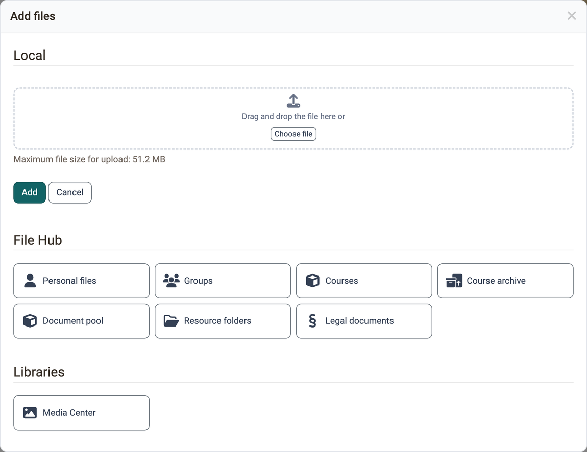
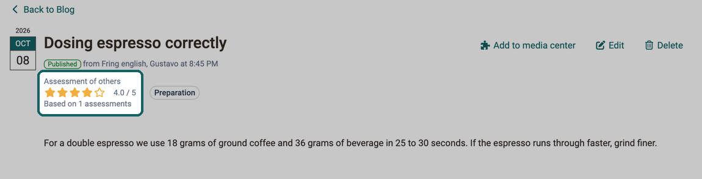

# Blogging {: #blog_blogging}

If a blog is embedded in a course that the participants can open, that is a course with the status ["Published"](Access_configuration.md), participants and [coaches](../basic_concepts/Roles/index.md#coach) work with it: they read entries (blog posts), write their own, comment on them and rate them. This is called blogging. The user interface sometimes speaks of posts or items, for example with the user right "Create items". This always means the entries.

What participants and coaches may do in the blog is defined by the [owners](../basic_concepts/Roles/index.md#owner) of the course in the course element "Blog", the item of the blog in the course menu. The user right "Create items" determines who writes their own entries, the user right "Moderator" who edits and deletes all entries, see [Configure a blog in the course element](Blog_Configuration.md#blog_configuration_permissions). If a period ("Start date", "End date") limits the user right, it only applies during this time. The "Add entry" button is therefore only visible to persons who currently have one of these user rights and to the owners of the course. A blog that the course offers via the [toolbar](Course_Settings_Toolbar.md#blog) at the top of the course is not controlled by a course element: there, owners and coaches of the course create and moderate the entries.

!!! note "Quick Links"

    Depending on your user rights, as a participant or coach you can

    * [View and read entries](#blog_blogging_read_posts)
    * [Add and edit entries](#blog_blogging_add_posts)
    * [Delete entries](#blog_blogging_delete_posts)
    * [Comment on entries](#blog_blogging_comment_posts)
    * [Rate entries](#blog_blogging_assess_posts)
    * [Moderate a blog](#blog_blogging_moderate)
    * [Subscribe to entries](#blog_blogging_abo)
    * [Store entries in the Media Center](#blog_blogging_media_center)

## View and read entries {: #blog_blogging_read_posts}

You open a blog in the course menu on the left with a click on its course element, a blog for the whole course with the blog icon in the [toolbar](Course_Settings_Toolbar.md#blog). Then select the entry that interests you.

To switch between "List view" and "Table view", use the buttons on the right above the list.

With the "Timeline & Tags" toggle you additionally show and hide a timeline and the tags of the entries to the right of the list.

Filters are available above the list to limit the displayed entries: "All", "My entries" and "Drafts".

!!! info "Important"

    If you only have read access in the blog, for example as a participant without the user right "Create items", only the filter "All" is available to you [:octicons-tag-16:{ title="from Release 20.3.0 (OO-9220)" }](https://track.frentix.com/issue/OO-9220){:target="_blank"}.

{ class="shadow lightbox" title="Blog in the course view · 2026.10.08" }

!!! note "Note"

    A blog learning resource can also be used standalone, without a course, see [Function concept courses and learning resources](General_Functions_Concept.md). Once it is [shared](Access_configuration.md), people then open it, for example, via a link in an e-mail or via the [catalog](../area_modules/catalog2.0/index.md). You can also send a direct link to a single course element, such as the blog, in an e-mail. You copy the link from the address bar of your browser while the course element is open.

[To the top of the page ^](#blog_blogging)

## Add and edit entries {: #blog_blogging_add_posts}

!!! tip "Requirements"

    As a participant or coach, you write your own entries if the owners of the course have given you the user right "Create items" or "Moderator" in the course element and a period set there ("Start date", "End date") currently applies, see [Configure a blog in the course element](../learningresources/Blog_Configuration.md#create_entries). 
    In the blog of the toolbar, only owners and coaches of the course write entries. 
    If the learning resource embeds an external blog via URL, that is a blog that someone runs outside of OpenOlat, its entries are created there and are also edited there.

You add your own entry with the "Add entry" button. To edit it, select "Edit" in the menu with the three dots at the entry in the list. Or open the entry with a click on its title and click "Edit" there.

When adding or editing an entry, you fill in the following fields.

#### Title {: #entry_title}

Enter a title that describes the entry. This field is mandatory.

#### Tags {: #entry_tags}

Optionally, assign tags to the entry. You select an existing tag or create a new one. With the "Timeline & Tags" toggle, the tags appear next to the list of entries.

#### Content {: #entry_content}

The content is the actual text of the entry. Unlike the title, OpenOlat does not require it. Formatting and images are permitted. To use them, switch from "Multi-line" to "Formatted" at the top right of the field. You write the content in the same HTML editor as in the course element "HTML page", but here without the "Table" menu. How to arrange several images side by side is described in the section [Several images side by side](Course_Element_HTML_Page.md#images_side_by_side).

{ class="shadow lightbox" title="Published entry" }

#### Summary {: #entry_summary}

The summary is optional. OpenOlat shows it as a preview of the entry, so it can also be a short introduction.

#### Audio or video file {: #entry_media_file}

Optionally, attach a file in the formats MP3, MP4, M4V, M4A or AAC to the entry. For a video, OpenOlat prefills "Width" and "Height" with the values from the file when uploading.

#### Time and date of publication {: #entry_publication_date}

With the date and time of publication you define from when others see the entry. If the time is in the past, the entry is visible. If it is in the future, the publication is planned.

With "Publish" you make the entry accessible to others from the date specified. If you want to continue working on your entry at a later date, click on "Save draft". "Cancel" discards your changes and closes the form window. In the list of entries, a colored label shows the status: "Draft" in yellow, "Planned" in blue for a publication in the future and "Published" in green. Published entries are visible to others.

[To the top of the page ^](#blog_blogging)

## Delete entries {: #blog_blogging_delete_posts}

"Delete" appears on the entry for your own entries, and as a moderator or owner of the course for all entries.

In the table view, you delete several entries at once with a mass action. To do this, select the checkboxes in the first column and click "Delete". Filters and search help you find specific entries.

[To the top of the page ^](#blog_blogging)

## Comment on entries {: #blog_blogging_comment_posts}

If the option "Posts are commentable" is switched on in the blog learning resource under `Blog > Administration > Settings > Tab "Options"`, all persons except guests comment on the entries with a text and attach files, see [Blog: Administration](Blog_Administration.md#tab_options). This option is set by the owners of the blog learning resource.

To write a comment or read existing comments, click in the comment line. A small text editor opens. Click the "Comment" button to send the comment.

{ class="shadow lightbox" title="Comments below an entry · 2026.10.08" }

With "Attach file" you attach a file to your comment. In the "Add files" dialog, upload a file from your computer under "Local" or select a file from the ["File Hub"](../basic_concepts/File_Hub_Concept.md) or from the ["Media Center"](../basic_concepts/Media_Center_Concept/index.md).

{ class="shadow lightbox" title="Add files dialog · 2026.10.08" }

[To the top of the page ^](#blog_blogging)

## Rate entries {: #blog_blogging_assess_posts}

If the option "Posts are rateable" is switched on in the blog learning resource, all persons except guests rate the entries with 1 to 5 stars. 
The stars first show the ratings of the others. Move your mouse over the stars and click the star of your own rating.

{ class="shadow lightbox" title="Entry in the course view · 2026.10.08" }

[To the top of the page ^](#blog_blogging)

## Moderating a blog {: #blog_blogging_moderate}

Moderating means intervening in a communication to steer it. In the blog, moderators check whether the entries are appropriate and correct or delete them if necessary. Moderators of an OpenOlat blog read, comment on, edit and delete all entries and create new ones. The title and description of the whole blog are maintained by the owners in the blog learning resource, see [Blog: Administration](Blog_Administration.md#tab_info).

As an owner of the course, you always moderate. In the course element, you additionally grant the user right "Moderator" to coaches or specifically to individual persons, see [Configure a blog in the course element](../learningresources/Blog_Configuration.md#moderator).

!!! info "Important"

    Only moderators and owners of the course delete entries from a blog that someone imported as a file, for example with "Import" in the course element. The entries still show the original authors as creators.

[To the top of the page ^](#blog_blogging)

## Subscribe to entries [:octicons-tag-16:{ title="from Release 11.5 (OO-1620)" }](https://track.frentix.com/issue/OO-1620) {: #blog_blogging_abo}

With a subscription you do not miss any new entries. OpenOlat collects the news of all your subscriptions in the personal menu under [Subscriptions](../personal_menu/Subscriptions.md). How to set up subscriptions is shown in the video [Set up subscriptions](https://www.youtube.com/embed/h9gOqt7TR7Q) (German).

If you would like to be notified as soon as a new entry is added, subscribe to the blog as a whole. To do this, use the bell icon "Subscribe" on the right above the list of entries.
If you only want to be notified of new comments on the entries, select "Only subscribe for comments" at the bell icon.

On the left above the list of entries, the "RSS" button opens the address of the blog's RSS feed. Via this address, a feed reader, a program for following websites, fetches the new entries. The address belongs to your account because it contains a personal key. It is therefore intended for your own feed reader.

If you would like to pass on the direct link to an individual entry, you can copy the URL from your browser window. The direct link will be displayed there.

[To the top of the page ^](#blog_blogging)

## Store entries in the Media Center {: #blog_blogging_media_center}

You can also store your own entries in the [Media Center](../basic_concepts/Media_Center_Concept/index.md) and reuse them from there across courses. If the Portfolio module is switched on in OpenOlat, the "Add to Media Center" button appears on your own entries for this purpose.

[To the top of the page ^](#blog_blogging)

## Further information {: #further_information}

**Mentioned on this page** 
[Access configuration >](Access_configuration.md) 
[Roles and Rights: Which roles are available? >](../basic_concepts/Roles/index.md) 
[Configure a blog in the course element >](../learningresources/Blog_Configuration.md) 
[Toolbar >](Course_Settings_Toolbar.md) 
[Function concept courses and learning resources >](General_Functions_Concept.md) 
[Catalog 2.0: Overview >](../area_modules/catalog2.0/index.md) 
[Course Element "HTML page" >](../learningresources/Course_Element_HTML_Page.md) 
[Blog: Administration >](Blog_Administration.md) 
[File Hub Concept >](../basic_concepts/File_Hub_Concept.md) 
[Media Center Concept >](../basic_concepts/Media_Center_Concept/index.md) 
[User tools: Subscriptions >](../personal_menu/Subscriptions.md)

**Further reading** 
[Blog: Overview >](Blog/index.md) 
[Create a blog >](../learningresources/Blog_Create.md) 
[How do I create a blog? >](../../manual_how-to/blog/blog.md)

**youtube** 
[Set up subscriptions](<https://www.youtube.com/embed/h9gOqt7TR7Q>) (German)

[To the top of the page ^](#blog_blogging)

