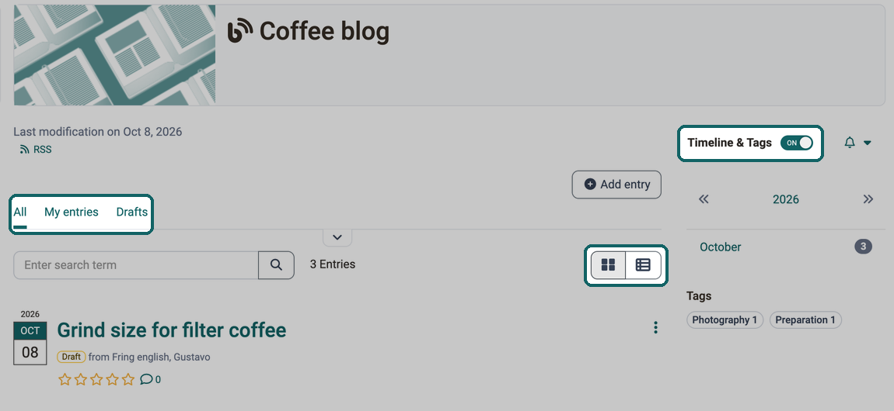
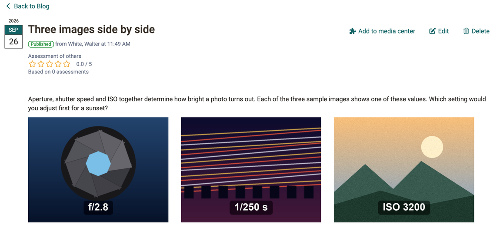
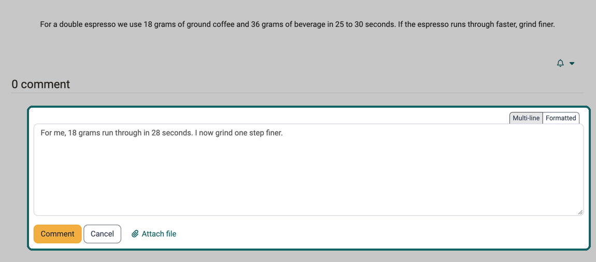

# Blogging {: #blog_blogging}

If a blog is embedded in a published course, participants and coaches work with it: they read posts, write their own, comment on them and rate them. This is called blogging.

What participants and coaches may do in the blog is defined by the owners of the course in the course element. The user right "Create items" determines who writes their own posts, the user right "Moderator" who edits and deletes all posts, see [Configure a blog in the course element](Blog_Configuration.md#blog_configuration_permissions). The "Add entry" button is therefore only visible to persons with one of these user rights and to the owners of the course. In the blog of the toolbar, owners and coaches of the course create and moderate the posts.

!!! note "Quick Links"

    Depending on your user rights, as a participant or coach you can

    * [View and read posts](#blog_blogging_read_posts)
    * [Add and edit posts](#blog_blogging_add_posts)
    * [Delete posts](#blog_blogging_delete_posts)
    * [Comment on posts](#blog_blogging_comment_posts)
    * [Assess posts](#blog_blogging_assess_posts)
    * [Moderate a blog](#blog_blogging_moderate)
    * [Subscribe to posts](#blog_blogging_abo)
    * [Store posts in the Media Center](#blog_blogging_media_center)

## View and read posts {: #blog_blogging_read_posts}

You open a blog in the course menu on the left with a click on its course element, a blog for the whole course with the blog icon in the [toolbar](Course_Settings_Toolbar.md#blog). Then select the post that interests you.

To switch between "List view" and "Table view", use the buttons on the right above the list.

With the "Timeline & Tags" toggle you additionally show and hide a timeline and the tags of the entries to the right of the list.

Filters are available above the list to limit the displayed posts: "All", "My entries" and "Drafts".

!!! info "Important"

    If you only have read access in the blog, for example as a participant without the user right "Create items", only the filter "All" is available to you [:octicons-tag-16:{ title="from Release 20.3.0 (OO-9220)" }](https://track.frentix.com/issue/OO-9220){:target="_blank"}.

{ class="shadow lightbox" title="Blog in the course view · 2026.10.08" }

!!! note "Note"

    A blog learning resource can also be used standalone, without a course. Once it is shared, people then open it, for example, via a link in an e-mail or via the catalog. You can also send a direct link to a single course element, such as the blog, in an e-mail.

[To the top of the page ^](#blog_blogging)

## Add and edit posts {: #blog_blogging_add_posts}

!!! tip "Requirements"

    As a participant or coach, you write your own posts if the owners of the course have given you the user right "Create items" or "Moderator" in the course element and a period set there ("Start date", "End date") currently applies, see [Configure a blog in the course element](../learningresources/Blog_Configuration.md#create_entries). 
    The posts of an external blog that the learning resource embeds via URL are created outside of OpenOlat and are edited there.

You add your own entry with the "Add entry" button. To reopen and edit, select "Edit" in the menu with the three dots or click on the title in the list view. In the course view, you will find an "Edit" link for each of your contributions.

When adding or editing an entry, you fill in the following fields.

#### Title {: #entry_title}

Enter a title that describes the blog entry. This field is mandatory.

#### Tags {: #entry_tags}

Optionally, assign tags to the entry. You select an existing tag or create a new one. With the "Timeline & Tags" toggle, the tags appear next to the list of entries.

#### Content {: #entry_content}

The content is the actual blog entry, so always fill in this field. Formatting and images are permitted. To use them, switch from "Multi-line" to "Formatted" at the top right of the field. You write the content in the same HTML editor as in the course element "HTML page", but here without the "Table" menu. How to arrange several images side by side is described in the section [Several images side by side](Course_Element_HTML_Page.md#images_side_by_side).

{ class="shadow lightbox" title="Published blog entry" }

#### Summary {: #entry_summary}

The summary is optional. OpenOlat shows it as a preview of the entry, so it can also be a short introduction.

#### Audio or video file {: #entry_media_file}

Optionally, attach a file in the formats MP3, MP4, M4V, M4A or AAC to the entry. For a video, OpenOlat prefills "Width" and "Height" with the values from the file when uploading.

#### Time and date of publication {: #entry_publication_date}

With the date and time of publication you define from when other participants see the entry. If the time is in the past, the entry is visible. If it is in the future, the publication is planned.

With "Publish" you make the entry accessible to others from the date specified. If you want to continue working on your entry at a later date, click on "Save draft". "Cancel" discards your changes and closes the form window. In the list of entries, a colored label shows the status: "Draft" in yellow, "Planned" in blue for a publication in the future and "Published" in green. Published entries are visible to others.

[To the top of the page ^](#blog_blogging)

## Delete posts {: #blog_blogging_delete_posts}

"Delete" appears on the post for your own posts, and as a moderator or owner of the course for all posts.

In the table view, you delete several posts at once with a mass action. To do this, select the checkboxes in the first column and click "Delete". Filters and search help you find specific posts.

[To the top of the page ^](#blog_blogging)

## Comment on posts {: #blog_blogging_comment_posts}

If "Posts are commentable" is switched on in the blog learning resource, course members comment on blog posts with a text and attach files, see [Blog: Administration](Blog_Administration.md#tab_options).

To write a comment or read existing comments, click in the comment line. A small text editor opens. Click the "Comment" button to send the comment.

{ class="shadow lightbox" title="Comments below a blog post · 2026.10.08" }

With "Attach file" you attach a file to your comment. In the "Add files" dialog, upload a file from your computer under "Local" or select a file from the "File Hub" or from the "Media Center".

{ class="shadow lightbox" title="Add files dialog · 2026.10.08" }

[To the top of the page ^](#blog_blogging)

## Assess posts {: #blog_blogging_assess_posts}

If "Posts are rateable" is switched on in the blog learning resource, course members rate posts with 1 to 5 stars. 
The stars first show the ratings of the other readers. Move your mouse over the stars and click the star of your own rating.

{ class="shadow lightbox" title="Blog post in the course view · 2026.10.08" }

[To the top of the page ^](#blog_blogging)

## Moderating a blog {: #blog_blogging_moderate}

Moderating means intervening in a communication to steer it. In the blog, moderators check whether the posts are appropriate and correct or delete them if necessary. Moderators of an OpenOlat blog read, comment on, edit and delete all entries and create new ones. With the "Edit blog" button they also adjust the title and description of the whole blog.

Owners of the course always moderate. In the course element, you additionally grant the user right "Moderator" to coaches or specifically to individual persons, see [Configure a blog in the course element](../learningresources/Blog_Configuration.md#moderator).

!!! info "Important"

    Only moderators and owners of the course delete blog entries from a blog that was imported as a file. The posts still show the original authors as creators.

[To the top of the page ^](#blog_blogging)

## Subscribe to posts [:octicons-tag-16:{ title="from Release 11.5 (OO-1620)" }](https://track.frentix.com/issue/OO-1620) {: #blog_blogging_abo}

With a subscription you do not miss any new entries. How to set up subscriptions is shown in the video [Set up subscriptions](https://www.youtube.com/embed/h9gOqt7TR7Q) (German).

If you would like to be notified as soon as a new post is added, subscribe to the blog as a whole. To do this, use the bell icon "Subscribe" on the right above the list of entries.
If you only want to be notified of new comments on the blog entries, select "Only subscribe for comments" at the bell icon.

If you would like to pass on the link to the blog, you will find the link on the left above the list of posts under "RSS".

If you would like to pass on the direct link to an individual post, you can copy the URL from your browser window. The direct link will be displayed there.

[To the top of the page ^](#blog_blogging)

## Store posts in the Media Center {: #blog_blogging_media_center}

As the author of a post, you can also store your blog posts in the Media Center. The "Add to Media Center" button appears on your own posts for this purpose.

[To the top of the page ^](#blog_blogging)

## Further information {: #further_information}

**Mentioned on this page** 
[Configure a blog in the course element >](../learningresources/Blog_Configuration.md) 
[Toolbar >](Course_Settings_Toolbar.md) 
[Course Element "HTML page" >](../learningresources/Course_Element_HTML_Page.md) 
[Blog: Administration >](Blog_Administration.md)

**Further reading** 
[Blog: Overview >](Blog/index.md) 
[Create a blog >](../learningresources/Blog_Create.md) 
[How do I create a blog? >](../../manual_how-to/blog/blog.md)

**youtube** 
[Set up subscriptions](<https://www.youtube.com/embed/h9gOqt7TR7Q>) (German)

[To the top of the page ^](#blog_blogging)

