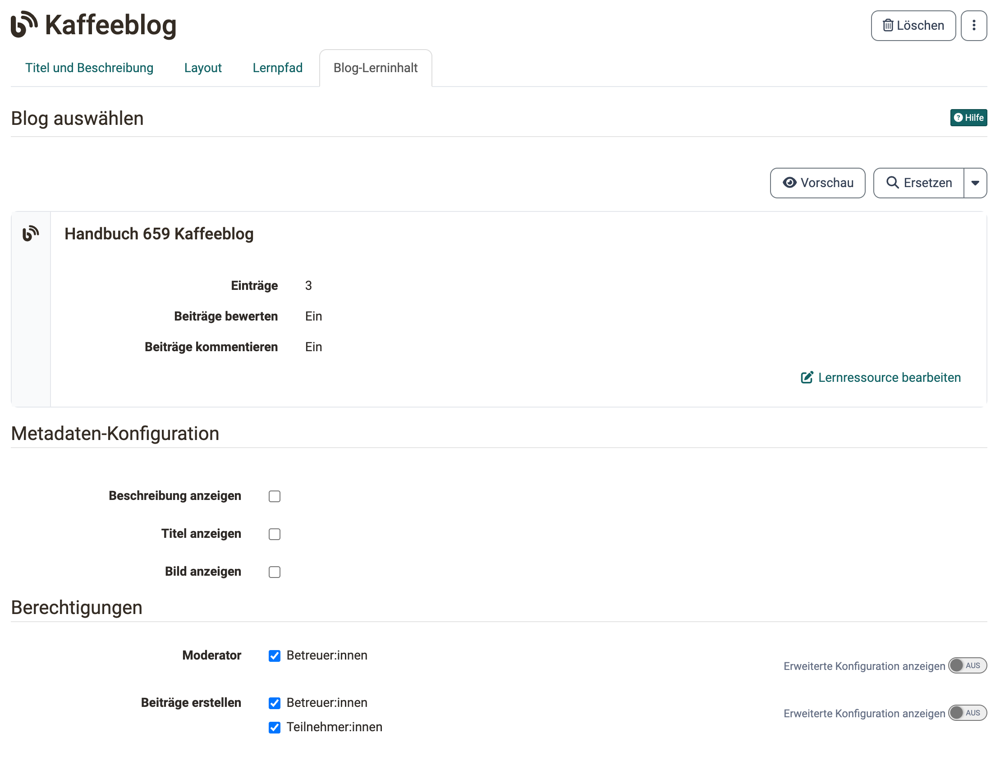
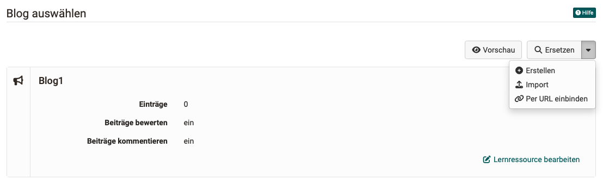
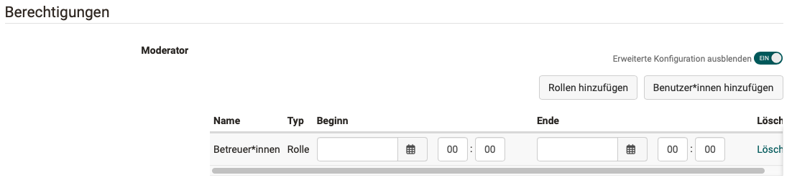
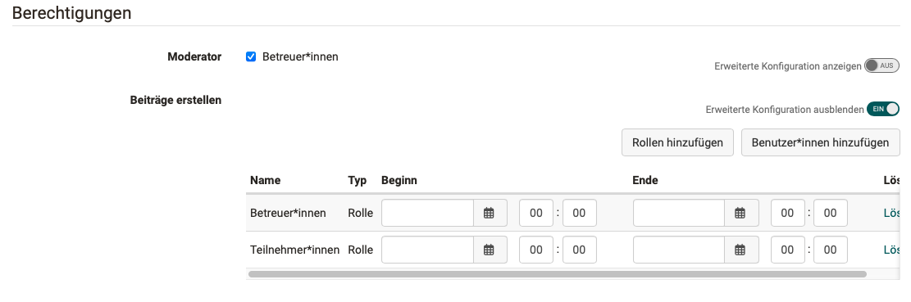

# Blog im Kursbaustein konfigurieren {: #blog_configuration}

Einen Blog konfigurieren Sie an zwei Orten: im Kursbaustein und in der Lernressource. Im Kursbaustein legen Sie fest, welcher Blog im Kurs erscheint und wer darin moderiert und Beiträge erstellt. Diese Seite beschreibt den Kursbaustein. Was für den Blog in allen Kursen gilt, legen Sie in der Lernressource fest, siehe [Blog: Administration](Blog_Administration.de.md).

## Konfiguration im Kursbaustein "Blog" {: #blog_configuration_course_element}

Nachdem Sie im Kurseditor einen Kursbaustein "Blog" eingefügt haben, finden Sie die Konfigurationen zu Lernressource und Berechtigungen im Tab "Blog-Lerninhalt" des Kursbausteins.

Die Darstellung des Kursbausteins legen Sie im Tab "Layout" fest. Wer den Kursbaustein wann sieht und öffnen kann, steuern Sie je nach Kurstyp in den Tabs "Sichtbarkeit" und "Zugang" (herkömmliche Kurse) bzw. im Tab "Lernpfad" (Lernpfadkurse).

{ class="shadow lightbox" title="Tab Blog-Lerninhalt im Kurseditor · 2026.11.06" }

### Blog auswählen

Ist dem Kursbaustein noch kein Blog zugewiesen, wählen Sie einen der vier Wege:

* **Auswählen:** Sie wählen eine vorhandene Blog-Lernressource aus dem Autorenbereich.
* **Erstellen:** Sie erstellen eine neue Blog-Lernressource.
* **Import:** Sie importieren einen Blog, der als Datei vorliegt.
* **Per URL einbinden:** Sie binden einen externen Blog ein.

Einen externen Blog binden Sie mit "Per URL einbinden" über die Adresse seines Feeds ein. Der Feed muss über das öffentliche Internet erreichbar sein, denn OpenOlat ruft ihn vom Server aus ab. Ist in der System-Administration unter `Administration > Login > Sicherheit` der Schutz "SSRF Mitigation" eingeschaltet, ruft OpenOlat keinen Feed aus dem lokalen Netz ab, etwa von einem Server im Netz Ihrer Organisation, siehe [Sicherheit](../../manual_admin/administration/Login_Security.de.md#ssrf). [:octicons-tag-16:{ title="ab Release 21.1 (OO-9310)" }](https://track.frentix.com/issue/OO-9310){:target="_blank"}

Ist ein Blog zugewiesen, tauschen Sie ihn mit "Ersetzen" gegen eine andere Blog-Lernressource aus. Mit "Vorschau" sehen Sie sich den Blog an, mit "Lernressource bearbeiten" öffnen Sie die Blog-Lernressource direkt. Über den Pfeil neben "Ersetzen" setzen Sie an die Stelle des Blogs einen neu erstellten, importierten oder per URL eingebundenen Blog.

Der Kasten des zugewiesenen Blogs zeigt die Anzahl Einträge, bei einem externen Blog die URL, und ob "Beiträge bewerten" und "Beiträge kommentieren" eingeschaltet sind. Diese Optionen legen Sie in der Lernressource im Tab "Optionen" fest, siehe [Blog: Administration](Blog_Administration.de.md#tab_options).

{ class="shadow lightbox" title="Bereich Blog auswählen im Tab Blog-Lerninhalt" }

!!! info "Wichtig"

    Einen externen Blog binden Sie ein, wenn Sie bereits unabhängig von OpenOlat einen Blog führen oder einen bekannten Blog als Inhalt oder Diskussionsgrundlage in Ihren Kurs holen wollen. Die Beiträge entstehen dann im externen Blog. In OpenOlat bewerten Sie sie mit Sternen und kommentieren sie.

    Eine Blog-Lernressource enthält entweder eigene Beiträge oder einen externen Blog. Die Art legen Sie beim Erstellen der Lernressource fest und ändern sie danach nicht mehr. Für einen Wechsel ersetzen Sie im Kursbaustein die Lernressource mit "Ersetzen".

### Metadaten-Konfiguration

Mit "Beschreibung anzeigen", "Titel anzeigen" und "Bild anzeigen" legen Sie fest, welche Angaben der Blog-Lernressource der Kursbaustein zeigt. Die Angaben selbst pflegen Sie in der Lernressource unter `Blog > Administration > Einstellungen > Info`, siehe [Blog: Administration](Blog_Administration.de.md#tab_info).

### Berechtigungen [:octicons-tag-16:{ title="ab Release 15.0 (OO-4417)" }](https://track.frentix.com/issue/OO-4417) {: #blog_configuration_permissions}

Im Bereich "Berechtigungen" legen Sie fest, wer den Blog moderiert und wer Beiträge erstellt. So nutzen Sie den Blog, um die Teilnehmenden zu informieren, oder Sie öffnen ihn als gemeinsamen Blog, in dem die Teilnehmenden selbst schreiben. Besitzer:innen des Kurses haben im Blog immer alle Rechte. Gäste lesen den Blog nur.

Weil dieselbe Blog-Lernressource in mehreren Kursen und Kursbausteinen eingebunden sein kann, gelten die Berechtigungen je Kursbaustein. Im einen Kurs moderieren so zum Beispiel die Betreuer:innen, im anderen nicht.

#### Moderator {: #moderator}

Moderator:innen bearbeiten und löschen alle Beiträge des Blogs und erstellen selbst Beiträge, siehe [Bloggen](../learningresources/Blog_Blogging.de.md#blog_blogging_moderate). Ihre eigenen Beiträge bearbeiten und löschen alle Autor:innen selbst.

Mit der Checkbox "Betreuer:innen" übertragen Sie das Recht den Betreuer:innen des Kurses. Bei einem neuen Kursbaustein ist die Checkbox eingeschaltet. Besitzer:innen des Kurses moderieren immer, unabhängig von der Checkbox.

Mit "Erweiterte Konfiguration anzeigen" vergeben Sie das Recht gezielt. Mit "Rollen hinzufügen", "Benutzer:innen hinzufügen" und "Gruppen hinzufügen" nehmen Sie eine Rolle, einzelne Personen unabhängig von ihrer Rolle oder Gruppen des Kurses auf. Mit "Beginn" und "Ende" begrenzen Sie das Recht je Eintrag auf einen Zeitraum, mit "Löschen" entfernen Sie einen Eintrag. "Gruppen hinzufügen" erscheint, sobald der Kurs Gruppen hat.

{ class="shadow lightbox" title="Bereich Berechtigungen im Tab Blog-Lerninhalt" }

#### Beiträge erstellen {: #create_entries}

Wer im Blog Beiträge erstellt, legen Sie mit den Checkboxen "Betreuer:innen" und "Teilnehmer:innen" fest. Bei einem neuen Kursbaustein sind beide eingeschaltet. Besitzer:innen des Kurses und Moderator:innen erstellen immer Beiträge.

"Beiträge erstellen" erscheint, sobald dem Kursbaustein ein Blog zugewiesen ist.

!!! info "Wichtig"

    Wird ein externer Blog eingebunden, entstehen seine Beiträge ausserhalb von OpenOlat. "Beiträge erstellen" erscheint deshalb in diesem Fall nicht.

Mit "Erweiterte Konfiguration anzeigen" nehmen Sie auch hier Rollen, einzelne Personen oder Gruppen auf und begrenzen das Recht je Eintrag mit "Beginn" und "Ende" auf einen Zeitraum.

{ class="shadow lightbox" title="Bereich Berechtigungen im Tab Blog-Lerninhalt" }

!!! info "Wichtig"

    In älteren Kursbausteinen steuern noch Zugangsregeln die Rechte. Dann fehlt der Bereich "Berechtigungen", und der Kursbaustein zeigt den Tab "Zugang" mit "Moderieren", "Lesen und Schreiben" und "Nur Lesen". Mit "Löschen" entfernen Sie die Zugangsregeln und arbeiten mit den Berechtigungen in diesem Abschnitt weiter.

## Einstellungen der Blog-Lernressource {: #learningresource_settings}

Ob Beiträge bewertet und kommentiert werden können und wer bei neuen Kommentaren eine E-Mail erhält, legen Sie in der Lernressource unter `Blog > Administration > Einstellungen` fest. Diese Einstellungen gelten in allen Kursen, die den Blog einbinden. Die Tabs beschreibt die Seite [Blog: Administration](Blog_Administration.de.md).

## Weiterführende Informationen {: #further_information}

**Auf dieser Seite erwähnt** 
[Blog: Administration >](Blog_Administration.de.md) 
[Sicherheit >](../../manual_admin/administration/Login_Security.de.md) 
[Bloggen >](../learningresources/Blog_Blogging.de.md)

**Weiterführend** 
[Blog erstellen >](../learningresources/Blog_Create.de.md) 
[Wie erstelle ich einen Blog? >](../../manual_how-to/blog/blog.de.md) 
[Kursbaustein "Blog" >](../learningresources/Course_Element_Blog.de.md) 
[Blog: Übersicht >](Blog/index.de.md) 
[Zugangskonfiguration / Freigabe >](../learningresources/Access_configuration.de.md) 
[Mitgliederverwaltung >](../learningresources/Members_management.de.md)

[Zum Seitenanfang ^](#blog_configuration)

