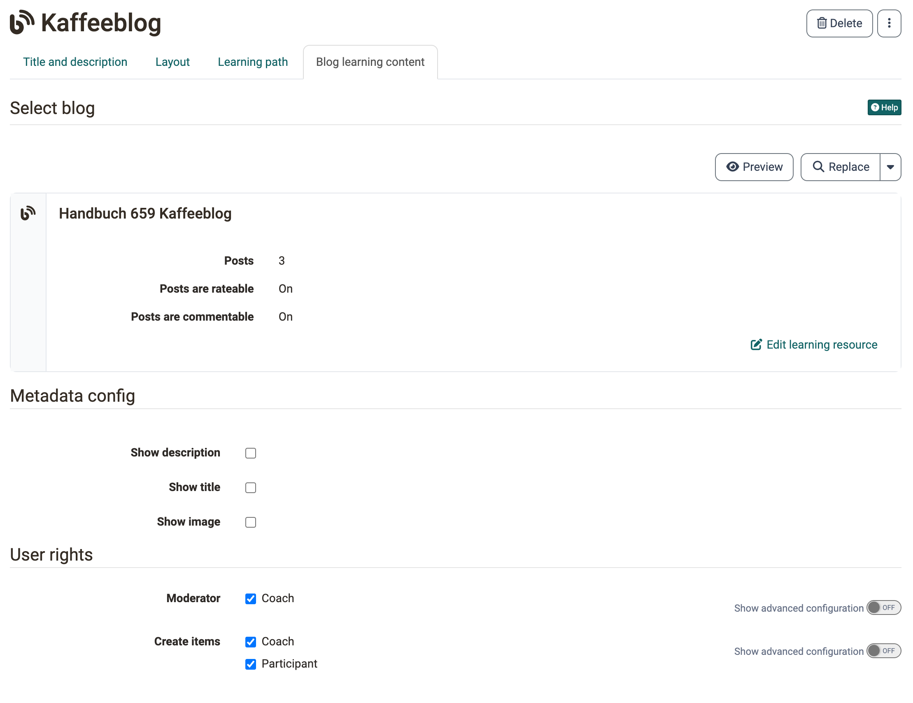
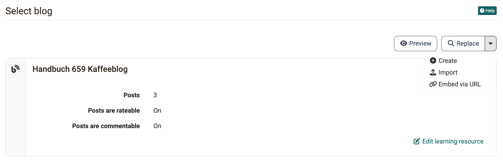
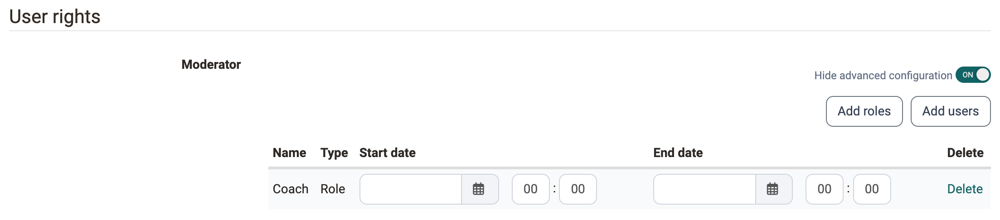
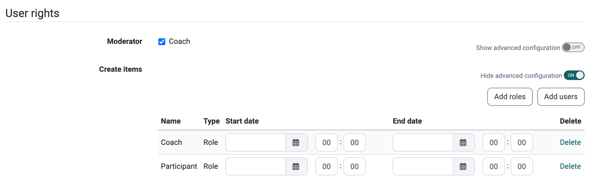

# Configure a blog in the course element {: #blog_configuration}

You configure a blog in two places: in the course element and in the learning resource. In the course element you define which blog appears in the course and who moderates it and creates posts. This page describes the course element. What applies to the blog in all courses, you define in the learning resource, see [Blog: Administration](Blog_Administration.md).

## Configuration in the "Blog" course element {: #blog_configuration_course_element}

After you have inserted a course element "Blog" in the course editor, you will find the configurations for the learning resource and user rights in the tab "Blog learning content" of the course element.

You define the display of the course element in the tab "Layout". Who sees and can open the course element when is controlled, depending on the course type, in the tabs "Visibility" and "Access" (conventional courses) or in the tab "Learning path" (learning path courses).

{ class="shadow lightbox" title="Blog learning content tab in the course editor · 2026.11.06" }

### Select blog

If no blog is assigned to the course element yet, you choose one of four ways:

* **Select:** You select an existing blog learning resource from the authoring area.
* **Create:** You create a new blog learning resource.
* **Import:** You import a blog that is available as a file.
* **Embed via URL:** You embed an external blog.

You embed an external blog with "Embed via URL" through the address of its feed. The feed must be reachable via the public internet, because OpenOlat retrieves it from the server. If the "SSRF mitigation" protection is switched on in the system administration under `Administration > Login > Security`, OpenOlat does not retrieve a feed from the local network, for example from a server in the network of your organisation, see [Security](../../manual_admin/administration/Login_Security.md#ssrf). [:octicons-tag-16:{ title="from Release 21.1 (OO-9310)" }](https://track.frentix.com/issue/OO-9310){:target="_blank"}

Once a blog is assigned, you exchange it for another blog learning resource with "Replace". With "Preview" you look at the blog, with "Edit learning resource" you open the blog learning resource directly. With the arrow next to "Replace" you put a newly created, imported or via URL embedded blog in place of the blog.

The box of the assigned blog shows the number of posts, for an external blog the URL, and whether "Posts are rateable" and "Posts are commentable" are switched on. You define these options in the learning resource in the tab "Options", see [Blog: Administration](Blog_Administration.md#tab_options).

{ class="shadow lightbox" title="Select blog section in the Blog learning content tab · 2026.11.06" }

!!! info "Important"

    You embed an external blog if you already run a blog independently of OpenOlat or if you want to bring a well-known blog into your course as content or a basis for discussion. The posts are then created in the external blog. In OpenOlat you rate them with stars and comment on them.

    A blog learning resource contains either its own posts or an external blog. You set the type when you create the learning resource and cannot change it afterwards. To switch, replace the learning resource in the course element with "Replace".

### Metadata configuration

With "Show description", "Show title" and "Show image" you define which information of the blog learning resource the course element shows. You maintain the information itself in the learning resource under `Blog > Administration > Settings > Info`, see [Blog: Administration](Blog_Administration.md#tab_info).

### User rights [:octicons-tag-16:{ title="from Release 15.0 (OO-4417)" }](https://track.frentix.com/issue/OO-4417) {: #blog_configuration_permissions}

In the section "User rights" you define who moderates the blog and who creates posts. This way you use the blog to inform the participants, or you open it as a shared blog in which the participants write themselves. Owners of the course always have all rights in the blog. Guests only read the blog.

Because the same blog learning resource can be embedded in several courses and course elements, the user rights apply per course element. In one course, for example, the coaches moderate, in the other they do not.

#### Moderator {: #moderator}

Moderators edit and delete all posts of the blog and create posts themselves, see [Blogging](../learningresources/Blog_Blogging.md#blog_blogging_moderate). All authors edit and delete their own posts themselves.

With the checkbox "Coach" you grant the right to the coaches of the course. For a new course element the checkbox is switched on. Owners of the course always moderate, regardless of the checkbox.

With "Show advanced configuration" you grant the right specifically. With "Add roles", "Add users" and "Add groups" you add a role, individual persons regardless of their role, or groups of the course. With "Start date" and "End date" you limit the right per entry to a period, with "Delete" you remove an entry. "Add groups" appears as soon as the course has groups.

{ class="shadow lightbox" title="User rights section in the Blog learning content tab · 2026.11.06" }

#### Create items {: #create_entries}

You define who creates posts in the blog with the checkboxes "Coach" and "Participant". For a new course element both are switched on. Owners of the course and moderators always create posts.

"Create items" appears as soon as a blog is assigned to the course element.

!!! info "Important"

    If an external blog is embedded, its posts are created outside of OpenOlat. "Create items" is therefore not displayed in this case.

With "Show advanced configuration" you also add roles, individual persons or groups here and limit the right per entry with "Start date" and "End date" to a period.

{ class="shadow lightbox" title="User rights section in the Blog learning content tab · 2026.11.06" }

!!! info "Important"

    In older course elements, access rules still control the rights. Then the section "User rights" is missing, and the course element shows the tab "Access" with "Moderate", "Read and write" and "Read only". With "Delete" you remove the access rules and continue with the user rights in this section.

## Settings of the blog learning resource {: #learningresource_settings}

Whether posts can be rated and commented on and who receives an e-mail for new comments, you define in the learning resource under `Blog > Administration > Settings`. These settings apply in all courses that embed the blog. The tabs are described on the page [Blog: Administration](Blog_Administration.md).

## Further information {: #further_information}

**Mentioned on this page** 
[Blog: Administration >](Blog_Administration.md) 
[Security >](../../manual_admin/administration/Login_Security.md) 
[Blogging >](../learningresources/Blog_Blogging.md)

**Further** 
[Create a blog >](../learningresources/Blog_Create.md) 
[How do I create a blog? >](../../manual_how-to/blog/blog.md) 
[Course Element "Blog" >](../learningresources/Course_Element_Blog.md) 
[Blog: Overview >](Blog/index.md) 
[Access configuration >](../learningresources/Access_configuration.md) 
[Members management >](../learningresources/Members_management.md)

[To the top of the page ^](#blog_configuration)