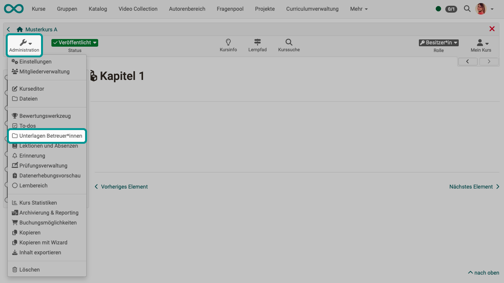

# Unterlagen Betreuer:innen {: #coach_files}

Für Betreuer:innen kann ein gemeinsamer Ordner zur Ablage von Dateien eingerichtet werden. Den Ordner öffnen Betreuer:innen und Besitzer:innen des Kurses, ausserdem Personen mit dem Recht "Kurseditor".

{ class="shadow lightbox" title="Menü Administration eines Kurses" }

Damit der Eintrag "Unterlagen Betreuer:innen" im Menü "Administration" des Kurses erscheint, schalten Besitzer:innen des Kurses zuerst unter `Kurs > Administration > Einstellungen > Tab "Optionen"` die Option "Unterlagen Betreuer:innen Ordner" ein.

Unter "Ablageort" wählen sie dort, wo der Ordner liegt: "Automatisch generierter Ordner" legt einen neuen Ordner im [Ablageordner](Storage_folder.de.md) des Kurses an, "Ordner aus Ablageordner des Kurses verwenden" nimmt einen bestehenden Ordner. In beiden Fällen öffnen Betreuer:innen über den Menüeintrag nur diesen Ordner, nicht die übrigen Dateien des Ablageordners.

Besitzer:innen des Kurses und Personen mit Zugriff auf den Kurseditor sehen den ganzen Ablageordner. Beim automatisch generierten Ordner finden sie die Dateien der Betreuer:innen dort im Ordner "_coachdocuments". Sie können diese Dateien in Kursbausteinen verknüpfen, etwa in einer Einzelseite. Betreuer:innen können das über diesen Ordner nicht.

[Zum Seitenanfang ^](#coach_files)

## Weiterführende Informationen {: #further_information}

[Ablageordner >](Storage_folder.de.md) 
[Kurseinstellungen - Tab Optionen >](Course_Settings_Options.de.md)

[Zum Seitenanfang ^](#coach_files)