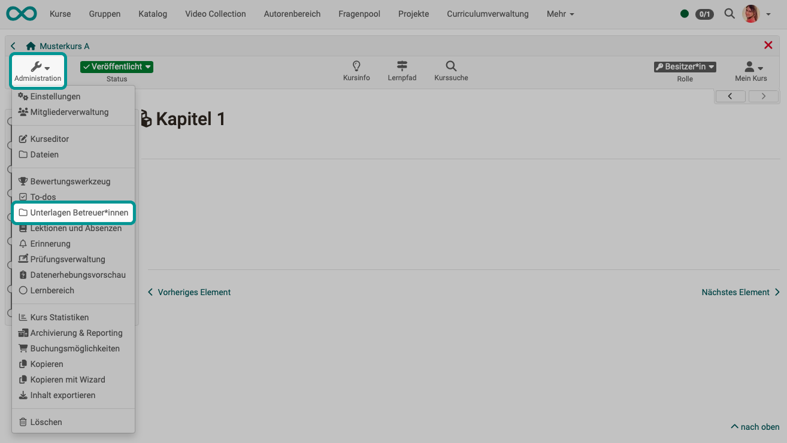

# Coach files {: #coach_files}

A shared folder can be set up for coaches to store files. The folder is opened by coaches and owners of the course, as well as by persons with the "Course editor" right.

{ class="shadow lightbox" title="Administration menu of a course" }

So that the entry "Coach files" appears in the "Administration" menu of the course, owners of the course first switch on the option "Coach files folder" under `Course > Administration > Settings > Tab "Options"`.

There, under "File destination", they choose where the folder is located: "Automatically generated folder" creates a new folder in the [storage folder](Storage_folder.md) of the course, "Choose folder from course storage" uses an existing folder. In both cases, coaches only open this folder via the menu entry, not the other files of the storage folder.

Owners of the course and persons with access to the course editor see the entire storage folder. With the automatically generated folder, they find the coaches' files there in the folder "_coachdocuments". They can link these files in course elements, for example in a single page. Coaches cannot do this via this folder.

[To the top of the page ^](#coach_files)

## Further information {: #further_information}

[Storage folder >](Storage_folder.md) 
[Course Settings - Tab Options >](Course_Settings_Options.md)

[To the top of the page ^](#coach_files)