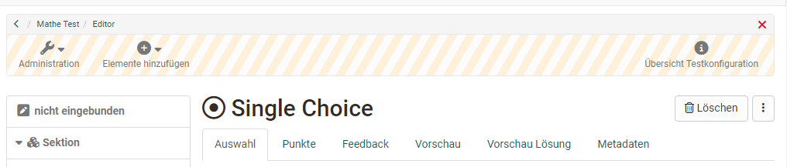
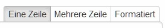
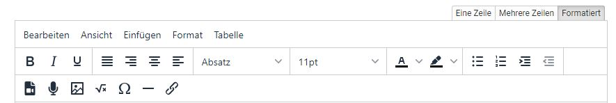
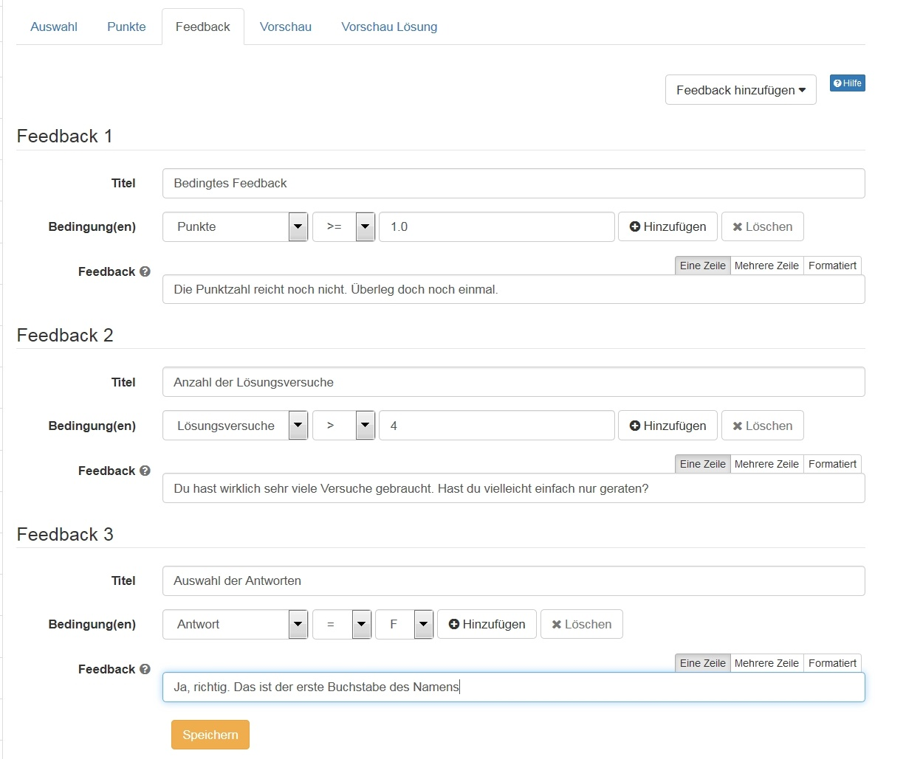

# Testfragen konfigurieren {: #configure_test_questions}

Im Testeditor richten Sie jede Testfrage in mehreren Tabs ein: Sie formulieren Frage und Antworten, legen die Punkte fest, ergänzen Feedback und prüfen das Ergebnis in der Vorschau. Zu jedem [Fragetyp](Test_question_types.de.md) gibt es die Tabs "Auswahl" (oder den Namen des Fragetyps), "Punkte", "Feedback", "Vorschau", "Vorschau Lösung" und "Metadaten".

{ class="shadow lightbox" title="Tabs einer Testfrage im Testeditor" }

## Tab Auswahl

Im ersten Tab, "Auswahl" oder dem Namen des Fragetyps, geben Sie die eigentliche Fragestellung und die Antwortalternativen ein. Je nach Fragetyp legen Sie hier weitere Einstellungen fest, zum Beispiel ob die Antworten in zufälliger Reihenfolge erscheinen oder wie sie ausgerichtet sind. Für die Antworten der Fragetypen Single Choice, Multiple Choice, Reihenfolge und Kprim stehen in den Tabs "Auswahl" und "Feedback" drei Formatierungsvarianten zur Auswahl:

{ class="shadow lightbox" title="Formatierungsvarianten über dem Antwortfeld" }

Verwenden Sie die Option "Eine Zeile" (Standardeinstellung), wenn die Antwort nur eine Zeile umfasst und keine Formatierung braucht. Verwenden Sie die Option "Mehrere Zeilen", wenn die Antwort aus zwei oder mehr Zeilen besteht und keine Formatierung braucht. Wählen Sie "Formatiert", wenn die Antwort Bilder, Audios, Videos, Links, mathematische Formeln oder andere Formatierungen enthalten soll, die Sie mit dem HTML-Editor von OpenOlat erstellen.

{ class="shadow lightbox" title="Antwortfeld im Modus Formatiert" }

## Tab Punkte [:octicons-tag-16:{ title="ab Release 20.3.0 (OO-8321)" }](https://track.frentix.com/issue/OO-8321) {: #score}

Im Tab "Punkte" legen Sie fest, wie oft Teilnehmende eine Frage beantworten dürfen, welche Punktzahl minimal und maximal erreichbar ist und nach welcher Methode OpenOlat die Punkte vergibt.

Folgende Einstellungen stehen zur Verfügung:

* **Anzahl Versuche einschränken:**

    * **Ja**: Geben Sie hier an, wie oft Teilnehmende diese Frage bearbeiten und speichern dürfen. Die maximale Anzahl erscheint auch während des Tests. Tragen Sie zum Beispiel 1 ein, bearbeiten und speichern Teilnehmende die Frage nur einmal. Änderungen sind danach nicht mehr möglich. Das ist besonders wichtig, wenn Sie mit antwortspezifischem Feedback arbeiten, Teilnehmende ihre Antwort aber nicht anhand dieser Rückmeldung überarbeiten sollen.
    * **Nein**: Die Lösungsversuche für die Frage sind unbeschränkt. Teilnehmende speichern und korrigieren ihre Antworten beliebig oft. Unabhängig davon kann die Anzahl der Bearbeitungen einer Sektion oder des gesamten Tests eingeschränkt sein.
    * **Vererbt**: Die Anzahl Lösungsversuche wird von der oberen Ebene (Sektion) übernommen.

* **Minimal erreichbare Punktzahl:** Für Fragetypen, bei denen die Werte ins Negative gehen können, also Hotspot, Single Choice, Multiple Choice, Drag and Drop und Matrix, legen Sie die minimal erreichbare Punktzahl selbst fest. So setzen Sie das Ergebnis auch bei einer negativen Gesamtpunktzahl auf 0 und vermeiden einen negativen Wert. Bei anderen Fragetypen setzt OpenOlat den Wert automatisch auf 0.

* **Maximal erreichbare Punktzahl:** die höchste Punktzahl, die in dieser Frage erreichbar ist.

* **Bewertungsmethode:** Für die meisten Fragetypen legen Sie auch fest, wie OpenOlat die Punkte vergibt.

    * Wählen Sie "Alle korrekten Antworten", vergibt OpenOlat nur dann Punkte, wenn alle Antworten richtig sind.
    * Wählen Sie "Punkte pro Antwort", vergeben Sie in der Spalte "Punkte" für jede Antwort die gewünschte Punktzahl und gewichten so individuell. Auch negative Punkte sind möglich. Die maximal erreichbare Punktzahl wird beim Zusammenzählen aber nie überschritten.
    * **Teilpunkte** können für Multiple Choice, Hotspot, Hottext, Drag and Drop, Matrix, Lückentext (Text, numerisch und gemischt), Lückentext mit Dropdown verwendet werden. Bei der Berechnung wird für jede richtig ausgewählte Antwort automatisch eine gewichtete Punktzahl addiert, während für jede falsch ausgewählte Antwort automatisch eine gewichtete Punktzahl abgezogen wird. [:octicons-tag-16:{ title="ab Release 18.1 (OO-7231)" }](https://track.frentix.com/issue/OO-7231)
    * Für die Fragetypen Lückentext, Lückentext numerisch und Lückentext gemischt vergeben Sie mit "Punkte pro Antwort und Varianten" zudem unterschiedliche Punkte, zum Beispiel eine reduzierte Punktzahl für alternative Schreibweisen einer Lösung.
    * Bei Kprim, Datei hochladen, Zeichnen und Freitext steht die Bewertungsmethode nicht zur Verfügung.

    Die beiden Methoden für abgestufte Punktevergabe im Vergleich:

    |  | Teilpunkte | Punkte pro Antwort und Varianten |
    |---|------------|----------------------------------|
    | **Punktevergabe** | Automatisch nach gewichteter Formel | Manuell pro Antwort bzw. Variante |
    | **Konfigurationsaufwand** | Keiner | Jede Antwort und Variante einzeln |
    | **Negative Punkte** | Automatischer Abzug für falsche Antworten | Frei konfigurierbar |
    | **Verfügbar für** | Multiple Choice, Hotspot, Hottext, Drag and Drop, Matrix, alle Lückentext-Typen | Lückentext, Lückentext numerisch, Lückentext gemischt |

## Tab Feedback {: #feedback}

Mit Feedback unterstützen Sie Teilnehmende gezielt beim Lernen, besonders wenn Sie einen Test als formatives Assessment oder Selbsttest einsetzen. Pro Frage fügen Sie über das Menü "Feedback hinzufügen" unterschiedliche Arten von Feedback hinzu, vom Lösungshinweis bis zur korrekten Lösung unter bestimmten Bedingungen. Im Selbsttest geben Feedback, Lösungshinweis und korrekte Lösung den Teilnehmenden bei falschen Antworten Tipps, wie sie auf die richtige Antwort kommen. Auch bei Selbstlerntutorials ist solches Feedback hilfreich.

Diese Varianten von Feedback stehen zur Wahl, auch kombiniert:

* **Lösungshinweis:** Der Lösungshinweis erscheint als Fragezeichen unter der Fragestellung. Teilnehmende klicken auf das Fragezeichen und erhalten den hinterlegten Lösungshinweis. Diese Variante eignet sich zum Beispiel für weitere Links oder Texte, aber nicht unbedingt für die richtige Lösung.
* **Korrekte Lösung:** OpenOlat zeigt diese Lösung automatisch, wenn die Antwort falsch ist.

!!! info "Spezialfälle: Freitext, Datei hochladen, Zeichnen"
    Bei diesen Fragetypen zeigt OpenOlat das Feedback während des Tests nicht an. Hinterlegen Sie in diesem Feld stattdessen die Musterlösung. Sie erscheint anschliessend im Korrektur-Workflow (Bewertungswerkzeug) und im Ergebnis-Report.
* **Feedback bei Wahl aller korrekten Antworten:** Dieses Feedback erscheint nur, wenn alle Antworten korrekt sind. Hier passt zum Beispiel ein besonderes Lob oder eine Grafik.
* **Feedback bei Wahl einer falschen Antwort:** Dieses Feedback erscheint, wenn mindestens eine Antwort falsch ist. Beispiel: Bei einer Multiple-Choice- oder Kprim-Frage oder einem umfangreichen Lückentext mit 50 Lücken erscheint das Feedback, sobald mindestens eine Antwort falsch ist. Mit dieser Variante zeigen Sie Teilnehmenden, dass sie auf dem richtigen Weg sind, auch wenn noch nicht alles korrekt ist.
* **Bedingtes Feedback:** Mit dieser Variante geben Sie ein individuelles Feedback. Je nach Fragetyp hängt das Feedback von den Bedingungen "Punkte", "Lösungsversuche" oder "Antwort" ab. So geben Sie zum Beispiel eine gezielte Rückmeldung auf eine bestimmte Antwort und gehen auf typische Fehler ein. Je nach Bedingung stehen Vergleichsoperatoren wie gleich (=), ungleich (!=), grösser (>) oder kleiner (<) zur Verfügung. Mehrere Bedingungen lassen sich kombinieren.

  { class="shadow lightbox" title="Tab Feedback einer Testfrage" }

Für jedes Feedback geben Sie einen Titel und einen Feedbacktext ein. Der Titel ist optional, der Feedbacktext ist Pflicht, wenn das Feedback erscheinen soll. Fehlt der Text, erscheint das Feedback nicht, und der Eintrag wird gelöscht. Ist kein Feedback hinterlegt, gelangen Teilnehmende mit "Antwort speichern" direkt zur nächsten Frage.

Bei bereits verwendeten Tests bearbeiten Sie das hinterlegte Feedback weiterhin, neue Feedbacks fügen Sie aber nicht mehr hinzu.

Die Option "Feedback bei Wahl einer falschen Antwort" wirkt nicht, wenn in einer Multiple-Choice-Frage zwar keine falschen, aber auch nicht alle richtigen Antworten angekreuzt sind.

Auf Testebene richten Sie im Testeditor im Tab "Feedback" das Gesamtfeedback eines Tests ein. Ob Feedbacks im Test überhaupt erscheinen, legen Sie mit der Option "Feedbacks anzeigen" fest: 
`Test > Administration > Einstellungen > Tab "Optionen"`

!!! note "Testebene"
    Konfigurationsmöglichkeiten auf Testebene im Testeditor. 
    [Test konfigurieren](Configure_tests.de.md)

## Tab Vorschau

Die Vorschau zeigt die Frage so, wie Teilnehmende sie sehen. Hier prüfen Sie, ob alle Einstellungen stimmen, zum Beispiel die Feedbacks, und ob die Darstellung passt.

## Tab Vorschau Lösung [:octicons-tag-16:{ title="ab Release 11.3 (OO-2517)" }](https://track.frentix.com/issue/OO-2517)

Dieser Tab zeigt die Frage mit der (Muster-)Lösung. Diese Lösung kann später im Test auch als korrekte Lösung erscheinen. Vor allem bei Lückentext-Fragen hilft diese Vorschau, zum Beispiel um eine passende Lückenlänge zu prüfen. In der Lücke steht die Lösung. Alternative Antworten stehen zusätzlich neben der Lücke, ausser sie sind mit 0 oder negativen Punkten bewertet. [:octicons-tag-16:{ title="ab Release 21.0 (OO-9385)" }](https://track.frentix.com/issue/OO-9385)

## Tab Metadaten

Im Tab "Metadaten" hinterlegen Sie weitere Angaben zu jeder Frage. Dazu zählen im Bereich "Allgemein" Angaben zum Thema, zum Fachbereich, zur Sprache, zur Testart und Ähnliches.

Im Bereich "Itemanalyse" geben Sie die durchschnittliche Bearbeitungszeit der Frage, die Schwierigkeit, die Trennschärfe, die benötigte Korrekturzeit und Ähnliches an.

Der Bereich "Technik" zeigt weitere Informationen an.

!!! note "Metadaten und Fragenpool"
    Weitere Informationen zu diesen Einstellungen finden Sie auch im Fragenpool. 
    [Metadaten](../area_modules/Item_Detailed_View.de.md) 
    [Fragenpool](../area_modules/Question_Bank/index.de.md)

## Weiterführende Informationen {: #further_information}

[Test Fragetypen >](Test_question_types.de.md) 
[Test konfigurieren >](Configure_tests.de.md) 
[Fragenpool: Detailansicht einer Frage >](../area_modules/Item_Detailed_View.de.md) 
[Fragenpool: Übersicht >](../area_modules/Question_Bank/index.de.md) 
[Testeditor >](Test_editor_QTI_2.1.de.md) 
[Tests erstellen >](Test.de.md) 
[Kursbaustein "Selbsttest" >](Course_Element_Self_Test.de.md)

[Zum Seitenanfang ^](#configure_test_questions)
