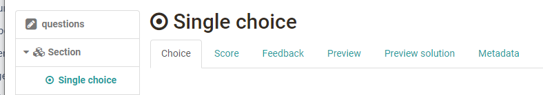
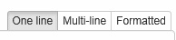
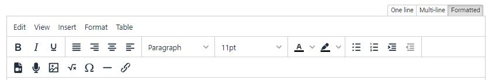
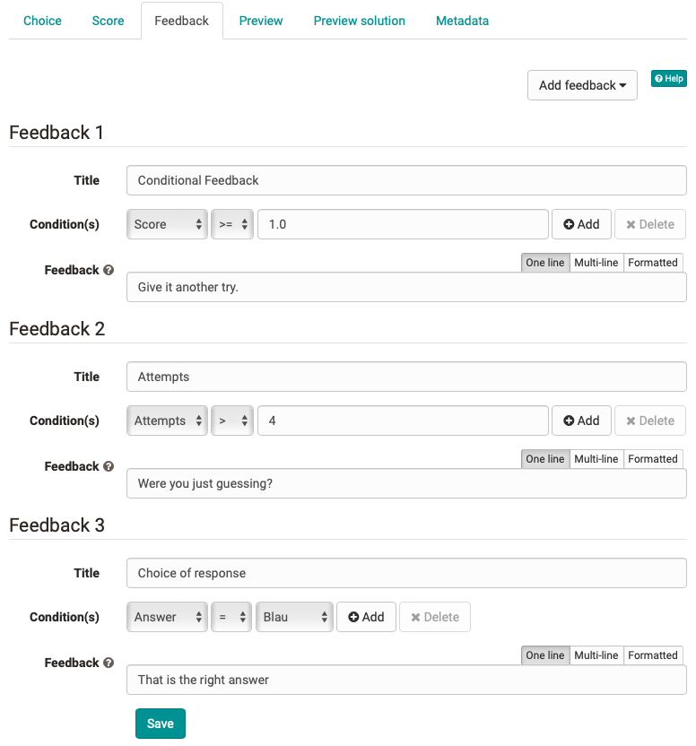

# Configure test questions {: #configure_test_questions}

In the test editor, you set up each test question in several tabs: you write the question and the answers, define the score, add feedback and check the result in the preview. Each [question type](Test_question_types.md) has the tabs "Choice" (or the name of the question type), "Score", "Feedback", "Preview", "Preview solution" and "Metadata".

{ class="shadow lightbox" title="Tabs of a test question in the test editor" }

## Tab Choice

In the first tab, "Choice" or the name of the question type, you enter the actual question and the alternative answers. Depending on the question type, you define further settings here, for example whether the answers appear in random order or how they are aligned. For the answers of the question types Single choice, Multiple choice, Order and Kprim, the tabs "Choice" and "Feedback" offer three formatting options:

{ class="shadow lightbox" title="Formatting options above the answer field" }

Use the option "One line" (default setting) if the answer takes up only one line and needs no formatting. Use the option "Multi-line" if the answer consists of two or more lines and needs no formatting. Choose "Formatted" if the answer should contain images, audios, videos, links, mathematical formulas or other formatting that you create with the HTML editor of OpenOlat.

{ class="shadow lightbox" title="Answer field in Formatted mode" }

## Tab Score [:octicons-tag-16:{ title="from Release 20.3.0 (OO-8321)" }](https://track.frentix.com/issue/OO-8321) {: #score}

In the "Score" tab, you define how often participants may answer a question, which minimum and maximum score can be reached and which method OpenOlat uses to assign the score.

The following settings are available:

* **Limit number of attempts:**

    * **Yes**: Specify here how often participants may edit and save this question. The maximum number also appears during the test. If you enter 1, for example, participants edit and save the question only once. Changes are no longer possible afterwards. This is especially important if you work with answer-specific feedback but participants should not revise their answer based on this feedback.
    * **No**: The number of attempts for the question is unlimited. Participants save and correct their answers as often as they like. Independently of this, the number of attempts for a section or the whole test may be limited.
    * **Inherit**: The number of attempts is taken from the level above (section).

* **Min. score:** For question types whose values can become negative, namely hotspot, single choice, multiple choice, drag and drop and matrix, you define the minimum score yourself. This way, you set the result to 0 even for a negative total score and avoid a negative value. For other question types, OpenOlat sets the value to 0 automatically.

* **Max. score:** the highest score that can be reached in this question.

* **Method of assessment:** For most question types, you also define how OpenOlat assigns the score.

    * If you choose "All correct answers", OpenOlat assigns points only if all answers are correct.
    * If you choose "Score per answer", you assign the desired score to each answer in the column "Points" and weight them individually. Negative points are also possible. However, the maximum score is never exceeded when the points are added up.
    * **"Partial score"** can be set for multiple choice, hotspot, hottext, drag and drop, matrix, gap (text, numerical and mixed), gap with dropdown. In the calculation, a weighted score is added for each correctly selected answer, while a weighted score is subtracted for each incorrectly selected answer. [:octicons-tag-16:{ title="from Release 18.1 (OO-7231)" }](https://track.frentix.com/issue/OO-7231)
    * For the question types Gap text, Gap FIB numerical and Gap mixed, you can also assign different points with "Score per answer and alternatives", for example a reduced score for alternative spellings of a solution.
    * The method of assessment is not available for Kprim, upload file, drawing and essay.

    The two methods for graduated scoring in comparison:

    |  | Partial score | Score per answer and alternatives |
    |---|------------|----------------------------------|
    | **Scoring** | Automatic, based on a weighted formula | Manual, per answer or alternative |
    | **Configuration effort** | None | Each answer and alternative individually |
    | **Negative points** | Automatic deduction for incorrect answers | Freely configurable |
    | **Available for** | Multiple choice, hotspot, hottext, drag and drop, matrix, all gap types | Gap text, Gap FIB numerical, Gap mixed |

## Tab Feedback {: #feedback}

With feedback, you support participants in a targeted way while they learn, especially if you use a test as a formative assessment or self-test. For each question, you add different types of feedback via the "Add feedback" menu, from a hint to the correct solution under certain conditions. In a self-test, feedback, hint and correct solution give participants tips on how to find the right answer after a wrong one. Such feedback is also helpful in self-learning tutorials.

These types of feedback are available, also in combination:

* **Hint:** The hint appears as a question mark under the question. Participants click the question mark and receive the stored hint. This variant is suitable, for example, for additional links or texts, but not necessarily for the correct solution.
* **Correct solution:** OpenOlat shows this solution automatically if the answer is wrong.

!!! info "Special Cases: Essay, Upload file, Drawing"
    For these question types, OpenOlat does not show the feedback during the test. Store the sample solution in this field instead. It then appears in the correction workflow (assessment tool) and in the results report.
* **Feedback for all correct answers:** This feedback appears only if all answers are correct. A special praise or a graphic fits here, for example.
* **Feedback for wrong answer:** This feedback appears if at least one answer is wrong. Example: For a multiple choice or Kprim question or an extensive gap text with 50 gaps, the feedback appears as soon as at least one answer is wrong. With this variant, you show participants that they are on the right track, even if not everything is correct yet.
* **Conditional feedback:** With this variant, you give individual feedback. Depending on the question type, the feedback depends on the conditions "Score", "Attempts" or "Answer". This way, you give targeted feedback on a specific answer and address typical errors, for example. Depending on the condition, comparison operators such as equal to (=), not equal to (!=), greater than (>) or less than (<) are available. You can combine several conditions.

  { class="shadow lightbox" title="Feedback tab of a test question" }

For each feedback, you enter a title and a feedback text. The title is optional, the feedback text is mandatory if the feedback is to appear. If the text is missing, the feedback does not appear and the entry is deleted. If no feedback is stored, participants go directly to the next question with "Submit answer".

For tests already in use, you can still edit the stored feedback, but you can no longer add new feedback.

The option "Feedback for wrong answer" does not take effect if, in a multiple choice question, no wrong answers are ticked but not all correct answers are ticked either.

At test level, you set up the overall feedback of a test in the test editor in the "Feedback" tab. Whether feedback appears in the test at all is defined with the option "Show feedbacks": 
`Test > Administration > Settings > Tab "Options"`

!!! note "Test level"
    Configuration options at test level in the test editor. 
    [Configure tests](Configure_tests.md)

## Tab Preview

The preview shows the question the way participants see it. Here you check whether all settings are correct, for example the feedback, and whether the display fits.

## Tab Preview solution [:octicons-tag-16:{ title="from Release 11.3 (OO-2517)" }](https://track.frentix.com/issue/OO-2517)

This tab shows the question with the (sample) solution. This solution can later also appear in the test as the correct solution. Especially for gap text questions, this preview helps, for example to check a suitable gap length. The solution is shown in the gap. Alternative answers are additionally listed next to the gap, unless they are scored with 0 or negative points. [:octicons-tag-16:{ title="from Release 21.0 (OO-9385)" }](https://track.frentix.com/issue/OO-9385)

## Tab Metadata

In the "Metadata" tab, you store further information on each question. In the "General" section, this includes information on the topic, subject area, language, type of test and similar.

In the "Item analysis" section, you enter the average processing time of the question, the difficulty, the selectivity, the required correction time and similar.

The "Technical" section shows further information.

!!! note "Metadata and Question Bank"
    Further information on these settings is also available in the question bank. 
    [Metadata](../area_modules/Item_Detailed_View.md) 
    [Question bank](../area_modules/Question_Bank.md)

## Further information {: #further_information}

[Test question types >](Test_question_types.md) 
[Configure tests >](Configure_tests.md) 
[Item Detailed View >](../area_modules/Item_Detailed_View.md) 
[Question Bank: Overview >](../area_modules/Question_Bank.md) 
[Test editor >](Test_editor_QTI_2.1.md) 
[Creating Tests >](Test.md) 
[Course Element "Self-test" >](Course_Element_Self_Test.md)

[To the top of the page ^](#configure_test_questions)
