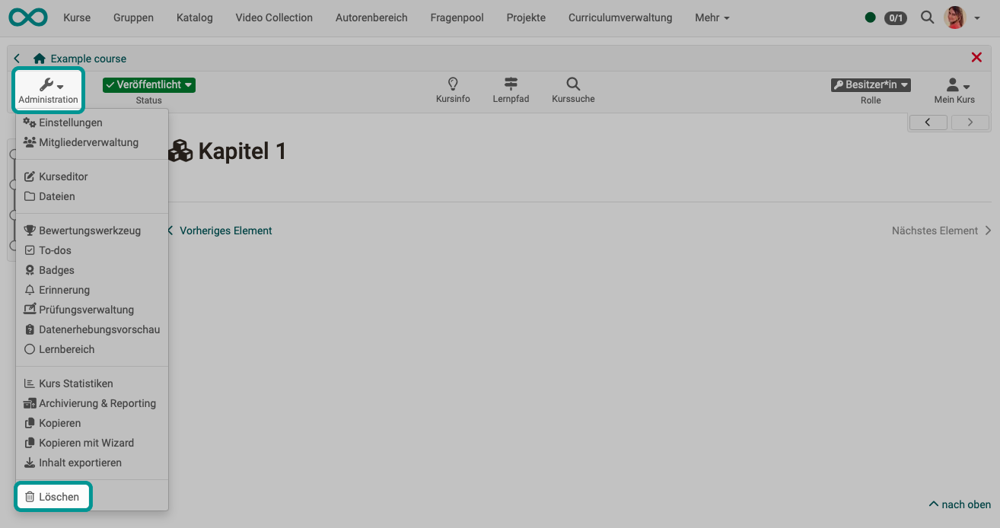

# Löschen (eines Kurses/einer Lernressource) {: #course_delete}

{ class="shadow lightbox" title="Menü Administration eines Kurses" }

Wenn ein Kurs bzw. eine Lernressource gelöscht wird, kommt sie in den Papierkorb. Der Kurs ist nun weder für die ehemaligen Teilnehmenden noch die Betreuer:innen aufruf- oder einsehbar.

Kursbesitzer:innen finden die gelöschte Lernressource anschliessend im Autorenbereich im Tab "Gelöscht". Hier erscheint die Lernressource mit dem Status "Papierkorb". Es besteht weiter Zugriff auf die Menüpunkte der Administration. Der Status "Papierkorb" kann nicht geändert werden. Jedoch ist es möglich, über den Link im 3-Punkte Menü die Lernressource wiederherzustellen.

!!! info "Endgültiges Löschen"

    Das endgültige Löschen eines Kurses bzw. einer Lernressource aus dem Tab "Gelöscht" ist nur durch Administrator:innen und Lernressourcenverwalter:innen möglich.

!!! info "Archivierung"

    Wenn ein Kurs dauerhaft gelöscht wird, werden Benutzerdaten (z.B. Testresultate) zuerst als Excel-Datei in den [persönlichen Dateien](../personal_menu/File_Hub.de.md#personal_files) der Person archiviert, die ihn dauerhaft löscht, und im Anschluss gelöscht. Löscht der automatische Kurs-Lebenszyklus einen Kurs dauerhaft, landet das Archiv in den persönlichen Dateien einer Administrator:in.

Es ist möglich, andere Kursbesitzer:innen via E-Mail über das Beenden oder Löschen eines Kurses zu informieren. Dies kann entweder im Beenden/Löschen-Dialog optional ausgewählt oder von Systemadministrator:innen systemweit eingestellt werden.

Bei einer gelöschten Lernressource erscheint in der Kursadministration der Menüpunkt "Wiederherstellen". 

Ebenso kann ein Kurs auch automatisiert beendet bzw. gelöscht werden. Die Einstellungen dafür nehmen ebenfalls Systemadministrator:innen vor.

## Was beim Löschen entfernt wird {: #removed_on_delete}

Im Papierkorb bleibt die Lernressource mit ihrem Inhalt und ihren Daten erhalten. Die Verbindungen zu Personen und zu anderen Bereichen löst OpenOlat dagegen schon beim Löschen:

* Betreuer:innen, Teilnehmer:innen und Personen auf der Warteliste werden ausgetragen. Die Besitzer:innen bleiben eingetragen.
* Die Verknüpfungen mit Gruppen und mit Elementen im Course Planner werden aufgehoben.
* Die Einträge im Katalog, die auf die Lernressource verweisen, werden gelöscht.
* Das "Angebot für Gäste" und die Angebote "Ohne Buchung" werden gelöscht. Die übrigen Angebote bleiben bestehen.
* Ausstehende Mitgliedschaften, also Aufnahmen, die noch auf eine Bestätigung warten, werden gelöscht.
* Die Abonnements von Betreuer:innen, Teilnehmer:innen und Personen auf der Warteliste für diese Lernressource werden gelöscht. Die Abonnements der Besitzer:innen bleiben bestehen.

!!! warning "Achtung"

    "Wiederherstellen" holt die Lernressource mit ihrem Inhalt zurück, die oben aufgeführten Mitglieder, Verknüpfungen, Katalogeinträge und Angebote aber nicht. Ein wiederhergestellter Kurs hat den Status "Beendet", jede andere Lernressource den Status "Vorbereitung".

## Weiterführende Informationen {: #further_information}

[Persönliche Werkzeuge: File Hub >](../personal_menu/File_Hub.de.md) 
[Automatischer Kurs-Lebenszyklus >](../../manual_admin/administration/Automatic_Course_Lifecycle.de.md) 
[Wie manage ich Lebenszyklen von Gruppen, Kursen oder Benutzerkonten? >](../../manual_how-to/lifecycle/lifecycle.de.md)

[Zum Seitenanfang ^](#course_delete)
