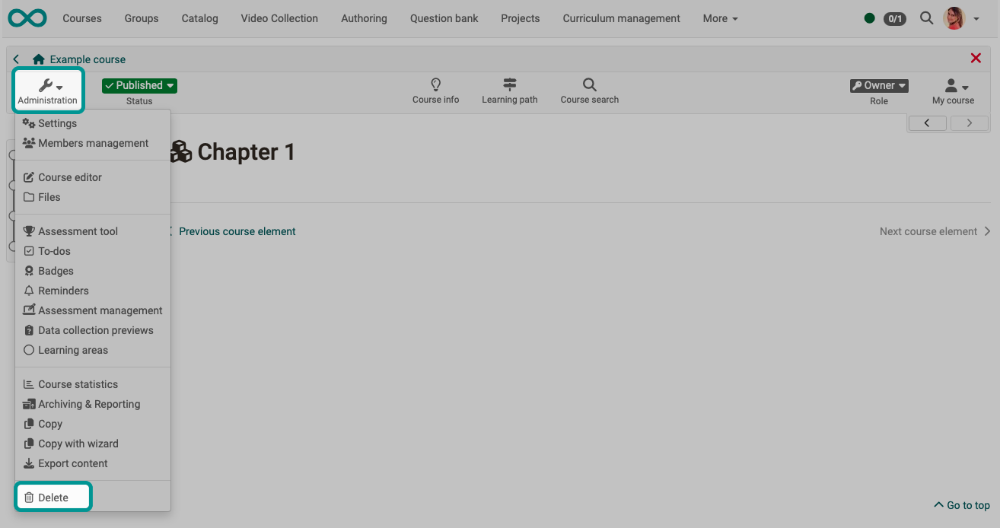

# Delete (a course or learning resource) {: #course_delete}

{ class="shadow lightbox" title="Administration menu of a course" }

When a course or learning resource is deleted, it is moved to the trash. The course can now neither be accessed nor viewed by former participants or coaches.

Course owners can then find the deleted learning resource in the "Deleted" tab in the author area. The learning resource appears here with the status "Trash". The administration menu items can still be accessed. The "Trash" status cannot be changed. However, it is possible to restore the learning resource via the link in the 3-dot menu.

!!! info "Final deletion"

    The final deletion of a course or learning resource from the "Deleted" tab is only possible by administrators and learning resource managers.

!!! info "Archiving"

    When a course is deleted permanently, user data (e.g. test results) is first archived as an Excel file in the [personal files](../personal_menu/File_Hub.md#personal_files) of the person who deletes it permanently, and then deleted. If the automatic course life cycle deletes a course permanently, the archive ends up in the personal files of an administrator.

It is possible to inform other course owners via e-mail about the completion or deletion of a course. This can either be optionally selected in the Finish/Delete dialog or set system-wide by system administrators.

If a learning resource has been deleted, the menu item "Restore" appears in the course administration. 

A course can also be closed or deleted automatically. The settings for this are also made by system administrators.

## What deleting removes {: #removed_on_delete}

In the trash, the learning resource keeps its content and its data. OpenOlat, however, already removes the connections to people and to other areas when the resource is deleted:

* Coaches, participants and persons on the waiting list are removed. The owners remain registered.
* The links to groups and to elements in the Course Planner are removed.
* The catalog entries that refer to the learning resource are deleted.
* The "Offer for guests" and the offers "Without booking" are deleted. The other offers remain.
* Pending memberships, i.e. admissions that are still waiting for a confirmation, are deleted.
* The subscriptions of coaches, participants and persons on the waiting list to this learning resource are deleted. The subscriptions of the owners remain.

!!! warning "Attention"

    "Restore" brings back the learning resource with its content, but not the members, links, catalog entries and offers listed above. A restored course has the status "Finished", every other learning resource the status "Preparation".

## Further information {: #further_information}

[User tools: File Hub >](../personal_menu/File_Hub.md) 
[Automatic Course Life Cycle >](../../manual_admin/administration/Automatic_Course_Lifecycle.md) 
[How do I manage lifecycles of groups, courses or user accounts? >](../../manual_how-to/lifecycle/lifecycle.md)

[To the top of the page ^](#course_delete)

