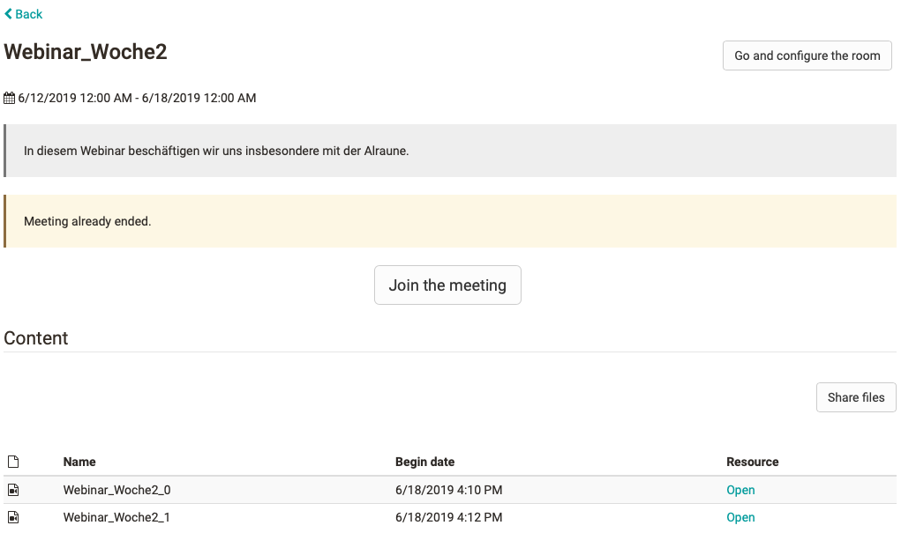
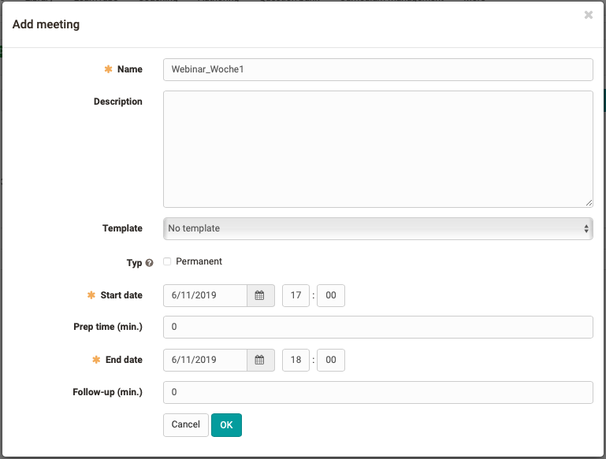
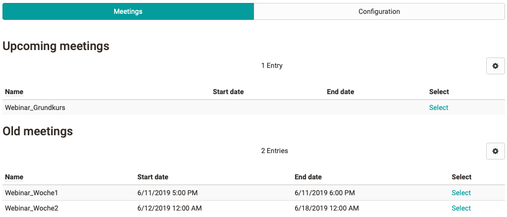

# Course Element "Adobe Connect" {: #adobe_connect}

## Profile

Name | Adobe Connect
---------|----------
Icon | :o_icon_o_vc_icon:
Available since | Release 14.0 (OO-3888)
Functional group | Communication and collaboration
Purpose | Integration of the Adobe Connect web conferencing software 
Assessable | no
Specialty / Note | Adobe Connect is commercial software. To use the course element, a separate license and server hosting is required.

## Tool-specific

By default, course owners and coaches are Adobe Connect administrators and participants are Connect participants with no other rights.

In the Connect room, various elements (pods) are available, which can be combined with each other and organized in "layouts". For example, presentation files can be uploaded and an event recording can be activated. Both the uploaded presentation files and the recordings are visible in OpenOlat for course owners and coaches and can be made available to course participants in full or in part.

{ class="shadow lightbox" title="Meeting in the Adobe Connect course element" }

## Configuration in the course editor

Here, the "Configuration" tab is available for further settings: 
`Course > Administration > Course editor > Course element "Adobe Connect" > Tab "Configuration"`

## Configuration in the course view {: #configuration-in-the-course-run-closed-editor}

After you have added the course element, create a meeting room in the course with the course editor closed. To do this, click the button "Add meeting" in the tab "Configuration": 
`Course > Course element "Adobe Connect" > Configuration > Add meeting`

Then the following dialog appears:

{ class="shadow lightbox" title="Add meeting dialog" }

Under the entered title the room is displayed in the meeting area. The description becomes visible after you have selected the room.

If available, you can use a template provided by the hosting server or "No template". Also define whether the room should be available permanently or only at a certain date. For a time-bound room, you can add a lead time and a follow-up time.

Irrespective of the room configuration, access to the course element of the virtual classroom can also be configured like all other course elements via the Visibility and Access tabs in the course editor.

A built-in Adobe Connect course element can contain multiple differently configured meeting rooms. Depending on the configuration in the system administration under `Administration > External Tools > Adobe Connect`, all meetings set up run in the same or different Adobe Connect rooms.

In the "Meetings" tab, the overview of the virtual rooms set up is displayed in the same way as they are visible to participants. Scheduled meetings are marked accordingly.

{ class="shadow lightbox" title="Meetings tab in the Adobe Connect course element" }

"Select" takes you to the corresponding virtual classroom. At the first call you have to "register" for the meeting and afterwards you have the possibility to join the meeting via another dialog window. With "Join the meeting" you enter the virtual classroom and all room specific tools are available.

!!! note "Link to further information"

    Adobe Connect Provider Website: <https://www.adobe.com/de/products/adobeconnect.html>

    Since many universities in Germany use the [DFN server](https://www.conf.dfn.de/anleitungen-und-dokumentation/adobe-connect) for Adobe Connect, the corresponding information can also be interesting.

## Further information {: #further_information}

**Mentioned on this page** 
[Adobe Connect (provider website)](https://www.adobe.com/de/products/adobeconnect.html) 
[DFN server](https://www.conf.dfn.de/anleitungen-und-dokumentation/adobe-connect)

**Further reading** 
[Types of Course Elements >](Course_Elements.md) 
[Course Element "GoToMeeting" >](Course_Element_GoToMeeting.md) 
[Virtual classrooms >](../basic_concepts/Virtual_classrooms.md) 
[External Tools: Overview >](../../manual_admin/administration/External_Tools_-_Administration.md)

[To the top of the page ^](#adobe_connect)
