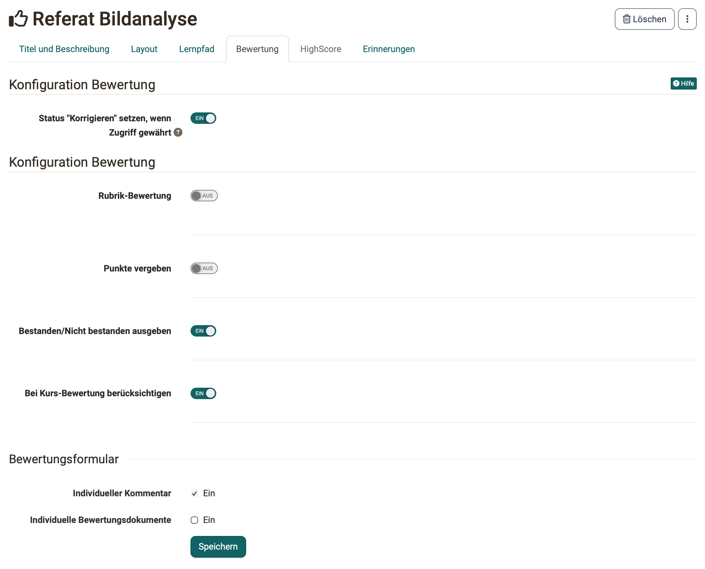
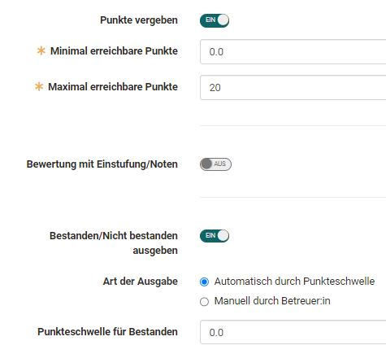
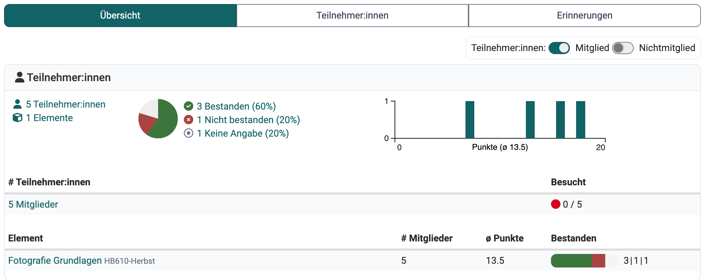

# Kursbaustein "Bewertung" {: #course_element_assessment}

## Steckbrief

Name | Bewertung
---------|----------
Icon | :o_icon_o_ms_icon:
Verfügbar seit | Release 7.1 oder früher
Funktionsgruppe | Wissensüberprüfung
Verwendungszweck | Bewertung von Leistungen, auch wenn sie ausserhalb von OpenOlat erbracht wurden (z.B. Präsenz-Referate, praktische Arbeiten)
Bewertbar | ja
Spezialität / Hinweis |

Mit dem Kursbaustein "Bewertung" bewerten Sie Leistungen, die Teilnehmende nicht in OpenOlat abgeben, zum Beispiel ein Referat vor Ort oder eine eigene Website.

## Bewertung im Kurseditor erstellen und einrichten

Besitzer:innen des Kurses konfigurieren den Kursbaustein "Bewertung" im Kurseditor im Tab "Bewertung". Betreuer:innen brauchen dafür im Kurs das Recht "Kurseditor". Im Tab legen Sie fest, ob

  * eine [Rubrik](../learningresources/Form_Element_Rubric.de.md) als Basis für die Bewertung dient,
  * Punkte vergeben werden,
  * die Punkte in eine Note umgerechnet werden,
  * Bestanden/nicht bestanden angezeigt wird,
  * ein individueller Kommentar hinzugefügt werden kann,
  * ein individuelles Dokument hinzugefügt werden kann.

{ class="shadow lightbox" title="Tab Bewertung im Kurseditor, Lernpfadkurs · 2026.11.02" }

Die Einstellungen haben Einfluss auf die späteren Bewertungsoptionen und auf die Informationen, die die Teilnehmenden sehen.

## Tab "Bewertung" konfigurieren {: #tab_assessment}

In Lernpfadkursen gliedert sich der Tab in drei Bereiche. Zuoberst steht unter der Legende "Konfiguration Bewertung" die Option "Status "Korrigieren" setzen, wenn Zugriff gewährt". Darunter folgt eine zweite Legende "Konfiguration Bewertung" mit den Einstellungen von "Rubrik-Bewertung" bis "Bei Kurs-Bewertung berücksichtigen". Zuletzt folgt der Bereich "Bewertungsformular". In herkömmlichen Kursen fehlt der oberste Bereich.

Sind für den Kursbaustein bereits Bewertungen vorhanden, zeigt OpenOlat die Einstellungen unter der zweiten Legende "Konfiguration Bewertung" schreibgeschützt an. Bearbeitbar bleiben die Option "Status "Korrigieren" setzen, wenn Zugriff gewährt" und der Bereich "Bewertungsformular". Mit "Bearbeitungsmodus aktivieren" machen Sie die Einstellungen wieder bearbeitbar, siehe [Schreibschutz der Bewertungskonfiguration](Course_Elements.de.md#assessment_config_read_only). [:octicons-tag-16:{ title="ab Release 21.1 (OO-9647)" }](https://track.frentix.com/issue/OO-9647)

### Status "Korrigieren" setzen [:octicons-tag-16:{ title="ab Release 16.0 (OO-5564)" }](https://track.frentix.com/issue/OO-5564)

Damit die Betreuenden sehen, wo eine Bewertung ansteht, setzt OpenOlat in Lernpfadkursen den Status auf Wunsch automatisch. Ist die Option "Status "Korrigieren" setzen, wenn Zugriff gewährt" eingeschaltet, erhält die teilnehmende Person den Status "Korrigieren", sobald sie Zugriff auf den Kursbaustein hat. Die Teilnehmenden sehen dann "In Korrektur". Ist die Option ausgeschaltet, steht der Status zunächst auf "Nicht gestartet". Bei einem neu eingefügten Kursbaustein ist die Option eingeschaltet.

### Rubrik-Bewertung [:octicons-tag-16:{ title="ab Release 14.0 (OO-4080)" }](https://track.frentix.com/issue/OO-4080)

Für eine kriterienbasierte Bewertung verknüpfen Sie den Kursbaustein "Bewertung" mit einem [Rubrik-Formular](../learningresources/Forms_in_Rubric_Scoring.de.md), also einem OpenOlat-Formular mit mindestens einem Rubrik-Element.

Ist zusätzlich "Punkte vergeben" eingeschaltet, wählen Sie unter "Punkte", wie die Punkte entstehen: "Summe aus Rubrik-Formular übernehmen" addiert die Punkte aller Rubrik-Zeilen, "Durchschnitt aus Rubrik-Formular übernehmen" bildet den Durchschnitt aller Rubrik-Zeilen, und mit "Punkte manuell vergeben" setzen die Betreuenden die Punkte selbst. Übernimmt OpenOlat die Punkte aus dem Rubrik-Formular, passen Sie sie mit dem "Skalierungsfaktor" an. Alternativ verzichten Sie ganz auf Punkte.

### Punkte vergeben

Ist "Punkte vergeben" eingeschaltet, vergeben Betreuer:innen und Besitzer:innen Punkte. Dafür geben Sie die "Minimal erreichbare Punkte" und die "Maximal erreichbare Punkte" an.

Ist zusätzlich die Rubrik-Bewertung eingeschaltet, kann OpenOlat die Punkte aus dem Rubrik-Formular übernehmen. Die minimalen und maximalen Punkte ergeben sich dann aus dem Formular.

### Bewertung mit Einstufung/Noten [:octicons-tag-16:{ title="ab Release 16.2 (OO-6009)" }](https://track.frentix.com/issue/OO-6009)

Sobald "Punkte vergeben" eingeschaltet ist, können Sie auch die Option "Bewertung mit Einstufung/Noten" einschalten. OpenOlat rechnet die Punkte dann in eine Note um.

Mit "Bewertungsskala bearbeiten" wählen Sie eine Skala und legen bei Bedarf weitere Einstellungen fest. Die Skala legt auch fest, ob und ab wann eine Bewertung als bestanden gilt. Mit eingeschalteter Option bestimmt die Bewertungsskala das Bestehen: Die Option "Bestanden/Nicht bestanden ausgeben" erscheint nicht, und das Formular zeigt stattdessen das "Erfolgskriterium" der Skala, sofern sie eines festlegt.

Unter "Zuweisung" legen Sie fest, ob die Betreuenden die Note manuell zuweisen ("Manuell") oder ob OpenOlat sie automatisch zuweist ("Automatisch bei Punktänderungen"). Mehr dazu auf der Seite [Einstufung/Noten](../learningresources/Assessment_translate_points_in_grades.de.md).

### Bestanden/Nicht bestanden ausgeben

Schalten Sie die Option ein, wenn die Teilnehmenden sehen sollen, ob sie den Kursbaustein bestanden haben.

Ist zusätzlich "Punkte vergeben" eingeschaltet, wählen Sie unter "Art der Ausgabe" zwischen "Manuell durch Betreuer:in" und "Automatisch durch Punkteschwelle". Bei der automatischen Ausgabe geben Sie die "Punkteschwelle für Bestanden" an.

{ class="shadow lightbox" title="Punkte und Bestanden im Tab Bewertung" }

### Bei Kurs-Bewertung berücksichtigen

In Lernpfadkursen erscheint die Option "Bei Kurs-Bewertung berücksichtigen", sobald "Punkte vergeben" oder "Bestanden/Nicht bestanden ausgeben" eingeschaltet ist. Ist die Option eingeschaltet, zählt der Kursbaustein für die Kurs-Bewertung, die Sie unter `Kurs > Administration > Einstellungen > Bewertung` festlegen: Die erreichten Punkte zählen zur Punkteschwelle für das Bestehen des Kurses, oder der Kursbaustein gehört zu den Kursbausteinen, die für das Bestehen des Kurses nötig sind.

In herkömmlichen Kursen legen Sie das im Tab "Punkte" des obersten Kursbausteins fest.

### Skalierungsfaktor für Kurs-Bewertung [:octicons-tag-16:{ title="ab Release 18.2 (OO-7378)" }](https://track.frentix.com/issue/OO-7378) {: #score_scaling}

Das Feld erscheint, wenn die Kurs-Bewertung die Punkte mit Gewichtung zusammenzählt und "Punkte vergeben" sowie "Bei Kurs-Bewertung berücksichtigen" eingeschaltet sind. OpenOlat multipliziert die Punkte des Kursbausteins für die Kurs-Bewertung mit diesem Faktor. Mehr dazu unter [Kursbewertung mit Punkten: Summe mit Gewichtung](Course_Settings_Assessment.de.md#evaluation_with_points_weighting).

### Bewertungsformular {: #assessment_form}

Aktivieren Sie unter "Bewertungsformular" die Checkbox "Individueller Kommentar" oder "Individuelle Bewertungsdokumente", um den Teilnehmenden individuelle Kommentare oder Dokumente bereitzustellen, zum Beispiel als Feedback.

## Tab Badges [:octicons-tag-16:{ title="ab Release 18.0 (OO-7003)" }](https://track.frentix.com/issue/OO-7003)

Haben Besitzer:innen des Kurses unter [`Kurs > Administration > Einstellungen > Bewertung > Badges`](../learningresources/Course_Settings_Assessment.de.md#section_badges) die Vergabe von Badges eingeschaltet, zeigt der Kurseditor für diesen Kursbaustein den Tab "Badges". Dort erstellen Sie einen Badge für diesen Kursbaustein.

## Bewertung in der Kursansicht durchführen {: #bewertung-im-kursrun-durchfuhren}

Besitzer:innen und Betreuer:innen bewerten die Teilnehmenden entweder im Kurs bei geschlossenem Kurseditor oder im [Bewertungswerkzeug](../learningresources/Assessment_tool_overview.de.md).

Der Tab "Übersicht" zeigt eine Gesamtübersicht zum Kursbaustein.

{ class="shadow lightbox" title="Tab Übersicht im Kursbaustein Bewertung · 2026.11.02" }

Der Tab "Teilnehmer:innen" listet alle Teilnehmenden. Je nach gewählten Spalten zeigt die Tabelle weitere Angaben zu jeder Person, zum Beispiel die erreichte Punktzahl und den Status. Im Tab bewerten Sie auch mehrere Personen auf einmal (Massenbewertung) oder setzen die Daten aller Teilnehmenden zurück.

Um eine Person zu bewerten, wählen Sie sie aus und füllen die angezeigten Felder aus, bei einer Rubrik-Bewertung die Felder der Rubrik. Sie können die Bewertung zwischenspeichern oder direkt abschliessen und freigeben.

Die Teilnehmenden haben nach der Freigabe Zugriff auf ihre Bewertung inklusive Bewertungsrubrik und sonstiger Feedbacks.

Der Tab "Erinnerungen" zeigt die [Erinnerungen](../learningresources/Course_Reminders.de.md), die für den Kursbaustein im Kurseditor angelegt sind. Hier erstellen Sie auch neue Erinnerungen oder bearbeiten und löschen bestehende.

## Weiterführende Informationen {: #further_information}

**Auf dieser Seite erwähnt** 
[Das Formular-Element Rubrik >](../learningresources/Form_Element_Rubric.de.md) 
[Kursbausteine im Überblick >](../learningresources/Course_Elements.de.md) 
[Formular als Rubrik-Bewertung >](../learningresources/Forms_in_Rubric_Scoring.de.md) 
[Einstufung/Noten >](../learningresources/Assessment_translate_points_in_grades.de.md) 
[Kurseinstellungen - Tab Bewertung >](../learningresources/Course_Settings_Assessment.de.md) 
[Bewertungswerkzeug - Übersicht >](../learningresources/Assessment_tool_overview.de.md) 
[Erinnerungen >](../learningresources/Course_Reminders.de.md)

**Weiterführend** 
[Das Bewertungsformular >](../learningresources/The_assessment_form.de.md) 
[Bewertung von Kursbausteinen >](../learningresources/Assessment_of_course_modules.de.md) 
[Wie protokolliere ich eine mündliche Prüfung in OpenOlat? >](../../manual_how-to/oral_exam/oral_exam.de.md)

[Zum Seitenanfang ^](#course_element_assessment)
