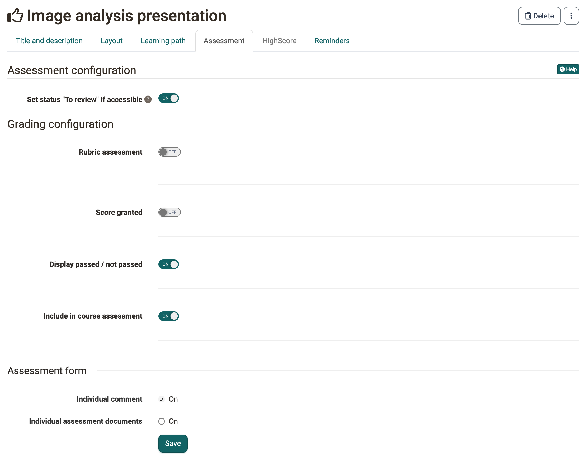
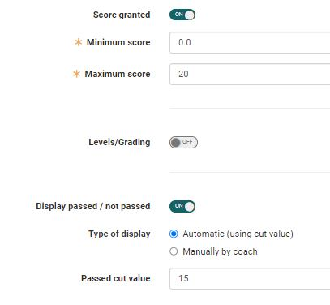
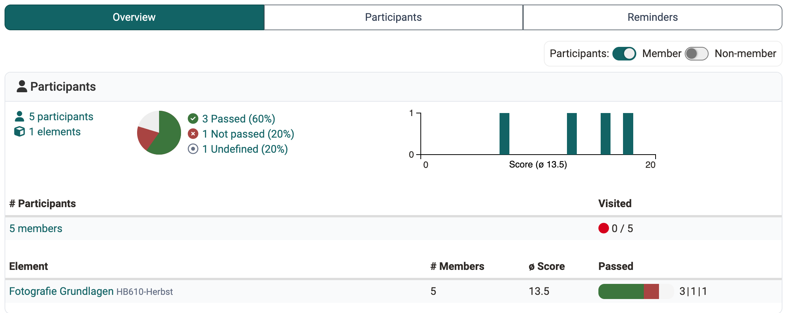

# Course Element "Assessment" {: #course_element_assessment}

## Profile

Name | Assessment
---------|----------
Icon | :o_icon_o_ms_icon:
Available since | 
Functional group | Assessment
Purpose | Assessment of performances, even if they were performed outside OpenOlat (e.g. presence presentations, practical work)
Assessable | yes
Specialty / Note |

With the course element "Assessment" you assess achievements that participants do not submit in OpenOlat, for example an on-site presentation or a website of their own.

## Create and set up Assessment in the course editor

The owners of the course configure the course element "Assessment" in the course editor in the tab "Assessment". Coaches need the "Course editor" right in the course for this. In the tab you define whether

  * a [rubric](../learningresources/Form_Element_Rubric.md) serves as the basis for the assessment,
  * points are awarded,
  * the points are converted into a grade,
  * passed/not passed is displayed,
  * an individual comment can be added,
  * an individual document can be added.

{ class="shadow lightbox" title="Tab Assessment in the course editor, learning path course · 2026.11.02" }

The settings influence the subsequent assessment options and the information the participants see.

## Tab "Assessment" - Configuration {: #tab_assessment}

In learning path courses, the tab is divided into three areas. At the top, under the legend "Assessment configuration", is the option "Set status "To review" if accessible". Below that follows the legend "Grading configuration" with the settings from "Rubric assessment" to "Include in course assessment". Finally follows the area "Assessment form". In conventional courses, the top area is missing.

If assessments already exist for the course element, OpenOlat displays the settings under the legend "Grading configuration" as read-only. The option "Set status "To review" if accessible" and the area "Assessment form" remain editable. With "Enable edit mode" you make the settings editable again, see [Read-only assessment configuration](Assessment.md#assessment_config_read_only). [:octicons-tag-16:{ title="from Release 21.1 (OO-9647)" }](https://track.frentix.com/issue/OO-9647)

### Set status "To review" [:octicons-tag-16:{ title="from Release 16.0 (OO-5564)" }](https://track.frentix.com/issue/OO-5564)

So that the coaches see where an assessment is pending, OpenOlat sets the status automatically in learning path courses on request. If the option "Set status "To review" if accessible" is switched on, the participant gets the status "To review" as soon as they have access to the course element. The participants then see "In review". If the option is switched off, the status is initially "Not started". In a newly inserted course element, the option is switched on.

### Rubric assessment [:octicons-tag-16:{ title="from Release 14.0 (OO-4080)" }](https://track.frentix.com/issue/OO-4080)

For a criteria-based assessment, you link the course element "Assessment" with a [rubric form](../learningresources/Forms_in_Rubric_Scoring.md), i.e. an OpenOlat form with at least one rubric element.

If "Score granted" is also switched on, you choose under "Score" how the points are created: "Transfer sum from rubric form" adds up the points of all rubric rows, "Transfer average from rubric form" calculates the average of all rubric rows, and with "Set score manually" the coaches set the points themselves. If OpenOlat transfers the points from the rubric form, you adjust them with the "Scaling factor". Alternatively, you do without points entirely.

### Score granted

If "Score granted" is switched on, coaches and owners award points. For this, you enter the "Minimum score" and the "Maximum score".

If the rubric assessment is also switched on, OpenOlat can transfer the points from the rubric form. The minimum and maximum score then result from the form.

### Levels/Grading [:octicons-tag-16:{ title="from Release 16.2 (OO-6009)" }](https://track.frentix.com/issue/OO-6009)

As soon as "Score granted" is switched on, the option "Levels/Grading" can also be switched on and further configured. OpenOlat then converts the points into a grade.

With "Edit rating scale" you select a scale and define further settings if needed. The scale also defines whether and from when an assessment counts as passed. With the option switched on, the rating scale determines the passing: the option "Display passed / not passed" is not shown, and the form instead shows the "Success criterion" of the scale, provided it defines one.

Under "Assignment" you define whether the coaches assign the grade manually ("Manually by coach") or whether OpenOlat assigns it automatically ("Automatically on score change"). More about this on the page [Levels/Grading](../learningresources/Assessment_translate_points_in_grades.md).

### Display passed / not passed

Switch on this option if the participants are to see whether they have passed the course element.

If "Score granted" is also switched on, you choose under "Type of display" between "Manually by coach" and "Automatic (using cut value)". With the automatic display, you enter the "Passed cut value".

{ class="shadow lightbox" title="Score and passed in the tab Assessment" }

### Include in course assessment

In learning path courses, the option "Include in course assessment" appears as soon as "Score granted" or "Display passed / not passed" is switched on. If the option is switched on, the course element counts for the course assessment that you define under `Course > Administration > Settings > Assessment`: the points achieved count towards the score threshold for passing the course, or the course element is one of the course elements needed for passing the course.

In conventional courses, you define this in the tab "Score" of the top course element.

### Scaling factor for course assessment {: #score_scaling}

The field appears if the course assessment adds up the points with weighting and "Score granted" as well as "Include in course assessment" are switched on. OpenOlat multiplies the points of the course element by this factor for the course assessment. More about this under [Course assessment with points: Sum with weighting](Course_Settings_Assessment.md#evaluation_with_points_weighting).

### Assessment form {: #assessment_form}

Activate under "Assessment form" the checkbox "Individual comment" or "Individual assessment documents" to provide participants with individual comments or documents, for example as feedback.

## Perform assessment in the course view {: #bewertung-im-kursrun-durchfuhren}

Owners and coaches assess the participants either in the course with the course editor closed or in the [assessment tool](../learningresources/Assessment_tool_overview.md).

The tab "Overview" shows a complete overview of the course element.

{ class="shadow lightbox" title="Tab Overview in the course element Assessment · 2026.11.02" }

The tab "Participants" lists all participants. Depending on the selected columns, the table shows further information on each person, for example the score achieved and the status. In the tab you also assess several persons at once (bulk assessment) or reset the data of all participants.

To assess a person, select them and fill in the displayed fields, for a rubric assessment the fields of the rubric. You can save the assessment temporarily or complete and release it directly.

After release, the participants have access to their assessment, including the assessment rubric and any other feedback.

The tab "Reminders" shows the [reminders](../learningresources/Course_Reminders.md) created for the course element in the course editor. Here you also create new reminders or edit and delete existing ones.

### Tab Badges

If the owners of the course have switched on the awarding of badges under [`Course > Administration > Settings > Assessment > Badges`](../learningresources/Course_Settings_Assessment.md#section_badges), the course editor shows the tab "Badges" for this course element. There you create a badge for this course element.

## Further information {: #further_information}

**Mentioned on this page** 
[The form element rubric >](../learningresources/Form_Element_Rubric.md) 
[Assessment >](../learningresources/Assessment.md) 
[Forms in Rubric Scoring >](../learningresources/Forms_in_Rubric_Scoring.md) 
[Levels/Grading >](../learningresources/Assessment_translate_points_in_grades.md) 
[Assessment tool - overview >](../learningresources/Assessment_tool_overview.md) 
[Course Reminders >](../learningresources/Course_Reminders.md) 
[Course Settings - Tab Assessment >](../learningresources/Course_Settings_Assessment.md)

**Further reading** 
[The assessment form >](../learningresources/The_assessment_form.md) 
[Assessment of course modules >](../learningresources/Assessment_of_course_modules.md) 
[How do I record an oral exam in OpenOlat? >](../../manual_how-to/oral_exam/oral_exam.md)

[To the top of the page ^](#course_element_assessment)
