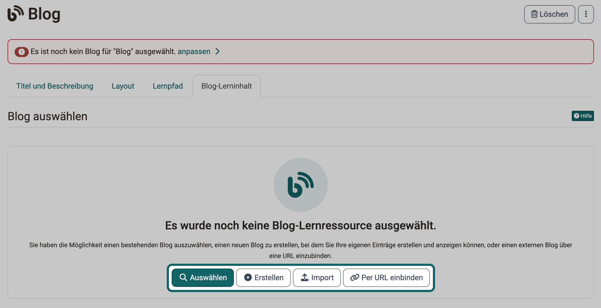
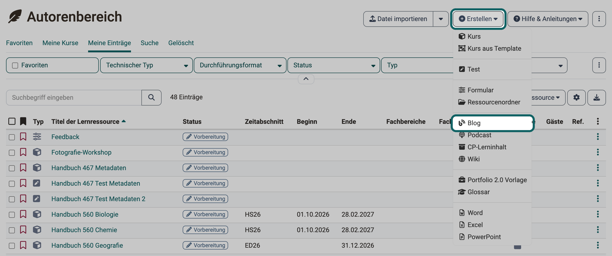

# Kursbaustein "Blog" {: #course_element_blog}

## Steckbrief

Name | Blog
---------|----------
Icon | :o_icon_o_blog_icon:
Verfügbar seit | Release 7.1 oder früher
Funktionsgruppe | Wissensvermittlung
Verwendungszweck | Information von Teilnehmenden über aktuelle Themen
Bewertbar | nein
Spezialität / Hinweis |

Mit dem Kursbaustein "Blog" halten Sie die Teilnehmenden Ihres Kurses über aktuelle Themen auf dem Laufenden, ähnlich wie mit einem Podcast. Beiträge enthalten neben Text auch Bilder oder Videos, und an Kommentare lassen sich Dateien anhängen.

Als Besitzer:in oder Betreuer:in eines Kurses führen Sie so zum Beispiel einen Blog zum Thema der Veranstaltung und informieren die Teilnehmenden über neue Aspekte.

## Kursbaustein und Lernressource {: #course_element_learning_resources}

Ein Kursbaustein "Blog" zeigt immer eine Blog-Lernressource an. Nach dem Einfügen des Kursbausteins wählen Sie im Tab "Blog-Lerninhalt" einen der vier Wege:

* **Auswählen:** Sie wählen eine vorhandene Blog-Lernressource aus dem Autorenbereich.
* **Erstellen:** Sie erstellen direkt im Kursbaustein eine neue Blog-Lernressource. OpenOlat legt sie im Autorenbereich ab, von dort verwenden Sie sie auch in anderen Kursbausteinen.
* **Import:** Sie importieren einen Blog, der als Datei vorliegt.
* **Per URL einbinden:** Sie binden einen externen Blog über seine URL ein.

{ class="shadow lightbox" title="Tab Blog-Lerninhalt im Kurseditor · 2026.11.03" }

Wer im Blog moderiert und wer Beiträge erstellt, legen Sie im selben Tab im Bereich "Berechtigungen" fest. So nutzen Sie den Blog, um die Teilnehmenden zu informieren, oder Sie öffnen ihn als gemeinsamen Blog, in dem die Teilnehmenden selbst schreiben. Bei einem neuen Kursbaustein moderieren die Betreuer:innen, und Betreuer:innen sowie Teilnehmer:innen erstellen Beiträge. Mehr dazu finden Sie unter [Blog im Kursbaustein konfigurieren](../learningresources/Blog_Configuration.de.md#blog_configuration_permissions). [:octicons-tag-16:{ title="ab Release 15.0 (OO-4417)" }](https://track.frentix.com/issue/OO-4417)

!!! tip "Tipp"

    Eine Blog-Lernressource erstellen Sie auch im Autorenbereich über "Erstellen". Anschliessend binden Sie sie im Kurseditor in einen Kursbaustein "Blog" ein.  
    { class="shadow lightbox" title="Menü Erstellen im Autorenbereich · 2026.11.03" }

!!! tip "Tipp"

    Abonnieren Sie den RSS-Feed des Blogs, um keine neuen Einträge zu verpassen. Eine Anleitung dazu finden Sie hier: [Abonnements einrichten (Video-Einführung)](https://www.youtube.com/embed/h9gOqt7TR7Q)

## Weiterführende Informationen {: #further_information}

[Blog erstellen >](../learningresources/Blog_Create.de.md) 
[Wie erstelle ich einen Blog? >](../../manual_how-to/blog/blog.de.md) 
[Blog im Kursbaustein konfigurieren >](../learningresources/Blog_Configuration.de.md) 
[Bloggen >](../learningresources/Blog_Blogging.de.md)

**youtube** 
[Abonnements](<https://www.youtube.com/embed/h9gOqt7TR7Q>)

[Zum Seitenanfang ^](#course_element_blog)

