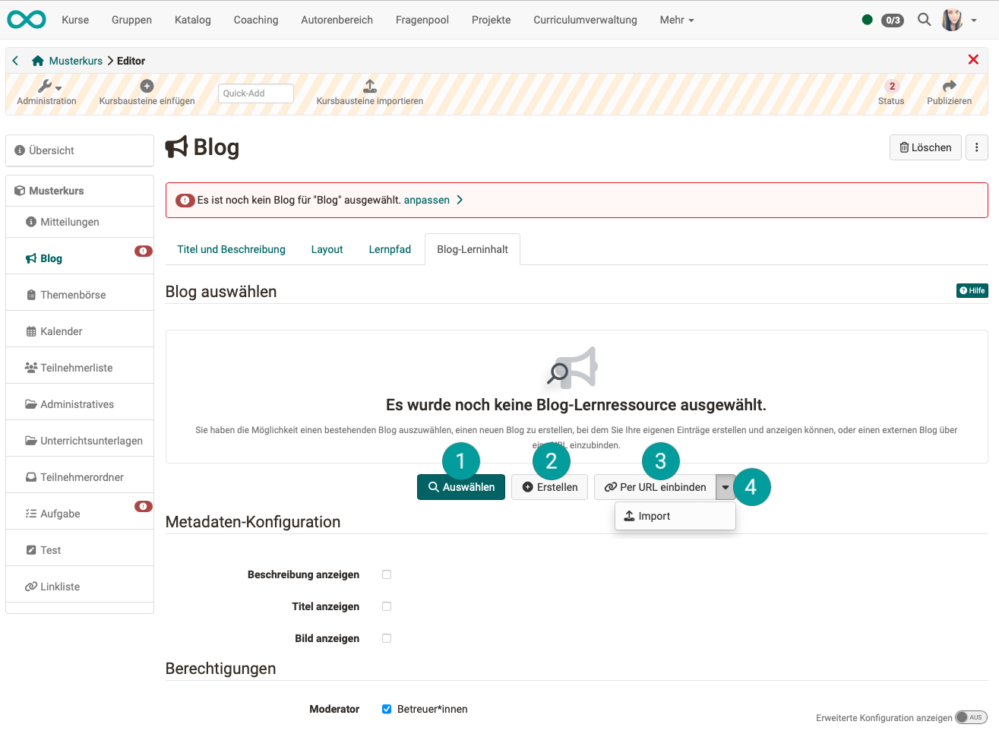
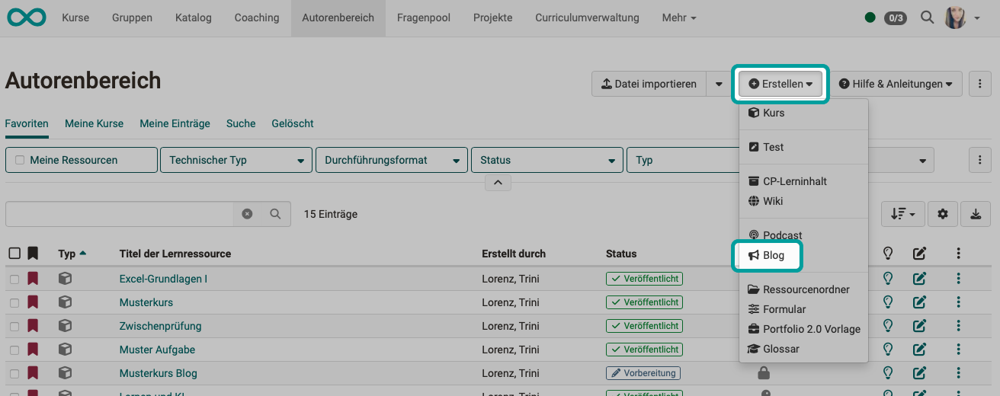

#  Course Element "Blog" {: #course_element_blog}

## Profile

Name | Blog
---------|----------
Icon | :o_icon_o_blog_icon:
Available since | Release 7.1 or earlier
Functional group | Knowledge transfer
Purpose | Information of participants about current topics
Assessable | no
Specialty / Note | 

With the course element "Blog" you keep the participants of your course up to date on current topics, similar to a podcast. In addition to text, posts contain images or videos, and files can be attached to comments.

As an owner or coach of a course, you can, for example, keep a blog on the topic of the course and inform the participants about new aspects.

## Course element and learning resource {: #course_element_learning_resources}

A course element "Blog" always shows a blog learning resource. After inserting the course element, you choose one of four ways in the tab "Blog learning content":

* **Select:** You select an existing blog learning resource from the authoring area.
* **Create:** You create a new blog learning resource directly in the course element. OpenOlat stores it in the authoring area, from where you can also use it in other course elements.
* **Embed via URL:** You embed an external blog via its URL.
* **Import:** You import a blog that is available as a file. You find the entry in the menu next to "Embed via URL".

{ class="shadow lightbox" title="Tab Blog learning content in the course editor" }

!!! tip "Tip"

    You can also create a blog learning resource in the authoring area via "Create". Afterwards, you integrate it into a course element "Blog" in the course editor.  
    { class="shadow lightbox" title="Menu Create in the authoring area" }

!!! tip "Tip"

    Subscribe to the blog's RSS feed to make sure you don't miss any new entries. You can find instructions here: [Set up subscriptions (video introduction, German)](https://www.youtube.com/embed/h9gOqt7TR7Q)

## Further information {: #further_information}

[Create blogs >](../learningresources/Blog_Create.md) 
[How do I create a blog? >](../../manual_how-to/blog/blog.md) 
[Configure blog >](../learningresources/Blog_Configuration.md) 
[Blogging >](../learningresources/Blog_Blogging.md)

**youtube** 
[Subscriptions (German)](<https://www.youtube.com/embed/h9gOqt7TR7Q>)

[To the top of the page ^](#course_element_blog)

